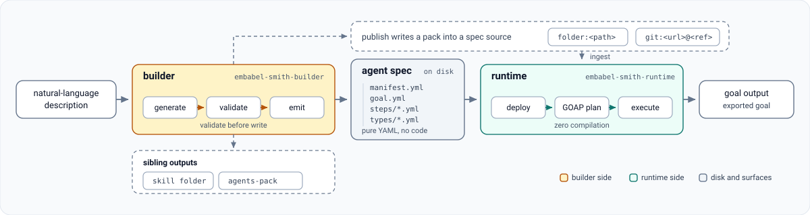
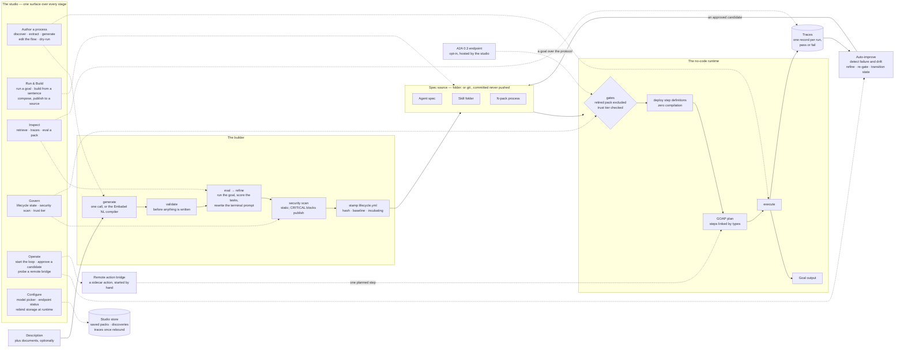
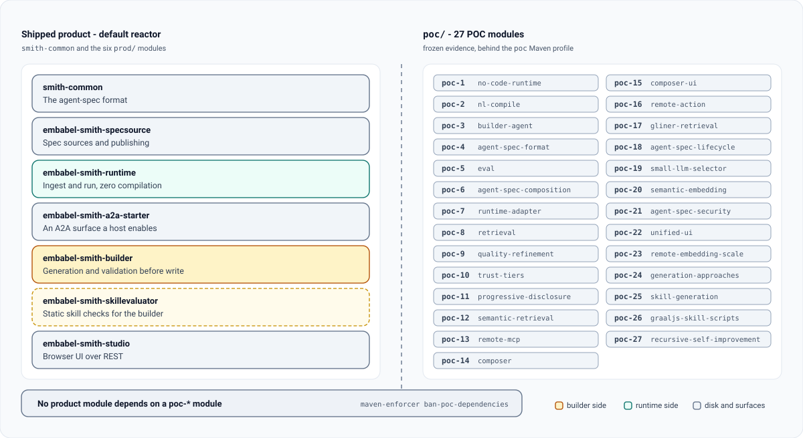

# Embabel Smith

<p align="center">
  
</p>

**Embabel Smith makes agents into data.** A builder agent turns a sentence — *an agent that explains a
topic in plain language and posts it as a background message* — into an **agent spec**: a directory of
YAML files holding Embabel goals and actions. A separate **no-code runtime** loads that directory with
zero compilation and runs a GOAP plan over its exported goal. Built on Embabel 1.5.4, Java 21, and
Spring Boot.

The consequence is the point of the project: an agent is a folder, not a binary. It can be generated by
a model, validated before it is written, diffed in git, published to a source, and re-run by a process
that never invokes a compiler.

## The shape of it



The studio is the only end user of that pipeline, and it implements none of it: every pane calls a
builder or runtime class, and the only code the module owns is persistence and view glue. The
`Operate` group's Scale pane is the exception to the rule that every pane does real work — it is a POC
reference with no controller behind it, and so is absent from the diagram above.

Three invariants carry most of the design:

- **Validate before writing.** A generated spec that fails validation is reported, not emitted — a
  broken pack never reaches disk.
- **Zero compilation at runtime.** The runtime deploys step definitions as data and lets the planner
  chain them; adding a capability means adding a folder.
- **One format, three kinds of pack.** An agent spec, a skill folder, and an N-pack process are
  published by the same route into a `folder:` or `git:` **spec source**, which is what the runtime and
  the UI then read.

## A spec is a folder

An agent spec is a directory of YAML and nothing else — [`agent-specs/explainer`](agent-specs/explainer)
on disk:

```text
agent-specs/explainer/
├── manifest.yml            # name, version, default planner
├── goal.yml                # the exported goal and the type it must produce
├── types/TopicBrief.yml    # the intermediate type that links actions together
└── steps/
    ├── extractTopic.yml    # UserInput  -> TopicBrief
    └── writeExplainer.yml  # TopicBrief -> BackgroundMessage
```

One step is a prompt plus two type names, and that is the whole unit of an agent:

```yaml
# steps/extractTopic.yml
stepType: action
name: extractTopic
inputTypeNames:
  - com.embabel.agent.domain.io.UserInput
outputTypeName: TopicBrief
prompt: |
  From the user request below, extract three things:
  - topic: what they want explained
  - audience: who it is for
  - tone: the voice and style they are asking for
  User request: {{userInput.content}}
```

The planner links actions through their types rather than their names:
`UserInput → TopicBrief → … → BackgroundMessage`. No two steps call each other; the chain is decided at
run time. [`docs/agent-spec-format.md`](docs/agent-spec-format.md) is the format and its six invariants.


## What ships, and what is evidence

<p align="center">
  
</p>

`prod/` holds the product — the format in `smith-common`, spec sources and publishing in
`embabel-smith-specsource`, generation in `embabel-smith-builder` (with
`embabel-smith-skillevaluator` as its static inspection gate), execution in `embabel-smith-runtime`, and
two surfaces: the browser UI in `embabel-smith-studio` and the A2A protocol in
`embabel-smith-a2a-starter`, which stays shut until a host enables it. The 27 modules under `poc/` are
frozen evidence: they sit behind the `poc` Maven profile, and a build-enforcer rule stops any product
module from depending on one.

## Run it

```bash
make build && make test      # the whole product, offline, no model endpoint
```

Model-backed work is opt-in by tag and driven entirely by the environment — no endpoint is baked into
any artifact. Point a run at a model and the full loop is one command:

```bash
export OPENAI_CUSTOM_BASE_URL=http://localhost:4000 OPENAI_CUSTOM_API_KEY=sk-... \
       OPENAI_CUSTOM_MODELS=my-model EMBABEL_MODELS_DEFAULT_LLM=my-model

./run-loop.sh "An agent spec that explains a topic in plain language and posts it as a background message" \
              "Explain how a coffee machine works"
```

That is description → built spec → goal output. The same capabilities are available as
`smith build`, `smith blueprint`, `smith skill-run` and `smith run`, and in the studio UI.
`make help` lists the entry points.

## Reading

- [`docs/index.md`](docs/index.md) — the durable reference: how the system works now, the design
  history behind it, and the measured POC results.
- [`.wiki/index.md`](.wiki/index.md) — the orientation map, 46 cross-linked pages, also published at
  <https://iromu.github.io/embabel-smith/>.
- [`AGENTS.md`](AGENTS.md) — the working conventions for AI agents editing this repository.
