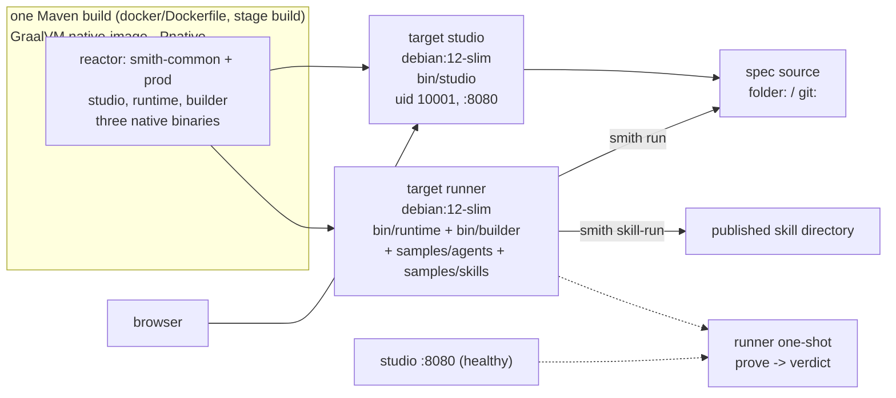

# 14 — Containers

The product ships as two container images, built from one Maven build, and the pipeline that builds,
proves and publishes them. The files are in `docker/`; `docker/README.md` is the run guide. This page
is the reference: what each image is, the packaging decision and its consequences, and what the
container leg of the pipeline does and does not gate.



## The two images

**studio** runs `com.embabel.smith.studio.SmithStudioApplication` and serves the UI plus its REST
routes on `SERVER_PORT` (8080). It needs nothing to boot: no database, no model endpoint, no key.
Its `application.yml` feeds inert placeholders (`sk-studio-no-endpoint`, base URL
`http://127.0.0.1:9/v1`) so that a container with no secrets reaches a serving state and
`/api/status` answers `configured: false`. Storage resolves from a settings document, then from
`smith.studio.storage.url`, and otherwise stays unbound — the studio is designed to run without a
database rather than fail without one. Postgres is an optional Compose service, not a dependency.

**runner** carries the product's two CLIs — `smith run` from `prod/embabel-smith-runtime` and
`smith skill-run` from `prod/embabel-smith-builder` — plus a sample of the repository's own
artifacts, and is the end-to-end demonstration that the pieces fit: an agent-spec source in, a goal
out, a skill folder in, an answer out, with no compiler anywhere in the loop.

Both run as uid 10001 and write under `/home/smith/.smith` — traces, storage settings, the git
source cache — so a read-only root filesystem needs that path mounted writable.

## How the two images are packaged

Every process an image runs is a GraalVM native image, compiled by the same `-Pnative` profile
`make native` uses. One reactor invocation produces three binaries — `smith-studio` from
`prod/embabel-smith-studio`, `smith-runtime` from `prod/embabel-smith-runtime` and `smith` from
`prod/embabel-smith-builder` — and the two final stages divide them: the studio image carries
`/opt/smith/bin/studio`, the runner carries `/opt/smith/bin/runtime` and `/opt/smith/bin/builder`.
Both final stages are `debian:12-slim`, and the only package either installs is `curl`, for the
healthcheck. There is no JVM in either image, so there is no `java`, no `CLASSPATH` and no `JAVA_OPTS`;
a native program sizes its own memory from the container's cgroup and would read a `-XX:` flag handed
to it as a program argument it does not understand.

A module joins that build only if its own pom declares the profile's three executions — Boot's
`process-aot`, a `maven-resources-plugin` copy that folds the AOT output into `target/classes`, and
`native-maven-plugin:compile-no-fork` at `package`. The opt-in is not new: the builder has carried it
since `make native` existed, and [08 — The builder](08-builder.md) ("As a native binary") owns the
mechanics, including the two hint directories under `META-INF/native-image/` and how they grow by
failure rather than by guesswork. The root profile supplies what is common to all three — the GraalVM
reachability-metadata repository and `--no-fallback` — so an application that static analysis cannot
close fails the build instead of shipping a fallback.

The compiler is downloaded rather than inherited because there is nothing to inherit from:
`ghcr.io/graalvm/jdk-community:25` ships no `native-image`, and there is no `native-community` tag for
25. So the build stage is `debian:12-slim` with `build-essential`, `zlib1g-dev`, `ca-certificates`,
`curl` and `libatomic1`, plus GraalVM Community `jdk-25.0.2` fetched from the graalvm-ce-builds
release — the same artifact `native-image.yml` downloads, which keeps the container's compiler and the
CI's on one version. `build-essential` and `zlib1g-dev` are there only to finish the link. GraalVM's
analysis runs to completion and the last step shells out to `gcc`, so a slim stage fails in two ways
that both read as a broken GraalVM and are nothing of the kind: without a compiler, "Default
native-compiler executable 'gcc' not found"; with a compiler and no zlib development symlink,
`/usr/bin/ld: cannot find -lz`. GitHub runners ship both packages, which is why the CI path never
shows either. Neither belongs in a final image: a native binary is self-contained.

The `repackage` executions with the `exec` classifier stay in the studio's and the runtime's poms,
where they serve a host rather than a container. `mvn package` still leaves each of those modules with
two artifacts — the thin jar its library consumers keep compiling against, and
`target/<module>-<version>-exec.jar`, `Main-Class` set to Boot's `JarLauncher`, `Start-Class` set,
`BOOT-INF/` inside — and the second is what a standalone `java -jar` run uses. The classifier is still
load-bearing for the reason it was introduced: `embabel-smith-runtime` is a compile dependency of
`embabel-smith-studio` and `embabel-smith-a2a-starter`, `embabel-smith-studio` is a library dependency
of `poc/poc-27-recursive-self-improvement`, and a repackaged jar keeps its classes under
`BOOT-INF/classes`, where an ordinary classpath cannot see them, so repackaging *in place* would have
left three modules compiling against a jar they cannot read. What changed is only that the images
stopped reading the artifact that motivated it.

The runner's two legs stay two programs, as they were two mechanisms before, and for the same reason
they were never merged into one classpath: both modules ship an `application.yml` at their classpath
root, so one merged artifact would let one silently answer for the other.

Three traps are worth stating because someone would otherwise rediscover them:

- **The frontend bundle has to be generated before the resources copy, not merely generated.** Vite
  writes into `prod/embabel-smith-studio/src/main/resources/static`, and it is
  `maven-resources-plugin` at `process-resources` that puts that directory into `target/classes`. The
  module's three npm executions used to be bound to `compile` — after that copy — so a clean
  single-pass build produced a studio whose classes had no `static/`: it booted perfectly and 404'd
  at `/`, and only a *second* build on the same tree looked right, because the second copies what the
  first generated. That was a packaging bug, not a container quirk: it applied to every artifact
  built from a clean checkout. The executions now run at `generate-resources`, the plugin's own
  default phase. Native packaging repeats the failure one level up and takes away the way to see it:
  an image carries its resources as a flat registered set with no directory entries, so an SPA that
  reached `target/classes` and was not registered into the binary is silently absent from the thing
  that ships. A jar can be inspected with `jar tf`; a native image's resource set has no listing a
  script could grep. So the check is behavioural instead — the build boots the studio binary and
  waits for it to answer `/api/status`, and `docker/smoke.sh` is what asserts the bundle at `/`.
  `.dockerignore` drops the host's stale bundle, so inside the image nothing but the npm stage can
  have produced that directory.
- **The frontend toolchain needs `libatomic1`.** `frontend-maven-plugin` downloads a Node 26 binary
  linked against it; without the package, `npm install` fails with exit 127 and
  `error while loading shared libraries: libatomic.so.1`. It is a build-time dependency of the
  frontend toolchain only and never reaches either final image, and neither do the compiler packages
  above.
- **A runtime switch cannot add a bean.** Spring's AOT pass decides `@ConditionalOnProperty` while the
  image is compiling, so a property flipped at run time chooses between beans the binary already
  contains and cannot introduce one it was not built with. Asking what a deployment was told is the
  wrong question for those; the answer is in what the image was compiled from. The case that matters
  here is `/a2a`: `A2ARouterConfiguration` and `A2AAgentCardConfiguration` are gated on
  `smith.a2a.enabled`, which defaults to false, so an image compiled with the default contains not
  merely disabled beans but the routes themselves nowhere — dead-code analysis removes the classes,
  and what is left of the resolver is an `@Import` string on a configuration that was never
  registered. `make run-a2a` works on a host because a JVM evaluates that condition at startup and an
  image does not. Serving A2A from a container therefore means building the image with the property
  visible to `process-aot`, and accepting that the same freezing then keeps it switched on for that
  image, which is why this surface is a development surface and not a published one.

## Spec sources from a container

The sources a container sees are named by the same `folder:` / `git:` grammar the studio's own parser
accepts — see [06 — Spec sources and publishing](06-spec-sources.md). `SMITH_STUDIO_SOURCES` takes a
comma-separated list; the runner's `SMITH_AGENT_SOURCE` takes one URI. `folder:` names a directory
that *contains* pack directories, not a pack: pointing it at `agent-specs/explainer` itself answers
`contains no agent specs`, and the pack belongs one level down.

The runner's baked sample is `agent-specs/explainer` as a one-pack source, which is what lets the
default run resolve its single exported goal with no `--goal`, and the builder's own shipped skill at
`prod/embabel-smith-builder/src/main/resources/skills/` as the published skill directory.

Mounting the repository's whole `agent-specs/` instead raises one difference worth knowing.
`agent-specs/shell-runner` declares the `shell` tool group, and the trust gate checks every pack in a
source rather than only the steps a plan selects, so a source containing it refuses at the default
`standard` tier:

```text
Run blocked by trust tier: pack 'shell-runner' declares tool group(s) [shell]
that require a higher trust tier (granted: standard). Re-run with the higher tier to allow
these steps.
```

The refusal happens before any model call, which makes it the cheapest available proof that the gate
is live. `SMITH_TRUST_TIER=high` is the answer when the pack is meant to run. See
[07 — The no-code runtime](07-runtime.md) for the tiers themselves.

## The profile both images set

The studio's *default* profile is `local`, and `application-local.sample.yaml` turns on
`spring.docker.compose` against the repo-relative path `./docker/docker-compose-infra.yml`. That path
is not inside an image, and a container starting a container is not what anyone wants. Both images
therefore set `SPRING_PROFILES_ACTIVE=container` — a profile name that has no config file anywhere in
the repository, which is the same device `make run-a2a` uses with `a2a`. Setting it to `local` inside
a container asks the studio to run Compose; the base config keeps `required: false`, so the attempt
is survivable rather than fatal.

## The pipeline

`.github/workflows/docker.yml` is the container leg. It builds both targets with BuildKit cache
scopes that each build reads both of (a `type=gha` cache is addressed by scope, and the two targets
share one build stage, so a build restricted to its own scope would rebuild the reactor), runs
`docker/smoke.sh`, scans the images with Trivy, and publishes
`ghcr.io/<owner>/embabel-smith-{studio,runner}` on a push to `main` — the repository's default branch
— or a `v*` tag. Pull requests build and smoke-test and do not publish.

One reproducibility caveat the pipeline cannot close by itself: the publish job rebuilds rather than
re-tagging, and the studio's frontend stage runs `npm install` followed by `npm update`
(`prod/embabel-smith-studio/pom.xml`), which resolves against the registry rather than a lockfile.
The Java half of a pushed image is a function of the commit; the SPA bundle is reproducible to the
precision that `npm update` allows.

`docker/smoke.sh` is the gate, and it is the same script a developer runs, so a green CI run means
the same thing as a local one. It asserts that the studio answers `/api/status`, serves the SPA
bundle at `/`, answers `/api/sources` with JSON, and returns 404 rather than the SPA fallback for an
unknown `/api` route; and that the runner's `probe` sees an agent-spec source and a skill directory.

What a green container run does **not** cover, stated because the gaps are the interesting part:

- **No model call.** There is no endpoint and no key on a runner. The studio is checked to the point
  where it serves without one, and the runner is checked with `probe`, which reads its inputs and
  calls nothing. Generation, eval, running a goal and answering with a skill stay with the
  `@Tag("live")` tests and `examples/`.
- **No publish from a pull request**, matching the rule that publishing commits and never pushes.
- **The scan reports and does not gate.** What ships is a slim Debian userland around a compiled
  binary, and the advisories that remain are in layers this repository does not control; failing pull
  requests on them trains people to ignore the report.
- **linux/amd64 only.** No SBOM, no attestation, no multi-architecture manifest.
- **Not the studio's Postgres path** — storage-unbound is the state tested.

The leg compiles all three binaries itself, so it is also the container's native gate: reachability
metadata or AOT hints that go missing fail the build rather than the smoke. The gap it cannot close is
a native-only failure that needs a model call to surface, which is the same gap as the first bullet.
Two settings make the compile survivable on a hosted runner, and they travel together: the workflow
adds a 6 GB swapfile before building and the Dockerfile carries
`ARG NATIVE_IMAGE_OPTIONS=-J-Xmx10g`, because three native compiles in one build stage peak past a
runner's 16 GB and a cgroup kill arrives looking like a compiler crash rather than an out-of-memory
error. It is the same pairing `native-image.yml` uses for the host build.

The reactor is gated by `offline-verification.yml` and the builder's native binary by
`native-image.yml`; this leg does not re-run either, though it compiles the same three binaries from
the same commit.

## Building and running

```bash
make docker-build                    # both targets
make docker-smoke                    # what CI runs, against those images
make docker-demo                     # studio up, then the runner's verdict
```

or directly:

```bash
docker build -f docker/Dockerfile --target studio -t embabel-smith-studio .
docker build -f docker/Dockerfile --target runner -t embabel-smith-runner .
docker compose -f docker/docker-compose.yml --profile demo up --abort-on-container-exit
```
