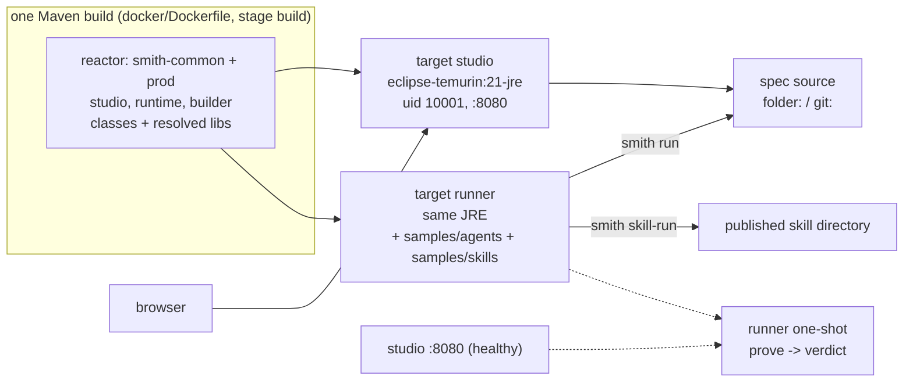

# 14 — Containers

The product ships as two container images, built from one Maven build, and the pipeline that builds,
proves and publishes them. The files are in `docker/`; `docker/README.md` is the run guide. This page
is the reference: what each image is, the packaging decision and its consequences, and what the
container leg of the pipeline does and does not gate.



## The two images

**studio** runs `com.embabel.smith.studio.SmithStudioApplication` and serves the UI plus its REST
routes on `SERVER_PORT` (8080). It needs nothing to boot: no database, no model endpoint, no key.
Its `application.yml` feeds inert placeholders (`sk-studio-no-endpoint`, base URL
`http://127.0.0.1:9/v1`) so that a container with no secrets reaches a serving state and
`/api/status` answers `configured: false`. Storage resolves from a settings document, then from
`smith.studio.storage.url`, and otherwise stays unbound — the studio is designed to run without a
database rather than fail without one. Postgres is an optional Compose service, not a dependency.

**runner** carries the product's two CLIs — `smith run` from `prod/embabel-smith-runtime` and
`smith skill-run` from `prod/embabel-smith-builder` — plus a sample of the repository's own
artifacts, and is the end-to-end demonstration that the pieces fit: an agent-spec source in, a goal
out, a skill folder in, an answer out, with no compiler anywhere in the loop.

Both run as uid 10001 and write under `/home/smith/.smith` — traces, storage settings, the git
source cache — so a read-only root filesystem needs that path mounted writable.

## Why the images use a classpath instead of an executable jar

No module in this repository produces an executable Spring Boot jar. The root pom keeps
`spring-boot-maven-plugin` in `<pluginManagement>` only (`pom.xml:349-352`) and no module declares
a `repackage` goal, so `target/*.jar` is a thin jar: no `Main-Class`, no `BOOT-INF/`. The images
therefore lay out what `mvn spring-boot:run` hands the JVM — the module's classes plus its resolved
runtime dependencies, via `maven-dependency-plugin:copy-dependencies -DincludeScope=runtime` — and
launch with `-cp`. This is the launch form `examples/smith-cli.sh` already uses on a host, chosen
over running `spring-boot:run` inside the image so that Maven is not part of the runtime image.

Three consequences are worth stating because each one is a trap someone would otherwise rediscover:

- **The frontend bundle needs an explicit overlay.** Vite writes into
  `prod/embabel-smith-studio/src/main/resources/static` at the `compile` phase, which is *after*
  `maven-resources-plugin` copies that directory into `target/classes`. On a clean single-pass build
  the classes directory therefore has no `static/`, and a studio built that way boots perfectly and
  serves 404 at `/`. A developer's working tree hides the ordering, because a second build copies
  what the first generated. The Dockerfile overlays the generated bundle into the classes directory
  and asserts that `index.html` arrived.
- **The Maven base image needs `libatomic1`.** `frontend-maven-plugin` downloads a Node 26 binary
  linked against it; without the package, `npm install` fails with exit 127 and
  `error while loading shared libraries: libatomic.so.1`. It is a build-time dependency of the
  frontend toolchain only and never reaches either final image.
- **The runtime's and the builder's classes stay in separate directories** in the runner image, with
  one shared `lib/`. Both modules ship an `application.yml` at their classpath root, so merging the
  two class directories would let one silently answer for the other.

If `repackage` is ever added to these poms, both final stages collapse to a `COPY` of the fat jar.

## Spec sources from a container

The sources a container sees are named by the same `folder:` / `git:` grammar the studio's own parser
accepts — see [06 — Spec sources and publishing](06-spec-sources.md). `SMITH_STUDIO_SOURCES` takes a
comma-separated list; the runner's `SMITH_AGENT_SOURCE` takes one URI. `folder:` names a directory
that *contains* pack directories, not a pack: pointing it at `agent-specs/explainer` itself answers
`contains no agent specs`, and the pack belongs one level down.

The runner's baked sample is `agent-specs/explainer` as a one-pack source, which is what lets the
default run resolve its single exported goal with no `--goal`, and the builder's own shipped skill at
`prod/embabel-smith-builder/src/main/resources/skills/` as the published skill directory.

Mounting the repository's whole `agent-specs/` instead raises one difference worth knowing.
`agent-specs/shell-runner` declares the `shell` tool group, and the trust gate checks every pack in a
source rather than only the steps a plan selects, so a source containing it refuses at the default
`standard` tier:

```text
Run blocked by trust tier: pack 'shell-runner' declares tool group(s) [shell]
that require a higher trust tier (granted: standard). Re-run with the higher tier to allow
these steps.
```

The refusal happens before any model call, which makes it the cheapest available proof that the gate
is live. `SMITH_TRUST_TIER=high` is the answer when the pack is meant to run. See
[07 — The no-code runtime](07-runtime.md) for the tiers themselves.

## The profile both images set

The studio's *default* profile is `local`, and `application-local.sample.yaml` turns on
`spring.docker.compose` against the repo-relative path `./docker/docker-compose-infra.yml`. That path
is not inside an image, and a container starting a container is not what anyone wants. Both images
therefore set `SPRING_PROFILES_ACTIVE=container` — a profile name that has no config file anywhere in
the repository, which is the same device `make run-a2a` uses with `a2a`. Setting it to `local` inside
a container asks the studio to run Compose; the base config keeps `required: false`, so the attempt
is survivable rather than fatal.

## The pipeline

`.github/workflows/docker.yml` is the container leg. It builds both targets with BuildKit cache
scopes that each build reads both of (a `type=gha` cache is addressed by scope, and the two targets
share one build stage, so a build restricted to its own scope would rebuild the reactor), runs
`docker/smoke.sh`, scans the images with Trivy, and publishes
`ghcr.io/<owner>/embabel-smith-{studio,runner}` on a push to `main` — the repository's default branch
— or a `v*` tag. Pull requests build and smoke-test and do not publish.

One reproducibility caveat the pipeline cannot close by itself: the publish job rebuilds rather than
re-tagging, and the studio's frontend stage runs `npm install` followed by `npm update`
(`prod/embabel-smith-studio/pom.xml`), which resolves against the registry rather than a lockfile.
The Java half of a pushed image is a function of the commit; the SPA bundle is reproducible to the
precision that `npm update` allows.

`docker/smoke.sh` is the gate, and it is the same script a developer runs, so a green CI run means
the same thing as a local one. It asserts that the studio answers `/api/status`, serves the SPA
bundle at `/`, answers `/api/sources` with JSON, and returns 404 rather than the SPA fallback for an
unknown `/api` route; and that the runner's `probe` sees an agent-spec source and a skill directory.

What a green container run does **not** cover, stated because the gaps are the interesting part:

- **No model call.** There is no endpoint and no key on a runner. The studio is checked to the point
  where it serves without one, and the runner is checked with `probe`, which reads its inputs and
  calls nothing. Generation, eval, running a goal and answering with a skill stay with the
  `@Tag("live")` tests and `examples/`.
- **No publish from a pull request**, matching the rule that publishing commits and never pushes.
- **The scan reports and does not gate.** A JRE base image carries unfixed advisories in layers this
  repository does not control; failing pull requests on them trains people to ignore the report.
- **linux/amd64 only.** No SBOM, no attestation, no multi-architecture manifest.
- **Not the studio's Postgres path** — storage-unbound is the state tested.

The reactor is gated by `offline-verification.yml` and the builder's native binary by
`native-image.yml`; this leg does not re-run either.

## Building and running

```bash
make docker-build                    # both targets
make docker-smoke                    # what CI runs, against those images
make docker-demo                     # studio up, then the runner's verdict
```

or directly:

```bash
docker build -f docker/Dockerfile --target studio -t embabel-smith-studio .
docker build -f docker/Dockerfile --target runner -t embabel-smith-runner .
docker compose -f docker/docker-compose.yml --profile demo up --abort-on-container-exit
```
