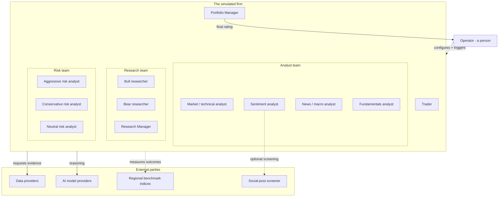
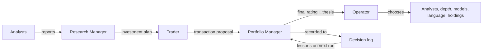

# Actors and Roles

This document lists every actor that participates in the application — the human
operator, the simulated firm's roles, and the external parties the tool relies on.

**Legend:** **Confirmed** (directly observable) · **Assumption** (inferred) ·
**Unresolved** (open question).

---

## 1. Actors at a glance

---

## 2. The operator (a person)

**Confirmed.** The human is the only actor outside the simulated firm. They do
not sit in the middle of the decision; they configure the run, watch it run, and
consume the result.

**Responsibilities**
- Choose the **instrument** (ticker) and the **analysis date**.
- Choose **which analysts** participate (any non-empty subset).
- Choose the **research depth** (how many rounds of debate and risk discussion).
- Choose the **AI models** for the two tiers — a "quick" model for the analysts,
  researchers, debaters and trader, and a "deep" model for the two managers — and
  which **provider** each uses.
- Choose the **output language**.
- Optionally provide a **snapshot of their own holdings and cash** so sizing is
  grounded in their real position.
- Optionally enable **resume-from-interruption** (checkpoint) behaviour.
- After the run: decide whether to **save** the report, view it on screen, and
  save/open the single-page web view.

**What they do NOT do**
- They do not place trades. The tool produces a recommendation; acting on it is
  entirely the operator's (or their real portfolio's) responsibility.
- They do not intervene mid-run. The firm runs to completion once configured.

**Assumption.** The operator is typically a researcher, analyst, or a developer
studying multi-agent reasoning, consistent with the tool's stated research purpose.

---

## 3. The simulated firm

The firm is a fixed cast of roles. Each is an AI model with a defined job, a
defined view of the evidence, and a defined output. Roles are grouped into teams
that mirror a real desk.

### 3.1 The Analyst team — work in parallel, each on its own evidence

All selected analysts start **at the same time**, each working from a different
slice of the market, and each producing a written report. The research debate does
not begin until **every** selected analyst has filed its report. **Confirmed.**

| Role | Focus | Evidence it works from | Produces |
|---|---|---|---|
| **Market / Technical Analyst** | Price action and technical indicators | Verified price data and a curated set of technical indicators (trend, momentum, volatility, volume) it selects | A detailed technical report, with exact price/indicator claims grounded in a verified snapshot. |
| **Sentiment Analyst** | Retail / community mood | News headlines plus retail social chatter (a cashtag message stream and community forums), optionally pre-screened for relevance | A structured sentiment read: a six-level band, a 0–10 score, a confidence level, and a narrative. |
| **News / Macro Analyst** | Company news and the wider world | Company news, global/macro headlines, macroeconomic indicators, and live market-implied probabilities of forward events | A report on the current state of the world relevant to trading. |
| **Fundamentals Analyst** | The company's financials | Company profile, income statement, balance sheet, cash flow, and insider trading (for US filers, as filed) | A report on the company's fundamental health. |

**Notes**
- The operator selects the subset; at least one must be chosen. **Confirmed.**
- For **crypto** instruments, the Fundamentals Analyst is not offered, because
  there is no company filing statements. **Confirmed.**
- The Sentiment Analyst's sources are **not archived** — they serve recent items,
  so a historical run's sentiment inputs are *not* fully point-in-time.
  **Confirmed** (stated as a known limitation).
- An analyst that is not selected, or that returns nothing, is reported to the
  downstream roles as *absent* — explicitly "no report", not an empty finding —
  so a missing report is never mistaken for a neutral conclusion. **Confirmed.**

### 3.2 The Research team — the bull/bear debate and its verdict

| Role | Job |
|---|---|
| **Bull Researcher** | Builds the strongest evidence-based case **for** investing: growth, competitive advantage, positive indicators; directly rebuts the Bear. |
| **Bear Researcher** | Builds the strongest case **against** investing: risks, weaknesses, negative indicators; directly rebuts the Bull. |
| **Research Manager** | Facilitates and closes the debate. Weighs the two sides on their merits and issues a **structured investment plan** with a five-level recommendation, a rationale, and concrete strategic actions. |

**Confirmed.** The Bull and Bear take turns (each "round" is one Bull turn + one
Bear turn) up to the configured depth. The Research Manager then renders the
investment plan. The plan's recommendation uses the same five-level scale as the
final decision.

### 3.3 The Trader

**Confirmed.** The Trader converts the Research Manager's investment plan into a
**concrete transaction proposal**: an action (Buy / Hold / Sell), the reasoning,
and — when it can state them — an **entry price**, a **stop-loss**, and
**position sizing**, grounded in the technical report's price structure.

- The Trader works at the **transaction** level (three levels: Buy / Hold / Sell);
  the finer Overweight / Underweight sizing is left to the Portfolio Manager.
  **Confirmed.**
- When the operator supplied holdings, the Trader sizes against the real
  position; otherwise it gives guidance the operator can apply to their own
  position. **Confirmed.**

### 3.4 The Risk team — three stances on the transaction

The Trader's proposal is then debated by three risk analysts, each with a fixed
stance, who challenge one another up to the configured depth. **Confirmed.**

| Role | Stance |
|---|---|
| **Aggressive Risk Analyst** | Champions the high-reward, high-risk path; pushes to act on the upside. |
| **Conservative Risk Analyst** | Protects capital, minimises volatility; points out where the plan is too risky. |
| **Neutral Risk Analyst** | Weighs both sides; argues for the balanced, moderate-risk path. |

All three see the same inputs: the trader's proposal, the analyst reports, and
(the operator's) holdings if provided. **Confirmed.**

### 3.5 The Portfolio Manager — the final decision

**Confirmed.** The Portfolio Manager is the **final gate**. It reads the
Research Manager's plan, the Trader's proposal, the full risk debate, and any
lessons from the decision log, then issues the **final decision**:

- a **five-level rating** (Buy / Overweight / Hold / Underweight / Sell);
- an **executive summary** (the call and how to act);
- an **investment thesis** (the evidence that decided it, and what would change it);
- optionally a **target price** and a **time horizon**.

Its rating **is** the run's final rating. **Confirmed.**

---

## 4. The caller's portfolio (optional input)

**Confirmed.** The operator may supply a snapshot of their own book: free cash,
its currency, and positions (instrument, quantity — negative for short — and
average entry price). It is rendered into the prompts of the **Trader, the three
risk analysts, and the Portfolio Manager** so they size against the real position.

Three distinct situations are treated differently and must stay so:

1. **A position** in the instrument (and possibly others).
2. **A flat book** — explicitly "no position."
3. **No portfolio provided at all** — the tool does *not* assume the caller holds
   nothing; it says it does not know and gives direction/sizing the caller can
   apply to their own position.

**Confirmed.** This distinction is deliberate: treating "not provided" as "flat"
would invent a fact about the caller's account.

---

## 5. External parties

### 5.1 Data providers

The tool requests market evidence from a set of external data sources. The
operator configures, per category, **which source serves which kind of data**, and
can list several in order as a fallback chain. **Confirmed.**

| Evidence | Typical provider(s) | Notes |
|---|---|---|
| Prices (OHLCV) & technical indicators | Yahoo Finance; Alpha Vantage (alternative) | The technical analyst also uses a verified price snapshot as the source of truth. |
| Company fundamentals & statements | SEC filings (US filers, **as filed**, with filing dates); Yahoo Finance; Alpha Vantage | SEC is used for statements; the others for profile/insider data SEC does not serve. |
| Company & global news | Yahoo Finance; Alpha Vantage | |
| Macroeconomic indicators | FRED (requires a key) | Optional enrichment; a failure degrades rather than aborts. |
| Prediction markets | Polymarket (no key) | Optional enrichment; a failure degrades rather than aborts. |
| Retail social chatter | A cashtag message stream (StockTwits); community forums (Reddit) | Not archived — recent items only. |
| Social-post relevance screening | TypeSafe ("Jev") — optional | Screens social posts for relevance/stance before the Sentiment Analyst reads them; only when a key is configured. |

**Confirmed.** Macro and prediction-market data are classified as *optional
enrichment*: a problem there is reported as "unavailable" and the run proceeds,
whereas a problem with core data (prices, fundamentals, news) is surfaced loudly.

### 5.2 AI model providers

Every role is powered by an AI model. The operator picks a **provider** and a
**model** for each of the two tiers (quick and deep); the two tiers may even run on
different providers. **Confirmed.** Supported providers include, among others:
OpenAI, Google, Anthropic, xAI, DeepSeek, Qwen, GLM, MiniMax, OpenRouter, Mistral,
Kimi, Groq, NVIDIA, Azure OpenAI, Amazon Bedrock, a local model server (Ollama),
any OpenAI-compatible endpoint, and — via a browser sign-in — the operator's own
ChatGPT Plus/Pro plan.

**Business implication.** The choice of models materially affects the output and
its run-to-run variation; the tool treats model choice as a first-class, per-run
decision and records which models produced a given report. **Confirmed.**

### 5.3 Regional benchmark indices

When a past decision is settled, its return is measured **against the regional
benchmark** for the instrument's market (e.g. S&P 500 for US listings, Nikkei 225
for Tokyo, Hang Seng for Hong Kong, Nifty/Sensex for India, and so on), or a
benchmark the operator overrides. **Confirmed.**

### 5.4 The decision log (persistent memory)

Not an external third party, but a persistent store the firm reads and writes:
an append-only record of past decisions and, once settled, their outcomes and
reflections. **Confirmed.** See STATES_AND_TRANSITIONS for its lifecycle.

---

## 6. Who decides what (responsibility summary)

**Confirmed.** The Portfolio Manager is the single role that issues the final
rating; no other role's output is the run's verdict. The decision log feeds back
into the Portfolio Manager on subsequent runs.
