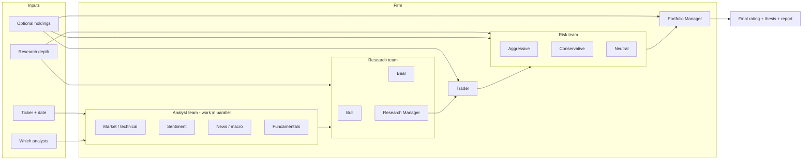

# TradingAgents — Business Overview

> This document set describes **what the application does, who uses it, and the
> processes it follows**, in business terms. It deliberately avoids implementation
> detail (languages, frameworks, data schemas, internal mechanisms).
>
> **Evidence convention used across all documents**
> - **Confirmed** — behaviour directly observable in the codebase.
> - **Assumption** — inferred from the design; not explicitly stated.
> - **Unresolved** — an open question the codebase does not answer.

---

## 1. Purpose: what problem does it solve?

TradingAgents is a **research tool that simulates how a small trading firm would
reason about a single investment decision** on a single financial instrument
(a stock, ETF, or crypto asset) on a given date.

It answers one question per run:

> *"Given everything that was knowable on date D about instrument X, what would a
> disciplined, multi-perspective investment team decide, and why?"*

The deliverable of a run is a **final investment rating** — one of five levels
(Buy, Overweight, Hold, Underweight, Sell) — plus a written thesis explaining the
evidence that decided it, an executive action plan, and a full audit trail of how
the team reached the conclusion.

**Confirmed.** The tool is explicitly scoped as a **research scaffold**, not a
source of financial advice. Its own documentation states it is *"not intended as
financial, investment, or trading advice"* and that it is *"a research scaffold
for studying multi-agent analysis, not a strategy with a fixed, replicable
return."*

### The core idea

Rather than one person (or one model) making a call, the application assembles a
**team of specialised roles that mirror a real trading desk**:

- an **Analyst team** that each looks at a different slice of the evidence
  (technical price action, retail sentiment, news/macro, company fundamentals);
- a **Research team** that debates the case for and against the investment;
- a **Trader** that turns the research verdict into a concrete transaction;
- a **Risk team** that debates the risk of that transaction from three stances;
- a **Portfolio Manager** who issues the final decision.

Each role is powered by an **AI model** (a "language model") that the operator
chooses. The value of the tool is the *structure of the reasoning* — parallel
analysis, adversarial debate, and a final gate — not any single model's output.

**Assumption.** The roles are described as AI-powered analysts because every
"agent" in the system is driven by a selectable AI model; the tool's identity is
that these are AI stand-ins for human desk roles, not a human team.

---

## 2. What it is NOT

Being explicit about the boundaries prevents misuse:

| It is NOT | Why (Confirmed) |
|---|---|
| **Financial advice** | Stated disclaimer; it is a research scaffold. |
| **A live trading / execution system** | No order is ever placed. The "exchange" is a simulation; the output is a rating and a written plan, not an executed trade. |
| **A portfolio simulator** | It does not carry a position forward across runs or model fills, cash ledgers, or slippage. An optional snapshot of the caller's holdings is used for *sizing context only*. |
| **A repeatable strategy** | Because it is AI-driven, two runs of the same input can differ. It is *not* a fixed, replicable return. |
| **A general market screener** | It analyses one instrument per run. (A separate evaluation mode runs many instruments, but to *score decision quality*, not to screen the market.) |

**Confirmed.** The backtest/evaluation mode is explicitly documented as *"not a
portfolio simulator"* and as evaluating **decision quality**, with cells kept
independent and no position carried forward.

---

## 3. The simulated firm, at a glance

**Confirmed.** The team composition, the parallel execution of the analysts, and
the hand-offs (analysts → research debate → trader → risk debate → portfolio
manager) are the actual structure of a run.

---

## 4. Key business concepts

These terms recur throughout the documents. They are business concepts, not
technical ones.

| Term | Business meaning |
|---|---|
| **Instrument** | The single thing being analysed — a stock, ETF, index, or crypto pair, identified by a ticker. |
| **Analysis date** | The "as of" date for the whole run. All evidence is treated as if known on this date (see *Point-in-time integrity* in BUSINESS_RULES). |
| **Decision / rating** | The output: a five-level verdict (Buy → Sell) plus a written thesis. |
| **Holding period** | The window (default **5 trading days**) over which a past decision's outcome is measured. |
| **Alpha** | A decision's return **relative to its regional benchmark** (e.g. S&P 500 for US, Nikkei 225 for Tokyo). The measure the tool uses to judge whether a call was "right." |
| **Benchmark** | The regional index a decision is compared against, chosen automatically from the instrument's market. |
| **Decision log (memory)** | A persistent, append-only record of every past decision and, once its outcome is known, its result and a short lesson. Later runs read from it. |
| **Settlement** | The act of resolving a past decision: once its holding window has fully traded, the tool works out what it earned (raw + alpha) and writes a reflection. |
| **Point-in-time integrity** | The guarantee that a run dated in the past only sees information that was actually public on that date. |
| **Run** | One full analysis of one instrument on one date, from start to a recorded decision. |

---

## 5. How a person uses it (in one paragraph)

An operator starts the tool, names an **instrument** and a **date**, chooses
**which analysts** to use, how **deep** the research should go, **which AI
models** power the fast and the deep roles, and the **output language**. The tool
then runs the simulated firm: analysts work in parallel, the research team debates,
the trader proposes a transaction, the risk team debates it, and the portfolio
manager issues the final rating. The result is shown on screen and can be saved
as a report (a set of readable documents and a single-page web view). The decision
is also recorded in the persistent decision log. On a later run — or automatically
alongside the analysts — the tool settles any past decisions whose holding window
has now closed, turning them into lessons that future runs read back. A separate
**evaluation** mode runs the whole firm across a grid of instruments and dates to
score how good the decisions have been.

**Confirmed.** Each of these steps maps to a real, selectable input in the tool's
setup flow and to a real process in the codebase.

---

## 6. Scope and boundaries

- **One instrument per run.** The tool is built around a single ticker at a time.
- **Any market the primary price source covers.** US, and international markets
  via exchange-suffixed tickers (e.g. `0700.HK`, `7203.T`), plus crypto pairs.
- **Stock vs crypto differ.** For crypto, the Fundamentals analyst is not
  available (there is no company to file statements), and the tool does not assume
  company fundamentals exist. **Confirmed.**
- **Past and present dates.** A run can be dated in the past (subject to
  point-in-time withholding) or on today's date.
- **Language.** Reports can be produced in a chosen language; the internal
  reasoning stays in English for quality. **Confirmed.**
- **Where outputs live.** Reports and the decision log are written to a
  configurable local storage area; nothing is transmitted about the runs to any
  external party. **Confirmed** (an optional, once-a-day, background "what's new"
  check sends nothing about the runs and can be disabled).
