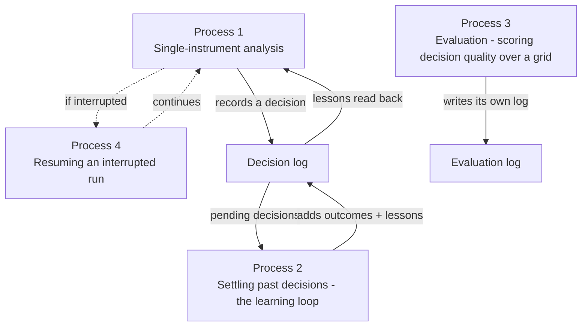

# Business Processes

This document identifies the main business processes the application implements.
For each: its purpose, what triggers it, who participates, and its inputs and
outputs.

**Legend:** **Confirmed** · **Assumption** · **Unresolved.**

The application has **four** business processes. The first is the core; the others
support it.

---

## Process 1 — Single-instrument analysis (the core process)

**Purpose.** Produce a final investment rating and written thesis for one
instrument on one date, by running the simulated firm end to end.

**Trigger.** The operator starts a run (interactively or by supplying the run's
parameters directly, e.g. for a scheduled job). **Confirmed.**

**Participants.** The operator (setup + result); the whole firm (Analyst team,
Research team, Trader, Risk team, Portfolio Manager); data providers and AI model
providers (evidence and reasoning).

**Inputs**
- Instrument (ticker) and analysis date (today or earlier).
- Which analysts to use (non-empty subset).
- Research depth (debate + risk discussion rounds).
- AI provider(s) and model(s) for the quick and deep tiers.
- Output language.
- Optional: the operator's holdings/cash snapshot.
- Optional: resume-from-interruption enabled.

**Outputs**
- The **final decision**: five-level rating, executive summary, investment thesis,
  optional target price and time horizon.
- A **report**: a set of readable documents (one per role, grouped by team) plus a
  consolidated report and a single-page web view, with a header recording what
  produced the run (date, version, models, analysts, data sources).
- A **record in the decision log** (the decision, pending settlement).
- A **state record** of the run (the full set of reports and debate histories).

**Key characteristics**
- The selected analysts run **in parallel**; the research debate starts only when
  all have filed. **Confirmed.**
- The decision is recorded **after** the run completes; a decision nobody can
  read is recorded as *for review*, not as a position. **Confirmed.**
- The run is **non-deterministic**: two runs of the same input can differ (AI
  sampling plus live data). This is expected, not a defect. **Confirmed.**

See WORKFLOWS.md for the step-by-step.

---

## Process 2 — Settling past decisions (the learning loop)

**Purpose.** Turn a past decision, now that its holding window has fully traded,
into a scored outcome (raw return and alpha vs the regional benchmark) plus a
short written lesson, so that future runs can learn from what worked and what did
not.

**Trigger.** Two triggers:
- **Automatic, alongside the analysts.** During any run, the tool settles every
  due decision (across all instruments) while the analysts are working. A
  decision is "due" once its holding window (default 5 trading days) has fully
  traded after the analysis date. **Confirmed.**
- **On demand.** A caller that is done analysing an instrument (an evaluation
  sweep, a scheduled job) can settle its due decisions now. **Confirmed.**

**Participants.** The settlement routine; the AI model (to write the reflection);
price data; the regional benchmark; the decision log.

**Inputs.** The pending decision (its text and rating), the instrument, its
analysis date, the configured holding period, and the resolved benchmark.

**Outputs.**
- The decision's entry updated from *pending* to *settled*, with the raw return,
  the alpha, the holding window, and the date the outcome became known.
- A **reflection** — 2–4 sentences of plain prose: what the window's alpha shows
  about the call, which part of the thesis it supports/undercuts, and one
  concrete lesson for the next similar analysis. **Confirmed.**

**Downstream use.** On a later run, the Portfolio Manager reads the most recent
settled decisions for the same instrument plus recent cross-instrument lessons.
For a run dated in the past, only lessons whose outcome was already known by that
date are included (point-in-time). **Confirmed.**

**Failure behaviour.** If prices or the reflection cannot be obtained, the
decision **stays pending** and is reported as unsettled; the run is not blocked.
**Confirmed.**

---

## Process 3 — Evaluation: scoring decision quality over a grid

**Purpose.** Because one run yields one decision and cannot show whether the
system decides well, this process runs the **same firm over a grid of instruments
and dates** and reads the aggregate. It evaluates **decision quality** — it is
explicitly *not* a portfolio simulator.

**Trigger.** The operator runs an evaluation over a set of tickers and a date
range (e.g. weekly steps), optionally continuing a previous sweep. **Confirmed.**

**Participants.** The whole firm, run once per (instrument, date) cell; the
settlement routine; the decision log (the evaluation's own).

**Inputs.** Tickers, a start and end date, a step (days between dates), the
analysts to use, asset type, an optional holdings snapshot (held constant across
the grid), and optionally a prior sweep to continue.

**Outputs.**
- An **evaluation decision log** (separate from the operator's own log, which is
  never written to). **Confirmed.**
- A **summary**, grouped by rating, of the settled cells: how many, the
  "hit rate" (how often the call's direction matched the realised alpha — not
  defined for Hold, which claims no direction), and the mean alpha vs benchmark.
- The number of cells run, skipped, failed, and unsettled.

**Key characteristics**
- Cells are **independent**: no position is carried forward. **Confirmed.**
- A decision is entered at the **first close after its analysis date** (because a
  run reads news published after that day's close). **Confirmed.**
- An interrupted sweep **resumes**: re-running with the same sweep id skips cells
  already done. **Confirmed.**
- Results are **indicative, not repeatable**: one model sampling per cell, and
  text feeds are not archived. **Confirmed.**

---

## Process 4 — Resuming an interrupted run

**Purpose.** Let a run that crashed or was interrupted **continue from its last
completed step** instead of starting over.

**Trigger.** The operator enables resume-from-interruption for a run; if a saved
snapshot for that instrument+date+configuration exists, the run resumes rather
than starting fresh. **Confirmed.**

**Participants.** The run; the saved snapshot store.

**Inputs.** The same instrument, date, and run configuration as the interrupted
run.

**Outputs.** A completed run, continuing from where it stopped. On successful
completion the snapshot is cleared so a later run starts fresh. **Confirmed.**

**Key characteristics**
- The tool reports whether a run **resumed a saved run or started fresh**.
  **Confirmed.**
- If the run's **configuration changes** (different analysts, depth, asset type,
  holdings, models, etc.), the old snapshot does **not** apply — the run starts
  fresh rather than silently continuing a different run. **Confirmed.**
- A run that fails mid-stream keeps its snapshot, so it can be resumed.
  **Confirmed.**

**Assumption.** This process is a reliability convenience for long runs, not a
feature the operator is expected to use on every run.

---

## Process 5 (supporting) — Configuration and setup

**Purpose.** Gather the run's parameters before any analysis starts.

**Trigger.** Every run begins here.

**Inputs/outputs.** The operator's choices (instrument, date, analysts, depth,
models, language, optional holdings), with the **previous run's answers offered
as defaults** and the ability to supply parameters directly to skip prompts
(useful for scheduled jobs). If a parameter is missing and there is no terminal to
ask, the run stops *before* it starts and names exactly what to set. **Confirmed.**

**Confirmed.** Setup is a prerequisite gate: provider credentials/endpoints for
the models actually in use are checked before the run, so a missing credential is
caught up front rather than after the expensive roles have run.
