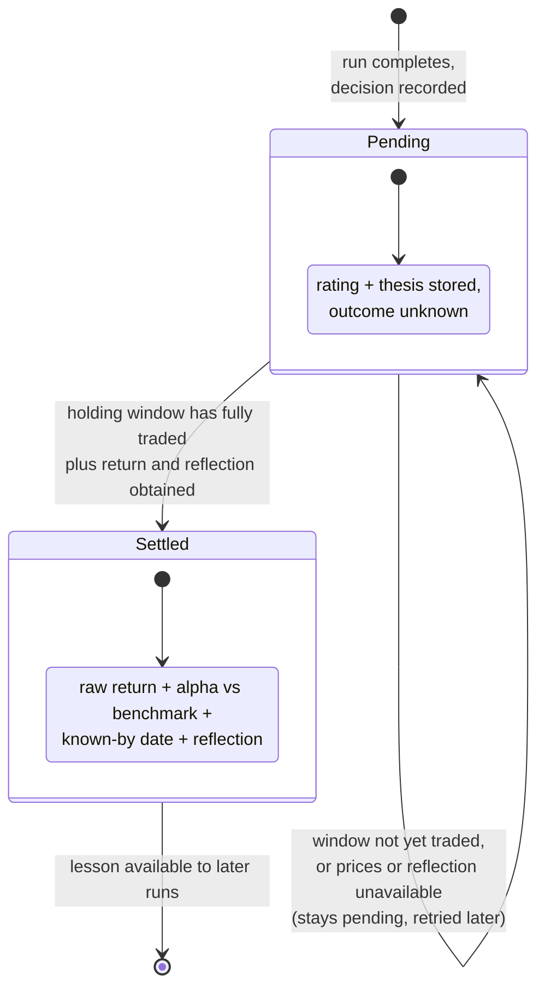
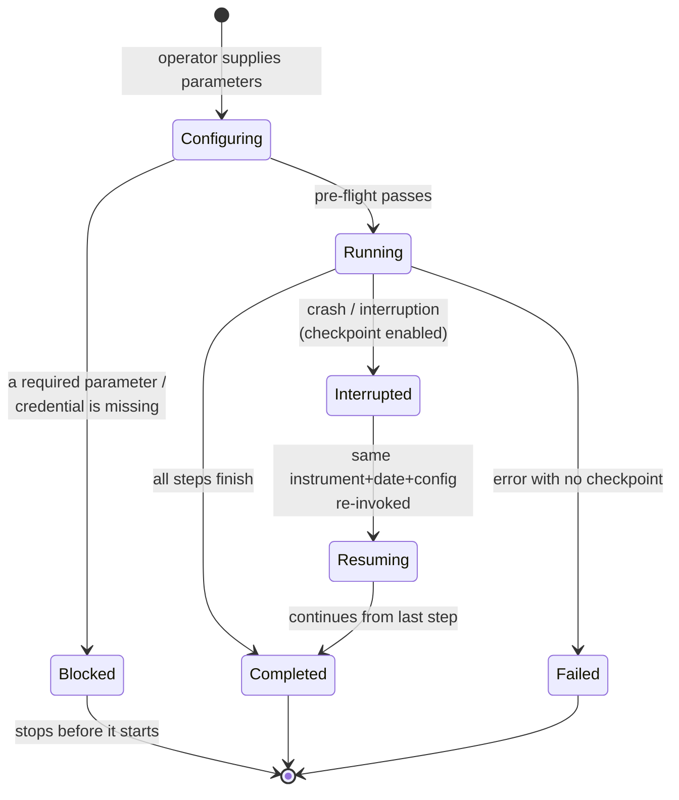
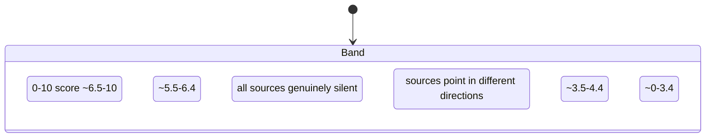
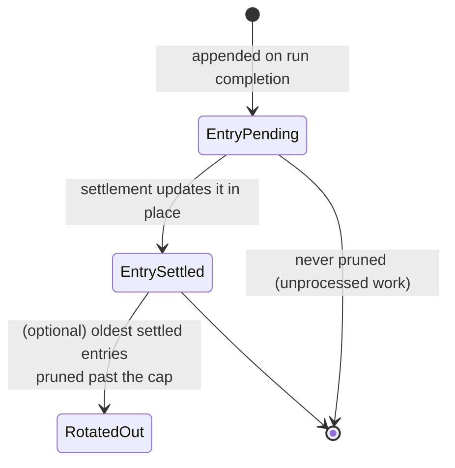
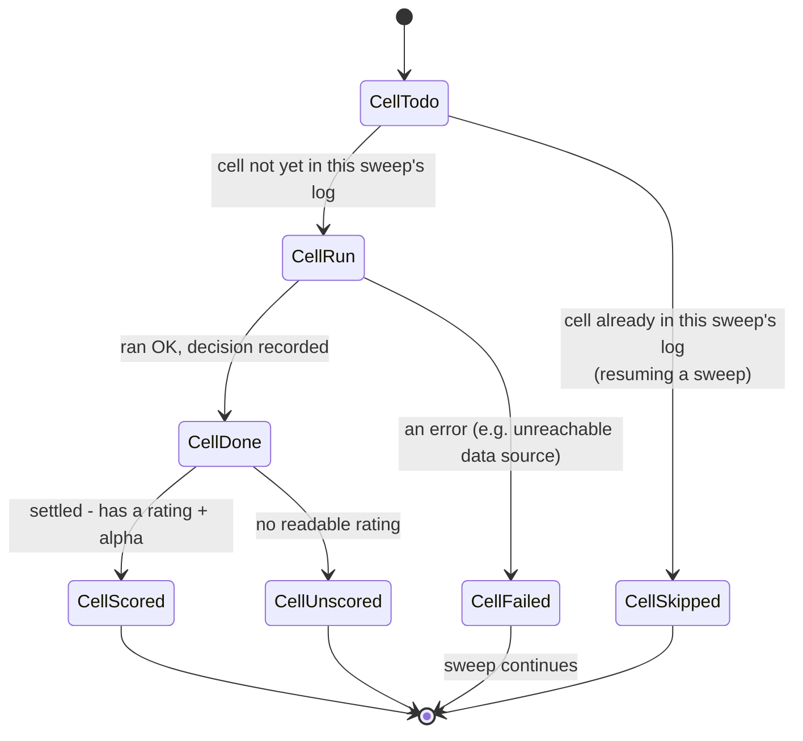
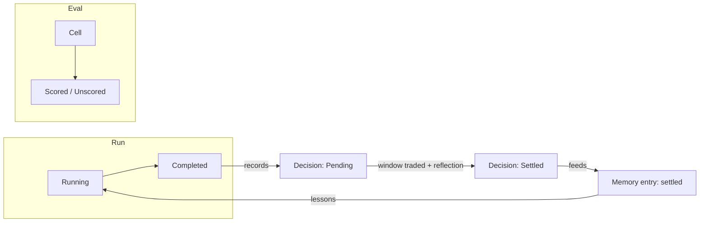

# States and Transitions

This document describes the lifecycle states of the application's main business
objects — a **decision**, a **run**, a **sentiment read**, and a **memory entry**
— and the transitions between them.

**Legend:** **Confirmed** · **Assumption** · **Unresolved.**

---

## 1. The decision (the central business object)

A decision is the output of a run: a five-level rating plus a written thesis. Its
life is defined by whether its **outcome is known yet**.

**Confirmed.**

| State | Meaning | Enters when |
|---|---|---|
| **Pending** | The decision is recorded but its outcome is not yet known. | The run completes and the decision is written to the log. |
| **Settled** | The outcome is known: the decision's holding window has fully traded, and its raw return, alpha (vs the regional benchmark), known-by date, and a reflection are recorded. | Settlement succeeds for a due decision. |

**Transitions**
- **Pending → Settled** happens automatically alongside later runs (or on demand)
  once the full holding window has traded *and* the prices and reflection are
  available.
- **Pending → Pending** (stays) is the normal case when the window has not yet
  traded, or when prices/reflection are temporarily unavailable. The decision is
  reported as unsettled and retried on a later pass. **Confirmed.**

**Note on rating vs state.** The rating (Buy…Sell) is the decision's *content*;
*pending/settled* is its *lifecycle*. A decision with no readable rating is
recorded as **REVIEW** — a content state, not a lifecycle state — and is excluded
from scoring in evaluation. **Confirmed.**

---

## 2. The run

A run is one analysis of one instrument on one date. Its lifecycle is shaped by
whether it is **checkpoint-enabled** (able to resume).

**Confirmed.**

| State | Meaning |
|---|---|
| **Configuring** | Gathering the run's parameters (instrument, date, analysts, depth, models, language, optional holdings). |
| **Blocked** | A required parameter or credential is missing and there is no terminal to ask; the run stops *before* it starts and names what to set. |
| **Running** | The firm is executing: analysts in parallel → research debate → trader → risk debate → portfolio manager. |
| **Completed** | The final decision is produced and recorded; any snapshot is cleared. |
| **Interrupted** | The run stopped mid-way with a saved snapshot (checkpoint enabled). |
| **Resuming** | A later invocation with the *same* instrument, date, and run configuration continues from the last completed step. |
| **Failed** | An error ended the run with no snapshot to resume from. |

**Key transition rule.** If any run-affecting setting changes (analysts, depth,
asset type, holdings, models, or other settings), the old snapshot does **not**
apply and the run starts **fresh** rather than resuming. **Confirmed.**

**Assumption.** "Interrupted/Resuming" is a reliability path for long or
flaky runs, not the normal flow.

---

## 3. The sentiment read

The Sentiment Analyst's output is a discrete band plus a numeric score and a
confidence level. **Confirmed.**

- **Band** (six levels) — the direction.
- **Score** — a 0–10 intensity, kept consistent with the band.
- **Confidence** — low / medium / high, driven by data quality and sample size
  (low when a source was a placeholder or returned very few data points).

**Transition note.** The band is a single output per run, not a state machine over
time; it is re-derived fresh each run. **Confirmed.**

---

## 4. The memory entry

A memory entry is the log record for one decision. Its lifecycle mirrors the
decision but is described at the record level.

**Confirmed.**

- **EntryPending** — the decision is stored, outcome unknown. Tagged *pending*.
- **EntrySettled** — updated in place with the return, alpha, window, known-by
  date, and reflection.
- **RotatedOut** — with an optional cap, the *oldest settled* entries are dropped
  once the cap is exceeded. **Pending entries are never rotated out.**

---

## 5. The evaluation cell

In the evaluation mode, each (instrument, date) cell has its own small lifecycle.

**Confirmed.**

- **CellSkipped** — when resuming a sweep, cells already done are not re-run.
- **CellFailed** — one failed cell does not end the sweep; it is recorded and the
  sweep continues.
- **CellScored / CellUnscored** — a settled cell is scored by rating; a decision
  with no readable rating is reported as unscored.

---

## 6. Cross-object summary

**Confirmed.** The decision log is the connective tissue: a completed run records
a pending decision; settlement turns it into a settled entry; and that settled
entry's lesson is read back by the Portfolio Manager on a later run — closing the
learning loop.
