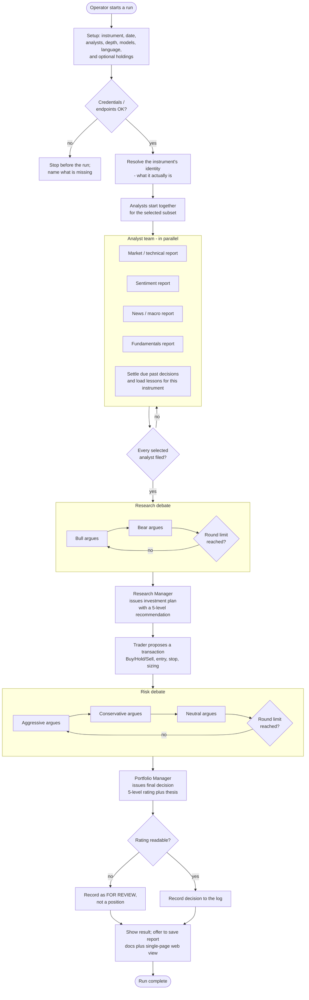
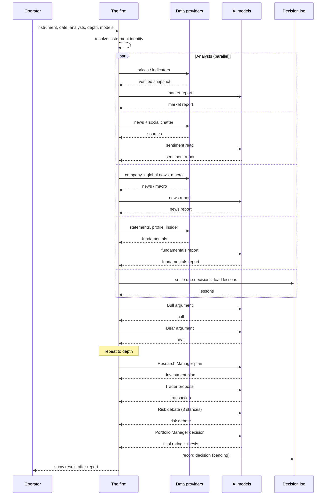
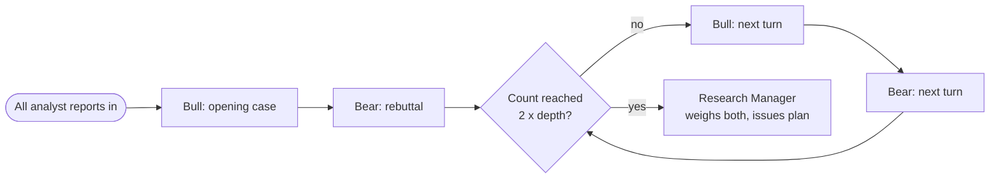
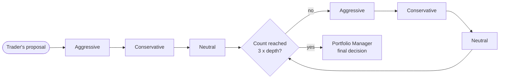
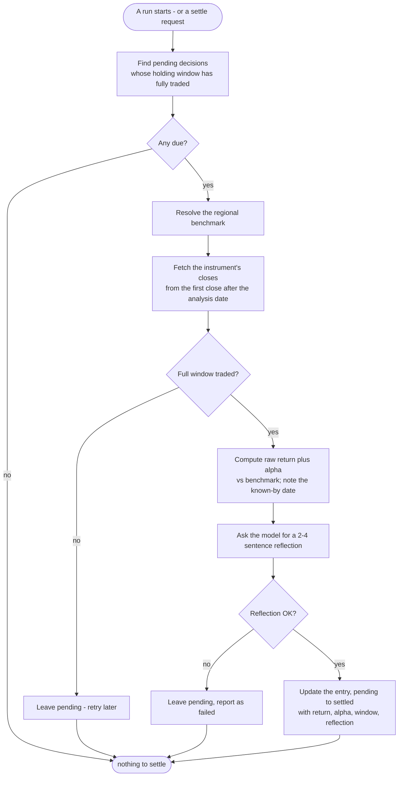
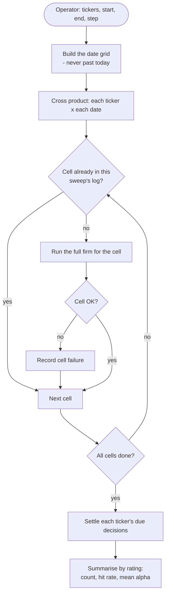
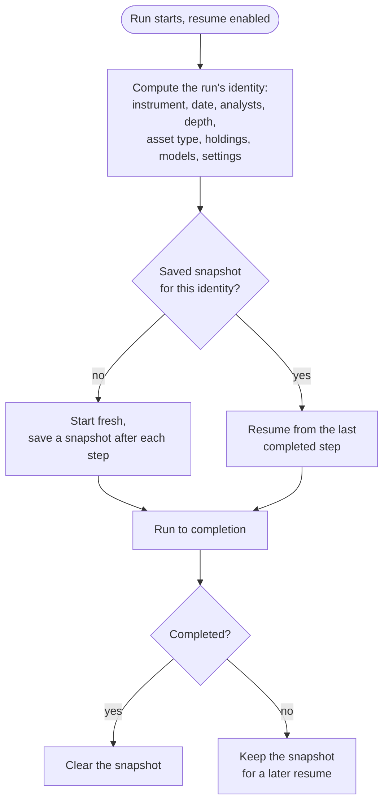

# Workflows

This document describes each process **step by step**, with flowcharts and
sequence diagrams.

**Legend:** **Confirmed** · **Assumption** · **Unresolved.**

---

## 1. The main analysis workflow

This is the step-by-step of a single-instrument run.

### Step-by-step

1. **Setup.** The operator supplies (or is prompted for) the instrument, date,
   analysts, depth, models, and language; optionally holdings. The previous run's
   answers are the defaults. **Confirmed.**
2. **Pre-flight.** The credentials/endpoints for the models actually in use are
   checked. A missing credential stops the run before it starts. **Confirmed.**
3. **Instrument identity.** The tool resolves what the instrument actually is
   (its real name and classification) so every role anchors to the correct
   company instead of inferring one from the price chart. If the lookup is
   unavailable, it proceeds with ticker-only context rather than failing.
   **Confirmed.**
4. **Analysts in parallel.** The selected analysts each produce their report from
   their own evidence. In parallel, the tool settles any due past decisions and
   loads the lessons for this instrument. **Confirmed.**
5. **Gate.** The research debate begins only once *every* selected analyst has
   filed. **Confirmed.**
6. **Research debate.** The Bull and Bear take turns up to the configured depth,
   each rebutting the other. **Confirmed.**
7. **Research Manager verdict.** The manager weighs both sides and issues a
   structured investment plan with a five-level recommendation. **Confirmed.**
8. **Trader proposal.** The Trader turns the plan into a concrete transaction
   (action, reasoning, entry/stop/sizing), grounded in the technical price
   structure and, if given, the operator's holdings. **Confirmed.**
9. **Risk debate.** The Aggressive, Conservative, and Neutral risk analysts
   debate the proposal up to the configured depth. **Confirmed.**
10. **Portfolio Manager decision.** The Portfolio Manager issues the final
    five-level rating, executive summary, and thesis, incorporating any lessons.
    **Confirmed.**
11. **Record + output.** The decision is recorded to the decision log (as a
    position, or as *for review* if no rating is readable). The result is shown,
    and the operator is offered the saved report (documents + single-page web
    view). **Confirmed.**

---

## 2. Sequence: a single run

**Confirmed.** The parallel fan-out of the analysts, the ordered hand-offs, and
the final recording are the actual run structure.

---

## 3. The research debate (sub-workflow)

- Each **round** = one Bull turn + one Bear turn. The debate stops when the count
  reaches twice the configured depth. **Confirmed.**
- The first speaker, with no opponent yet, is told the other "has not spoken
  yet" and opens with its own case rather than inventing a rebuttal.
  **Confirmed.**
- The Research Manager's instruction is explicit: **conflict alone is not a
  reason to Hold** — commit to the stronger side, sized by how decisively it
  wins; Hold only when the evidence is still balanced or too thin. **Confirmed.**

---

## 4. The risk debate (sub-workflow)

- The three stances speak in a fixed order (Aggressive → Conservative → Neutral);
  a **round** is one turn each. The debate stops when the count reaches three
  times the configured depth. **Confirmed.**
- The Portfolio Manager applies the same "conflict is not a Hold" rule to the risk
  debate. **Confirmed.**

---

## 5. The settlement workflow (learning loop)

**Confirmed.** Key rules in this workflow:
- A decision is settled **only** once the full holding window has traded; a
  re-run before that leaves it pending rather than scoring a premature, partial
  return.
- If prices or the reflection are unavailable, the decision stays pending and is
  reported; the run is not blocked.
- Settlement is **idempotent and safe under concurrency**: one pass at a time per
  log, and each outcome is written as soon as its reflection is done, so an
  interrupted pass keeps what it finished.

---

## 6. The evaluation (backtest) workflow

**Confirmed.**
- The grid stops at **today** (a future date has no outcome to score).
- An interrupted sweep **resumes**: re-run with the same sweep id skips done cells.
- The evaluation writes to its **own** log; the operator's own log is never
  touched.
- One unreachable data source must not end the whole sweep — a failed cell is
  recorded and the sweep continues.

---

## 7. The resume workflow

**Confirmed.** Changing any run-affecting setting invalidates the snapshot, so a
run under different settings starts fresh instead of silently continuing the
previous one.
