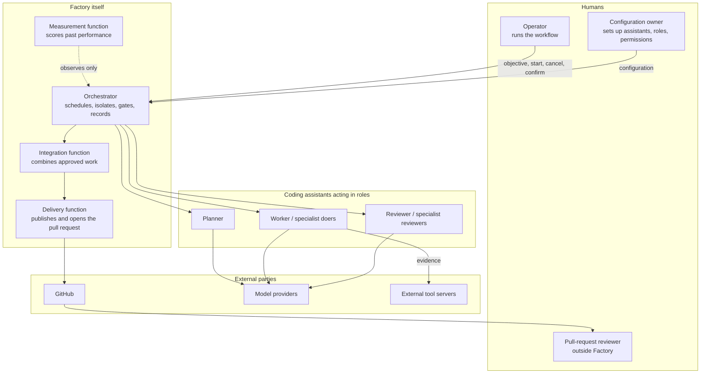
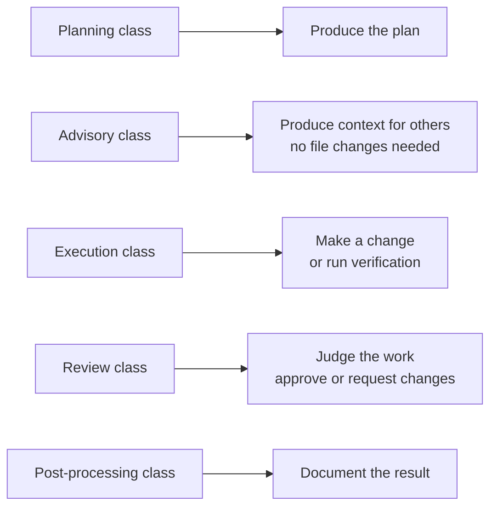

# Actors and Roles

Who and what takes part in Factory's business processes, what each is responsible for, and
where their authority stops. Tagging: **[Confirmed]** / **[Assumption]** / **[Unresolved]**,
as defined in `BUSINESS_OVERVIEW.md`.

---

## 1. The actor map

---

## 2. Human actors

### 2.1 The operator

**[Confirmed]** The person who drives a workflow from the dashboard. They:

- write the objective, or import a work item;
- choose (or accept the default) team of assistants and roles;
- inspect and edit the generated plan before it starts;
- press **Start**, and may **Cancel** while it runs;
- retry an eligible failed task;
- pin a task to a particular assistant if they want a specific one to do it;
- preview and then confirm the pull request;
- watch attempts, evidence, reviews and results in the inspector.

They cannot: run arbitrary commands, invoke an assistant directly from the dashboard, edit
the plan of a run that is already active, or force publication of incomplete work.
**[Confirmed]**

**[Assumption]** In practice the operator is a software engineer on the team. The material
never separates the operator from a manager or a requester, so this analysis treats them as
one person who both commissions and supervises the work.

### 2.2 The configuration owner

**[Confirmed]** Often the same person, but the responsibility is distinct and it is the
governance-critical one. They decide, once per project:

- which coding assistants are available, and how each is launched;
- which assistant may act in which role, and which is the preferred choice;
- what each role and each assistant is *permitted* to do — which files may be written, which
  commands may be run, which environment variables are visible, which external tools may be
  called;
- which custom roles exist and what each is responsible for;
- which reusable workflow recipes exist;
- which external tool servers, if any, may be connected.

**[Confirmed]** Access to the dashboard is explicitly equivalent to access to the project's
agent configuration. That makes this role the real control point, and it is why the
application treats the local machine as the trust boundary.

### 2.3 The pull-request reviewer

**[Confirmed]** A person outside Factory, in the team's ordinary code-review process. They
receive a pull request whose description was generated from recorded evidence — objective,
tasks, the commands the accepted attempts actually reported, and the recorded review
decisions. They hold the merge decision. Factory never merges.

**[Unresolved]** Whether this reviewer must be someone other than the operator is not
addressed. See `BUSINESS_OVERVIEW.md` §9.2.

### 2.4 The trusted local operator (implicit actor)

**[Confirmed]** The security model defines an actor by implication: *anyone with access to
the machine and its loopback network interface*. The API binds to the local machine only and
has no password; the boundary protects against cross-site browser attacks, not against a
person or a local process. The documentation states plainly that such a person "is equivalent
to a trusted local operator", and warns against exposing the service through a proxy or
tunnel.

This is an actor definition with real consequences: everyone who can reach the machine can
reconfigure which assistants run with which permissions.

---

## 3. The process roles filled by coding assistants

Eight responsibilities ship built in; a team may define more. **[Confirmed]** The first three
are **mandatory pipeline roles** — every workflow needs them. The rest participate only when
a plan actually assigns them work.

| Role | Responsibility | What it must produce | Authority limit |
| --- | --- | --- | --- |
| **Planner** | Turn the objective into a task plan with dependencies. Exactly one per workflow. | A structured plan of tasks, each with a role, an action type, and acceptance criteria. | Changes no code. Cannot invent a role the team does not contain. |
| **Worker** | Carry out a planned change in an isolated working copy. | The change, plus a report of what was done and which commands were run. | Writes only inside its permitted file scopes. Cannot publish anything. |
| **Reviewer** | Independently judge an attempt against its acceptance criteria. | A decision: **approve** or **request changes**. | The final acceptance authority for implementation work — but not the merge authority. |
| **Architect** | Analyse design, boundaries and constraints before implementation. | A written design artefact later tasks consume. | Advisory: succeeds without changing any file. |
| **Researcher** | Gather technical context another role needs. | Findings as an artefact. | Advisory. Gets no research capability the underlying assistant does not already have. |
| **Test Engineer** | Add or run tests that check the requirement. | A verification record of what ran and what actually passed. | Reports results as observed; coverage figures are not invented. |
| **Security Auditor** | Review the security-relevant parts of a change. | Findings with a severity, plus approve or request changes. | Read-only by default. |
| **Documentation Writer** | Update documentation after implementation. | Documentation changes and a context artefact. | Permitted to write only documentation paths under the standard settings. |

**[Confirmed]** Custom roles are first-class: a team can define a Database Engineer, a
Performance Analyst or an Accessibility Reviewer, and it then behaves exactly like the
built-in role of the same kind — the process branches on *what kind of work this is*, never
on a role's name.

### The four kinds of work a role can be built for

**[Confirmed]** Every role belongs to exactly one class, and the class decides what tasks it
is allowed to be given:

A plan that asks a review-class role to make a change is **rejected and sent back for
repair** — the application refuses to reinterpret the request silently. **[Confirmed]**

---

## 4. Factory's own actors

Factory is not one actor but several with deliberately separated powers. **[Confirmed]**

| Function | Responsibility | Exclusive power |
| --- | --- | --- |
| **Orchestrator** | Validate before starting; schedule ready tasks one at a time; give each its own working copy; hand out the mission; capture evidence; enforce permissions; record everything. | Decides *when* a task runs and *which* assistant performs it. |
| **Integration function** | Land each approved change onto the run's own branch. | The only thing that advances Factory's integration branches. |
| **Delivery function** | Push the run branch and open or link the pull request, after the operator confirms. | **The only thing in the whole system that can publish to the remote.** |
| **Policy function** | Compute one permission decision per (role, assistant) pair and apply it at every gate. | Denies; never grants operating-system rights. |
| **Measurement function** | Derive performance statistics from history. | None — it observes and reports and cannot influence scheduling by itself. |

The separation between the delivery function and the coding assistants is the single most
important control in the design. Assistants are permanently forbidden from publishing:
push, force-push, branch deletion, branch reset and remote modification are denied
unconditionally, and no configuration or instruction can allow them. Only the explicit
delivery action publishes, and only the run's own branch, never forcibly. **[Confirmed]**

---

## 5. External parties

| Party | Participation | Trust posture | **[Confirmed]** / other |
| --- | --- | --- | --- |
| **Coding assistants** (Codex, Claude Code, OpenCode, Gemini CLI, Qwen Code, custom) | Do the work. Keep their own model, authentication and capabilities. | Run with the operator's own operating-system permissions. "Run agents you trust." | Confirmed |
| **Model providers** | Serve the assistants. | Factory never talks to a provider and never handles a provider credential. | Confirmed |
| **GitHub** | Source of imported work items; destination of the published branch and pull request. | Reached through the locally authenticated GitHub command-line tool. Factory never reads, stores or displays a GitHub token. Work-item text arrives as **untrusted data**. | Confirmed |
| **External tool servers** (optional) | Give assistants access to documentation, issue trackers, databases and similar. | **Denied by default.** Configuring a server grants nothing; a role must be explicitly allowed each tool, and risky tools must be allowed by exact name. Every result comes back marked as untrusted external data. | Confirmed |
| **The project repository** | The object being worked on. | Each task works on a separate copy; the main line is never written by Factory. | Confirmed |

---

## 6. Responsibility split (who decides what)

| Decision | Decided by | Can an assistant overrule it? |
| --- | --- | --- |
| What work to commission | Operator | No |
| How the work is broken down | Planner, then accepted or edited by the operator | No |
| Who performs each task | Orchestrator, from the team and routing rules; the operator may pin it | No |
| Whether a task's output is acceptable | Reviewer role | No |
| Whether the change may be published | Operator, at the preview | No |
| Whether the change enters the main line | Pull-request reviewer, outside Factory | No |
| What an assistant is permitted to touch | Configuration owner, via policy | **Never** — instructions can never widen permissions |

**[Confirmed]** for every row.

---

## 7. Role conflicts and separations the design enforces

**[Confirmed]** These separations are deliberate and are enforced in code, not merely
documented:

- **Doing and judging are different acts.** The party that produces an implementation never
  accepts it; a review decision comes from a reviewer-role session.
- **Working and publishing are different powers.** Assistants work; only the delivery
  function publishes.
- **Asking and permitting are different systems.** Role instructions are prompt content;
  policy is enforcement. Where they disagree, policy wins, and deny always beats allow.
- **Measuring and scheduling are different functions.** Statistics are read-only; a project
  must opt in before performance data influences who is chosen.
- **Planning and executing are different moments.** A plan is reviewed by a human before any
  repository work begins.

**[Unresolved]** No separation-of-duties rule exists between the operator and the
configuration owner, so a single person can both widen a permission and use it. Flagged in
`BUSINESS_OVERVIEW.md` §9.

---

## Evidence

- `docs/roles.md` — the role/agent/assignment model, the eight built-in roles, execution
  classes, custom roles, and the rejection of incompatible plans.
- `docs/architecture.md` — role resolution chain, the separation of the integration function
  and the delivery function, and the read-only measurement function.
- `docs/policies.md` — instructions-versus-policy separation, deny-wins precedence, the
  unconditional Git denials, and the enforcement boundary.
- `docs/security.md` — the local trust boundary, the trusted-operator definition, and the
  dashboard-equals-configuration-access statement.
- `docs/github.md` — delivery as the sole publication path; untrusted work-item content.
- `docs/mcp.md` — default-deny external tools and untrusted results.
- `docs/routing.md` — who selects the assistant, and the operator's manual pin.
- `docs/api.md` — the complete set of operations available to a human operator.
