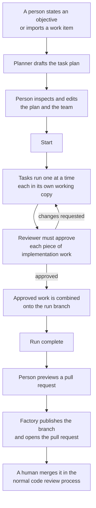
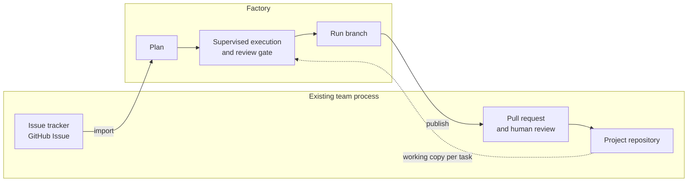

# Business Overview — Agentic Software Factory

**Audience:** business analysts, product owners, engineering managers. No programming
knowledge is assumed.

**What this document is.** A reconstruction of what this application does and how people
use it, derived from the application's own documentation and source. Every statement is
tagged:

| Tag | Meaning |
| --- | --- |
| **[Confirmed]** | Directly evidenced by the application's documented and implemented behaviour. |
| **[Assumption]** | A reasonable reading of the evidence that the application does not state outright. |
| **[Unresolved]** | A genuine open question the application does not answer. Raised in §9. |

An **Evidence** appendix at the end of each document in this set records where the claims
came from, so any statement can be checked.

---

## 1. Purpose — the problem it solves

Software teams now have AI coding assistants that can write real code. The difficulty has
moved from "can an assistant produce code?" to a management problem:

- A single assistant conversation cannot be trusted to deliver a coherent, reviewed change.
- Nobody can say what was attempted, by whom, on what evidence, or why it was accepted.
- Attempts are not coordinated: they overlap, they collide, and failures are invisible.
- Work disappears when the browser tab closes.

**Factory is a workflow manager for AI coding work.** A person states a software objective;
Factory turns that objective into a plan of tasks with dependencies, has coding assistants
carry out the tasks under supervision, requires a review decision before any task is
accepted, combines the accepted work onto its own branch, and can hand the result over as a
pull request for a human to merge. **[Confirmed]**

The critical framing, stated by the application itself: **Factory does not provide models —
it orchestrates agents.** The AI capability belongs to coding tools the organisation already
installs and authenticates (Codex, Claude Code, OpenCode, Gemini CLI, Qwen Code, or a
company's own). Factory adds the planning, isolation, review gate, integration, and audit
around them. **[Confirmed]**

### In one sentence

> Factory converts "make this change to the codebase" into a planned, isolated, reviewed and
> auditable software delivery workflow, using coding assistants you already own, entirely on
> your own machine. **[Confirmed]**

---

## 2. What it is, and what it deliberately is not

| It **is** | It deliberately **is not** |
| --- | --- |
| A local orchestrator of external coding tools | An AI model, or a replacement for one |
| A planner that produces a reviewable task list before work starts | A fixed pipeline template — the plan is generated per objective |
| A supervisor that isolates each task on its own working copy | An operating-system sandbox — see §7 |
| A gatekeeper that requires a review decision before accepting work | An automatic merger to the main line |
| A record-keeper of every attempt and its evidence | A cloud service or telemetry collector |
| A measuring instrument for how well each assistant performs | A cost or token optimiser |

**[Confirmed]** for every row.

---

## 3. Who it is for

**[Confirmed]** The product is a desktop/local tool for software engineering teams:

- **Software teams** already using AI coding CLIs who want governed, reviewable output
  rather than ad-hoc assistance.
- **Teams with governance requirements** — the permission model, audit trail and
  "nothing leaves the machine" posture fit organisations that cannot send code to a hosted
  agent service. The documentation targets individual developers and small teams; it does
  not describe multi-user administration, so enterprise rollout is addressed in §9.
- **Repository maintainers** who want incoming work to arrive as a clean, evidence-backed
  pull request rather than a raw diff.

**[Assumption]** Pricing, licensing beyond the open-source licence, and team sizing are not
covered anywhere in the material. The licence is MIT, so this reads as an open-source tool
rather than a commercial product.

---

## 4. The end-to-end journey

**[Confirmed]** Two human decision points are load-bearing and cannot be removed: **Start**
(nothing touches the repository before it) and **confirm the pull request preview** (nothing
is published before it). The application states plainly that "an agent can never silently
publish".

---

## 5. The units of work

Understanding four terms makes the rest of this document set readable. **[Confirmed]**

| Term | Business meaning |
| --- | --- |
| **Agent** | A coding assistant the organisation installed and authenticated. An outside contractor with its own tools and its own credentials. |
| **Role** | A responsibility in the process — Planner, Worker, Reviewer, Architect, Researcher, Test Engineer, Security Auditor, Documentation Writer, or one the team defines. |
| **Assignment** | The permission for a particular assistant to carry out a particular role. Several assistants may hold one role; one assistant may hold several. |
| **Run** (workflow) | One complete piece of delivery work: an objective, its plan, its team, everything attempted, and its outcome. |

The separation is deliberate and is the product's core governance idea: **a role says what
an assistant is asked to do; a policy says what it is permitted to do.** Instructions never
grant permission. **[Confirmed]**

---

## 6. What the organisation gets out of it

**[Confirmed]** Every run leaves behind durable, inspectable records:

- **The plan as it was agreed** — including later revisions, kept as durable revisions so
  completed work is never silently rewritten.
- **Every attempt**, with who performed it, what role they acted in, when it started and
  finished, and whether it succeeded.
- **The evidence** — which files changed, which commands were reported, what was tested and
  what the test result actually was.
- **The review decisions**, including findings and their severity when changes were
  requested.
- **The reasoning behind every assignment** of work to an assistant, recorded as an
  explainable routing decision.
- **A working branch** containing the approved result, and optionally the pull request.

This is the practical answer to "who did what, and why should we accept it?".

---

## 7. Honest limits — what the organisation must still provide

The application is unusually candid about its own boundaries. These are **[Confirmed]**
limitations the application documents itself, not gaps in this analysis:

1. **This is not a security sandbox.** Coding assistants run with the full permissions of
   the person who started Factory. Isolation between tasks is about keeping work separate,
   not about containment. The application's own summary: "policies make Factory a
   disciplined orchestrator with hard gates where it controls the boundary, not a sandbox.
   Run agents you trust."
2. **Network restrictions are advisory only.** A rule that says "this role may not use the
   network" is stated to the assistant and recorded, but is not technically enforced on any
   supported platform.
3. **Permission enforcement is evidence-based.** A task is stopped before it starts if it
   could not legally run, and an attempt is failed after the fact if the files it reports
   changing fall outside its allowance. Individual actions inside an assistant's own process
   are not intercepted.
4. **The main line is protected by convention and by design, not by force.** Factory never
   writes to the project's main branch and keeps its own integration branch under exclusive
   control — but the assistants themselves retain operating-system access.
5. **Restart loses in-flight work.** Work survives closing the browser; it does not survive
   restarting Factory. A run that was mid-flight is marked failed and must be retried.
6. **Within one run, tasks execute one at a time.** Parallelism across *different* runs is
   supported; the design is described as "parallel-ready" but concurrent scheduling inside a
   run is not performed in this release.
7. **A few advertised capabilities are documented but not wired up.** The per-run task-width
   setting is accepted and validated but never read by the scheduler, and a queued integration
   stage described in the reference documentation has no callers and is unreachable. In each
   case the implementation is the *more conservative* of the two, so this is not a safety
   exposure — but do not plan around those two features. Five such gaps are catalogued with
   their evidence in `EXCEPTIONS_AND_EDGE_CASES.md` §15. **[Confirmed]**

---

## 8. How it fits the wider delivery process

Factory sits **between** the work item and the pull request. It does not replace the issue
tracker, the repository, the code-review process, or the merge decision. **[Confirmed]** It
reads a GitHub Issue as input and writes a pull request as output; everything in between is
Factory's own process. **[Confirmed]**

**[Confirmed]** External participation is limited and explicit: the coding assistants' own
model providers, GitHub through the locally authenticated command-line tool, and optional
external tool servers the team configures. Factory sends nothing to its own backend — there
is none.

---

## 9. Unresolved questions

These are product and operating questions the material does not answer. They are listed
rather than guessed.

1. **Team operation.** The local trust model treats anyone with access to the machine as a
   trusted operator, and there is no user authentication. How does an organisation run this
   for a team — one operator per machine, or a shared host? **[Unresolved]**
2. **Who may authorise publication.** The pull request is published on the confirmation of
   whoever is at the dashboard. Is four-eyes separation intended anywhere in the process, or
   is that delegated to the pull-request review itself? **[Unresolved]**
3. **Objective quality.** Guidance is to "keep objectives concrete and bounded", but there
   is no stated triage standard for what makes a good unit of Factory work versus work that
   should be decomposed by a person first. **[Unresolved]**
4. **Liability for assistant output.** Factory records what was approved and by which
   review, but the material does not address accountability when an assistant introduces a
   defect or a licence problem that review missed. **[Unresolved]**
5. **Sizing of the review gate.** The built-in reviewer is the acceptance authority for
   implementation work. The material does not discuss whether that is acceptable for
   high-risk changes, beyond offering an optional Security Auditor role. **[Unresolved]**
6. **Cost governance.** Model spend is owned by each assistant's own subscription or
   contract, and Factory explicitly does not track cost or tokens. Cost control is therefore
   entirely outside this tool. **[Confirmed]** as a design decision; the organisational
   consequence is **[Unresolved]**.
7. **Failure escalation.** A run can end blocked or failed with a diagnostic. No escalation
   or notification path to a team is described — the operator is expected to be watching.
   **[Unresolved]**

---

## Evidence

Claims above were reconstructed from the application's own reference documentation and
verified against its implementation. Principal sources:

- `README.md` — product framing, capability table, quick start, trust model.
- `docs/architecture.md` — workflow lifecycle, role model, persistence, invocation modes.
- `docs/roles.md` — role/agent/assignment separation, execution classes, operations.
- `docs/policies.md` — permission model, precedence, enforcement boundary.
- `docs/security.md` — trust boundaries, what is and is not enforced.
- `docs/github.md` — issue import, delivery flow, publication states.
- `docs/evaluations.md`, `docs/routing.md` — measurement and work assignment.
- `docs/recipes.md`, `docs/mcp.md`, `docs/api.md` — reusable configuration, external tools,
  the full set of operations a person can perform.
- `examples/sample-objectives.md` — how work is entered.

The application's own documentation states its limits explicitly, which is why §7 can be
written as **[Confirmed]** rather than inferred.
