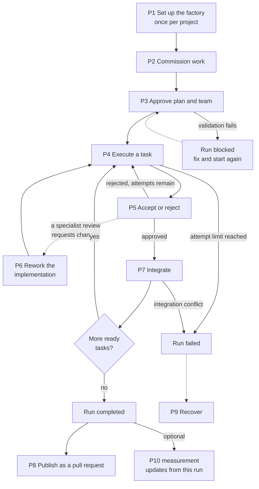
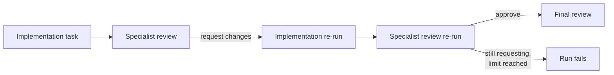
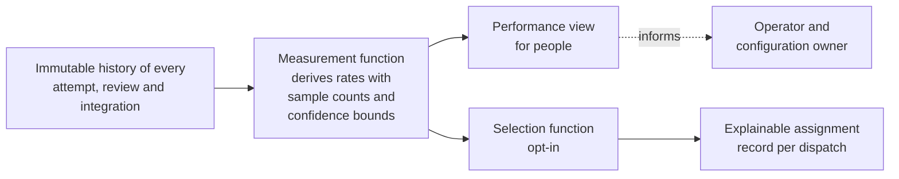
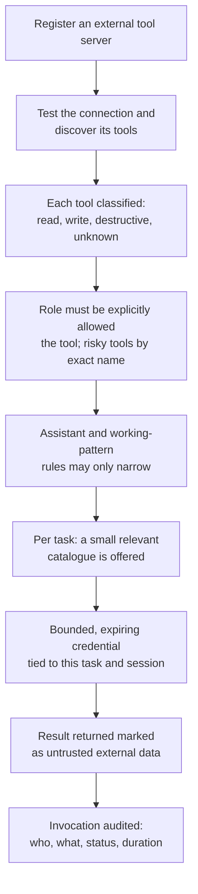

# Business Processes

The distinct processes Factory runs, what starts each one, what it delivers, and who is
involved. Step-by-step narration of the flows is in `WORKFLOWS.md`; the states the objects
pass through are in `STATES_AND_TRANSITIONS.md`.

Tagging: **[Confirmed]** / **[Assumption]** / **[Unresolved]**.

---

## 1. Process inventory

| # | Process | Trigger | Outcome | Primary owner |
| --- | --- | --- | --- | --- |
| **P1** | Set up a project's factory | First use of a project | A governed, configured factory ready for work | Configuration owner |
| **P2** | Commission a piece of work | A person has an objective, or a work item to action | A planned, inspectable run with a named team | Operator + Planner |
| **P3** | Approve the plan and the team | A plan exists | A validated run cleared to start | Operator |
| **P4** | Execute one task | A task's dependencies are finished | An attempt with captured evidence | Orchestrator + a doer role |
| **P5** | Accept or reject an attempt | An implementation-style attempt finishes | An explicit approve or request-changes decision | Reviewer role |
| **P6** | Rework after a change request | A specialised review requests changes | A fresh implementation attempt, then a fresh review | Orchestrator |
| **P7** | Integrate approved work | A task is approved | The change lands on the run's own branch | Integration function |
| **P8** | Publish the result | The run completed and the operator wants it delivered | A pull request awaiting ordinary human review | Delivery function + operator |
| **P9** | Recover from a stopped run | Cancellation, failure, blockage or a restart | A retried, restarted or abandoned run | Operator |
| **P10** | Measure and assign work | Continuous, from history | Explainable assignment choices and a performance view | Measurement + selection functions |
| **P11** | Govern what is permitted | A change in risk posture or a new role | One authoritative permission decision per role and assistant | Configuration owner |
| **P12** | Grant external tool access | A team needs an outside tool | A bounded, audited, revocable capability | Configuration owner |
| **P13** | Hold an interactive assistant session | A person wants to drive an assistant directly | A supervised terminal conversation, recorded, outside any run | Operator |
| **P14** | Define a reusable working pattern | A team repeats a kind of work | A reusable configuration others can select | Configuration owner |

**[Confirmed]** for all fourteen processes and their triggers and outcomes.

Two of these are one-off or occasional (P1, P14); four run per task inside every run (P4–P7);
the rest are per-run or continuous. **[Assumption]** — the count and grouping are this
analysis's reading of the material, though each listed process is itself evidenced.

---

## 2. The master process

Processes P10–P14 run alongside or before this master flow and are described in §4 onwards.

---

## 3. Process detail

### P1 — Set up a project's factory

| | |
| --- | --- |
| **Trigger** | A team decides to use Factory on a repository for the first time. |
| **Actor** | Configuration owner. |
| **Steps** | Create the project's local factory area; record which coding assistants are available; decide which assistant may act in which role and which is preferred; choose the permission preset for each role; optionally define custom roles, external tool servers and reusable working patterns; authenticate each assistant with its own provider. |
| **Outcome** | A governed factory. A fresh setup already has Planner, Worker and Reviewer assigned and sensible permission presets in place, so the minimum path is short. |
| **Business rule anchors** | R-01 to R-05, R-13, R-14, R-100 to R-107. |

**[Confirmed]** The setup explicitly does **not** involve Factory in model credentials:
"Factory never talks to model providers; each CLI keeps its own authentication." Factory's
own installers fetch pre-built software over HTTPS and verify published checksums, need no
administrator rights, and do not run the downloaded binary or store credentials.
**[Confirmed]**

**[Confirmed]** Older projects are carried forward: an earlier single-assistant-per-role
configuration still loads and is rewritten once into the current form on first start, with
the previous file kept as a backup. Upgrading never requires discarding history.

---

### P2 — Commission a piece of work

| | |
| --- | --- |
| **Trigger** | Someone wants a change made — a feature, a fix, a refactor, a test added. |
| **Actors** | Operator (states it), Planner (structures it). |
| **Two entry points** | Type an objective in free form, or import a GitHub work item by number or link. Both converge on the same pipeline — there is no separate route for imported work. |
| **Steps** | Operator supplies the objective and optionally picks a reusable working pattern; the team is pre-filled or chosen; the run is recorded as *planning*; the Planner is invoked as a real, recorded session and returns a structured plan; the plan is validated and stored atomically as tasks and dependencies. |
| **Outcome** | A run in the *planned* state, holding a task list with dependencies, roles and acceptance criteria — and **no repository change has occurred**. |
| **Business rule anchors** | R-40 to R-48, R-50, R-110 to R-113. |

**[Confirmed]** Guidance to the person commissioning work is to keep objectives concrete and
bounded, naming the deliverable, the verification and the important constraints. Example
objectives supplied with the product include "add a health endpoint that responds with status
JSON" and "port the command-line JSON flag and add a unit test for the formatter".

**[Confirmed]** The run stores an immutable snapshot of the team and of any reusable
configuration used, so later reconfiguration never rewrites what this run agreed to.

---

### P3 — Approve the plan and the team

| | |
| --- | --- |
| **Trigger** | A plan exists and has not started. |
| **Actor** | Operator. |
| **Steps** | Inspect the tasks, their dependencies, their roles and their action types; edit the team if needed; pin a task to a specific assistant if wanted; press **Start**. Start then re-validates everything from scratch: team completeness, the repository's usability, the plan's shape, that tasks exist, assistant availability, and every task's permissions. |
| **Outcome** | Either the run begins, or it is **blocked** with a reason naming the offending role, assistant or permission — with no assistant process started and **no attempt budget consumed**. |
| **Business rule anchors** | R-51, R-75, R-103. |

**[Confirmed]** The team can be edited until the run is active; once active it is locked.
**[Confirmed]** A blocked run keeps its tasks untouched and can be started again once the
problem is fixed.

---

### P4 — Execute one task

| | |
| --- | --- |
| **Trigger** | The task's dependencies are all finished and it is the next ready task. |
| **Actors** | Orchestrator; one assistant acting in the task's role. |
| **Steps** | Choose the assistant under the eligibility-then-merit rules and reserve its capacity; create or reuse the task's own working copy; assemble the mission — role responsibility, action semantics and required output, the run objective, the artefacts of direct dependencies, the project context digest, the applicable permission set, and any permitted external tools; record the assignment reasoning; run the assistant as a recorded session; capture which files changed, which commands were reported, and the exit outcome; check the evidence against the permission set. |
| **Outcome** | A recorded attempt with evidence — or a permission violation, or a failure. |
| **Business rule anchors** | R-10 to R-36, R-52 to R-56, R-70 to R-78. |

**[Confirmed]** Each task's mission includes a digest of the project built by a bounded,
read-only context function: relevant paths, symbols and related tests, honouring the
project's own ignore rules and capped at every stage.

**[Confirmed]** Advisory tasks succeed with zero file changes. Review tasks receive a bounded
change summary and work in their own working copy rather than sharing the implementation's.

---

### P5 — Accept or reject an attempt

| | |
| --- | --- |
| **Trigger** | An implement, verify or post-processing attempt finishes. |
| **Actor** | A reviewer-role assistant, rotating across the team's selected reviewers. |
| **Inputs given** | The task objective, its acceptance criteria, the change evidence, the doer's report, and the relevant upstream artefacts — including any specialist review artefacts. |
| **Outcome** | A structured decision: **approve**, or **request changes**. A change request consumes an attempt; the limit is bounded. |
| **Business rule anchors** | R-08, R-57, R-58. |

**[Confirmed]** The built-in reviewer is described as "the final acceptance authority for
implementation work". Advisory tasks skip this gate — they have no implementation to accept —
and a failed advisory attempt simply retries within the limit.

---

### P6 — Rework after a change request

**[Confirmed]** When a specialised review (for example a Security Auditor task) returns
*request changes*, Factory does not fail the run and does not introduce a circular
dependency. It re-runs the implementation task that review evaluated, as a new attempt, and
the review waits on it:

Both the implementation task and the review task remain inside the ordinary attempt limit,
so rework cannot loop indefinitely. **[Confirmed]**

---

### P7 — Integrate approved work

| | |
| --- | --- |
| **Trigger** | A task from the implementation family is approved. |
| **Actor** | Integration function. |
| **Outcome** | The change lands on the run's own branch, in dependency order. Later tasks base their working copy on the already-integrated state, so a test task exercises what the earlier change actually did. |

**[Confirmed, verified in code]** The landing is measured for quality and recorded as one of:
**clean**, **rebased** (the base had moved and the landing was re-applied successfully), or
**conflict** (the re-application failed). Conflicts are never counted as an assistant's failure
— they usually reflect concurrent work — and are reported as their own metric. **[Confirmed]**

**[Confirmed, verified in code]** A conflict is run-fatal: it aborts the task and **fails the
whole run**. There is no per-task conflicted state to inspect and no in-tool retry of just the
integration step. Integration itself happens inline, immediately after approval, by committing
any uncommitted work in the task's working copy and advancing the run branch to it — rebasing
first if the branch has moved.

**[Unresolved]** The material does not describe a human route to resolve a conflict inside
Factory; the documented remedy for a diverged remote branch is to "re-run or rebase manually
and retry", which happens outside the tool. See `EXCEPTIONS_AND_EDGE_CASES.md` §5.

---

### P8 — Publish the result

| | |
| --- | --- |
| **Trigger** | The run completed and the operator chooses to deliver it. |
| **Actors** | Operator (confirms), delivery function (executes), pull-request reviewer (accepts). |
| **Steps** | Check eligibility; show an editable preview of the target repository, base, head, title, description and a draft toggle; on confirmation, atomically claim the delivery, push the run's branch, then create — or link — the pull request through the locally authenticated GitHub tool; record the outcome durably. |
| **Outcome** | A pull request carrying an evidence-generated description, awaiting ordinary human review. |
| **Business rule anchors** | R-06, R-07, R-90 to R-99. |

**[Confirmed]** The documented default is a **normal, non-draft** pull request. The default
base and draft preference can be set in a reusable working pattern. Nothing is published
before the operator confirms.

---

### P9 — Recover from a stopped run

| Situation | What recovery looks like | Tag |
| --- | --- | --- |
| Operator cancels | Scheduling stops, the running assistant's process tree is terminated, the working copy and all evidence are preserved. | [Confirmed] |
| A task hits its attempt limit | The run fails; an eligible failed task can be retried. | [Confirmed] |
| Start validation failed | The run is blocked; fix the configuration, then start again — budget intact. | [Confirmed] |
| Factory was restarted | In-flight work is not resumed; the run is marked failed and the interface can expose the failure and an eligible retry. | [Confirmed] |
| Publication outcome uncertain | No retry until a read-only reconciliation confirms what actually happened remotely. | [Confirmed] |

**[Unresolved]** Whether a cancelled or failed run can be resumed from where it stopped, or
must be re-commissioned, is not stated. See `EXCEPTIONS_AND_EDGE_CASES.md` §6.

---

### P10 — Measure and assign work

A continuous supporting process rather than a per-run one. **[Confirmed]**

**[Confirmed]** Measurement is read-only: it "computes; it never schedules". A project must
opt in before performance influences who is chosen, and even then only from reliable local
history. The performance view also reports whether each assistant's numbers are currently
influencing selection, so what the selector can see is itself visible.

---

### P11 — Govern what is permitted

| | |
| --- | --- |
| **Trigger** | A new role, a new assistant, a risk finding, or a team's own control requirement. |
| **Actor** | Configuration owner, from the dashboard or the project's configuration file. |
| **Steps** | Set or change a role's permission preset, or a specific role or assistant restriction across files, commands, environment, Git and external tools; review the resulting effective permission in the inspector. |
| **Outcome** | One authoritative decision per role-and-assistant pair, reused at every gate. |
| **Business rule anchors** | R-01 to R-05, R-10 to R-23. |

**[Confirmed]** The dashboard's permission view is a faithful rendering of the same decision
used for enforcement — it is not a separate description.

**[Important, Confirmed]** This process has **no approval step and no second person**.
Widening a permission takes effect immediately for whoever is at the dashboard. Raised in
`BUSINESS_OVERVIEW.md` §9 and `EXCEPTIONS_AND_EDGE_CASES.md` §7.

---

### P12 — Grant external tool access

**[Confirmed]**

**[Confirmed]** Concurrency per server is limited, and one server's outage affects only tools
from that server rather than stopping the run. Cancellation is terminal and auditable.
Operational metrics are kept separate from assistant-quality measurement so an infrastructure
outage does not penalise an assistant.

---

### P13 — Hold an interactive assistant session

**[Confirmed]** A person may open a supervised terminal to an assistant directly, outside any
run. This is a deliberate second mode:

| | Automated work | Interactive session |
| --- | --- | --- |
| Started by | The orchestrator | A person |
| Interaction | One-way mission in, captured output out | A live terminal conversation |
| Review gate | Yes | **None** |
| Belongs to a run | Yes | No |

**[Confirmed]** It launches only a configured assistant, is scoped to that one session, and
is not a general shell — the interface cannot spawn an arbitrary program chosen by the
browser. Output volume is bounded, and a viewer that cannot keep up is disconnected rather
than allowed to stall the assistant.

**[Assumption]** Because there is no review gate on this path, work produced in an
interactive session reaches the repository outside Factory's acceptance process. The material
does not discuss this asymmetry. Raised in `EXCEPTIONS_AND_EDGE_CASES.md` §7.

---

### P14 — Define a reusable working pattern

**[Confirmed]** A "recipe" captures which roles a kind of work prefers, its routing and
concurrency defaults, the permission presets it references, bounded guidance for the Planner,
and its tool selection — and nothing else. It never captures a task list; the Planner still
generates the plan each time.

Six patterns ship built in:

| Pattern | Shape | Concurrency |
| --- | --- | --- |
| Standard Development | Planner, Worker, Reviewer | 4 |
| Thorough Development | adds Architect, Test Engineer, Documentation Writer | project default |
| Security Sensitive | adds Architect, Test Engineer, Security Auditor; stricter permission presets | 2 |
| Bug Fix | Planner, Worker, Test Engineer, Reviewer | project default |
| Documentation | Planner, Documentation Writer, Reviewer | 2 |
| Custom | no prefill | project default |

**[Confirmed]** Specialised roles in a pattern remain **optional**: the Security Sensitive
pattern applied to a trivial styling change may legitimately produce just an implementation
task and a review, with no architect, auditor or test task at all.

**[Confirmed]** Any planned run can be saved back as a reusable pattern — configuration only,
never its tasks or history.

---

## 4. Processes deliberately absent

**[Confirmed]** The absence of each of these is stated by the application, so their omission
is a product decision rather than a gap in this analysis:

- **No automatic merge, and no automatic closing of work items** beyond ordinary pull-request
  semantics.
- **No continuous polling of the work-item tracker, no webhooks, no remote or cloud workers.**
- **No automatic repair from continuous-integration failures, no pull-request comment
  agents, no automatic deployment.**
- **No cost, token or provider-pricing management**, and no model switching — the assistants
  own their models.
- **No marketplace, cloud synchronisation or automatic model-driven selection** of working
  patterns or external tool servers.
- **No notification, escalation or messaging** to a team; the operator is expected to be
  watching.
- **No multi-user administration**, shared workspace or central reporting.
- **No retention or archival** of accumulated run history.

**[Assumption]** The product is positioned as a single-operator, single-project desktop tool;
the absent processes are consistent with that positioning rather than with an oversight.

---

## Evidence

- `README.md` — quick start, capability table, example workflow, not-implemented posture.
- `docs/architecture.md` — lifecycle, start validation, integration, cancellation, restart
  reconciliation, context engine, invocation modes.
- `docs/roles.md` — pipeline versus optional roles, review chain, rework, recipes'
  optionality, artefact flow.
- `docs/policies.md`, `docs/security.md` — governance process and its enforcement boundary.
- `docs/mcp.md` — external tool lifecycle, classification, grants, audit, metrics separation.
- `docs/github.md` — import, preview, delivery claim, reconciliation, not-implemented list.
- `docs/recipes.md` — pattern contents, the six built-ins with their concurrency settings,
  save-as-pattern scope.
- `docs/routing.md`, `docs/evaluations.md` — measurement and selection.
- `docs/api.md` — the operator's full action surface, including the interactive session
  routes.
- `examples/sample-objectives.md` — how work is entered.
