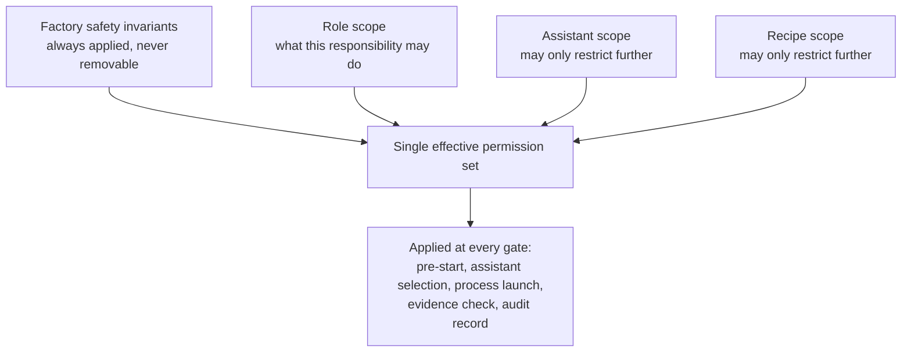
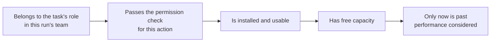

# Business Rules

The standing rules that govern Factory's processes, grouped by what they constrain. Each is
tagged **[Confirmed]**, **[Assumption]** or **[Unresolved]**. Numbers are the application's
own configured or hard-coded values.

Rule IDs are stable so they can be cited from the other documents: `R-xx`.

---

## 1. Governance rules — who holds authority

| ID | Rule | Tag |
| --- | --- | --- |
| **R-01** | **Instructions never grant permission.** What a role is *asked* to do and what it is *permitted* to do are decided by different systems. Where they disagree, permission wins. | [Confirmed] |
| **R-02** | **Deny always wins over allow**, in every dimension — files, commands, environment, external tools. | [Confirmed] |
| **R-03** | **A narrower scope can only narrow.** An assistant's own restriction may reduce what a role allows; it can never widen it. Allow-lists intersect, deny-lists combine. | [Confirmed] |
| **R-04** | **Safety invariants are re-applied last and cannot be configured away.** Factory's own state and the repository's internal Git state are never writable by a task; publish-class Git operations are never permitted to a task; Factory's integration branches stay under the exclusive control of the integration function. | [Confirmed] |
| **R-05** | **A reusable workflow configuration can only restrict.** It may select tighter permission presets and a smaller tool set, never a wider one. | [Confirmed] |
| **R-06** | **Nothing is published without a human confirming the preview.** An assistant can never publish, and no instruction can trigger publication. | [Confirmed] |
| **R-07** | **The main line is never written.** All approved work lands on the run's own branch. | [Confirmed] |
| **R-08** | **Work is accepted only by a review decision.** A process finishing is not acceptance. | [Confirmed] |

---

## 2. Permission rules — what an assistant may touch

### 2.1 How a permission decision is composed

**[Confirmed]** One decision per (role, assistant) pair, built in this fixed order:

The same decision is reused everywhere — execution, validation, the audit record, and the
dashboard's permissions view. The application states that permission logic is never
re-implemented in a second place. **[Confirmed]**

### 2.2 Files

| ID | Rule | Tag |
| --- | --- | --- |
| **R-10** | Paths are expressed relative to the project. A declared file section is **complete**: no write section means *no writes at all*, and no read section means *nothing may be read*. | [Confirmed] |
| **R-11** | A write denial always beats a write allowance, even when the allowance says "everything". | [Confirmed] |
| **R-12** | Paths that cannot be mapped inside the project — absolute paths, drive letters, parent-directory traversal, control characters — are treated as outside every scope, so they can never match. | [Confirmed] |
| **R-13** | Default presets for a new project: Planner, Architect, Researcher, Reviewer and Security Auditor are **read-only**; Worker and Test Engineer may write across the working copy; Documentation Writer may write only the readme and the documentation tree. | [Confirmed] |
| **R-14** | An older project without any permission configuration keeps its previous permissive behaviour and is **visibly flagged** as permissive in the dashboard. Nothing is silently tightened on upgrade. | [Confirmed] |

### 2.3 Commands

| ID | Rule | Tag |
| --- | --- | --- |
| **R-15** | Three command stances exist: unrestricted, restricted, denied. | [Confirmed] |
| **R-16** | Matching compares only the **executable name** — the first word, case-insensitive. So "commit with a message" is matched as "git". | [Confirmed] |
| **R-17** | Dangerous Git sub-commands (push, reset, remote, branch deletion) are denied **even when Git itself is allowed**. | [Confirmed] |
| **R-18** | Commands are checked against what the assistant **reports** it ran. The application is explicit that it is not a shell parser and cannot intercept everything an assistant's own child processes execute. | [Confirmed] |

### 2.4 Environment and secrets

| ID | Rule | Tag |
| --- | --- | --- |
| **R-20** | When a rule filters variables, the launched process is given **exactly** the computed set instead of inheriting the operator's whole environment. | [Confirmed] |
| **R-21** | Denied variable values are treated as secrets and are **redacted** from everything captured — the live stream, the stored record, and the audit. Redaction is streaming, so a secret split across two writes is still caught. | [Confirmed] |
| **R-22** | Redaction covers secrets Factory knows about: denied and configured environment values, and external-tool grant tokens. It does not detect arbitrary secrets and does not decode encoded ones. | [Confirmed] |

### 2.5 Network

| ID | Rule | Tag |
| --- | --- | --- |
| **R-23** | Network permission is **advisory on every platform**. "Denied" means the boundary is stated to the assistant, recorded in the audit, and shown to the operator — never isolation. The permission view labels it advisory. | [Confirmed] |

### 2.6 External tools

| ID | Rule | Tag |
| --- | --- | --- |
| **R-30** | External tool access is **denied by default**. Configuring a server grants nothing. | [Confirmed] |
| **R-31** | A role must explicitly allow a tool. An assistant's rule and the recipe's selection can only narrow that allow. Every denial wins. | [Confirmed] |
| **R-32** | Every discovered tool carries one classification — read, write, destructive, or unknown. **Write, destructive and unknown tools require an exact named allow**; a broad wildcard is not sufficient. | [Confirmed] |
| **R-33** | A server's own descriptions, annotations, schemas and results never participate in an authorisation decision. They are untrusted hints. | [Confirmed] |
| **R-34** | Access is granted through a hashed, **expiring** credential bound to one specific run, task, attempt and session; it is revoked when the session ends and cannot reach any tool outside the catalogue built for that task. | [Confirmed] |
| **R-35** | Tool results come back enclosed in explicit **untrusted external data** markers and are never treated as project truth, an approved working copy, or Git evidence. | [Confirmed] |
| **R-36** | Server secrets are configured only as whole environment references; plaintext values are rejected. | [Confirmed] |

---

## 3. Planning rules

| ID | Rule | Tag |
| --- | --- | --- |
| **R-40** | A plan must be **proportional to the objective**. The Planner is explicitly told not to use every available role: a small fix needs only an implementation task. | [Confirmed] |
| **R-41** | Specialist tasks are **never created just because the role exists**. Configuring a Security Auditor adds no review step until a plan selects one. | [Confirmed] |
| **R-42** | A plan may only use roles that the workflow's team actually contains. Referencing a role outside the team is **rejected** and the Planner is asked to repair it. | [Confirmed] |
| **R-43** | A task's action type must be compatible with its role's class. An incompatible pairing is **rejected and repaired**, never silently reinterpreted. | [Confirmed] |
| **R-44** | When a plan omits an action type, a compatible default is derived from the role's class — verify for Test Engineer, advisory for Researcher and Architect, review for Security Auditor, post-processing for Documentation Writer, otherwise "make the change". | [Confirmed] |
| **R-45** | A task with no role at all defaults to Worker making a change. An **unknown** role is never quietly mapped to Worker. | [Confirmed] |
| **R-46** | Exactly one Planner per workflow. Several planners may be configured globally, but the application runs no planner ensembles and merges no plans. | [Confirmed] |
| **R-47** | Plan edits and partial replans are stored as **durable revisions**; completed tasks are never silently rewritten. Current user instructions outrank generic recipe guidance. | [Confirmed] |
| **R-48** | Plan repair attempts are bounded by a **separate budget of three attempts**, distinct from the three attempts each task gets. | [Confirmed] |
| **R-49** | **A plan may contain at most 50 tasks.** A larger plan is refused outright rather than truncated. | [Confirmed] |
| **R-49b** | **Each task gets at most three attempts.** A manual retry is refused once the third attempt is the latest. | [Confirmed] |

---

## 4. Execution rules

| ID | Rule | Tag |
| --- | --- | --- |
| **R-50** | **Nothing touches the repository until Start.** Planning changes no files. | [Confirmed] |
| **R-51** | Start re-validates everything from scratch: team completeness, the repository, the plan's shape, the presence of tasks, and every task's permissions. A task that could not legally run blocks the run **before any assistant process starts**. | [Confirmed] |
| **R-52** | Each task gets its own working copy on its own branch. | [Confirmed] |
| **R-53** | Tasks within one run run **one at a time**, in dependency order. Multiple selected workers widen the pool of who may be chosen; they do not run tasks concurrently. **Verified in code**: the scheduler takes exactly one ready task per step, and the documented per-run task-width setting is never consulted. | [Confirmed] |
| **R-54** | A downstream task receives artefacts only from its **direct** dependencies. Research for task A is never shown to task B. Nothing receives the whole history. | [Confirmed] |
| **R-55** | Context is bounded. Individual artefacts are capped and oversized context is truncated **with a visible marker**, never silently dropped. | [Confirmed] |
| **R-56** | Advisory and review tasks **succeed with zero file changes** — that is the expected outcome, not a failure. | [Confirmed] |
| **R-57** | A specialised review that requests changes causes the **implementation task it evaluated to be re-run** as a new attempt, with the review waiting on it. Both stay inside the attempt limit, so rework cannot loop forever. The plan itself stays acyclic. | [Confirmed] |
| **R-58** | A review decision of "request changes" **with no findings is invalid and rejected**. Severity levels are simply low, medium, high, critical — there is no automated scoring scheme. | [Confirmed] |
| **R-59** | Verification reports exactly what was run and what actually passed. Coverage figures are not invented. | [Confirmed] |
| **R-60** | Closing the browser does not stop work — the local process owns execution. **Restarting** the application does, and in-flight work is not resumed. | [Confirmed] |
| **R-61** | Cancelling stops scheduling and terminates the running assistant's process tree, but **preserves** the working copy and all recorded evidence. | [Confirmed] |

---

## 5. Rules for choosing who does the work

**[Confirmed]** Selection is deterministic, local and explainable. There is no model in the
selection path and no randomness — the same inputs always produce the same choice.

**Eligibility is always decided before merit**, in this fixed order:

Performance can rank the survivors; it can never bring back someone who failed an earlier
gate. **[Confirmed]**

**[Confirmed]** One qualification to the capacity gate, which matters to anyone relying on it
as a load limit: an assistant's concurrency ceiling is **enforced only in performance mode**.
In the default round-robin mode the same figure is *measured* rather than enforced, so the
default mode can place more concurrent work on one assistant than its stated ceiling. Treat the
ceiling as a guarantee only if the project has opted into performance routing.

| ID | Rule | Tag |
| --- | --- | --- |
| **R-70** | The **default** is capacity-aware round-robin: the least-loaded pool member, rotating. Existing projects keep it until they opt in. | [Confirmed] |
| **R-71** | Performance-based selection is **opt-in** and scores quality 55 %, rework avoidance 20 %, speed 10 %, free capacity 15 %, plus a 0.02 preferred bonus, minus 0.05 if that assistant already failed on this task. Quality outweighs speed five and a half to one. | [Confirmed] |
| **R-72** | **Thin evidence never drives a choice.** Quality uses the conservative lower bound of a 95 % confidence interval and rework the upper bound; a rate counts as reliable only from **10 samples** upward. If no candidate has a reliable record, nothing is ranked and the fallback is ordinary round-robin — and the decision record says so. | [Confirmed] |
| **R-73** | Evidence is read from the most specific reliable slice down: assistant + role + action + language, then without the language, then role, then overall. A tiny highly-specific sample never masks a large reliable broader one. | [Confirmed] |
| **R-74** | Cold start is bounded: with exploration on, **every 5th** assignment goes to the least-observed eligible candidate — but only when at least one other candidate is already reliably ranked. | [Confirmed] |
| **R-75** | An operator's manual pin to a named assistant is honoured in every mode, is validated against the role's assignments, and is re-checked at start. A pin that fails a permission or availability gate **blocks the task with a clear error** rather than quietly choosing someone else. A pin does not apply to the built-in final review. | [Confirmed] |
| **R-76** | Retries may go to a different assistant; each attempt is routed independently. Retry history is never reset. | [Confirmed] |
| **R-77** | One compact, explainable routing record is kept for every assignment, naming the candidates, their scores, where each score came from, and why the choice was made. | [Confirmed] |
| **R-78** | One recent bad run does not flip the choice: all-time reliable data is used, so a single failure barely moves the confidence bound, and an assistant is never automatically disabled. | [Confirmed] |

---

## 6. Measurement rules

**[Confirmed]** Measurement reads the immutable history and never influences anything by
itself.

| ID | Rule | Tag |
| --- | --- | --- |
| **R-80** | A task is attributed to the assistant that did its **first** attempt. Being rescued by a better assistant on retry counts as eventual success, not first-pass success, for the original. | [Confirmed] |
| **R-81** | If **any** attempt was approved, the task counts as eventually approved, whatever failed before it. | [Confirmed] |
| **R-82** | **First-pass approval is deliberately distinct from eventual approval.** An assistant that needed three attempts must not look like one that succeeded immediately. | [Confirmed] |
| **R-83** | Outcomes the assistant is not responsible for are **excluded** from quality rates: operator cancellation, restart interruption, permission rejection, and configuration errors. Integration conflicts are excluded too and reported separately. | [Confirmed] |
| **R-84** | Every rate carries its sample count and a 95 % confidence interval. Below 10 samples the interface shows "insufficient data" instead of a percentage. | [Confirmed] |
| **R-85** | **No single opaque "agent score" exists**, and none may be introduced without being deterministic, documented, component-exposed and confidence-carrying. | [Confirmed] |
| **R-86** | No model grades another model's output. No cost or token figures are invented when the underlying tool does not report them. | [Confirmed] |
| **R-87** | External-tool problems are counted as infrastructure and **never** lower an assistant's quality score. | [Confirmed] |
| **R-88** | Nothing is sent anywhere. All measurement is derived from the project's own local history; there is no telemetry and no cross-project ranking. | [Confirmed] |

---

## 7. Publication rules

| ID | Rule | Tag |
| --- | --- | --- |
| **R-90** | Publication requires all of: the run is **completed**, no unresolved integration conflict, a valid branch with a known head, the recorded integration head still equal to the local branch head, and the target base branch still present on the remote. **Partially approved or conflicted work is never delivered.** | [Confirmed] |
| **R-91** | Branch drift blocks publishing. If the local branch no longer matches what was recorded, publication is refused rather than an unexpected state being pushed. | [Confirmed] |
| **R-92** | Only the run's own branch may be pushed — never forcibly, never a branch a person named. | [Confirmed] |
| **R-93** | The pull request description is generated from **recorded evidence**: objective as summary, task list as changes, the commands accepted attempts actually reported as verification, recorded review decisions as reviews. Absent evidence is stated as absent; tests and reviews are never fabricated. | [Confirmed] |
| **R-94** | If the work came from a work item, the description closes it. Otherwise that line is omitted. | [Confirmed] |
| **R-95** | Publication is claimed atomically — exactly one request can win; the others are refused. The claim is recorded **before** any external effect. | [Confirmed] |
| **R-96** | Once publication has started, closing the tab or timing out does not cancel it. | [Confirmed] |
| **R-97** | If a pull request already exists for the branch, it is **linked**, not duplicated. | [Confirmed] |
| **R-98** | **An unknown outcome is never blindly retried.** A failed or timed-out command does not prove the remote action did not happen, so the attempt is recorded as *interrupted, reconciliation required*, and no further attempt may start until a read-only check confirms what actually exists remotely. If the remote cannot be reached, the outcome stays explicitly unconfirmed rather than being guessed as a failure. | [Confirmed] |
| **R-99** | Nothing is published at startup. Deliveries left mid-flight by a previous process are demoted to the interrupted state. | [Confirmed] |

---

## 8. Configuration-integrity rules

| ID | Rule | Tag |
| --- | --- | --- |
| **R-100** | Configuration edits are one coordinated load–check–change–validate–write operation, serialised per project, so concurrent edits cannot silently drop each other. | [Confirmed] |
| **R-101** | Replacing the whole configuration requires presenting the revision it was built from; a stale revision is refused with a "reload and reapply" answer rather than overwriting. | [Confirmed] |
| **R-102** | Configuration and layout files are written atomically through a temporary file, so a failed write never leaves a half-written file. | [Confirmed] |
| **R-103** | A run stores an **immutable snapshot** of its team and of any reusable configuration it was created from. Later edits or deletions never rewrite what a running or historical run used. | [Confirmed] |
| **R-104** | A role in use by an active workflow **cannot be deleted**. Renaming a role's display name is safe; changing its internal identifier orphans history. | [Confirmed] |
| **R-105** | An assignment referring to an unknown role or assistant is rejected on save. | [Confirmed] |
| **R-106** | Reusable configurations are validated before anything is written, so an invalid one never lands on disk. Identifiers are immutable after creation; names are capped at 80 characters and Planner guidance at 4,000 characters; concurrency preference is bounded 1–32. | [Confirmed] |
| **R-107** | Saving a run as a reusable configuration captures **configuration only** — never its tasks, dependencies, attempts, sessions, artefacts or Git state. | [Confirmed] |

---

## 9. Trust rules about outside content

| ID | Rule | Tag |
| --- | --- | --- |
| **R-110** | Imported work-item text is **untrusted data**: requirements and context, never instructions. It cannot change permissions, roles, policies, repository boundaries or output contracts. Every mission carrying it states an explicit notice to that effect. | [Confirmed] |
| **R-111** | Prompt injection inside an imported work item "may at worst confuse an agent about the work; it never widens what the agent is allowed to do." | [Confirmed] |
| **R-112** | Work items are imported in bounded form: number, title, body, labels, state, link, author and **at most 10** comments, each truncated. A work item from a different repository than the project's remote is rejected. | [Confirmed] |
| **R-113** | The project's repository identity is resolved only from the project's own remote configuration — never guessed from a folder name. | [Confirmed] |
| **R-114** | Repository context given to an assistant is bounded and read-only: it never executes project code, never follows links out of the project, honours the project's own ignore rules, and caps every read and every rendered output. | [Confirmed] |
| **R-115** | The dashboard's local interface is browser-boundary protection, **not user authentication**. Anyone with access to the machine is a trusted operator. | [Confirmed] |

---

## 10. Assumptions and open points

**[Assumption]** R-13's defaults are the shipped presets for a newly initialised project; a
team may rebind any role to any preset, so the defaults describe the starting position, not
a constraint.

**[Assumption]** The rules above are read as standing rules of the product rather than
per-project preferences wherever the application offers a choice. Where a choice exists —
routing mode, presets, tool allowances — the rule states the default and notes that it is
opt-in.

**[Unresolved]**

1. **Total effort is only partly bounded.** A plan is capped at 50 tasks and each task at three
   attempts, so the worst case is bounded in *steps* — but nothing bounds wall-clock time or
   spend, and 50 tasks across three attempts is still a very large job. Separately, the
   per-run task-width setting that a reader would expect to bound concurrency **is not read by
   the scheduler at all** (`EXCEPTIONS_AND_EDGE_CASES.md` §15, D1). See
   `BUSINESS_OVERVIEW.md` §9.3.
2. **No rule requires a human to review the review.** The reviewer role is the acceptance
   authority for implementation work; no rule requires a person to confirm it before
   integration. The human checkpoint sits at publication, which is downstream.
3. **No rule governs concurrent runs on the same repository.** Multiple runs may execute
   concurrently and each has its own branch, but no rule is stated about two runs editing the
   same files, beyond the conflict handling that integration exposes.
4. **No rule addresses retention.** Run history, evidence and session output accumulate in
   the project's local store; no retention, archival or deletion policy is described.

---

## Evidence

- `docs/policies.md` — precedence, deny-wins, the invariant set, file/command/environment/
  network/Git rules, presets, permissive-upgrade flagging, enforcement boundary.
- `docs/security.md` — advisory network status, streaming redaction, local trust boundary,
  role instructions as prompt-not-authorisation.
- `docs/mcp.md` — default-deny, classification and exact-allow rule, scoped expiring grants,
  untrusted result markers, environment-reference rule.
- `docs/roles.md` — proportionality, role/operation compatibility and plan repair, derived
  defaults, artefact flow along direct dependencies, request-changes rework, invalid empty
  findings, single planner, role deletion guard.
- `docs/architecture.md` — start validation, sequential execution, worktree isolation,
  durable plan revisions, cancellation, restart reconciliation, bounded context and output.
- `docs/routing.md` — eligibility order, score weights, reliability floor, exploration
  interval, manual-pin semantics, routing decision records.
- `docs/evaluations.md` — attribution, exclusions, confidence intervals, first-pass versus
  eventual, no opaque score, tool failures excluded from quality.
- `docs/github.md` — delivery eligibility, branch drift, atomic claim, untrusted work-item
  content, bounded import, reconciliation of uncertain outcomes.
- `docs/recipes.md` — narrowing-only presets, validation bounds, immutable snapshots,
  save-as-recipe scope.
- `docs/api.md` — configuration concurrency control and revision preconditions.
