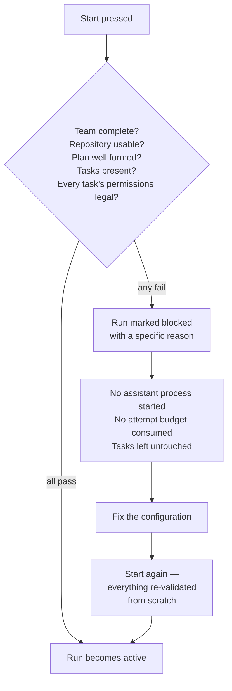

# Exceptions and Edge Cases

What happens when something fails or is unusual, how the person is told, and what the
consequences are for the work already done. Rule identifiers refer to `BUSINESS_RULES.md`.

Tagging: **[Confirmed]** / **[Assumption]** / **[Unresolved]**.

---

## 1. The exception-handling philosophy

Four principles run through every exception below, and they are worth stating before the
catalogue because they explain the shape of everything else. **[Confirmed]**

1. **Distinguish the assistant's fault from everyone else's.** A permission rejection, a
   cancellation, a restart, a misconfiguration and an integration conflict are all *not*
   charged to the assistant — neither as a consumed retry nor as a quality mark.
2. **Fail before acting, not after.** Where the application can tell in advance that
   something cannot legally happen, it stops before any process starts.
3. **Never guess an outcome.** Where the truth is unknown — most importantly after a
   half-finished publication — the state is recorded as *unknown, needs reconciliation* and
   the system refuses to act again until it is resolved.
4. **Preserve the evidence.** Working copies, output and evidence are kept rather than
   deleted, even on cancellation and even when the work is discarded.

The application's own summary of its posture: it is "a disciplined orchestrator with hard
gates where it controls the boundary, not a sandbox". **[Confirmed]**

---

## 2. Setup and configuration exceptions

| Situation | What happens | What the person sees | Tag |
| --- | --- | --- | --- |
| A role has no assistant assigned | Refused at start. | "No agent is assigned to the X role. Configure one from the dashboard." | [Confirmed] |
| A team names an assistant not assigned to that role | Refused at creation or team edit. | "agent 'x' is not assigned to the 'worker' role" — assign it first, or pick another. | [Confirmed] |
| An assignment refers to an unknown role or assistant | Rejected on save. | The save fails. | [Confirmed] |
| A custom role is in use by an active workflow | Deletion refused. | "role 'x' is used by an active workflow and cannot be deleted" — finish or delete the workflow first. | [Confirmed] |
| A custom role's internal identifier is changed after use | Allowed, but **orphans historical references**. | Renaming the display name is safe; changing the identifier is not. Documented as a caution. | [Confirmed] |
| The project has no usable repository | Start refuses. | A diagnostic naming the problem; assistant availability is checked before any task starts. | [Confirmed] |
| An assistant's program cannot be found | Start refuses, before any task begins. | The executable-not-found message. Recorded later as a **configuration error**, excluded from quality measurement. | [Confirmed] |
| An older project's configuration is loaded | Rewritten once into the current form, with the previous file kept as a backup. | A note that the configuration was rewritten and a backup file appeared; the new file is equivalent. | [Confirmed] |
| Two people edit configuration at once | Serialised; a whole-document save must present the revision it came from. | A "reload and reapply" refusal rather than a lost change. | [Confirmed] |
| A configuration save fails partway | Never leaves a half-written file — writes go through a temporary file and are moved into place. | Nothing visible; the previous file is intact. | [Confirmed] |

**[Unresolved]** Changing a role's identifier mid-project is permitted and quietly damages
history. The material flags the caution but describes no guard or warning at the moment of
change.

---

## 3. Planning exceptions

| Situation | What happens | Tag |
| --- | --- | --- |
| The plan uses a role the team does not contain | **Rejected; the Planner is asked to repair it.** Bounded by the ordinary attempt limit. | [Confirmed] |
| An action type does not fit the role's class | **Rejected and repaired** — never silently reinterpreted. | [Confirmed] |
| The plan omits an action type | A compatible default is derived from the role's class. | [Confirmed] |
| The plan omits a role | Defaults to Worker making a change. An *unknown* role is never quietly mapped to Worker. | [Confirmed] |
| The plan is structurally invalid | Validated before being written; a valid plan is stored atomically as tasks and dependencies, so no partial plan lands. | [Confirmed] |
| Planning attempts are exhausted | The run ends in the failed state. | [Confirmed] |
| The plan is empty | Start refuses: planned tasks must be present. | [Confirmed] |
| Structured output from an assistant is too large | **Rejected before parsing** rather than parsed from a partial document. | [Confirmed] |
| A reusable pattern requires a role nobody is assigned to | Workflow creation fails with a clear error. Roles are **never** silently substituted. | [Confirmed] |

The application states the reason for the repair loop explicitly: rejecting an
incompatible plan is "intentional — Factory does not silently reinterpret role semantics".
**[Confirmed]**

**[Unresolved]** There is no stated ceiling on plan size, so a plan could in principle be very
large. See `BUSINESS_RULES.md` §10.

---

## 4. Start-time exceptions — the blocked path

This is the most heavily protected exception path in the design. **[Confirmed]**

The reason is specific enough to act on. The application's own example message: *"Documentation
Writer cannot perform operation 'implement': no writable filesystem scope (allowed writes:
README.md, docs/**)"*. **[Confirmed]**

**[Confirmed]** A manual pin to a named assistant that fails a permission or availability gate
**blocks the task with a clear error** rather than quietly substituting someone else. Silent
substitution is explicitly ruled out.

**[Confirmed]** A run can also become blocked mid-flight on a policy or dependency problem.
The same rule applies: budget preserved, tasks preserved.

**[Confirmed, verified in code]** Start performs eight checks, and **only one of them produces
the blocked state**. The full list, because the distinction decides whether a person gets a
recoverable *blocked* run or a plain refusal:

| Start-time check | Result when it fails |
| --- | --- |
| The plan has at least one task | Plain refusal; run state unchanged |
| The dependency graph has no cycle | Plain refusal |
| The team resolves (with a default team backfilled if none was chosen) | Plain refusal |
| Every task's role has at least one assigned assistant in this team | Plain refusal |
| Any manual pin names an assistant that is in the team and permission-eligible | Plain refusal |
| Every role/assistant pair yields a usable command | Plain refusal |
| **Every task's effective permissions permit its action** | **Run marked blocked**, no retries consumed |
| The repository is usable and bounded | Plain refusal |

A start may be attempted from *planned* or from *blocked*, and everything is re-validated each
time.

---

## 5. Integration conflicts

| Situation | Handling | Tag |
| --- | --- | --- |
| The base had moved but the change re-applies cleanly | Recorded as **rebased** and the run continues. Reported as the stale-base signal. | [Confirmed] |
| The change cannot be re-applied | Recorded as **conflict** and **the whole run fails**. | [Confirmed, verified in code] |
| Is the task marked as conflicted? | **No such state exists.** There is no per-task "conflicted" status; the conflict surfaces as a run-level failure. | [Confirmed, verified in code] |
| Who is blamed | **Nobody.** "Conflicts are never counted as agent failures" — a conflict usually reflects concurrent work, and is reported as its own metric. | [Confirmed] |
| Can conflicted work be published? | **No.** Partially approved or conflicted work is never delivered. | [Confirmed] |
| How is the conflict resolved? | Not inside Factory. The documented remedy for a diverged branch is to re-run or rebase manually and retry. | [Confirmed] |

**[Confirmed, verified in code]** Integration is not a separate queued stage. It happens
**inline, immediately after the reviewer approves**, by committing any uncommitted work in the
task's working copy and then advancing the run branch to that working copy's head; if the run
branch is no longer an ancestor, the working copy is rebased onto it first. A rebase conflict
records the conflict and aborts the task, which fails the run. Tasks are integrated strictly one
at a time, in dependency order.

**[Unresolved]** There is no in-tool conflict resolution: no merge assistance, no interface for
choosing a side, no retry of just the integration step. A conflict ends the run and pushes the
problem to a person working outside Factory. Raised as an operating question in
`BUSINESS_OVERVIEW.md` §9 and `BUSINESS_PROCESSES.md` §4. **[Unresolved]**

**[Unresolved]** No rule is stated about two concurrent runs editing the same files. Each run
has its own branch and each task its own working copy, but nothing describes prevention — only
the conflict record that results.

---

## 6. Interruption: restart, cancellation and resume

| Situation | Handling | Tag |
| --- | --- | --- |
| Browser closed or reloaded | **Nothing happens to the work.** The local process owns execution. | [Confirmed] |
| Factory restarted while work was live | Live sessions and attempts marked **interrupted**; running tasks marked **failed**; active and planning runs marked **failed**. The interface can then expose the failure and an eligible retry. | [Confirmed] |
| Do interrupted attempts penalise the assistant? | No — interrupted is excluded from quality denominators. | [Confirmed] |
| Publication left mid-flight by a restart | Demoted to **interrupted**. **Nothing is pushed or created at startup.** | [Confirmed] |
| Operator cancels | A run-scoped stop signal is set, the run is marked **cancelled** immediately, the running assistant's process tree is terminated where possible, and the working copy, output and evidence are **preserved**. | [Confirmed] |
| What happens to the task that was running when cancel hit? | Its **attempt** is recorded as *cancelled* — and the **task** itself is marked **failed**. Only the run carries the cancelled state. | [Confirmed, verified in code] |
| Cancel an interactive console | The session stops; the retained history window is what a reconnect can see. | [Confirmed] |
| A stale publication attempt resurfaces after a crash | It can never overwrite a newer outcome, because every state change is guarded by the operation identifier. | [Confirmed] |

**[Confirmed, verified in code]** The exact effect of a restart on stored state — every one of
these is rewritten before anything else runs: outstanding external-tool credentials revoked;
tool calls still marked running set to *cancelled*; per-server concurrency reservations deleted;
live assistant sessions set to *interrupted*; attempts still running or under review set to
*interrupted*; running tasks set to *failed*; active and planning runs set to *failed*;
in-flight publications demoted to *interrupted*.

**[Unresolved]** Work survives closing a browser but not restarting the application, and the
material does not say whether a failed or cancelled run resumes from where it stopped or must
be driven task by task. Given that a restart marks running tasks failed and offers an
*eligible retry*, per-task retry is the likely shape — inference, not documented behaviour.
Flagged in `WORKFLOWS.md` §8 and `STATES_AND_TRANSITIONS.md` §10.

---

## 7. Governance exceptions

### 7.1 A task works outside its permission

**[Confirmed]** Two gates:

- **Before the attempt** — a task whose action needs writes the role does not have blocks the
  run rather than starting (R-51). This is the gate the documentation emphasises, and it is the
  favourable one: the run is marked *blocked*, the reason is specific, tasks are untouched, and
  **no attempt budget is consumed**.
- **After the attempt** — the recorded evidence (changed files, reported commands) is checked
  against the same decision; a violation is recorded as a failed attempt carrying a
  "blocked by policy" error, and that error text is what excludes it from the assistant's
  quality figures.

**[Confirmed, verified in code]** The second gate is **harsher than the documentation implies**.
The reference documentation says a violation "fails the attempt ... without consuming the
normal retry budget", which is true as far as the attempt goes — but in the implementation the
violation marks the **task failed** and aborts the task, which fails the **whole run**. It is
not a retry-with-corrected-configuration path like the pre-start gate. An organisation whose
permission presets are loose enough that violations actually occur should expect the run, not
just the attempt, to stop.

The practical rule that follows: **fix permissions before pressing Start**, because a permission
problem caught at the pre-start gate costs nothing and a permission problem caught after work
has been done costs the run.

### 7.2 What the permission system does *not* catch

**[Confirmed]** The application documents these as limitations rather than leaving them to be
discovered:

| Not caught | Why, in the application's own words |
| --- | --- |
| Individual file actions inside an assistant's own process | Agents run with the operator's operating-system permissions; "worktrees isolate work, they are not sandboxes". |
| Network use | Advisory on every platform. A denial is stated and recorded, never enforced. |
| Commands an assistant runs but does not report | Factory "is not a shell parser and does not intercept process trees". |
| Any operating-system virtualisation | Containers, virtual machines, and platform isolation features are out of scope for this milestone. |
| Secrets it does not know about | Redaction covers denied and configured environment values and tool grant tokens; it does not detect arbitrary secrets and does not decode encoded ones. |
| A secret longer than a megabyte split across writes | Matched within single chunks and in final whole-text redaction, but the cross-write streaming match is not guaranteed. |

### 7.3 Widening a permission needs no second person

**[Confirmed]** Permission changes take effect immediately for whoever is at the dashboard,
and access to the dashboard is explicitly equivalent to access to the project's assistant
configuration. There is no approval step, no second signature, and no separation between the
person who widens a permission and the person who benefits from it.

**[Unresolved]** For an organisation with segregation-of-duties requirements this is a gap
that must be closed by process outside the tool. The material does not address it.

### 7.4 An interactive session has no review gate

**[Confirmed]** Automated work passes through a reviewer before acceptance. An interactive
console session does not — it is a supervised terminal to an assistant, outside any run.

**[Assumption]** Changes made there therefore reach the repository without Factory's
acceptance process, and will not appear in the run's evidence or in performance measurement.
**[Unresolved]** — the material does not discuss this asymmetry or how teams should control it.

### 7.5 Untrusted content tries to steer the work

**[Confirmed]** Content from an imported work item or an external tool is data, never
instruction. It cannot change roles, permissions, policies, repository boundaries or output
contracts, and every mission carrying it says so explicitly. The application's assessment:
injection "may at worst confuse an agent about the *work*; it never widens what the agent is
*allowed* to do".

**[Unresolved]** The consequence of that residual risk is unexamined: an agent confused about
the work can still produce a bad change that then passes review. The controls bound
*authority*, not *judgement*.

---

## 8. Publication exceptions

| Situation | Handling | Tag |
| --- | --- | --- |
| The run is not complete | Publication not offered. | [Confirmed] |
| Unresolved integration conflict | Blocked. | [Confirmed] |
| The branch's recorded head no longer matches the local branch | **Branch drift** — publishing is blocked rather than pushing an unexpected state. | [Confirmed] |
| The target base branch no longer exists remotely | Blocked, with the reason. | [Confirmed] |
| Two people request publication at once | One atomic claim wins; the others get a conflict response. | [Confirmed] |
| The same request arrives again after publication | Answers with the existing pull request and creates nothing. | [Confirmed] |
| A pull request already exists for the branch | **Linked, not duplicated.** Not treated as an error. | [Confirmed] |
| The command-line tool is missing or unauthenticated | The exact next step is shown ("install gh", "run gh auth login") instead of a generic failure. | [Confirmed] |
| The account lacks repository access | Permission-denied, with a pointer to check the authentication status. | [Confirmed] |
| The remote branch diverged | Push refused. Factory **refuses to force-push**; re-run or rebase manually and retry. | [Confirmed] |
| Offline | Network unavailable; retry when connected. | [Confirmed] |
| The description is larger than the platform's own cap | Rejected with an actionable error **before anything is published**. | [Confirmed] |
| A command hits its deadline | Runs under a bounded supervisor with a per-operation deadline, output limits and process-tree termination; output that exceeds its limit is an explicit error, never parsed as if complete. | [Confirmed] |
| The command was pushed or created but the answer was lost | Recorded as **interrupted, reconciliation required** — never as failed. No retry until a read-only check resolves it. If the remote cannot be reached, the outcome stays explicitly **unconfirmed** rather than being guessed as a failure. | [Confirmed] |
| Missing credentials during a Git operation | Configured to fail rather than wait for terminal input; credential helpers and keyring flows still work. | [Confirmed] |

**[Confirmed]** The application is explicit about the limit of its own guarantee: a local
database alone cannot guarantee exactly-once publication when the remote may succeed before the
result is stored. What it guarantees instead is *practical idempotency* — one operation per run
at a time, existing pull requests linked rather than duplicated, unknown outcomes never retried
blindly, and stale attempts unable to corrupt newer state.

---

## 9. External tool exceptions

| Situation | Handling | Tag |
| --- | --- | --- |
| The server is unreachable | Recorded as server-unavailable. Use the connection test. One server's outage affects its own tools, not the run. | [Confirmed] |
| A tool is refused | Recorded as permission-denied. The fix is an explicit role allow, naming the exact tool for anything risky. | [Confirmed] |
| A tool the assistant expected is not offered | Expected behaviour: catalogues are deliberately bounded. Check permission, pattern selection, action type and objective relevance. | [Confirmed] |
| The server advertises a broken schema | Refused — malformed schemas and inputs that do not validate are rejected. | [Confirmed] |
| The result is too large | Refused. Raising the limit is possible only up to a one-megabyte ceiling, and only after reviewing the exposure. | [Confirmed] |
| The call timed out | Recorded as timeout. An optional tool failing does not by itself stop the run. | [Confirmed] |
| The call was cancelled | Teardown releases the server slot and marks the still-running audit record cancelled. Cancellation is terminal and auditable. | [Confirmed] |
| The server is malicious | It can return false data, consume resources up to a configured limit, or do whatever its own credentials allow once an authorised tool is called. Factory bounds the output and stops the response text becoming policy, but "cannot make a malicious external service truthful". | [Confirmed] |
| A tool's own classification is wrong | The owner may override it — flagged as a security decision to revisit whenever the server changes. | [Confirmed] |

**[Confirmed]** Tool failures are counted as **infrastructure**, separately from assistant
quality: "MCP usage is not a quality signal, and infrastructure outages do not lower an agent's
evaluation."

---

## 10. Assistant exceptions

| Situation | Handling | Tag |
| --- | --- | --- |
| The assistant's process fails | Attempt fails; retries rotate to the next eligible assistant; bounded by the attempt limit. | [Confirmed] |
| Output is enormous | Each stream is retained in full up to a one-megabyte limit, then as a head and a tail, with the omitted middle **counted** rather than silently dropped. | [Confirmed] |
| Structured output exceeds the limit | Rejected before parsing rather than parsed from a partial document. | [Confirmed] |
| The assistant's own child processes misbehave | Outside Factory's interception; the assistant retains the operator's permissions. | [Confirmed] |
| The assistant lacks a capability the role implies | Giving a role does not add a capability. "If the underlying CLI cannot do something — for example unrestricted web research — giving it a role does not add that capability." | [Confirmed] |
| An assistant is saturated | Skipped by the capacity reservation; the next-best eligible candidate is taken. If every ranked candidate is full, the selector falls back to capacity-aware selection rather than queueing forever. **Caveat:** this reservation-based ceiling applies in **performance mode**; in the default round-robin mode the concurrency figure is measured, not enforced. | [Confirmed] |
| Nobody is available | Assistant availability is checked before any task starts, preserving fail-fast behaviour. | [Confirmed] |

---

## 11. Measurement and selection exceptions

| Situation | Handling | Tag |
| --- | --- | --- |
| Too little history to compare assistants | **Nothing is ranked.** The application refuses to compare two attempts against one; it falls back to ordinary capacity-aware round-robin and says so in the decision record. | [Confirmed] |
| A rate is computed anyway | It carries its sample count and a confidence interval; below ten samples the interface shows "insufficient data" instead of a percentage. Two samples never produce a ranking-ready number. | [Confirmed] |
| A tiny but highly specific record competes with a large reliable broader one | The broader, reliable slice wins. The selector walks down from specific to general until it finds a reliable slice. | [Confirmed] |
| One recent bad run | Barely moves the confidence bound; the selector does not flip every task after a single bad run, and an assistant is never automatically disabled. | [Confirmed] |
| Old attempts without timing | Fall back to wall-clock time, counted in a disclosed "approximate samples" figure so the interface can label the approximation. | [Confirmed] |
| History grows very large | Measurement reads a lean projection rather than the full evidence, so cost is independent of evidence size; it is still linear in the number of attempts, and a caching layer is named as the future remedy if histories grow further. | [Confirmed] |
| Very large terminal output volume | A viewer that cannot keep up is disconnected rather than allowed to stall the assistant; a ninth concurrent viewer is refused outright. The assistant keeps running. | [Confirmed] |

---

## 12. Boundary and resource exceptions

**[Confirmed]** Every bound below is a hard cap the application imposes on itself, and each
one is designed to fail explicitly rather than silently.

| Boundary | Behaviour when hit |
| --- | --- |
| **Plan size** | **At most 50 tasks per plan.** A larger plan is refused outright with "plan exceeds the maximum of 50 tasks", and that refusal counts against the Planner's three repair attempts. |
| **Attempts** | **Three per task**, and a separate three for planning repair. A manual retry beyond the third is refused. |
| **Context handed to a task from its dependencies** | Capped at 32,000 characters. |
| **A specialist review's change summary** | Capped at 60,000 characters — and the same cap bounds the stored change patch. |
| **A producer's own report shown downstream** | Capped at 20,000 characters. |
| **A single stored artefact** | Capped at 12,000 characters. |
| **Role definition text** | Instructions capped at 16,384 characters; display name at 80. |
| **Project context reads** | Capped per file; an oversized file keeps a metadata-only entry rather than a truncated body being treated as complete. |
| Rendered context | Capped, and truncated with a visible marker rather than dropped. |
| Repository context search | A budget-limited result is explicitly *partial*, not a global ranking. The conservative fallback discards an unproven directory rather than choosing an arbitrary slice of it. |
| Links and escapes out of the project | Rejected at every stage — traversal, intermediate links, and case-aliasing attempts. |
| A specialist review's change summary | Bounded in size, and the review works in its own working copy rather than sharing the implementation's. |
| Imported work-item content | Bounded at import — at most ten comments, each truncated. |
| Reusable-pattern text | Name capped at 80 characters; Planner guidance at 4,000; concurrency preference bounded 1–32. |
| External tool input | One non-empty document up to one megabyte; reading stops as soon as the limit is exceeded so an unbounded producer cannot force unbounded buffering. Error messages never echo the submitted content. |
| External tool output | Bounded while being read, not only after parsing. |
| Session output | One megabyte per stream, then head and tail with the middle counted as dropped. |
| Interactive terminal history | About one megabyte retained; older output is not recoverable. |
| Concurrent external calls per server | Independently limited, backed by short-lived reservations — never a single global lock, and never a database lock held while waiting for a server. |

**[Assumption]** These are grouped as "resource exceptions" because each one converts a
potential silent degradation into either a partial-but-labelled result or an explicit refusal.
The grouping is this analysis's; each individual bound is documented by the application.

---

## 13. Exception summary by process

| Process | Most likely exception | Does it consume an attempt? | Is work preserved? | Who resolves it? | Tag |
| --- | --- | --- | --- | --- | --- |
| Commission work | Plan rejected for a bad role or action pairing | Yes, against planning attempts | Yes | Planner repairs, or the operator adjusts the team | [Confirmed] |
| Approve the plan | Start blocked on permissions or a missing role | **No** | Yes | Configuration owner | [Confirmed] |
| Execute a task | Assistant process fails | Yes | Yes | Selector retries, possibly with a different assistant | [Confirmed] |
| Execute a task | Permission violation on evidence | **No** | Yes | Configuration owner | [Confirmed] |
| Accept an attempt | Changes requested | Yes | Yes | The doer reworks | [Confirmed] |
| Integrate | Conflict | n/a | Yes | A person, outside the tool | [Confirmed] |
| Finish | Restart interrupted the run | n/a | Yes, as evidence | Operator retries eligible tasks | [Confirmed] |
| Publish | Uncertain remote outcome | n/a | Yes | Reconciliation must resolve it first | [Confirmed] |
| Grant tools | Server unavailable | No — tools are optional | Yes | Team, via the connection test | [Confirmed] |

---

## 14. Open exception questions

1. **In-tool conflict resolution.** A conflict stops the run and hands the problem to a person
   working outside the tool. Is that acceptable for the intended use? **[Unresolved]**
2. **Concurrent runs on shared files.** No prevention is described, only the conflict record
   that results. **[Unresolved]**
3. **Resume semantics** after failure, cancellation or restart. **[Unresolved]**
4. **No approval step on permission changes**, and no separation between the person who widens
   a permission and the person who uses it. **[Unresolved]**
5. **The interactive path has no review gate** and does not appear in run evidence or
   measurement. **[Unresolved]**
6. **No ceiling on total effort or elapsed time.** A plan is capped at 50 tasks and each task at
   three attempts, so the worst case is bounded in *steps* — but nothing bounds wall-clock time,
   spend, or cost, and 50 tasks times three attempts is still a very large job. **[Unresolved]**
7. **No notification or escalation path.** Every exception assumes someone is watching the
   dashboard. **[Unresolved]**
8. **No retention policy** for accumulated runs, evidence and session output. **[Unresolved]**
9. **Residual injection risk** is bounded in authority but not in judgement — a confused agent
   can still produce a change that passes review. **[Unresolved]**

---

## 15. Where the reference documentation overstates the implementation

This matters to a business reader, because a capability listed in a product table can be read
as a guarantee. Each item below was verified directly in the implementation, and each is a case
where the **documentation describes something the code does not do**. In every case the code is
the more conservative of the two, so none is a safety or data-loss exposure — but each is a
capability an organisation should not plan around.

| # | What the documentation says | What the implementation does | Consequence | Verified at |
| --- | --- | --- | --- | --- |
| **D1** | "Multiple workflows run concurrently with capacity-aware agent selection; **per-run task width** ... configurable" — a concurrency setting bounded 1–32 is offered and validated. | The scheduler executes **exactly one task at a time** and never reads the per-run width setting. The accessor that would expose it has **no callers outside tests**. | Configuring a wider per-run task width changes nothing. Runs are strictly sequential inside a run. (Separately, *different runs* can still execute concurrently.) | `factory-core/src/factory.rs` — `run_max_parallel_tasks` referenced only from `tests/recipes.rs` |
| **D2** | A task that passes review is "queued for the per-workflow, **serialized integration lane**", with dedicated `awaiting_integration` and `integrating` states. | The two functions that would claim a task into that lane have **no callers at all**, and no code ever sets either state. Integration runs inline, immediately after approval. | The queued-lane model is an unwired design. Two of the nine task states are unreachable in practice. | `factory-db/src/lib.rs` — `try_claim_task`, `try_claim_integration` uncalled |
| **D3** | An integration conflict is described as "the run stops exactly as before", alongside a per-task integration record. | The conflict **fails the whole run**; there is no per-task conflicted state to inspect. | Recovery is run-level, not task-level. Expect to re-drive the run, not resume one task. | `factory-core/src/factory.rs` — conflict returns an error that fails the run |
| **D4** | Cancellation is documented as stopping scheduling and preserving work. | True — and additionally the **task** caught mid-flight is marked **failed**; only its *attempt* is recorded as cancelled. | A cancelled run shows failed tasks. Read the attempt record, not the task, to tell "cancelled" from "failed". | `factory-core/src/factory.rs` — cancel path marks the task failed |
| **D5** | A post-execution permission violation "fails an attempt without consuming the normal retry budget". | True as stated — but it also marks the **task failed** and aborts it, which **fails the run**. | The after-the-fact gate is not a cheap retry. Fix permissions before starting. | `factory-core/src/factory.rs` — policy violation marks the task failed and returns the error |

**[Confirmed]** Two smaller wording gaps, worth knowing but not decision-changing:

- `Planning` exists as a task action type but **cannot be scheduled** as a task — planning is
  performed by the Planner itself, which is what the prose also says.
- Verification and post-processing work share the **same implementation path** as making a
  change, including the built-in reviewer. The prose implies only implementation work passes
  through that reviewer; in fact all three do. This is *stricter* than advertised, not laxer.

**[Unresolved]** Whether D1 and D2 are unfinished work awaiting wiring or superseded designs
awaiting removal is not stated anywhere in the material.

---

## Evidence

- `docs/policies.md` — the two permission gates, the quoted blocking diagnostic,
  budget-preserving policy blocks, the enforcement-boundary list, advisory network, redaction
  limits.
- `docs/security.md` — what is not enforced, streaming redaction guarantee and its
  over-one-megabyte exception, link and traversal handling, bounded subprocess supervision,
  credential-prompt suppression.
- `docs/architecture.md` — restart reconciliation, cancellation, output caps and accounting,
  rejection of oversized structured output, context engine budgets and partial-result posture,
  terminal backpressure and eviction.
- `docs/roles.md` — plan rejection and repair, derived defaults, troubleshooting messages
  quoted verbatim, role-deletion guard, identifier-change caution, capability honesty.
- `docs/github.md` — eligibility blockers, branch drift, atomic claim, linking not
  duplicating, timeout and uncertain-outcome handling, troubleshooting table, the idempotency
  statement.
- `docs/mcp.md` — classification overrides, audit statuses, size and input limits, outage
  isolation, malicious-server posture, metrics separation.
- `docs/routing.md` — insufficient-data fallback, capacity saturation, degradation protection,
  availability fail-fast.
- `docs/evaluations.md` — exclusions, confidence floors, approximate-sample disclosure, lean
  projection and scalability.
- `docs/recipes.md` — validation bounds, no-silent-substitution rule.
- `docs/api.md` — conflict and precondition responses for concurrent configuration edits,
  terminal close codes and subscriber refusal.
