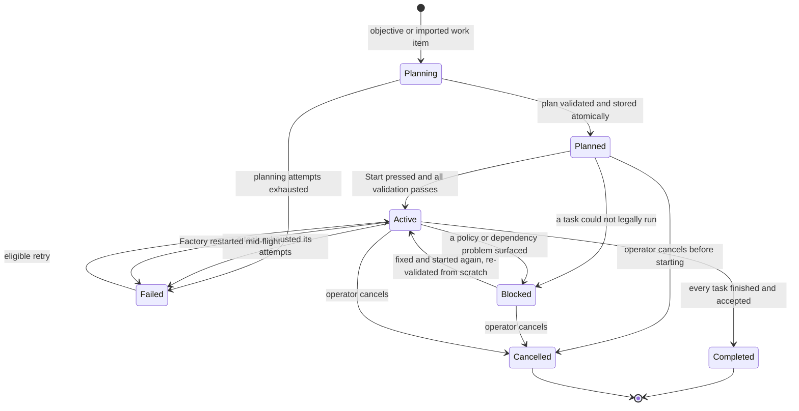
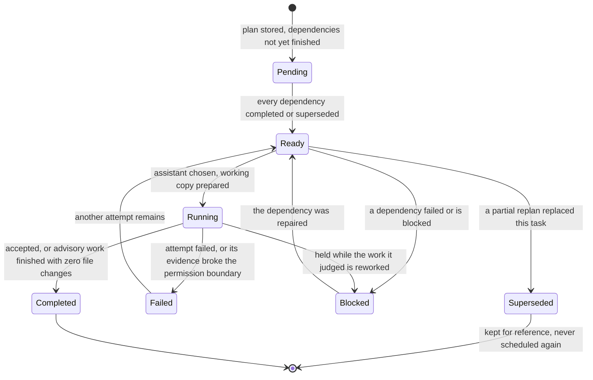
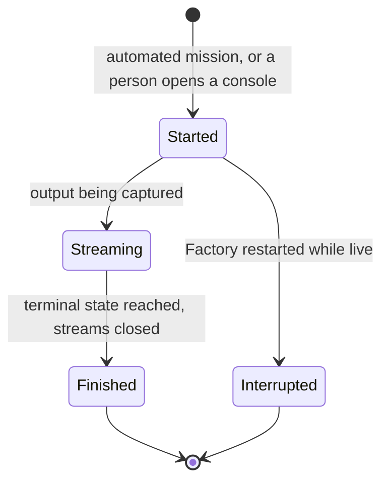
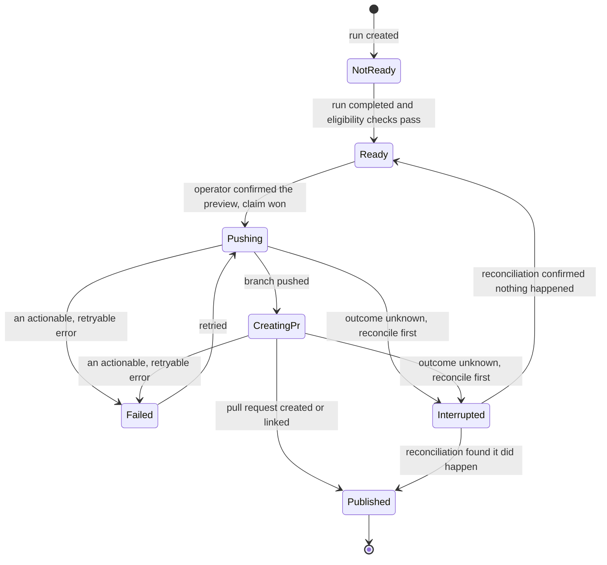
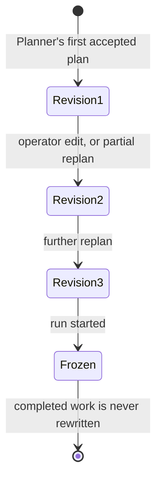
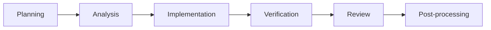
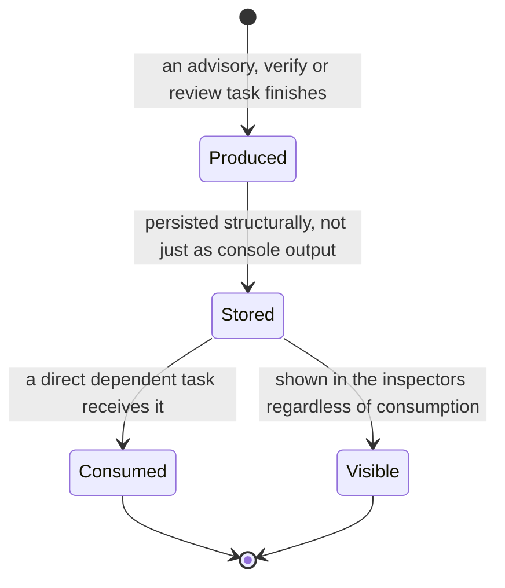
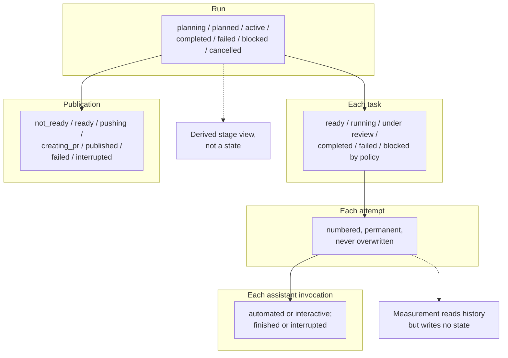

# States and Transitions

The stages each business object passes through, what moves it, and what happens to the work
around it when it moves. Rule identifiers refer to `BUSINESS_RULES.md`.

Tagging: **[Confirmed]** / **[Assumption]** / **[Unresolved]**.

There are **five separately-tracked state objects** plus one derived view. Keeping them
separate is itself a design decision: a run can be *completed* while its publication is
*not ready*, and a failed publication does not change the run's status. **[Confirmed]**

---

## 1. The run (workflow)

| State | Business meaning | What is true here | Tag |
| --- | --- | --- | --- |
| **Planning** | The plan is being drafted. | A real, recorded assistant session is running. No repository work has begun. | [Confirmed] |
| **Planned** | The plan exists and is awaiting a human. | Tasks, dependencies, roles and acceptance criteria are stored. The team can still be edited. Nothing has touched the repository. | [Confirmed] |
| **Active** | Work is being executed. | Ready tasks run one at a time. The team is **locked**. A run-scoped cancel signal can be set. | [Confirmed] |
| **Completed** | All work is accepted. | Approved changes sit on the run's own branch. Publication becomes possible. | [Confirmed] |
| **Failed** | The run could not finish. | Usually a task exhausted its attempts, or a restart interrupted it. An eligible failed task may be retried. | [Confirmed] |
| **Blocked** | Something outside the work must be fixed first. | Tasks are kept **untouched**. The reason names the offending role, assistant or permission. No attempt budget was consumed. Fixing and starting again re-validates everything. | [Confirmed] |
| **Cancelled** | A person stopped it. | Scheduling stopped, the running assistant's process tree terminated, working copy and evidence preserved. | [Confirmed] |

**[Confirmed]** Two transitions deserve emphasis because they carry money and trust:

- **Blocked is not a failure.** It preserves the attempt budget, because the fault is in
  configuration rather than in anyone's work.
- **Restart is destructive to in-flight work.** Work survives closing the browser; it does not
  survive restarting the application.

**[Confirmed, verified in code]** *How* a run becomes blocked is narrower than the prose
suggests, and the distinction matters to whoever has to fix it:

- At **Start**, only the **permission check** puts a run into *blocked*. Every other start
  failure — an empty plan, a dependency cycle, an incomplete team, a task whose role has no
  assistant, a pin that names someone outside the team, an assistant that yields no usable
  command, an unusable repository — is refused as a plain error and **leaves the run in the
  state it was already in**, so the person corrects it and presses Start again. Only the
  permission gate marks the run blocked, and it never consumes retries.
- Mid-flight, a run becomes blocked when there is **no ready task and no failed task** — that
  is, work is stuck behind a blocked task rather than having definitively failed. If any task
  is failed, the run goes to *failed* instead.
- A start may be attempted from either *planned* or *blocked*.

**[Confirmed, verified in code]** A run is declared **completed** only when *every* task has
reached the completed state; there is no partial-success completion.

**[Unresolved]** Whether a failed run can resume mid-plan or must be re-run task by task is
not stated. See `EXCEPTIONS_AND_EDGE_CASES.md` §6.

---

## 2. A task

The task's real state names, verified in the implementation (`factory-types/src/task.rs`):
**pending, ready, running, awaiting_integration, integrating, blocked, failed, completed,
superseded**. **[Confirmed]**

| State | Meaning | Consumes an attempt? | Tag |
| --- | --- | --- | --- |
| **Pending** | Waiting for dependencies. | — | [Confirmed] |
| **Ready** | Eligible to be picked up next. | — | [Confirmed] |
| **Running** | An assistant session is live in the task's own working copy. | Yes | [Confirmed] |
| **Completed** | Accepted, or advisory work finished. | — | [Confirmed] |
| **Failed** | This attempt failed; another may remain. A task that fails **while its own evidence violates a permission** also lands here — see §10. | Yes | [Confirmed] |
| **Blocked** | A **dependency** is failed or blocked, or this review is waiting while the work it judged is reworked. | No | [Confirmed] |
| **Superseded** | A partial replan replaced this task. Its records and dependency links are **kept for visual reference**; it is never scheduled and never counted for completion or blocking. | No | [Confirmed] |

**[Confirmed]** Two further states exist in the type — `awaiting_integration` and
`integrating` — intended for a serialised integration lane. **Neither is reachable in
practice**: the two functions that would claim a task into that lane have no callers at all,
and no production code ever sets either state. Integration happens inline, immediately after
approval, so real tasks go straight from running to completed. The code comment describing the
lane documents a design that was not wired up. **[Confirmed]** (verified: `factory-db/src/lib.rs`
`try_claim_task` and `try_claim_integration` are uncalled; `factory-core/src/factory.rs`
integrates inline).

**[Confirmed]** Being *blocked* is never the result of a task's own failure. A failing task
marks itself failed and then returns to ready for another attempt; only a **dependency** in a
failed or blocked state blocks its dependents. When the attempts run out, it is the **run**
that collapses to failed, not the task that gets blocked.

**[Confirmed]** A specialised review task whose implementation is being reworked is set to
**blocked**, the completed ancestors of that implementation are reset to pending, and the
implementation task itself is set back to ready. This is how the plan stays acyclic.

**[Confirmed]** A task's *planned* role and action, and the role and action that *actually
ran*, are both preserved — so a research task stays recorded as research even if the
configuration later changes.

---

## 3. An attempt

Every try at a task is a separate, permanent record holding its number, who performed it, the
role and action they acted in, its status, timing, working copy, commit, exit outcome, error,
evidence and structured review. **[Confirmed]** Attempts are never overwritten and retry
history is never reset.

**[Confirmed]** An attempt's own status values (`factory-types/src/attempt.rs`) are **running,
reviewing, approved, changes_requested, failed, interrupted, cancelled**. Note what is *not*
in that list: there is no "policy blocked" status. A permission violation is recorded as a
**failed** attempt carrying an error that begins "blocked by policy:" — the distinction that
matters to measurement is read from that error text, not from the status. **[Confirmed]**

**[Confirmed]** The attempt limit is **three attempts per task** (`MAX_TASK_ATTEMPTS = 3`). A
manual retry is refused once the third attempt is the latest. Planning repair has a **separate**
budget of three attempts (`planner.rs` `MAX_ATTEMPTS = 3`), so a run can consume three planning
attempts and still have three attempts available on every task.

The business-relevant classification used for measurement is:

| Outcome | Meaning | Counts toward assistant quality? | Tag |
| --- | --- | --- | --- |
| **Approved** | Accepted by review. | Yes | [Confirmed] |
| **Changes requested** | Review objected and no later approval followed. | Yes | [Confirmed] |
| **Agent failed** | The assistant's process failed, crashed or could not start. | Yes | [Confirmed] |
| **Integration conflict** | The approved change could not be re-applied. | **No** — reported separately | [Confirmed] |
| **Cancelled** | A person cancelled mid-attempt. | **No** | [Confirmed] |
| **Interrupted** | A restart interrupted it. | **No** | [Confirmed] |
| **Policy blocked** | The permission engine rejected its evidence. | **No** | [Confirmed] |
| **Configuration error** | The assistant was misconfigured. | **No** | [Confirmed] |
| **In progress** | Running or under review. | — | [Confirmed] |

**[Confirmed]** A task's outcome is decided by these rules: it belongs to whoever did the
**first** attempt; if **any** attempt was approved the task counts as eventually approved;
otherwise a recorded integration conflict outranks an attempt stuck in review; otherwise the
**last** attempt's classification is the outcome.

---

## 4. A session (one invocation of an assistant)

Two independent dimensions. **[Confirmed]**

| Dimension | Values | Why it matters |
| --- | --- | --- |
| **Mode** | *automated* (workflow work) or *interactive* (a person's console) | Only automated work passes through a review gate. |
| **Outcome** | running, interrupted, or rejected | Interrupted sessions are excluded from quality measurement — the assistant was not at fault. |

**[Confirmed]** A session's status is **not** a fixed enumerated type in the implementation —
it is a free text field whose values are written at the call sites. The values actually used
are *running* / *active* while live, *interrupted* after a restart, and *rejected* when the
invocation could not be started. So unlike runs, tasks, attempts and publications, session
status has no closed vocabulary enforced by the code. **[Confirmed]**

**[Confirmed]** Every automated session also stores a compact permission snapshot — which
permission source applied, the file stance, the network stance, the environment stance and
the effective write scopes — containing no secret values.

**[Confirmed]** Sessions record how much output was produced and how much was dropped, so
truncation is visible rather than silent.

---

## 5. Publication of the result

**[Confirmed]** Deliberately separate from the run's status: "a workflow can be completed
while its delivery is not_ready, and a failed delivery can be retried once its blocker is
resolved".

**[Confirmed]** The reporting rule is anti-masking: active, failed and interrupted operations
are always shown as themselves, never presented as though they were simply *ready*.

**[Confirmed]** **Interrupted is the honest state.** A failed or timed-out command does not
prove the remote action failed, so an uncertain outcome is recorded as interrupted with
reconciliation required — never as a failure — and no further attempt may start until a
read-only check resolves it. Nothing is pushed or created at startup.

---

## 6. The plan across revisions

A plan is not a snapshot that gets overwritten. **[Confirmed]**

- Plan edits and partial replans persist as **durable revisions**.
- Completed tasks are never silently rewritten.
- A task displaced by a partial replan becomes **superseded** rather than being deleted: "it no
  longer advances the run but its rows and dependency edges are kept for visual reference.
  Never scheduled, never considered for completion or blocking." **[Confirmed]**
- A run's team and any reusable configuration it was built from are stored as an **immutable
  snapshot**, so later reconfiguration never rewrites history.
- Current user instructions outrank generic working-pattern guidance, and replanning never
  mutates the original pattern.

**[Assumption]** "Frozen at start" is inferred from the statement that the team is locked once
active and that completed work is never rewritten; the material does not use the word frozen.

---

## 7. The derived stage view

**[Confirmed]** The workflow inspector derives a compact stage overview from the tasks that
actually exist in the plan. It is a **reading of the plan**, not a separate state machine:

Only stages present in this workflow are shown — a simple Worker-to-review job shows planning
and implementation, not a wall of empty rows. Stages answer *"what kind of work is happening
now?"* and are explicitly distinct from the run's operational status. **[Confirmed]**

---

## 8. The artefact lifecycle

An artefact is the durable output of advisory, verification and review work — the interface
between roles. **[Confirmed]**

- Artefacts travel **only** along dependency edges. A downstream task receives the artefacts
  of its direct dependencies and nothing else.
- Individual artefacts are capped and oversized context is truncated **with a visible
  marker**.
- Advisory tasks produce artefacts and succeed with **zero file changes** — that is normal,
  not a failure.

---

## 9. State summary in one view

**[Confirmed]** The five tracked objects are persisted so they survive restarts: runs, tasks,
dependencies, attempts, sessions, artefacts, work-item links, publication records and routing
decisions. Upgrades migrate stored history rather than requiring its deletion, and older
records are given compatible values so historical runs stay readable and runnable.

---

## 10. Unresolved state questions

1. **Resume versus re-run.** After failure or cancellation, whether a run continues from where
   it stopped or must be re-driven task by task. The code suggests the latter — a cancelled
   task is left *failed*, and recovery is a per-task retry — but no document states it.
   **[Unresolved]**
2. **Whether a completed run can be re-opened.** Nothing suggests it can, but nothing forbids
   it either. **[Unresolved]**
3. **Artefact expiry.** Whether artefacts can be regenerated or superseded after a replan is
   not described. **[Unresolved]**
4. **Superseded tasks and run completion.** A run is declared complete when every task is
   *completed*. How a superseded task interacts with that test after a replan is not described
   in the material. **[Unresolved]**

## 11. Where the reference documentation and the implementation disagree

The states above describe **the code**, because the code is what actually runs. Several places
in the prose documentation describe something the implementation does not do. They are
catalogued together in `EXCEPTIONS_AND_EDGE_CASES.md` §15; the two that bear on states are:

- the serialised **integration lane** (`awaiting_integration` → `integrating`) is documented
  and typed but has no callers and is unreachable (§2);
- the **per-run task width** setting is documented as configuring a parallel scheduler, but the
  scheduler executes exactly one task at a time and never reads it (§1).

**[Confirmed]** Neither is a security or data-loss issue: the first is an unwired optimisation,
the second makes the tool simpler than advertised, not less safe.

---

## Evidence

- `docs/architecture.md` — the run state diagram verbatim, blocked semantics, start
  re-validation, cancellation, restart reconciliation, durable plan revisions, immutable
  snapshots, session output accounting, persisted tables and migrations.
- `docs/roles.md` — stage view, waiting review during rework, acyclic plan, artefacts along
  dependencies, advisory zero-change success, preserved planned-versus-actual attribution.
- `docs/policies.md` — budget-preserving policy blocks, the quoted blocking diagnostic,
  permission snapshot contents.
- `docs/evaluations.md` — the nine outcome classifications, task attribution and outcome
  precedence, exclusions from quality denominators.
- `docs/github.md` — the publication state diagram verbatim, anti-masking reporting,
  interrupted semantics, restart demotion, reconciliation outcomes.
- `docs/recipes.md` — snapshot immutability, guidance precedence.
- `docs/routing.md` — per-attempt routing independence.
