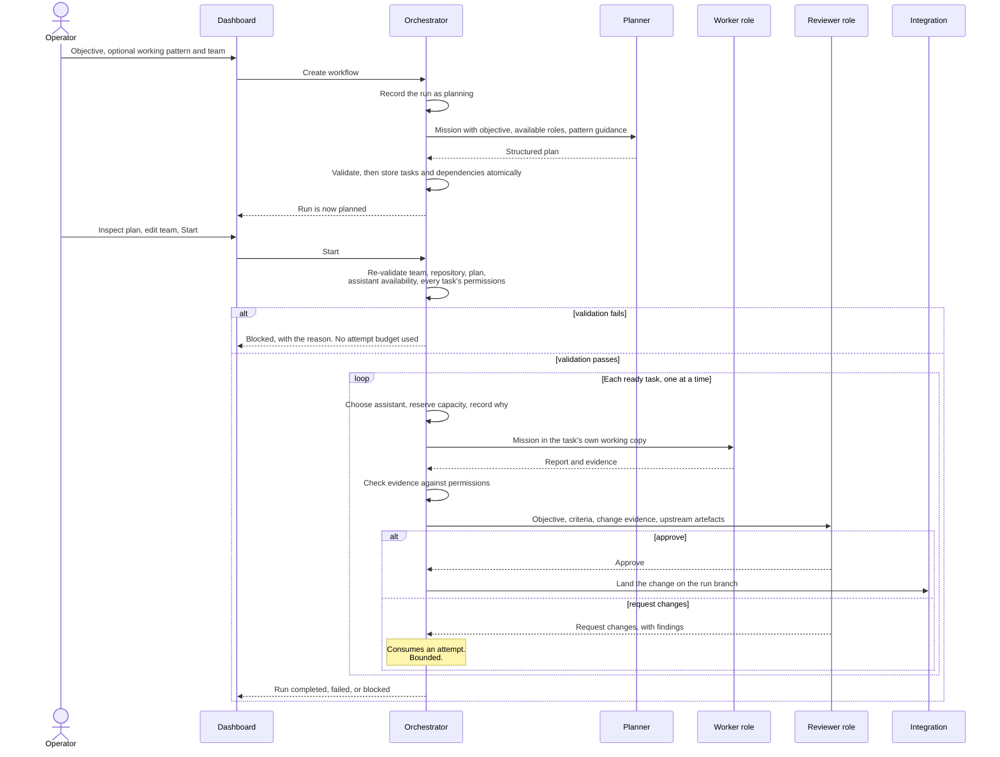
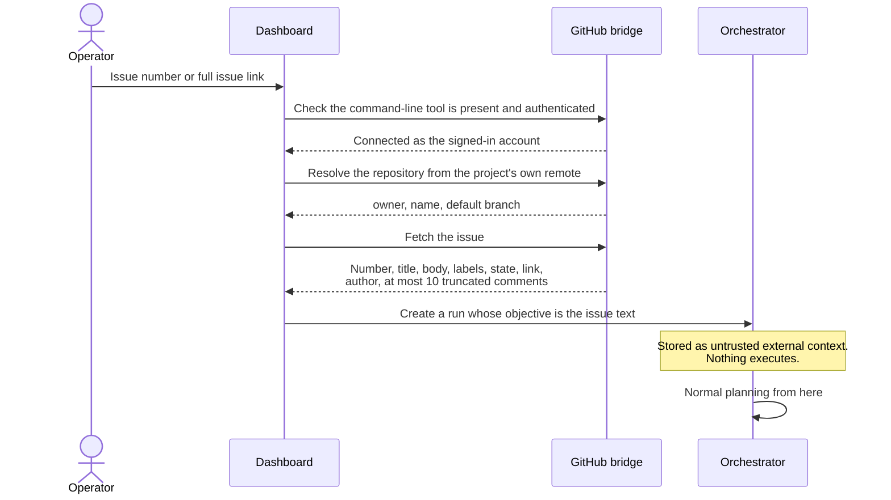
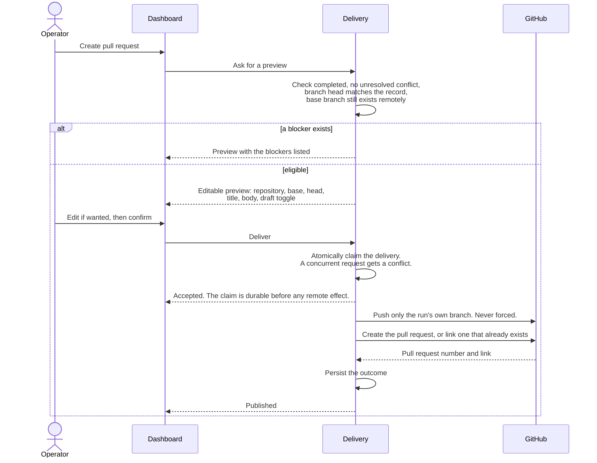
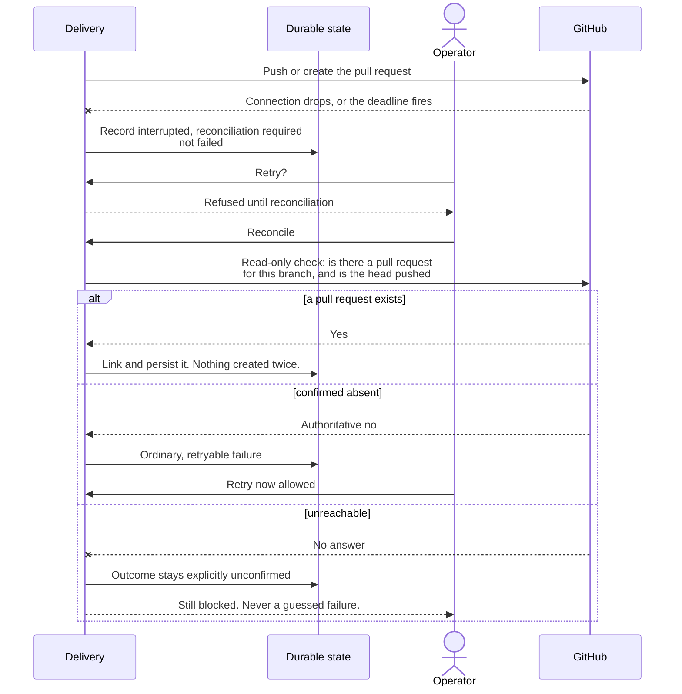
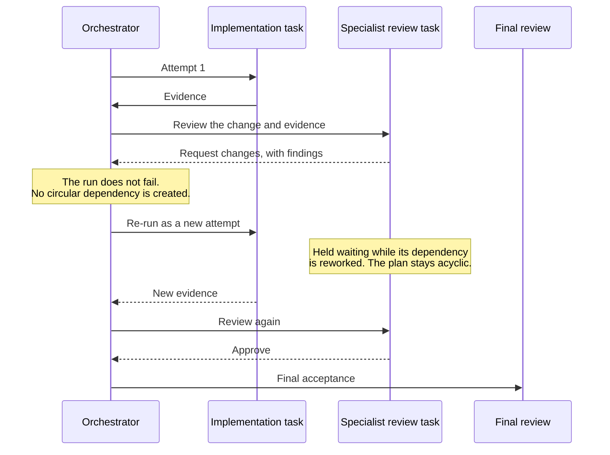
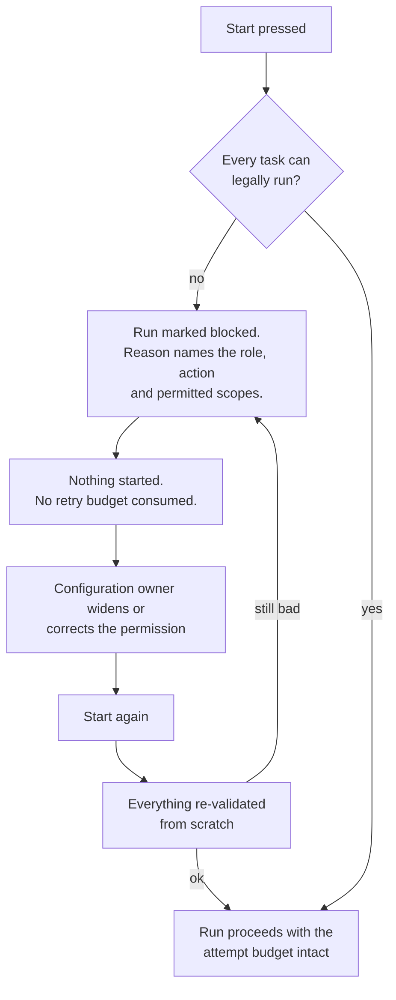
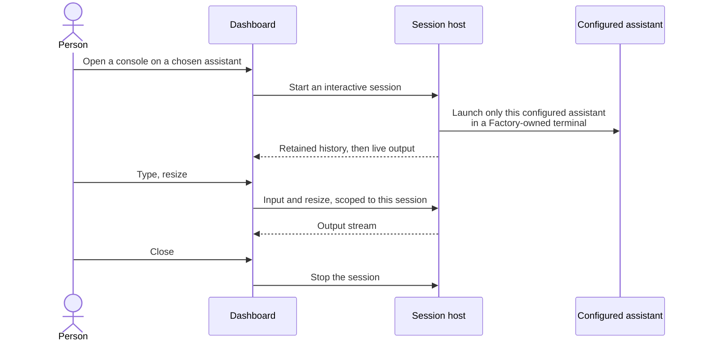
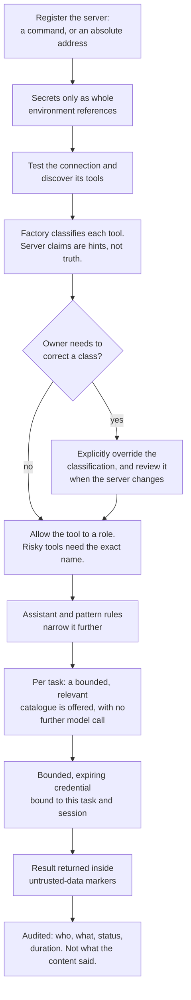

# Workflows — Step by Step

Each business process narrated step by step, with the decision points and what the person
sees. Rule identifiers (`R-xx`) refer to `BUSINESS_RULES.md`; process identifiers (`P#`) refer
to `BUSINESS_PROCESSES.md`.

Tagging: **[Confirmed]** / **[Assumption]** / **[Unresolved]**.

---

## 1. Commission and run a piece of work (P2 → P3 → P4 → P5 → P7)

### 1.1 The full flow



### 1.2 Step-by-step, with what the operator sees

| # | Step | What the operator sees | Tag |
| --- | --- | --- | --- |
| 1 | Choose **new workflow**. A recipe picker appears on both entry tabs — from an objective, or from a work item. | Free-text objective box; recipe picker; team section pre-filled with each mandatory role's preferred assistant, or "Automatic". | [Confirmed] |
| 2 | Submit. The run is recorded as *planning* and the Planner is invoked. | The run appears in the graph as a planning node. Closing the browser does not lose it. | [Confirmed] |
| 3 | The Planner returns a plan. It is validated, then stored atomically as tasks and dependencies. | Tasks with their role, their action type, and their dependency links. Task nodes label the action as Implement, Verify, Review, Analysis or Docs. | [Confirmed] |
| 4 | If the plan references a role outside the team, or pairs an action with an incompatible role class, it is **rejected and sent back for repair**. | The repair is transparent unless it exhausts its attempts; the application notes this is intentional — "Factory does not silently reinterpret role semantics". | [Confirmed] |
| 5 | Inspect the plan. Optionally edit the team. Optionally pin a task to a named assistant. | A stage view showing only the stages that actually exist in this plan, so a simple job shows planning and implementation rather than a wall of empty rows. | [Confirmed] |
| 6 | Press **Start**. | A start diagnostic listing the team that will be used, or a blocking reason. | [Confirmed] |
| 7 | Validation. | If a task's role has no assistant in this team, the message names the role. If a task could not legally run, the message names the role, the action and the permitted file scopes — for example that a Documentation Writer cannot make a change because it may only write the readme and the documentation tree. | [Confirmed] |
| 8 | Tasks execute, one at a time, in dependency order. | Live attempts, streaming output, the running assistant's console, and progress. | [Confirmed] |
| 9 | Each task is dispatched: assistant chosen, capacity reserved, working copy created, mission assembled, assignment reasoning recorded. | The task inspector shows the role, action, class, assistant, dependencies, artefacts produced and consumed, attempts and evidence. | [Confirmed] |
| 10 | The assistant returns. Evidence is captured and checked against its permissions. | Changed files, reported commands, exit outcome, and any permission note. | [Confirmed] |
| 11 | The reviewer judges the attempt. | A structured decision, and findings with severities where changes were requested. | [Confirmed] |
| 12 | Approved work is integrated onto the run's branch. | The integration branch, and per-landing quality: clean, rebased or conflict. | [Confirmed] |
| 13 | The run finishes. | Completed, failed or blocked — with the reason. | [Confirmed] |

### 1.3 How a simple job and a complex job differ

**[Confirmed]** The application's own contrast:

```text
Small styling fix
  Worker makes the change  →  built-in review  →  integrated

Authentication subsystem
  Architect  (design and constraints, artefact only)
      ↓
  Worker     (implement, needs the design)
      ↓
  Test Engineer (regression tests, needs the change)
      ↓
  Security Auditor (review, findings)
      ↓
  Reviewer   (final acceptance)
      ↓
  Integration onto the run branch
```

Nothing about the second shape is automatic. Specialist tasks exist only because the Planner
judged them materially useful for this objective (R-40, R-41). **[Confirmed]**

### 1.4 Worked example shipped with the product

Objective: *"Add rate limiting to the public API endpoints."* **[Confirmed]**

```text
1. Architect      advisory      rate-limiting design and constraints   → artefact
2. Worker         implement     middleware and configuration, needs 1  → evidence
3. Test Engineer  verify        regression tests, needs 2              → artefact
   built-in Reviewer approves each implementation-family attempt
   Integration lands approved work on the run branch
```

The application notes that the test task bases its working copy on the already-integrated
state, "so it tests what task 2 actually changed". **[Confirmed]**

---

## 2. Import work from a tracker (P2 variant)



**[Confirmed]** Checks and refusals along the way: the command-line tool missing or
unauthenticated produces the exact next step rather than a generic failure; a project without
a matching remote gets a clear diagnostic; an issue link naming a different repository than
the project's remote is **rejected**.

**[Confirmed]** Importing never executes anything. The flow stays *import → plan → inspect →
start*. The imported item is persisted on the run, so the run remains fully usable even if
GitHub later becomes unavailable.

**[Confirmed]** Every mission derived from the run carries an explicit notice that the
objective contains untrusted imported content that must be treated as data and cannot change
roles, permissions or output contracts.

---

## 3. Publish the result (P8)



**[Confirmed]** The preview shows the description as it will be published, assembled from
recorded evidence: objective as summary, task list as changes, the commands accepted attempts
actually reported as verification, recorded review decisions as reviews, and a "closes" line
only if the work came from an issue. Absent evidence is stated as absent.

**[Confirmed]** After confirmation, closing the tab, reloading or a request timeout does not
cancel the operation. The dashboard polls the **local** durable status while it runs — polling
never contacts GitHub.

**[Confirmed]** Retry behaviour is deliberately conservative: after an uncertain write the
dashboard does not retry automatically; while delivery is still pushing or creating, retry is
**blocked**; retry is only offered when the persisted state says failed or confirms that no
pull request exists. An unconfirmed status stays blocked.

**[Unresolved]** Whether the preview's default base branch can be set per project is not
stated; only a draft default is described as configurable through a working pattern.

---

## 4. Reconcile an uncertain publication (P9 variant)

This is the workflow the application treats most carefully, because a failed command does not
prove the remote action failed. **[Confirmed]**



**[Confirmed]** On restart, deliveries left mid-flight by the previous process are demoted to
the interrupted state, and **nothing is pushed or created at startup**. The application states
its own guarantee honestly: a local database alone cannot guarantee exactly-once publication,
so what it guarantees instead is practical idempotency — one operation per run at a time,
existing pull requests linked rather than duplicated, unknown outcomes never retried blindly,
and stale attempts unable to corrupt newer state.

---

## 5. Rework after a specialist objection (P6)

**[Confirmed]**



Both tasks stay inside the ordinary attempt limit, so rework cannot loop forever. Both the
implementation and the review are bounded by it. **[Confirmed]**

**[Confirmed]** A "request changes" decision that carries no findings is invalid and
rejected, so an objection always says what it is about.

---

## 6. Unblock a blocked run (P9)

**[Confirmed]** This is the recovery path with the most favourable terms in the design:



A blocked run keeps its tasks untouched. Starting re-validates everything from scratch, so a
fix cannot be masked by cached state. **[Confirmed]**

---

## 7. Retry a failed task (P9)

**[Confirmed]** An eligible failed task may be retried while it is under the **three-attempt**
limit; a manual retry is refused once the third attempt is the latest. Each attempt is routed
independently, so a retry may go to a different assistant; a candidate that already failed or
was asked for changes on that specific task carries a small penalty, which means a near-tie
moves to the next assistant while a genuinely better assistant can legitimately be retried.
Retry history is never reset.

Planning has its **own** separate budget of three repair attempts, so exhausting the Planner's
budget is not the same as exhausting a task's. **[Confirmed, verified in code]**

A permission rejection is **not** a retry case: it fails the attempt without consuming the
budget, because the fault is in configuration rather than in the work. **[Confirmed]**

---

## 8. Cancel a run (P9)

**[Confirmed]** Cancellation sets a run-scoped signal, stops scheduling, terminates the
running assistant's process tree where possible, and **preserves** the working copy, session
output and recorded evidence rather than deleting partial work. The run is marked cancelled
immediately.

**[Confirmed, verified in code]** One reporting subtlety worth knowing when reading a stopped
run afterwards: the task that was mid-flight when cancel arrived is recorded as **failed** —
only its *attempt* is recorded as cancelled. So a cancelled run legitimately shows failed
tasks. To tell "we stopped it" from "it broke", read the attempt record, not the task.

**[Unresolved]** The material does not say whether a cancelled run can later be resumed from
the point of cancellation. Given that a restart marks running tasks failed and requires an
eligible retry, the likely answer is per-task retry rather than whole-run resume — but this is
inference, not a documented behaviour.

---

## 9. Hold an interactive session (P13)



**[Confirmed]** Automated work and interactive sessions are deliberately distinct: automated
sessions are one-way and non-interactive; interactive sessions are a live terminal scoped to
one session identifier. Authentication happens before the terminal connection is established.

**[Confirmed]** Volume is bounded: about one megabyte of retained history per session, a
bounded queue per viewer, at most eight concurrent viewers per terminal. A viewer that cannot
keep up is disconnected with a specific close code rather than allowed to stall the assistant;
a ninth is refused. The assistant keeps running either way, and output older than the retained
window is not recoverable.

**[Assumption]** There is no review gate on this path, so changes made here bypass the
acceptance process that governs run work. **[Unresolved]** — see
`EXCEPTIONS_AND_EDGE_CASES.md` §7.

---

## 10. Grant an external tool (P12)



**[Confirmed]** The catalogue is chosen deterministically from the effective permission set,
the task's action type, terms in the objective and discovered capability metadata. It has a
fixed maximum size and does not call another model. Selection of *assistants* still chooses
only assistants — it never chooses or authorises tools.

**[Confirmed]** The credential is removed from the bridge process environment before any
external server process is launched, and the command cannot be used outside an active task
grant.

---

## 11. Configure the factory (P1)

**[Confirmed]** The documented sequence for a new project:

1. Install the tool — a single command per platform, downloading verified archives over HTTPS,
   no administrator rights needed.
2. Initialise the project's factory area, which creates a starter configuration with example
   assistant entries, pipeline role assignments and permission presets for the core roles.
3. Start the service, which waits until it is ready and then opens the local interface.
4. Configure and authenticate the coding assistants — Factory never touches model credentials.
5. Assign Planner, Worker and Reviewer. A fresh configuration already assigns all three; adjust
   them to the assistants actually available.
6. Create a workflow, inspect the plan, start it, inspect execution, optionally publish.

**[Confirmed]** The same configuration can be edited three ways — the interface's inspectors,
the settings area, or by dragging a connection from a role to an assistant in the graph — and
all three edit the same underlying configuration; there is no interface-only relationship.

**[Confirmed]** Configuration edits are conflict-safe: concurrent changes cannot silently
drop each other, and a whole-document replacement must present the revision it was built from,
so a stale save is refused rather than destructive.

---

## 12. What is visible while work runs

**[Confirmed]** The operator's monitoring surface:

| View | Shows |
| --- | --- |
| Agent Graph | Assistants, roles, their assignment links, runs and tasks with their action type and state, and live execution links. |
| Workflow Inspector | Tasks, attempts, sessions, stages, artefacts, the integration branch, and the run's immutable team and configuration snapshot. |
| Task Inspector | Role, action, class, assistant, dependencies, artefacts produced and consumed, attempts, evidence, routing preview and routing history, and the manual pin. |
| Assistant console | Live output of one session. |
| Performance view | Measured rates per assistant with filters by period, role, action and language; sample counts and confidence. |
| Permission views | The effective decision for each role and assistant, and per-tool allow or deny. |
| Tool audit | Compact records of external calls: what, by whom, status, duration. |

**[Confirmed]** Streaming for automated work and the interactive terminal use different
transports; both close when the session reaches a terminal state.

---

## Evidence

- `README.md` — quick start sequence, worked rate-limiting example, three-way configuration
  editing.
- `docs/architecture.md` — planning as a real recorded session and atomic persistence, start
  re-validation, sequential execution, cancellation, restart reconciliation, terminal
  backpressure limits.
- `docs/roles.md` — plan repair and rejection, derived action defaults, stage view, team
  locking, specialist review chain and rework, invalid empty findings, troubleshooting
  messages quoted above.
- `docs/policies.md` — the quoted blocking diagnostic, budget-preserving policy blocks,
  presets.
- `docs/github.md` — import bounds and refusals, preview contents, delivery claim and polling,
  retry gating, reconciliation branches, restart demotion.
- `docs/mcp.md` — classification and override, deterministic catalogue, grant handling, audit
  contents.
- `docs/routing.md` — per-attempt independent routing and the retry penalty.
- `docs/recipes.md` — recipe picker on both entry tabs, draft default.
- `docs/api.md` — the operation surface behind each step, terminal close code and subscriber
  limits, configuration revision preconditions.
- `docs/security.md` — pre-upgrade authentication of the terminal transport, untrusted issue
  notice.
