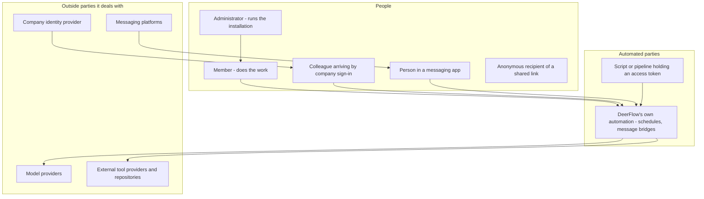
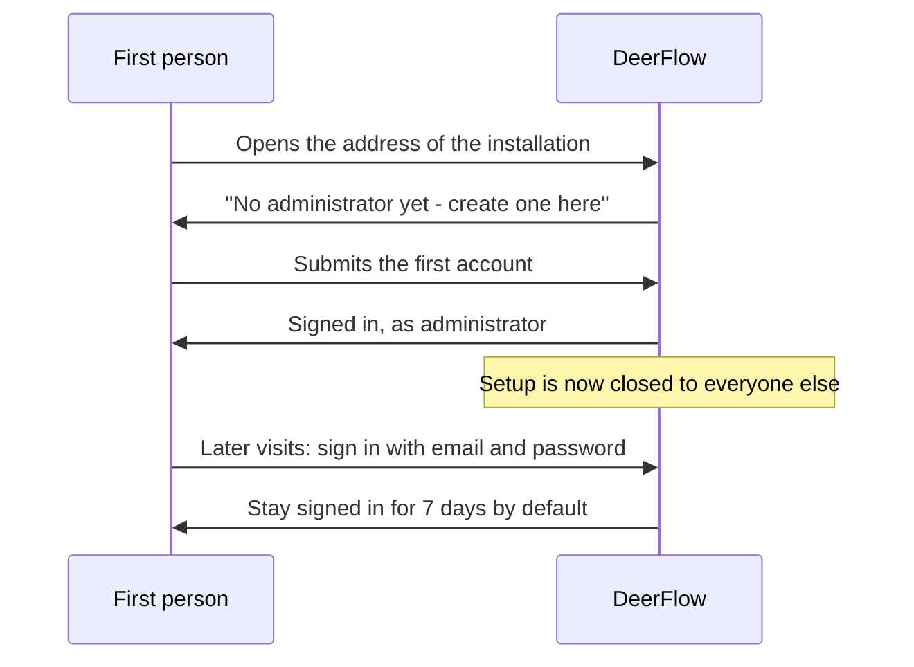
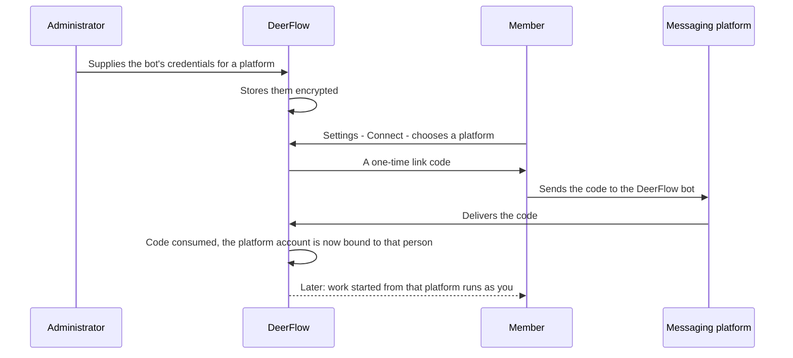

# DeerFlow — Actors and Roles

> Business-level description of who interacts with DeerFlow, how each of them
> gets in, what each may do, and what they may never do. Implementation detail
> (languages, data schemas, service internals) is deliberately excluded.
>
> **Evidence convention:** **Confirmed** · **Assumption** · **Unresolved**.

---

## 1. The people and parties

| Party | How they come to exist | What they can do | What they cannot do |
|---|---|---|---|
| **Administrator** | The very first person to open a fresh installation is invited to create the account, and that account becomes the administrator. **Confirmed** | Everything a member can do, **plus**: see and manage the user list, change someone's role, disable an account, and hold the credentials of messaging bots. **Confirmed** | Cannot demote or disable **themselves** if they are the last administrator left — the request is refused. **Confirmed** |
| **Member** | Registers themselves on the sign-up page, or is given an account. Always joins as a member. **Confirmed** | Their own conversations, files, memory, projects, custom assistants. **Confirmed** | Never sees the user list, never changes anyone's role, never configures messaging bots, and can never promote themselves to administrator. **Confirmed** |
| **Colleague by company sign-in** | Signs in through the organisation's identity provider and is provisioned automatically. **Confirmed** | As a member — unless their address is on the administrator list, which grants administrator automatically. **Confirmed** | Cannot change their password inside DeerFlow — the password belongs to the identity provider. **Confirmed** |
| **Person in a messaging app** | Links their account on that platform to their DeerFlow account with a one-time code. **Confirmed** | Starts and continues conversations as their own self, with their own files and memory. **Confirmed** | Until linked, their message is refused with an instruction to link first — no work is started. **Confirmed** |
| **Script or pipeline with an access token** | A member mints a personal access token from their own signed-in session. **Confirmed** | Only the narrow set of working-with-conversations permissions, and only the conversation routes — never administration. **Confirmed** | Cannot mint or revoke tokens, cannot change a password, cannot reach memory or assistant-management routes, never carries administrator power. **Confirmed** |
| **DeerFlow's own automation** | Internal to the product: the schedule runner and the messaging bridges. **Confirmed** | Starts work on behalf of a named owner. **Confirmed** | Is not an account: it has no login, no password, and does not appear in the user list. It is trusted for the owner it declares — DeerFlow does not re-verify that end person. **Confirmed** |
| **Anonymous recipient of a shared link** | Holds a share link. **Confirmed** | Reads that frozen snapshot and downloads the output files in it, without signing in. **Confirmed** | Cannot continue the conversation, change anything, or reach the original files. To continue it, they must sign in first. **Confirmed** |
| **External systems** | Message platforms, the identity provider, model providers, external tool servers, source repositories. **Confirmed** | Deliver events or serve requests. | Are not users and get no standing access. Webhooks from a source repository are refused unless a shared secret is configured. **Confirmed** |
| **A disabled account** | An administrator disables it. **Confirmed** | Nothing. Rejected at the door before the password is even checked, and any token they hold stops working while suspended. **Confirmed** |

**Assumption.** DeerFlow is positioned as a tool for a single trusted operator
first and a small team second: it ships with a self-service sign-up page and a
"first visitor becomes administrator" bootstrap rather than an invite-only flow.

---

## 2. What a member is allowed to do

There are thirteen named permissions. When permission checks are switched off
(everything runs as one trusted local person), a person holds all thirteen.
**Confirmed.**

| Area | Permissions |
|---|---|
| Conversations | read · write · delete |
| Work on a conversation | start work · read its history · cancel in-flight work |
| Projects | read · write · delete |
| Long-term memory | read · write |
| Custom assistants | read · write |

**Confirmed.** Cancellation is a permission of its own, so being able to talk to
the assistant does not automatically let someone call off work already running.

**Confirmed.** An access token for scripts may carry only **nine** of the thirteen
— memory and assistant-management are unreachable with one regardless of what
scopes were requested. Scopes can only *narrow* what their owner already has.

**Confirmed.** When the fine-grained rules are switched on, an explicitly denied
permission beats any grant, and an unrecognised role is treated as an error and
refused rather than allowed. The list of permissions a browser session is shown is
treated as advice for what to display — the real decision is made server-side.

---

## 3. What belongs to a person

**Confirmed.** Everything a person does is filed under a server-owned identity:

| Kept per person | Includes |
|---|---|
| Conversations and their work records | owned by the person, not by whatever the request claims |
| Files | a private workspace, uploads and outputs per conversation, inside that person's area |
| Long-term memory | one memory store per person |
| Custom assistants | one folder per person |

Another person's conversation is reported as **not found**, not as forbidden — the
product does not confirm that someone else's work exists. Values a caller tries to
put in the request claiming to be the owner are stripped and restamped from the
signed-in identity. **Confirmed.**

**Confirmed.** In single-user local mode there is one shared identity, and every
conversation, file and memory entry lands in one common bucket. This mode is
refused outright when the environment is declared to be production.

**Confirmed.** One deliberate escape exists: an administrator can point memory at
an absolute shared location, which opts out of per-person memory.

---

## 4. Getting in: first run and everyday sign-in

| Step | Behaviour | Evidence |
|---|---|---|
| Fresh installation | No account is created automatically; the log points at the setup page. | **Confirmed** |
| Setup open or closed | The product answers "setup still needed" and whether sign-up is enabled; that answer is cached for **60 seconds per address**. | **Confirmed** |
| Two people race to set up | One wins; the other is told the system is already initialised. | **Confirmed** |
| Everyday sign-in | Email and password, staying signed in for **7 days by default** (configurable from 1 to 30). | **Confirmed** |
| Wrong password | Refused, and counted per address. After **5 failed attempts within 300 seconds** further attempts are temporarily blocked; the lock is timed from the *first* failure. | **Confirmed** |
| Sign-up switched off | The sign-up page refuses new registrations. | **Confirmed** |
| Forgotten administrator password | An operator runs a recovery command: a random password is written to a file on the server that only the operator can read, the account is flagged as needing a password change, and all its existing sessions are invalidated. | **Confirmed** |
| Stale or tampered session | Refused outright; there is no fall-through to anonymous use. The browser is sent to the sign-in page and returned to the page it wanted afterwards. | **Confirmed** |
| Signed in over plain HTTP on a network address | The stay-signed-in cookie is deliberately downgraded to "until the browser closes" unless the operator explicitly accepts the weaker option. | **Confirmed** |

**Confirmed.** A person arriving through company sign-in whose address already
belongs to a local account is **refused** rather than silently linked, so nobody
inherits an existing person's work by coincidence.

**Unresolved.** What, beyond being told to change their password, a person flagged
"needs a password change" is prevented from doing.

---

## 5. Linking a messaging account

Two separate jobs, done by two different people.

| Rule | Value | Evidence |
|---|---|---|
| Code strength | Effectively unguessable (128 bits of randomness). | **Confirmed** |
| Code lifetime | **10 minutes**, and single-use. | **Confirmed** |
| Codes outstanding at once | At most **5** per person per platform; asking for a sixth is refused. | **Confirmed** |
| How the code is delivered | On one platform a ready-made link opens the bot with the code pre-filled; elsewhere the person is told to send a connect command with the code to the bot. | **Confirmed** |
| A code is checked before the platform's own allow-list | Deliberately, so that binding can be completed at all. | **Confirmed** |
| **If someone else already bound that same platform account** | **The newest binding wins** — the earlier person loses it. | **Confirmed** |
| Removing a link | The person unlinks it; unknown links report nothing. | **Confirmed** |
| An unlinked person's message | Rejected **before** any conversation is created, with an instruction to connect from settings. This is the default whenever authentication is on. | **Confirmed** |
| Group notifications | On two platforms the code is supplied together with a group name. | **Confirmed** |
| Duplicate message protection | Repeated deliveries of the same message are recognised within a **10-minute** window. | **Confirmed** |
| Inbound work queue | Up to **1 000** waiting items handled by **5** workers. | **Confirmed** |

**Confirmed.** Bot credentials can be supplied either by the operator in the
configuration file or, at run time, by an administrator through the browser —
stored encrypted. If the encryption key has not been configured, that
capability is simply unavailable and says so.

**Unresolved.** Whether there is any limit on how many platforms one person may
bind at the same time; only the five-pending-codes cap was found.

---

## 6. Access from a script

| Rule | Value |
|---|---|
| Minting | A signed-in member creates it; the value is shown **once** and only a fingerprint of it is kept. |
| Lifetime | **1 to 365 days**, or never. |
| Naming | Up to 128 characters. |
| Last-used record | Written at most once every **5 minutes** per token. |
| Reach | Only conversation-and-work routes, whatever scopes were asked for. Everything else is refused by default. |
| Revoked or unknown token | One generic "invalid token" answer, so the response cannot be used to probe which tokens exist. |
| Revocation | Immediate, from the same place it was created. |

**Confirmed.**

---

## 7. When access is refused

| Situation | What the person experiences |
|---|---|
| Session expired or forged | Sent to sign in, then back to where they were going. **Confirmed** |
| Account disabled | Told plainly that the account is disabled. **Confirmed** |
| Company sign-in provider unreachable | Told sign-in failed, rather than being let through. **Confirmed** |
| Address already used by a local account at company sign-in | Refused, with no automatic linking. **Confirmed** |
| Message from an unlinked chat account | Told to connect from settings; no work started. **Confirmed** |
| Platform switched off or not configured | Told that connections for it are disabled. **Confirmed** |
| Not enough permission for the action | Refused, naming the missing permission. **Confirmed** |
| Last administrator tries to demote or disable themselves | Refused. **Confirmed** |
| Script token used on a members-only page action | Refused. **Confirmed** |

---

## 8. Open questions

- **Unresolved.** Whether an administrator can hand out roles beyond the built-in
  member/administrator pair and have those roles actually take effect on the
  routes; the guides say fine-grained roles are not yet implemented while the
  wiring for them exists.
- **Unresolved.** Whether there is a cap on bound messaging connections per
  person, as opposed to the five pending codes.
- **Unresolved.** What the share-link management screen exposes about expiry
  beyond what the sharing guide states.
