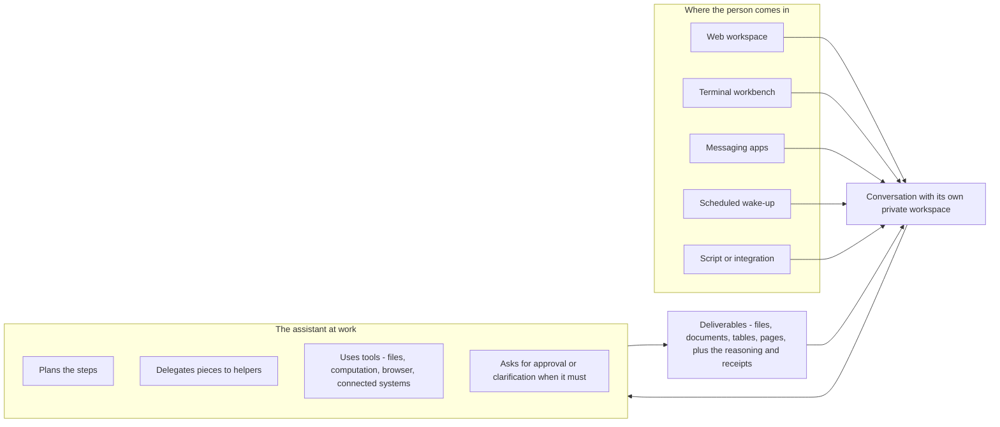

# DeerFlow — Business Overview

> This document set describes **what the application does, who uses it, and the
> processes it follows**, in business terms. It deliberately avoids
> implementation detail (languages, frameworks, data schemas, internal
> mechanisms) and translates what it finds into business concepts.
>
> **Evidence convention used across all documents**
> - **Confirmed** — behaviour directly observable in the codebase or its guides.
> - **Assumption** — inferred from the design; not explicitly stated.
> - **Unresolved** — an open question the codebase does not answer.

---

## 1. Purpose: what problem does it solve?

Most assistant tools answer a question. DeerFlow is built to **take on a piece of
work** — and finish it.

A person describes an outcome: *"research this market and give me a deck", "go
through these twelve contracts and give me a summary table", "refactor this
repository and make the tests pass", "every weekday morning, tell me what
changed".* The assistant then plans the work, carries it out using real tools —
reading and writing files, running computations, browsing live websites, querying
connected business systems — and hands back the finished artefacts, with the
reasoning and the evidence behind them.

It answers a different question from a question-answering tool:

> *"Can I hand this whole task to the assistant, walk away, and come back to the
> result?"*

**Confirmed.** Three properties make that possible:

| Property | What it means in practice |
|---|---|
| **A workspace of its own** | Every conversation gets a private working area where the assistant can keep files, take in attachments and produce deliverables. Nothing from another conversation leaks in. |
| **The ability to act, not only answer** | It can run computations, operate a browser, read and write documents, and call connected external systems — under guardrails and, where required, a person's approval. |
| **Persistence** | It remembers a person's durable facts between conversations, keeps a work list on long jobs, and can be told what "finished" means so it keeps going until the outcome is genuinely reached. |

**Confirmed.** DeerFlow began as a *deep research* framework and was rebuilt from
the ground up after its users started pointing it at data pipelines, slide decks,
dashboards and content workflows. The product's own description of itself is now a
**workbench that gives an assistant the infrastructure to actually get work done**,
rather than a research pipeline.

---

## 2. What it is — and what it is not

| It **is** | It is **not** |
|---|---|
| A self-hosted assistant workbench: the organisation runs it, on its own machine or server, with its own model subscriptions. **Confirmed** | A hosted consumer service. There is no vendor-run cloud; whoever installs it owns the deployment and its security. **Confirmed** |
| A **planning** assistant: it decides the steps for each request afresh, tracks them, and can delegate pieces to its own helpers. **Confirmed** | A fixed workflow engine with a pre-drawn diagram. The same request may be handled by a different sequence of steps next time. **Assumption**, from the design being planning-based rather than template-based. |
| Task-completing: it produces files, documents, decks, tables, code changes and web pages, not only prose. **Confirmed** | A system of record. It creates artefacts and notes; it does not replace a business system that holds authoritative data. **Assumption** — no such role is claimed anywhere. |
| Reachable from where the person already is: a web workspace, a terminal workbench, messaging apps, a scheduled wake-up, or a script. **Confirmed** | A single-channel product. The same assistant and the same conversation are shared across all of those entrances. **Confirmed** |
| Extensible: the organisation can add documented capabilities, connect external tool servers, and install packaged extensions. **Confirmed** | A closed product with a fixed capability list. **Confirmed** |
| Something that **can run commands and read and write files**, and is therefore designed to be run in a trusted, local environment. **Confirmed** | Safe to expose to an open network. Its own guidance is emphatic: an administrator account on the service is **equivalent to being able to run code on the machine**, and the installation is reachable only from the machine itself until someone deliberately opens it up. **Confirmed** |

**Confirmed.** The product ships with an explicit security notice covering exactly
this: unauthorised access to an exposed installation could drive command execution
and file access, with legal and compliance consequences. Opening it to a network is
a deliberate act requiring firewalls, pre-authentication or network isolation.

---

## 3. The shape of the work

**Confirmed.** All five entrances reach the *same* assistant and the same
conversation history; a session started in a terminal appears in the web
workspace's list, and a conversation begun in a messaging app can be continued in
the browser.

---

## 4. Key business concepts

These recur through the rest of the set. They are business concepts, not technical
terms.

| Term | Business meaning |
|---|---|
| **Conversation** | One ongoing engagement between a person and the assistant. Everything — files, decisions, history — belongs to it and is private to it. |
| **Turn of work** | One request carried out from start to finish. It has a status, a cost, and a delivery record. |
| **Private workspace** | The conversation's own working area: attachments in, deliverables out, scratch files in between. |
| **Deliverable** | A file the assistant produced and is presenting as the result of the turn. |
| **Completion condition** (a *goal*) | One outcome the person declares. The assistant is judged against it after each turn and keeps working until it is genuinely met or a limit is reached. |
| **Work list** | The visible step list the assistant keeps on a multi-step job, with each step not-started, in progress or done. |
| **Delegated sub-task** | A piece of work handed to one of the assistant's own helpers, which works separately and reports back. |
| **Long-term memory** | Durable facts about the person, gathered from conversations and offered back to the assistant later. Per person, reviewable and editable. |
| **Skill** | A documented, installable capability — the assistant's standard method for a kind of job. |
| **Connected tool** | An external system the assistant may call, switched on and off by the organisation. |
| **Custom assistant** | A named assistant a user configures for a recurring kind of work, with its own tools and instructions. |
| **Project** | A group of related conversations sharing a name, standing instructions and a shared shelf of documents. |
| **Scheduled task** | Work the assistant starts on its own timetable, without a person present. |
| **Messaging connection** | A person's link between their account on a chat platform and their DeerFlow identity. |
| **Shared snapshot** | A frozen, read-only copy of a conversation and its deliverables, published as a link that expires. |
| **Approval request** | A stop-the-work moment where the assistant needs a person's decision before it may act. |
| **Clarifying question** | A stop-the-work moment where the assistant needs information only the person has. |

---

## 5. How a person uses it, in one paragraph

A person opens the workspace, starts a conversation, and describes an outcome —
typing, or attaching a file. The assistant names the conversation, works out the
steps, and starts. As it goes it may take in the attachment, run computations in
the conversation's own workspace, browse live pages, and call the systems the
organisation has connected; it may hand pieces of the job to helpers working in
parallel; and if it needs a decision or a missing fact, it stops and asks. The
person can watch it stream, cancel it, or walk away and rejoin later. When it
finishes, the answer arrives together with the files it produced, which open in a
side panel and can be downloaded, quoted back into the conversation, or — for a
passage in one — rewritten in place after a review step. If the person declared a
completion condition, the assistant is checked against it after each turn and
quietly continues until it is met or it runs into an honest limit, at which point
the person is told which limit. Related conversations can be grouped into a
project with standing instructions and a shared document shelf; recurring work can
be put on a schedule; the finished conversation can be shared as an expiring
read-only link, or copied into someone else's workspace to continue. Everything
the person does is filed under their own identity: their conversations, their
files, their memory. **Confirmed** for each of these steps.

---

## 6. Where the work can be started from

| Entrance | Who it suits | Behaviour |
|---|---|---|
| **Web workspace** | Everyday use. | Conversations, search across titles and message text, projects, scheduled tasks, usage reporting, a trash bin for deleted documents, a capability centre, custom assistants. **Confirmed** |
| **Terminal workbench** | People who live in a shell. | Runs without the web services at all, honours the same settings, and shares the same conversation list. **Confirmed** |
| **Messaging apps** | Work that starts where the team already talks. | A linked account drives the same conversations; a person's link decides whose work it is. **Confirmed** |
| **Schedule** | Recurring jobs. | The assistant starts its own turn on a timetable, non-interactively: it cannot stop and ask a clarifying question. **Confirmed** |
| **Script or integration** | Automation and pipelines. | Uses an access token that runs as its owner, restricted to conversation-and-work routes. **Confirmed** |

---

## 7. Scope and boundaries

- **Model-agnostic.** The organisation brings its own models; the assistant works
  with any provider that follows the common interface, and performs best with
  long context, reasoning, image understanding and reliable tool use. **Confirmed**
- **Self-hosted and local-trusted by default.** Reachable only from its own
  machine until deliberately opened. **Confirmed**
- **One identity per person, enforced server-side.** Another person's conversation
  is reported as not found. **Confirmed**
- **Optional privacy measures.** Personal-identifier masking exists but is **off by
  default**; when enabled it masks identifiers on the way to the model while
  leaving the person's own view of their conversation intact, and keeps no mapping
  back. **Confirmed**
- **Cost is visible but is not a bill.** Recorded token usage is reported over 7
  and 30 day windows and per run, and may be incomplete; the guides state plainly
  it is not a provider invoice. **Confirmed**
- **Observability is opt-in.** Third-party tracing services can be connected; when
  one is, a correlation identifier follows a piece of work across the whole system
  and into the logs. **Confirmed**
- **Open source.** Published under a permissive licence. **Confirmed**

---

## 8. What this application is optimised for

Reading the codebase as a whole, the effort goes into **finishing long jobs
honestly** rather than answering quickly: the assistant is *judged* against a
declared outcome, keeps a work list that survives interruption, compresses its own
context instead of losing the thread, delegates to helpers whose usage counts
against the same budget, refuses to claim delivery it cannot show, and — when it
stops short — names the reason. **Confirmed** by the goal-stand-down rules, the
delivery checks, and the retained-unfinished-steps behaviour described in
STATES_AND_TRANSITIONS.md.
