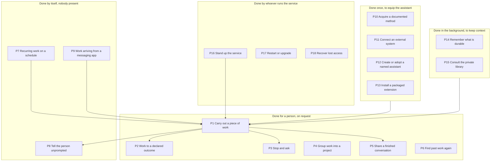
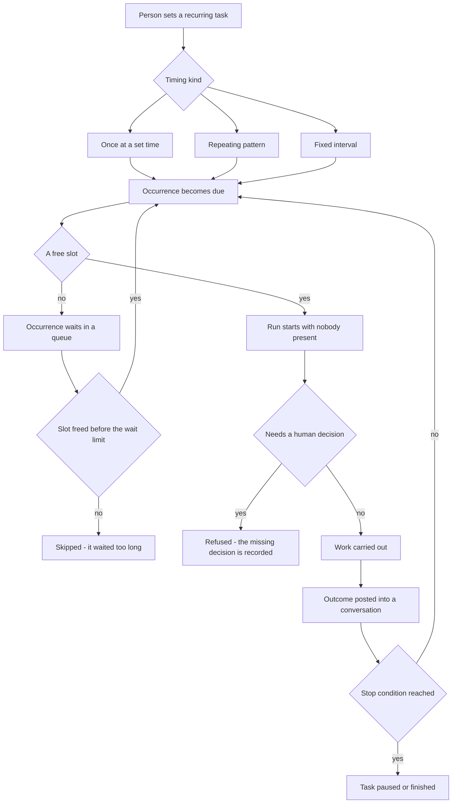

# DeerFlow — Business Processes

> The business processes DeerFlow takes part in, who owns each one, what starts
> it, and what it produces. Implementation detail is excluded.
>
> **Evidence convention:** **Confirmed** · **Assumption** · **Unresolved**.

---

## 1. The process map

**Confirmed** for every process above; the grouping is this document's
organisation, not the product's.

| # | Process | Owner | Trigger | Produces |
|---|---|---|---|---|
| P1 | Carry out a piece of work | A person | A message, an attachment, a walk-up request | An answer plus the files it produced |
| P2 | Work to a declared outcome | A person, then the assistant | A stated completion condition | A met outcome, or an honest reason it stopped |
| P3 | Stop and ask | The assistant | Missing decision or information | A decision from the person, then resumed work |
| P4 | Group work into a project | A person | Related work accumulating | Standing instructions and a shared document shelf applied to each new turn |
| P5 | Share a finished conversation | The owner | A decision to hand work to someone | An expiring read-only link, or a copy in the recipient's workspace |
| P6 | Find past work again | A person | Need to reuse something | The conversation, and the point in it, found |
| P7 | Recurring work on a schedule | The service | A timetable | A finished turn and a delivery, nobody present |
| P8 | Tell the person unprompted | The service | A scheduled occurrence ending | A message in the person's chat app |
| P9 | Work arriving from a messaging app | A person, remotely | A message to the bot | A turn in the person's own conversation |
| P10 | Acquire a documented method | Administrator | A capability is needed | A screened, installable method the assistant can follow |
| P11 | Connect an external system | Administrator, or a person for their own | A system must be reachable | Calls the assistant may make, within limits |
| P12 | Create or adopt a named assistant | A person | A recurring kind of work | A configured assistant with its own tools and standing behaviour |
| P13 | Install a packaged extension | The operator | New built-in behaviour is needed | Additional service behaviour, effective at next start |
| P14 | Remember what is durable | The service | Conversations ending | Reviewable facts offered back later |
| P15 | Consult the private library | The assistant | A question the organisation's own documents can answer | An answer with locatable citations |
| P16 | Stand up the service | The operator | A new installation | A usable, access-controlled instance |
| P17 | Restart or upgrade | The operator | Maintenance | Service restored, with known consequences for in-flight work |
| P18 | Recover lost access | The operator | A locked administrator | A restored sign-in, all old sessions invalidated |

---

## 2. P1 — Carry out a piece of work (the core process)

The process every other one hangs off. A person states an outcome; the assistant
plans, acts, and delivers.

**What the assistant may touch during this process**: the conversation's own
working area — files the person sent in, a working directory, and a deliverables
area — computations run in an execution environment belonging to that
conversation, live web pages, the organisation's connected systems, and its own
private library. Cross-conversation access is blocked. **Confirmed**

**Where this process ends and P2 begins**: P1 finishes a turn; P2 is what keeps
turns coming until a declared outcome is genuinely reached. **Confirmed**

---

## 2b. P1b — Deliverables, quoting and rewriting

A distinctive part of P1: the produced file is not a dead attachment. The person
can open it beside the conversation, quote a passage back into the conversation,
ask a question about it in a side conversation, or ask for the passage to be
rewritten — and then **review the proposed replacement and apply it to a draft**,
saving explicitly. Nothing is written to the file until the person saves. **Confirmed**

**Rule that matters here**: rewriting in place only works where the exact source
range can be verified, on an output file that is writable; read-only artefacts,
public demos, and files outside the deliverables area cannot be rewritten.
**Confirmed**

---

## 3. P2 — Work to a declared outcome

Described in full in STATES_AND_TRANSITIONS.md §4 and BUSINESS_RULES.md §3. In
process terms it is a loop with an independent judge and a named stopping reason,
capped at eight silent continuations and two fruitless rounds. **Confirmed**

---

## 4. P3 — Stop and ask

Two flavours, and the difference matters operationally:

| | Clarifying question | Approval request |
|---|---|---|
| Why | Only the person has the information | The action needs a person's decision |
| Default availability | On, for ordinary conversation | **Off** by default; switched on deliberately |
| Waits across a restart | — | **Yes** — approvals survive a restart |
| What happens if nobody is there | The turn waits | Work that needs a human **cannot** wait: an unattended run is refused or blocked rather than left hanging |
| Modes | — | Ask · Auto · Full |

**Confirmed.**

---

## 5. P4–P6 — Organising and reusing work

**P4 Grouping into a project.** A conversation joins a project when it is created
or later by an explicit move; **starting a turn never changes membership**. Each
project carries free-form standing instructions and a shared document shelf. When
a turn starts on a member conversation, the project's current state is pinned
**once** for that turn: the instructions are shown to the assistant for that turn
only — they never become part of the permanent history — and every new turn sees
the latest saved version. The assistant can page through the shelf and read its
documents. **Confirmed**

**P5 Sharing.** Owner opens the conversation menu, chooses an expiry, creates the
link. Recipients need no account. Continuing in one's own workspace creates an
independent copy. Full rules in BUSINESS_RULES.md §7. **Confirmed**

**P6 Finding past work.** Search covers conversation titles and, with an optional
extension enabled, the text of messages including code; results show matching
excerpts and open the historical context around a chosen message, with a way back
to the latest. Archive keeps work out of the way but restorable, with an **Undo**
offered. Deleted project documents sit in a trash bin with per-item restore.
**Confirmed**

---

## 6. P7 — Recurring work on a schedule

Key business facts: **Confirmed** throughout.

- **None of this exists until the operator enables it.** Scheduled work is switched
  off by default, and the ability to set a schedule in conversation is switched on
  separately again — so an installation can legitimately have no autonomous work at
  all.
- Occurrences survive a restart and are not lost; a **running** turn interrupted
  by a restart is **not** re-run — there is no catch-up.
- The task definition is frozen the moment an occurrence is queued, so an edit
  made while it waits does not affect that occurrence.
- A busy conversation or an exhausted allowance sends the occurrence to a queue,
  which expires by default after **one hour** with a plain "waited too long"
  message rather than a silent drop.
- Because nobody is present, the assistant **cannot** ask a clarifying question,
  and anything needing a human decision — or a risky, hard-to-undo action without
  authorisation — is refused with a structured *blocked* outcome naming the
  missing decision.
- Ways to stop it: a written stop condition, a lifetime run count (trials don't
  count), or an end date. Three consecutive occurrences judged "outcome not met"
  **pause the task automatically**.
- Tasks created in conversation on a sub-hourly rhythm must carry an end
  condition.
- Volume is deliberately capped: three occurrences at once across the whole
  service, two per person, twenty live conversation-created tasks per person.

---

## 7. P8 — Telling the person without being asked

Only on chat platforms that support pushing a message, and only where the person
has a connection. Notification is **opt-in per app**; switching it off cancels
what is still pending and does not resend on switching it back on, though anything
already sent may still arrive. **Confirmed**

One notice per occurrence per target: finished, failed, outcome missed,
auto-paused, or paused by the person. A one-off task reports only its outcome.
Deliberately **silent**: manual trials, interrupted occurrences and start-up
failures. Ordinary web reminders for tasks and goals are **off by default**.
**Confirmed**

**Group notifications** require an explicit per-task selection made through a
mention-binding; a group is never chosen automatically, and a broken binding
drops that recipient with a recorded failure. **Confirmed**

**There are no quiet hours anywhere in the product** — confirmed by an exhaustive
search. Timing is the operator's and the person's responsibility. **Confirmed**

---

## 8. P9 — Work arriving from a messaging app

Covered in ACTORS_AND_ROLES.md §5. In process terms: an unlinked sender is turned
away before anything is created; a linked sender's message becomes a turn in their
own conversation; rapid consecutive messages in the same topic are handled one
after another and kept visually distinct; a single running message is updated in
place rather than spamming new ones. **Confirmed**

---

## 9. P10–P13 — Equipping the assistant

**P10 Acquire a documented method (a skill).** A pack is submitted by an
administrator and must pass **two independent gates before installation
completes**: a fast offline deterministic scan, then a reviewer that returns
allow / warn / block. Anything serious, or any block, aborts the installation and
names the file and the reason. Afterwards, each person decides whether that method
is available to them. **Confirmed**

A separate, read-only **reviewer** can assess a pack without activating it,
binding credentials, or running its scripts — and grades how much assurance its
own checks actually support. **Confirmed**

**P11 Connect an external system.** Administrators configure shared connections;
a person may add their **own** connection but only to a public service over
ordinary secure web protocols — anything that would run a program on the server,
or reach an internal address, stays with the administrator. Toggling takes effect
without a restart. A connection that cannot be reached is skipped while the others
keep working. A long-running external job is tracked durably in the background so
the assistant only holds a reference. Full rules in BUSINESS_RULES.md §6.
**Confirmed**

**P12 Create or adopt a named assistant.** Configured with its own model, tools,
connections, skills and memory policy; exportable and importable as a versioned
package that deliberately excludes memory contents, conversations, credentials and
messaging links; import never overwrites. Choosing tools and skills is a
**preference, not a permission**. **Confirmed**

**P13 Install a packaged extension.** The operator's process, and the one place
where the trust decision is explicit: a prompt warns that the pack's code runs
with the service's own privileges, sources are limited to a package index or a
pinned secure address, and the change only takes effect at **start-up**. Marking a
pack as required turns a failure to load it into a refusal to start. **Confirmed**

---

## 10. P14 — Remembering what is durable

The assistant notices durable facts about a person — role, preferences, working
habits — and offers them back in later conversations. Extraction is batched and
delayed to avoid charging a model call per message. Only what the person actually
said and what the assistant finally replied is considered; intermediate tool
activity is not. Every proposed fact is classified for scope and durability at a
gate that **fails closed** — an unclear fact is not stored. **Confirmed**

| Aspect | Rule |
|---|---|
| Whose facts, who sees them | Each person's own; a separate pool of project facts is used **only inside that project** and is subordinate to explicit instructions and the current request. | **Confirmed** |
| Review and correction | The person can read, edit and delete facts; a "clear all" removes them. | **Confirmed** |
| Contradiction | A removal tied to a replacement is applied **only if** the replacement itself survives the checks; a near-duplicate is merged rather than duplicated, and a merge is **never** treated as the person's confirmation. | **Confirmed** |
| Volume | Facts, injected context, and the batching window are all capped. | **Confirmed** |
| Failure | A damaged memory store is set aside with a timestamped copy rather than trusted; a read either returns complete data or fails — it never returns a partial list. | **Confirmed** |
| Known loss | Facts queued for extraction when the service exits can be lost; shutdown tries to drain them within a limit. | **Confirmed** |

**Unresolved.** Whether facts ever expire on their own: there is an eviction
policy for making room, but no documented retention horizon.

---

## 11. P15 — Consulting the private library

The operator connects the organisation's document store and names which
collections may be used; that allow-list cannot be widened from a request. Who
searches which collections is decided per turn by the person, or by a named
assistant's saved default, or — for unattended turns — by that saved default
snapshotted at dispatch. Scope is stripped from what the model can see, and an
unknown selection never widens it. **Confirmed**

What comes back is a **snapshot taken at retrieval time** — an excerpt, the
collection and document names, page numbers — clickable, retained after a reload,
and explicitly *not* a live copy. If a cited record has since gone, it is reported
as unavailable rather than guessed at. **Confirmed**

Failure is reported as a single generic "retrieval failed" without exposing
credentials; but one document in the chosen set that the person cannot reach
rejects the **whole** retrieval. **Confirmed**

---

## 12. P16–P18 — Running the service

**P16 Stand up.** Copy the configuration, choose the model or models, start the
service, create the first administrator through the set-up screen. The installation
is reachable only from its own machine until someone deliberately opens it — and
the product's own security notice says that opening it requires address
allow-lists, pre-authentication or network isolation. **Confirmed**

**P17 Restart or upgrade.** Queued schedule occurrences survive; **running** turns
do not and are not replayed. Some upgrades need a configuration refresh, and one
memory-format migration is **one-way** — the guides say to stop the service and
take a filesystem snapshot first, because the automatic backup left behind is not
sufficient. Persistent deployments require a proper database; running more than
one worker also requires shared state, a shared credential key **that must be back
up**, and ownership heartbeats. **Confirmed**

**P18 Recover access.** An operator command on the server issues a random
password into a file only the operator can read, marks the account as needing a
password change, and invalidates every existing session. **Confirmed**
