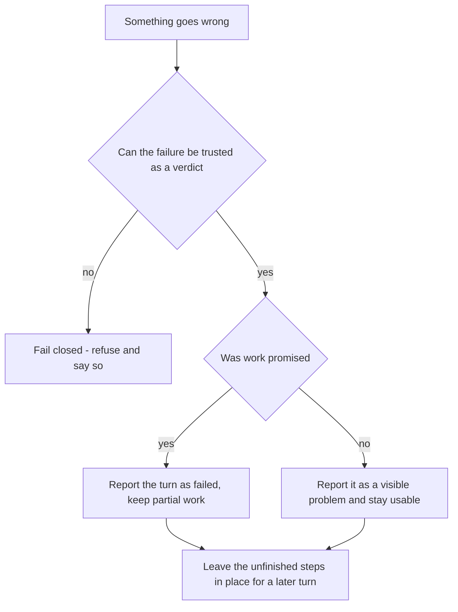

# DeerFlow — Exceptions and Edge Cases

> What happens when something fails, is refused, or is unexpected — and what the
> person actually sees. Implementation detail is translated into business terms.
>
> **Evidence convention:** **Confirmed** · **Assumption** · **Unresolved**.

---

## 1. The governing instinct

Reading the failure paths together, three defaults stand out and explain most of
what follows. **Confirmed**

| Instinct | What it means |
|---|---|
| **Fail closed** | When a check itself breaks — a safety check that errors, a reviewer that cannot be reached, a memory store that cannot be read, an approval whose owner vanished — the action is **refused**, not waved through. |
| **Never claim what cannot be shown** | A turn that promised output files but could not hand them over is a **failed** turn. A report citing no evidence is labelled **unverified**. An empty final answer becomes a visible error rather than a quiet success. |
| **Say which limit you hit** | Stopping is informative: thirteen named reasons for the outcome loop, a named missing decision for blocked unattended work, a "waited too long" message for a queued occurrence that expired. |

---

## 2. Getting in

| Situation | What happens | What the person sees |
|---|---|---|
| Wrong password | Refused and counted per address; after **5 failures in 300 s** further attempts are temporarily blocked, timed from the **first** failure. | A plain refusal, then a temporary block. **Confirmed** |
| Session expired or tampered with | Refused outright; there is no fall-through to anonymous use. | Sent to sign in, then returned to the page they wanted. **Confirmed** |
| Account disabled | Rejected **before** the password is even checked; any token they hold stops working while suspended. | Told the account is disabled. **Confirmed** |
| Sign-up switched off | New registrations refused. | Told registration is disabled. **Confirmed** |
| Two people race to set up the installation | One wins. | The other is told it is already initialised. **Confirmed** |
| Company sign-in provider down | Refused rather than let through. | Told sign-in failed. **Confirmed** |
| Company-sign-in address already used by a local account | **Refused, never silently merged** — nobody inherits someone else's work by coincidence. | A conflict. **Confirmed** |
| Forgotten administrator password | Operator command issues a random password into a file only the operator can read; every existing session is invalidated. | Operator-mediated recovery. **Confirmed** |
| Revoked or unknown script token | One generic answer, so responses cannot be used to probe which tokens exist. | "Invalid token". **Confirmed** |

---

## 3. Starting work

| Situation | What happens |
|---|---|
| Requesting work without the permission for it | Refused before anything is prepared; the draft is kept for retry. **Confirmed** |
| Trying to set or clear a completion condition while a turn is in flight — including a turn owned by a different worker | Refused, with an explanation; the condition is left unchanged and the command is **not** silently retried. **Confirmed** |
| Someone tries to inject a privileged instruction as though it came from the system | Rejected outright. This blocks new attempts but **does not rewrite history**: an older conversation that already accepted one keeps it, and restoring an older state can restore it. The stated remedy is a fresh conversation or an operator review. **Confirmed** |
| A conversation identifier supplied by a caller that does not fit the current rules | Older such conversations remain readable and deletable but **cannot start new work** or create new files. **Confirmed** |
| A conversation identifier collision between concurrent requests | The first one's record wins and is preserved; retries do not clobber the current state. **Confirmed** |

---

## 4. Inside a turn

### The model or provider misbehaves

| Situation | What happens |
|---|---|
| Provider connection or timeout failure | Retried within a small budget — **three attempts in total**; other unexplained provider failures get **one** retry. **Confirmed** |
| Retries exhausted | The turn is recorded as failed and the person gets a **visible message carrying the failure**, not silence. **Confirmed** |
| Provider halts an answer for safety or length | Tool use from that answer is suppressed, including malformed calls; an empty filtered answer gets an explanation; a visible partial answer without tool use is **kept**. **Confirmed** |
| Tool calls all succeeded but the final answer came back empty | Retried **once**, then reported as a visible error rather than a silent success. **Confirmed** |
| A tool call loop has to be force-stopped | The history is repaired before the next step so the provider does not reject the conversation; partial text is preserved. **Confirmed** |
| The conversation's saved state is not usable for a new turn | The turn fails its pre-flight and gets a zero-delivery record rather than pretending to have delivered. **Confirmed** |

### Guards intervene

| Guard | Behaviour |
|---|---|
| **Safety check on an action** | Below the bar the action is refused and the assistant is told, so it can adapt. If the checker itself errors, the action is **blocked by default**. **Confirmed** |
| **Implausibly large action request** | Refused locally, without consulting the checker. **Confirmed** |
| **Repetition guard** | Watches both repeated action sets and per-action frequency. A hard limit stops the **whole batch before any of it runs**; a warning-only batch still runs and gets a hint on the next step. **Confirmed** |
| **Effort allowance exhausted** | The turn stops; unfinished steps are kept; a declared completion condition **stays active** for a later turn rather than being failed. **Confirmed** |
| **Words are not evidence** | Page titles, quoted error text and words such as "timeout" or "no results" do **not** by themselves establish a failure or that a tool is permanently unavailable. **Confirmed** |

### Waiting for a person

| Situation | What happens |
|---|---|
| Nobody answers a main-line approval | It **does not expire** and keeps new work on that conversation blocked; the person may instead choose to roll the turn back. **Confirmed** |
| A secondary or delegated approval, and the turn is cancelled / times out / changes hands / the service restarts | It dies and **fails closed** — the work is not carried out. **Confirmed** |
| An approval recorded by an older version without a proper identifier | **Can never be answered**, not even by refusing everything. The person must continue in a new conversation. **Confirmed** (a known open issue) |
| Cancellation while a step is running | That step is allowed to finish; the next prompt is held back with a notice rather than racing it; partial text and unfinished steps are kept. **Confirmed** |

---

## 5. Delegated work

| Situation | What happens |
|---|---|
| A helper's model or provider fails | Reported as a **failed** task and the main assistant is told — never a fake success. **Confirmed** |
| A helper exceeds its allowance | Its status is published as **timed out**; the slot and its claim are held until cleanup genuinely finishes. **Confirmed** |
| A helper is called off | It keeps its place through cleanup so its work cannot be double-run. **Confirmed** |
| A helper returns nothing | Shown as "no response generated" rather than an empty success. **Confirmed** |
| A helper's status is not recognised | Left as **in progress** rather than guessed at. **Confirmed** |
| A batch prerequisite fails or is called off | Everything depending on it fails **without starting**, and a manual retry of the prerequisite does **not** requeue them — each blocked piece needs its own retry. **Confirmed** |
| Thin evidence against a piece's acceptance criteria | Verdict **unverified**, not a pass. **Confirmed** |
| A durable batch item whose owner was disabled, reset, or whose role changed | The item cannot start; ownership is re-checked before starting and again after capacity is taken. **Confirmed** |

---

## 6. Files and the workspace

| Situation | What happens |
|---|---|
| Attachment over the per-file or per-request limit | Refused, with the size reason. Defaults: **10 files, 50 MiB each, 100 MiB per request**. **Confirmed** |
| A duplicate file name in one upload | Renumbered rather than overwriting, and the response reports the names actually saved. **Confirmed** |
| A name that would escape the conversation's area, a Windows reserved device name, or a trailing dot | Refused **before any bytes are staged**, with a rename hint. **Confirmed** |
| A link standing in for a file, on upload or delete | Never followed; deletion of such a thing reports "not found". **Confirmed** |
| Cancelling an upload whose conversion is already running | Waits for the conversion to finish before removing its temporary source — so cancellation can take as long as the conversion. **Confirmed** |
| A file too large to preview | Preview shows the first **1 MiB** and offers an explicit "load full file". **Confirmed** |
| A file the browser would happily run | Active HTML, XHTML and SVG are **forced to download** rather than rendered. **Confirmed** |
| Disk space runs out | **Unresolved** — the only guidance found is troubleshooting advice to check disk space; no defined behaviour. |
| Scanning the workspace for changes after a turn | Capped at **2 000 files**; a truncated scan **skips verification** rather than reporting a false picture. **Confirmed** |

---

## 7. Remembering

| Situation | What happens |
|---|---|
| The memory store cannot be read | Either it fails or it returns complete data — **never a partial list**. A strict policy stops the turn; a lenient policy continues without new context. **Confirmed** |
| A read hangs | There is a short deadline; on expiry the turn stops under a strict policy. The waiting worker may still be occupied until the store returns. **Confirmed** |
| The stored file is corrupt | It is set aside under a timestamped copy rather than trusted. **Confirmed** |
| A fact's confidence value is unusable | Treated as middling rather than rejected outright. **Confirmed** |
| Two writers collide | A conflict is reported; a corruption is reported as a server fault; a management operation the store does not support says so explicitly. **Confirmed** |
| The service exits with facts still queued | Those pending facts **can be lost**; shutdown tries to drain them within a time limit. **Confirmed** |
| A project's facts fail to save after the personal ones committed | The batch is consumed anyway, so the paid work is not re-run; the failure is logged and reported **separately**, and is **not** automatically retried. **Confirmed** |

---

## 8. Acquiring capabilities

| Situation | What happens |
|---|---|
| A pack fails the offline scan on something serious | Installation **aborted**, naming the file and the reason. **Confirmed** |
| A pack is unsafe as *packaged* — escapes its folder, is oversized, contains a program binary | Aborted **before anything is written**. **Confirmed** |
| A pack's name is already in use | Refused as already existing. **Confirmed** |
| The reviewer cannot be understood, or cannot be reached | **Block** by default. Only non-executable material may be let through on a warning, and only if the operator deliberately switched off fail-closed. **Confirmed** |
| A pack's configuration is malformed | The administrator sees a "could not load" warning with the file and line; the pack stays unavailable to the assistant rather than half-working. **Confirmed** |
| A connected system's launch program is not on the named list | Enabling it is **blocked**, with the reason shown; one bad connection no longer prevents the others from being switched. **Confirmed** |
| A connected system cannot be reached | It is **skipped**; the others keep their tools, and it returns on the next refresh. **Confirmed** |
| A long external job asks for more input | Its status says so, but **the answer cannot yet be sent back** — a known gap. **Confirmed** |
| The organisation's document search fails | One generic "retrieval failed" message that never exposes credentials. **Confirmed** |
| One document in the chosen set is unreachable | The **whole** retrieval is rejected rather than quietly answered from the rest. **Confirmed** |
| A cited record has since disappeared | Reported as **unavailable**, never reconstructed from memory. **Confirmed** |

---

## 9. Unattended work

| Situation | What happens |
|---|---|
| Nobody is there and the work needs a human decision | **Refused**, with the missing decision named in a structured outcome — it does not park forever. **Confirmed** |
| Risky or hard-to-undo work without authorisation | Blocked with a structured reason. **Confirmed** |
| No free slot when the occurrence falls due | Queued, surviving a restart, then **skipped with a message** after the wait limit — **one hour** by default. **Confirmed** |
| The schedule's definition is edited while an occurrence waits | The queued occurrence keeps the **frozen** definition. **Confirmed** |
| The schedule cannot be interpreted — for example a missing time zone | The task is **paused with a stated reason** rather than silently drifting. **Confirmed** |
| A restart interrupts a running occurrence | Silent — no notice, and **no catch-up** on resume. **Confirmed** |
| The completion-hook for a failed occurrence cannot finish | Finalised on the next poll. **Confirmed** |
| One occurrence hits a storage error | Logged; the **others still proceed**. **Confirmed** |
| Three consecutive occurrences judged "outcome not met" | The task **pauses itself**. Failures to *check* the outcome neither count towards this nor reset it. **Confirmed** |
| A notice cannot be delivered because the platform is out | Parked for about a day; a rejection is retried after roughly fifteen minutes and then marked failed; retries stop after **5 attempts**. **Confirmed** |

---

## 10. Sharing and projects

| Situation | What happens |
|---|---|
| Trying to share a conversation that is still working, or from a stale state | Refused with a conflict; only the current idle state can be frozen. **Confirmed** |
| A snapshot over any of its limits | The **whole** snapshot is refused rather than trimmed. **Confirmed** |
| Sharing on a service without a proper database | Reported as unavailable. **Confirmed** |
| Expired, revoked or unknown link | All three answer identically: unavailable. **Confirmed** |
| Continuing a shared conversation | Requires signing in first; the copy is independent and **outlives revocation of the source link**. **Confirmed** |
| Project instructions too long | **Refused, never silently truncated.** **Confirmed** |
| Writing to an archived project | Refused; reads keep working, including the full document shelf. A trashed document cannot be restored **into** an archived project. **Confirmed** |
| The trash retention setting cannot be read | Automatic cleanup is **deferred** and the trash listing stays available; cleanup resumes once the setting is readable. **Confirmed** |
| A document already missing when it is purged | Does not block deletion; other faults leave it in the trash for retry. **Confirmed** |

---

## 11. Browsing the live web

| Situation | What happens |
|---|---|
| A destination resolves to a private or internal address | Outbound addresses are screened, and the connection is pinned to the screened address, so a late answer cannot redirect it to an internal host. **Confirmed** |
| Attaching to an already-running browser elsewhere | **Fails closed** unless the operator explicitly accepts the unguarded risk, because the product's own screening cannot be enforced there. **Confirmed** |
| The live view cannot connect | A **10-second** handshake deadline, then capped retries — up to **six** — with recovery guidance; a successful connection resets the budget, and turning the view off and on starts a fresh one. **Confirmed** |
| A screenshot would overwrite an existing deliverable | It never does; the name is moved on instead. **Confirmed** |
| The browsing capability is configured but not actually installed | The service **refuses to start** rather than half-offering it, and the interface hides the control. **Confirmed** |

---

## 12. Consistency after a stumble

| Situation | What happens |
|---|---|
| A worker dies mid-turn | On start-up the orphan is claimed and back-filled as an error marked **recovered**. **Confirmed** |
| A crash between committing a turn's end and confirming its record | The turn can be left without a terminal event; recovery does not wait on that record. **Confirmed** |
| A conversation exists only in older saved state | An empty message feed is seeded from that state before the next turn, so both the old and new turns stay visible. **Confirmed** |
| Deleting a turn's records | The conversation's ordering marker is preserved so a reader cannot miss later messages; it is only reset once no records remain. **Confirmed** |
| Deleting a conversation partially fails | The saved-state failure surfaces as a server fault and the owner record is **kept for retry**. **Confirmed** |

---

## 13. Things that look like failures but are not

| Appearance | Reality |
|---|---|
| A conversation not found | Could be someone else's — the product deliberately does not confirm it exists. **Confirmed** |
| "Skipped - it waited too long" | A deliberate expiry of a queued occurrence, not a crash. **Confirmed** |
| An occurrence that produced no notice | Manual trials, interrupted occurrences and start-up failures are **silent by design**. **Confirmed** |
| A turn stopped with unfinished steps still on the list | Intentional: the steps are kept for a later turn rather than marked done. **Confirmed** |
| A cited document that will not open | Reported as unavailable by design; the citation is a snapshot, not a live copy. **Confirmed** |
| Usage figures that do not add up to a bill | Recorded usage may be incomplete during a running turn or when a provider omits it, and is explicitly **not** a provider invoice. **Confirmed** |

---

## 14. Unresolved failure questions

- **Unresolved.** What happens when the disk fills up during an upload or a
  workspace write — no defined behaviour was found.
- **Unresolved.** Whether a per-run wall-clock cap exists for unattended work
  beyond its step limit.
- **Unresolved.** The precise mechanics of how long an undeliverable notification
  is parked before being abandoned ("about a day").
- **Unresolved.** Whether uploads accept arbitrary file types beyond the documented
  conversion list — no allow-list was found either way.
- **Unresolved.** Whether stored memory facts ever expire on their own; only an
  eviction policy for making room was found.
