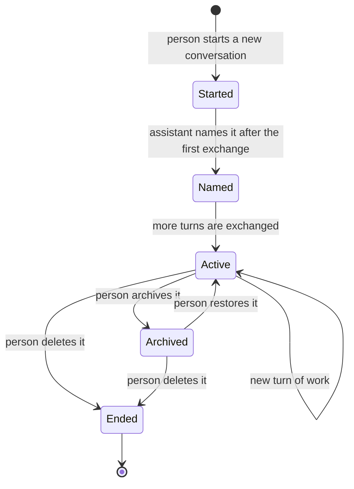
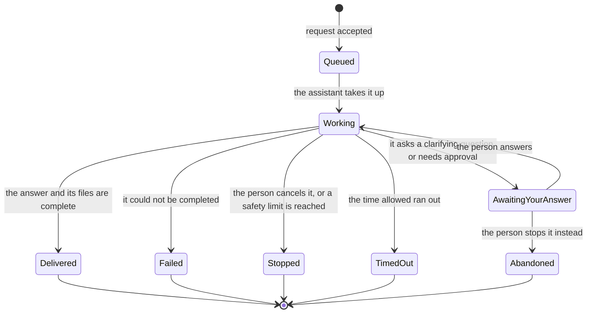
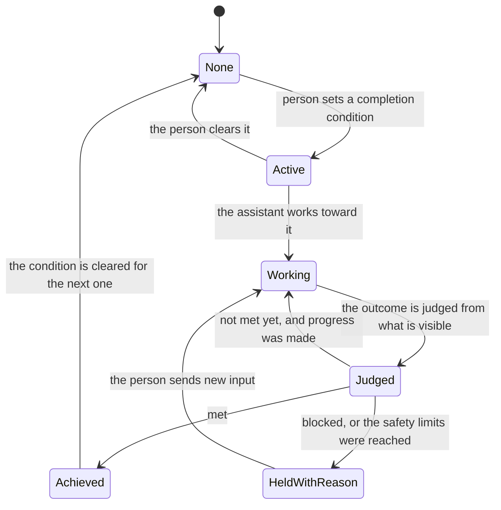

# DeerFlow — States and Transitions

> Business-level description of the stages a business object in DeerFlow can be
> in, and what moves it from one stage to the next. Implementation detail
> (languages, data schemas, service internals) is deliberately excluded.
>
> **Evidence convention used across all documents**
> - **Confirmed** — behaviour directly observable in the codebase or its guides.
> - **Assumption** — inferred from the design; not explicitly stated.
> - **Unresolved** — an open question the codebase does not answer.

DeerFlow has four objects that carry a lifecycle, and each has its own stages:

| Object | What it is in business terms |
|---|---|
| **Conversation** | The running engagement between one person and the assistant. |
| **Turn of work** (a *run*) | One request the assistant is asked to carry out, start to finish. |
| **Completion condition** (a *goal*) | One outcome the person declares and the assistant keeps working toward. |
| **Work list** and **delegated sub-tasks** | The steps the assistant tracks, and the pieces it hands to its own helpers. |

Files, projects, shared snapshots and messaging connections have their own
stages, covered in the last sections.

---

## 1. Conversation lifecycle

| Stage | What it means | What moves it on |
|---|---|---|
| **Started** | A conversation exists and has an identifier; it may not yet have a name. | The first exchange of messages. **Confirmed** |
| **Named** | The assistant gives the conversation a title of its own, taken from the original request. A message that carries only attachments is titled from the file name, or from `N files uploaded`. **Confirmed** |
| **Active** | Turns are being exchanged; a private workspace belongs to this conversation and nothing from another conversation is visible in it. **Confirmed** |
| **Pinned** *(an overlay, not a stage)* | The person keeps the conversation at the top of their list. Pinning survives archiving and restoring. **Confirmed** |
| **Archived** | Hidden from the recent list but everything is kept — messages, files and the original link. Restorable individually. Archiving does **not** stop work already in progress or pause any schedule. **Confirmed** |
| **Restored** | Back in the recent list, with its original activity time and pinned state preserved. New activity does **not** restore it automatically. **Confirmed** |
| **Deleted** | The conversation, its files and its history are removed and cannot be undone. Deletion asks for confirmation showing the title. If removal of the saved state fails, the record is kept so the deletion can be retried. **Confirmed** |

**Confirmed.** Archiving and deleting are deliberately different actions: archive
hides, delete destroys.

**Assumption.** There is no formal "closed" or "completed" stage for a
conversation — a conversation stays open indefinitely. Completion is expressed on
the *goal* and the *turn of work*, not on the conversation itself.

---

## 2. Turn of work (run) lifecycle

This is the object a person actually waits on. Every request — a chat message, a
scheduled wake-up, a message arriving from a chat app — becomes one turn of work.

| Stage (business name) | Recorded as | What it means to the person |
|---|---|---|
| **Queued** | `pending` | Accepted, not yet started. **Confirmed** |
| **Working** | `running` | The assistant is reasoning, reading, running work in its workspace, and streaming progress. **Confirmed** |
| **Awaiting your answer** | `waiting_for_input` | The assistant has asked something of the person — a clarifying question or an approval — and will not proceed until it is answered. **Confirmed** |
| **Delivered** | `success` | The turn finished and its answer and output files were handed over. **Confirmed** |
| **Failed** | `error` | It could not be completed. The person still gets a visible message explaining the failure rather than silence. **Confirmed** |
| **Stopped** | `interrupted` | Cancelled by the person, or halted by a safety limit. Anything already produced is kept; unfinished steps stay on the work list. **Confirmed** |
| **Timed out** | `timeout` | The allowed time ran out. **Confirmed** (the stage exists and ends the turn; *what* sets it is **Unresolved**) |

**Unresolved.** One recorded status, "awaiting your answer", is listed both as a
finished state and as a blocking one. In practice it behaves as *blocked pending
the person's reply*: while it is unanswered, new work on that conversation is
refused — unless the person chooses the option that rolls the turn back.

### What the person can change while a turn is in flight

| Action | Effect |
|---|---|
| **Cancel** | The turn ends as *Stopped*. A step already under way finishes first, so the answer is not left half-written. Cancellation cannot be used to retroactively approve anything. **Confirmed** |
| **Walk away (close the tab)** | By default the turn is cancelled. It can instead be left to continue, and the person can rejoin and watch it finish. **Confirmed** |
| **Watch only** | Rejoining to watch an existing turn is read-only; it cannot also stop or roll back that turn. **Confirmed** |

---

## 3. Approval and clarifying-question stages

When the assistant needs the person's decision, it raises a request and waits.

| Stage | Meaning |
|---|---|
| **Raised** | A question or approval request is put in front of the person. **Confirmed** |
| **Held** | The turn waits. A request raised by the main line of work **does not expire** and keeps new work on that conversation blocked until it is answered. **Confirmed** |
| **Answered / Granted / Refused** | The turn resumes on the strength of the answer. **Confirmed** |
| **Voided** | A request raised inside delegated or secondary work dies if the turn is cancelled, times out, changes ownership, or the service restarts — and it fails *closed*, meaning the work is not carried out. **Confirmed** |
| **Unresumable** | A request recorded by an older version without a proper identifier can never be answered, not even by refusing everything. The person must continue in a new conversation. **Confirmed** (a known open issue) |

---

## 4. Completion condition (goal) lifecycle

A person can attach **one** completion condition to a conversation — "finish the
implementation and make every test pass". It survives context summarisation, so
the assistant keeps working toward it even after the message that stated it has
been folded away.

| Stage | Meaning |
|---|---|
| **None** | No condition set. **Confirmed** |
| **Active** | One condition is attached and visible above the input box; the assistant sees it on every step. **Confirmed** |
| **Judged** | After each finished turn, a *separate, non-reasoning judge* reads what is visible — the answer, the steps taken, shortened results — and decides whether the condition is met. Success of an individual step is **not** enough. **Confirmed** |
| **Auto-continue** | If genuinely not met yet, the assistant quietly starts another turn without the person asking. **Confirmed** |
| **Achieved** | The condition is cleared and the achievement is recorded in the same save, and stays visible until the next condition changes. **Confirmed** |
| **Stood down with a reason** | Auto-continue stops and the person is told *why* in plain words. The condition itself **stays active** for a later turn. **Confirmed** |
| **Cleared** | Removed by the person. Clearing, or any new message from the person, always beats a queued auto-continue. **Confirmed** |

### The reasons auto-continue stops (translated)

These are the recorded stand-down reasons, each of which the interface shows in
words rather than as a code. **Confirmed** (a cross-component contract file lists
them so the display never shows a raw code).

| Recorded reason | What it means for the person |
|---|---|
| `blocked:missing_evidence` | The work cannot be shown to be finished from anything visible. |
| `blocked:needs_user_input` | The assistant ended the turn on a question the person has not answered. |
| `blocked:run_failed` | The turn itself failed. |
| `blocked:external_wait` | Something outside the assistant is still pending. |
| `max_continuations_reached` | The assistant has taken the allowed number of silent turns (**8 by default**). |
| `no_progress_detected` | Two turns in a row produced no new observable progress (**2 by default**). |
| `token_capped` | The agreed effort allowance for the turn was used up. |
| `loop_capped` | The repetition guard fired. |
| `recursion_capped` | The turn hit its limit of steps. |
| `evaluator_failed` | The judge itself could not produce a usable verdict. |
| `no_durable_end_of_turn` | There was no trustworthy record that the turn really ended. |
| `thread_changed_after_evaluation` / `thread_changed_before_continuation` | The person changed the conversation while it was being judged, so the judgement was thrown away rather than acted on. |

**Confirmed.** Four of these are classed as *the condition could not be checked*
rather than *not met*: a failed judge, no trustworthy end-of-turn record, and the
two "conversation changed" cases.

**Confirmed.** Only a narrow set of conditions permits an auto-continue: the
turn's last answer must be durably saved, the blocker must be "not met yet", the
conversation must not have changed during judging, and the no-progress breaker
must not have fired. If the judge returns an unusable verdict format, the same
evidence is judged **once** more; a second failure stops auto-continuing without
re-running the work.

**Confirmed.** A goal cannot be set or cleared while a turn is in flight on that
conversation — including a turn owned by a different worker — and the person is
asked to wait. A person without permission to start work is refused *before*
anything is prepared, and keeps their draft to retry.

---

## 5. Work list (plan mode) stages

Each tracked step is one of **Not started**, **In progress**, **Done**. A step
submitted without a stage counts as Not started.

**Confirmed.** When a turn is halted by the repetition guard, the effort cap, or
a provider-side safety or length limit, the unfinished steps are **kept** for a
later turn instead of being marked done. When the step list itself has been
summarised out of sight, the assistant re-reads the current stages before its
next step.

---

## 6. Delegated sub-task stages

The assistant can hand a piece of work to one of its own helpers, which works in
its own isolated context and cannot see the main conversation.

| Stage | Meaning |
|---|---|
| **Running** | The helper works in the background; progress is reported into the conversation. **Confirmed** |
| **Completed** | Its result comes back to the main line of work. **Confirmed** |
| **Failed** | It could not finish. **Confirmed** |
| **Cancelled** | It was called off. **Confirmed** |
| **Timed out** | It exceeded its allowance. By default a helper may run for **30 minutes**, with a **15-minute** fallback allowance where no built-in allowance applies; at most **3 helpers work at the same time**, and at most **6 pieces of delegated work are allowed within one turn of work**. **Confirmed** |

**Confirmed.** A durable batch of such work keeps its claim on the item alive
while it works, re-checks that the item still belongs to the same person before
it starts and again after it takes up capacity, and refuses an item whose owner's
account has been disabled or reset, or whose role has changed.

---

## 7. Document and file stages

| Object | Stages |
|---|---|
| **An attachment being sent** | Ready → Uploading → Uploaded / Failed / Cancelled, each file independently. A failed file keeps its own error detail and can be retried or removed while the rest of the upload and the message draft survive. **Confirmed** |
| **A conversation's output files** | Produced into the conversation's own workspace; presented as the deliverables of the turn. If hand-over of promised output fails, the turn is reported as failed and nothing is claimed as delivered. **Confirmed** |
| **A project document** | On a project's shared shelf → **Trashed** (deleted but retained for **30 days** by default) → **Restored** to its origin project or a project you pick, or **Purged permanently**. "Empty trash" removes everything immediately. Deleting a project moves its whole shelf to trash in the same step. **Confirmed** |
| **A shared snapshot** | **Created** (a frozen copy of the visible conversation plus the output files it had at that moment) → **Available** to anyone holding the link, no sign-in needed → **Expired** (after **7 days** by default; **1 hour to 30 days** selectable) or **Revoked** by the owner. Expired, revoked and unknown links all behave identically: unavailable. Revoking also deletes the stored copy. Copies the recipient already downloaded or imported are unaffected. **Confirmed** |
| **A project** | **Active** → **Archived**, which freezes writes but keeps reads: member conversations still run and still receive the project's instructions and document index. Deleting an archived project is still allowed. **Confirmed** |

**Unresolved.** There is no implemented retention *deletion* of a conversation's
saved state — the retention rules are written down as a contract but the cleanup
itself is not in place. The contract does define what must never be deleted:
anything needed to resume, the ancestors of a branch, a write still in progress,
the links that hold the history together, and the latest resumable state.

---

## 8. What has no stage

**Confirmed.** Three things people might expect to be stateful are not:

- **The conversation has no completion stage.** Completion belongs to the goal
  and to each turn.
- **A turn's cost is not a stage.** Token and time allowances stop a turn; they
  do not create an intermediate state.
- **Memory entries are only ever present or physically removed** — a stored fact
  has no "expired" or "disputed" stage.
