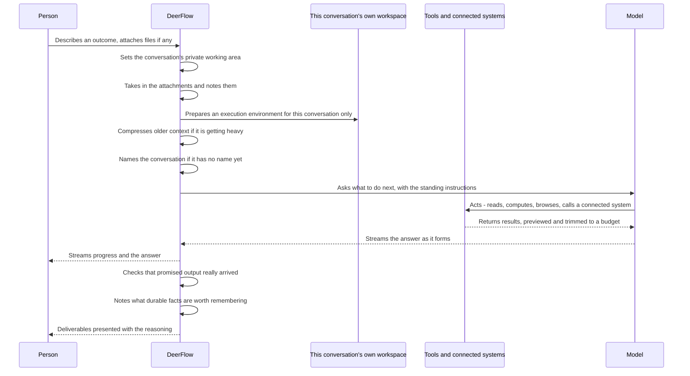
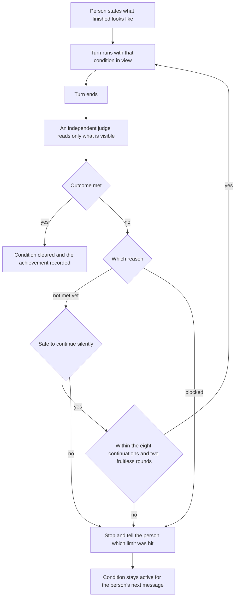
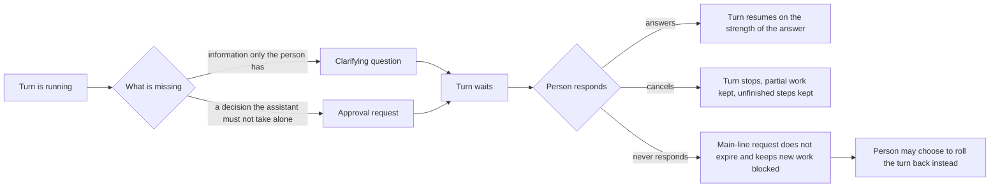
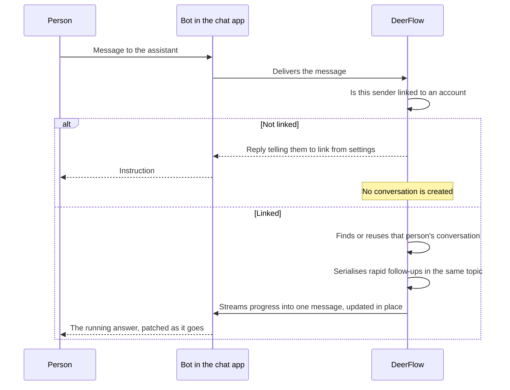
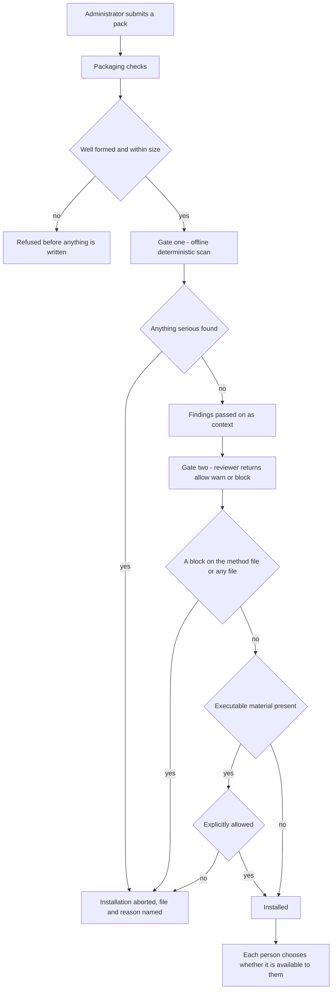
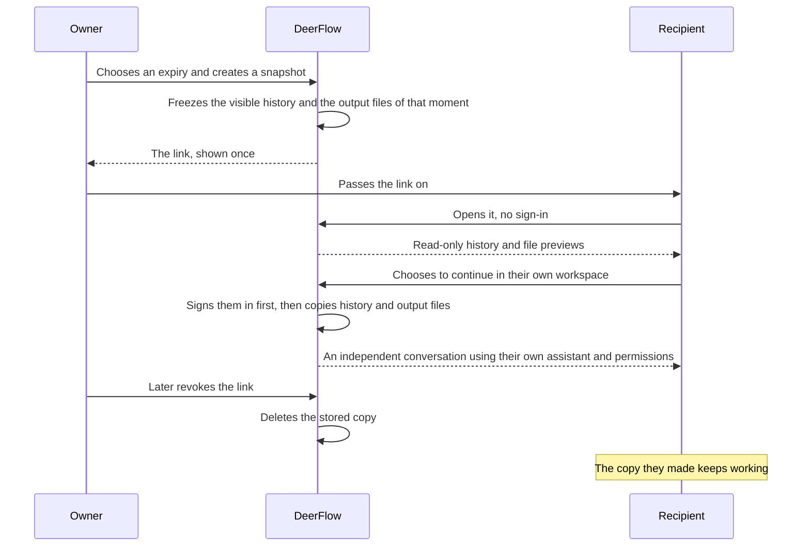

# DeerFlow — Workflows

> Step-by-step accounts of how each process actually runs, including the branch
> points. Implementation detail is translated into business terms.
>
> **Evidence convention:** **Confirmed** · **Assumption** · **Unresolved**.

---

## W1 — The core turn of work

**The ordered stages, in business terms.** Each stage exists and does what is
said; the exact live ordering of the newer stages is **Unresolved** because the
published list is out of date relative to the code. **Confirmed** for the stages
listed in the product's own architecture guide.

| # | Stage | What it decides or does |
|---|---|---|
| 1 | Prepare the ground | Give this conversation its own working area — nothing from another conversation is reachable. |
| 2 | Take in what the person sent | Newly attached files become visible to the assistant. |
| 3 | Provide somewhere to act | An execution environment belonging to this conversation, created lazily — only when something actually needs it. |
| 4 | Keep the thread of context | If the conversation is getting heavy, older activity is folded into a summary that is told to preserve active requirements and approval conditions. |
| 5 | Name the work | A title is generated from the original request after the first exchange. |
| 6 | Track the plan | On a multi-step job, the visible step list is maintained. |
| 7 | Handle images | Images are handed to the model when it can see them. |
| 8 | Ask rather than guess | A clarifying question interrupts the turn instead of letting it proceed on a guess. |
| 9 | Verify delivery | If the answer promised output files, their arrival is checked; a failure is reported as a **failed** turn. |
| 10 | Note what is durable | The conversation is queued for memory extraction, which is batched rather than immediate. |

**Rules that shape the middle of the turn.** Tool results are previewed and
trimmed to a character budget, with the full result still available on request and
guidance to go and read it; the assistant sees only the **names** of available
documented methods until it looks one up; each action may be put through a safety
check before it runs; and repeated action sets or over-frequent use of one action
trip a repetition guard. **Confirmed**

---

## W2 — Working to a declared outcome

**Confirmed.** Note the deliberate asymmetry: stopping is always *informative*,
and the condition is never quietly dropped — only the person, or a met outcome,
clears it.

---

## W3 — When the assistant needs the person

**Confirmed.** Two operational consequences worth flagging to a service owner:
a main-line approval **holds the conversation** until someone answers it, and
unattended runs cannot wait at all, which is why scheduled work refuses rather
than parks.

---

## W4 — Handing pieces of the job to helpers

1. The assistant decides a piece of work can be done separately and calls for a
   helper. **Confirmed**
2. The helper is started in the background **in its own context** — it cannot see
   the main conversation or the other helpers. **Confirmed**
3. At most three run at once; at most six in one turn of work. Anything beyond the
   limit is truncated rather than queued. **Confirmed**
4. Progress is reported into the conversation as cards showing the model used and
   the cost so far. **Confirmed**
5. The helper returns its result to the main line of work. **Confirmed**
6. If it fails, the failure is reported **as a failure** — never dressed up as a
   success — and an unknown status is left as "in progress" rather than guessed.
   **Confirmed**
7. Pieces with dependencies between them can be declared as a batch; partial
   results stay visible, and if a prerequisite fails or is called off, the pieces
   depending on it fail **without starting** and each needs its own retry.
   **Confirmed**
8. Acceptance criteria — a test outcome, a file or content check — decide each
   piece's verdict; thin evidence yields **unverified** rather than a pass.
   **Confirmed**

---

## W5 — A job that outlives the conversation

For an external system whose work takes minutes or hours:

1. The assistant submits the job and receives a **reference**; that is all it
   holds. **Confirmed**
2. The service itself tracks the job durably, with a claim that is renewed, so a
   restart does not lose it, and polls for status in the background rather than
   keeping the assistant busy. **Confirmed**
3. The job may end as completed, failed, cancelled — or **awaiting input**. **Confirmed**
4. **Gap**: an answer to "awaiting input" cannot yet be sent back through this
   route. **Confirmed**

---

## W6 — Scheduled work, start to finish

Workflow detail is in BUSINESS_PROCESSES.md §6 with its flowchart. The step
sequence a person should expect:

1. The person sets the task in the workspace, in conversation, or from a chat app.
   **Confirmed**
2. Timing is one of: once at a set time, a repeating pattern, or a fixed interval
   between one minute and one month. **Confirmed**
3. On the due time an occurrence is queued; a busy conversation or exhausted
   allowance keeps it queued for up to an hour, then it is **skipped with a
   message**, not silently dropped. **Confirmed**
4. The turn starts **without a person present**: no clarifying questions, and
   anything needing a human decision is refused with the missing decision named.
   **Confirmed**
5. The outcome is posted into the originating conversation, or a new one named for
   the task and time. **Confirmed**
6. Optionally, a notice is pushed to the person's chat app — one per occurrence,
   and silent for trials, interruptions and start-up failures. **Confirmed**
7. Stop conditions: a written condition, a lifetime count, an end date, or three
   consecutive "outcome not met" occurrences pausing the task automatically.
   **Confirmed**
8. Resuming does **not** catch up missed occurrences. **Confirmed**

---

## W7 — Work that starts in a messaging app

**Confirmed.** Rapid consecutive questions in the same topic are handled one after
another and stay visually distinguishable; a duplicate delivery inside ten minutes
is recognised and ignored.

---

## W8 — Acquiring a documented method, with its two gates

**Confirmed**, including the fail-closed default: if the reviewer cannot be
understood or cannot be reached, the result is a block. **Confirmed**

---

## W9 — Connecting an external system

1. An administrator adds a shared connection in the capability centre or the
   configuration; or a person adds one of their own, restricted to a public service
   over ordinary secure web protocols. **Confirmed**
2. If it would be launched by running a program on the server, the program must be
   on the short named list — and this is treated as defence in depth, not as a
   boundary. **Confirmed**
3. The connection is enabled; the change applies without a restart, and a cached
   tool list can be retired deliberately. **Confirmed**
4. If it cannot be reached at discovery, it is **skipped** and the others keep
   working. **Confirmed**
5. Its tools are offered to the assistant under a name prefixed by the connection,
   and when tools are numerous they are discovered on demand, with a selection
   lasting one turn. **Confirmed**
6. Preference hints to favour one connection over another are **advice only**.
   **Confirmed**
7. Because an administrator's role is re-checked before every privileged call, a
   demotion cuts their personal privileged connections immediately. **Confirmed**

---

## W10 — Sharing a finished conversation

**Confirmed.** What is deliberately *not* carried across: the source's assistant,
project, execution environment, uploads, tool calls and credentials — tool results
arrive as historical assistant text.

---

## W11 — Remembering, without charging a call per message

1. A conversation ends or pauses; it is queued for extraction rather than
   processed immediately. **Confirmed**
2. Extraction waits and batches — a short settling window with a hard maximum
   wait — to avoid paying for a model call on every message. **Confirmed**
3. Only what the person said and what the assistant finally replied is examined;
   intermediate tool activity is excluded. **Confirmed**
4. Each proposed fact is classified for scope and durability at a gate that
   **fails closed**: unclear, task-local or project-local facts do not enter the
   person's general memory. **Confirmed**
5. Facts are stored per person; project facts go into a separate pool used only
   inside that project. **Confirmed**
6. The next turn sees the top facts and context as background — subordinate to
   explicit instructions and the current request. **Confirmed**
7. The person can read, edit, delete or clear the facts at any time; a correction
   is protected from being merged away, and a merge is never treated as the
   person's agreement. **Confirmed**

**Confirmed.** Where a project pool is active, the shared extraction runs for every
eligible batch even when personal-memory screening would skip it — which costs
extra, and can be switched off per project while keeping its stored facts.

---

## W12 — Consulting the organisation's own documents

1. The operator connects the document store and names which collections may be
   used; a request cannot widen that list. **Confirmed**
2. Which collections to search is chosen for the turn by the person, or by a named
   assistant's saved default, or — for an unattended turn — by that default as it
   stood at dispatch. **Confirmed**
3. The assistant decides a search is needed and issues it; it is also given the
   names of available collections. **Confirmed**
4. Results come back as **retrieval-time snapshots**: excerpt, collection and
   document names, page numbers — retained after a reload, explicitly not live
   copies. **Confirmed**
5. The assistant is instructed to cite only the locators it was given; a cited
   record that has since gone is reported as unavailable rather than reconstructed.
   **Confirmed**
6. Failure is one generic message with no credentials exposed; but one document in
   the chosen set that the person cannot reach rejects the **whole** search.
   **Confirmed**

---

## W13 — Standing up a new installation

1. Copy the configuration template and the environment file. **Confirmed**
2. Add at least one model and its credential; a diagnostic step reports obvious
   placeholder keys as incomplete. **Confirmed**
3. Start the service — containers are the recommended route, and the entry point
   is published only on the machine itself. **Confirmed**
4. Open the address in a browser and complete the set-up screen: the first account
   becomes the administrator. **Confirmed**
5. Only then, if the service must be reachable from elsewhere, address allow-lists,
   pre-authentication or network isolation go in place. **Confirmed**

**Assumption.** Step 5 before exposure is guidance rather than an enforced gate;
the product will happily bind to a network address if told to.

---

## W14 — When the person walks away, or the machinery stumbles

| Situation | What happens, step by step |
|---|---|
| Person closes the tab | By default the turn is cancelled. Chosen otherwise, it continues and can be rejoined and watched to the end. **Confirmed** |
| A worker dies mid-turn | On start-up the orphan is claimed, back-filled as an error marked *recovered*, so it never looks alive. A crash in the narrow window between finishing and confirming can leave a turn without its final record; recovery does not wait on that record. **Confirmed** |
| Rejoining to watch | Read-only; it cannot also cancel or roll back that turn. **Confirmed** |
| A restart during a long job | Queued schedule occurrences survive; running turns do not and are **not** replayed. **Confirmed** |
| A step already running when cancelled | It is allowed to finish; the conversation holds the next prompt back with a notice rather than racing it. **Confirmed** |
