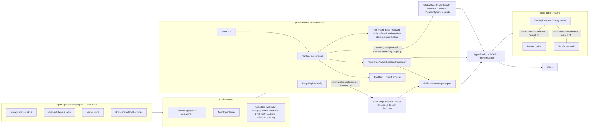
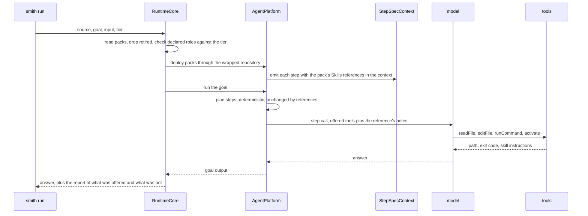
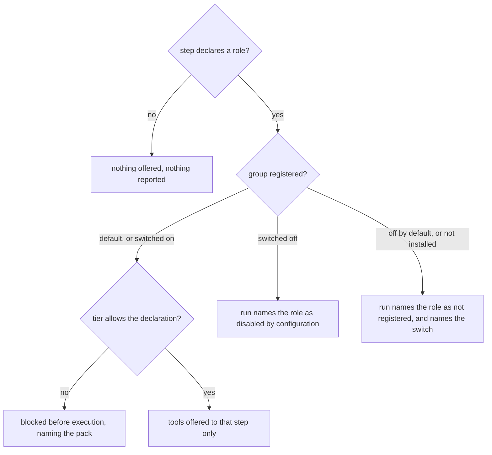

# Overview

Reading aid for this change, not a contract. `proposal.md` states what and why, `specs/` states the
behavior, `design.md` states the decisions. `file-map.md` lists the files.

## The whole change in one picture

```
                       BEFORE                                              AFTER

  steps/read.yml                              steps/read.yml
  ├─ prompt ─────────► model                  ├─ prompt ────────────────► model
  ├─ toolGroups:                               ├─ toolGroups:
  │    - file                                  │    - file ──────────────► ToolGroupResolver ─► readFile
  │        │                                    │        │                                            writeFile
  │        ▼                                            ▼                                            editFile
  │   (no bean registers "file"                 (bean registered by default; the
  │    -> empty tool loop,                      tier still decides whether the
  │    nothing says so)                         declaration is allowed)
  └─ references:                               └─ references:
       - repo-notes                                 - repo-notes
           │                                            ▼
           ▼                                     StepSpecContext.availableReferences
      (key deserializes, then resolves           ├─ <agent>-skills   <- skills/ beside the agent
       against an EMPTY list -> nothing)         └─ shared-skills    <- skills/ beside the folder
  skills/  (never read by smith run)             skills/  -> activate / listResources / readResource
```

Three separate gaps, closed by three separate mechanisms — a role that names nothing, a reference that
resolves against an empty list, and a skill folder no reader opens. The coding agent is where those three
gaps are visible at once; it is not the claim. The claim is a pack that follows a skill it has never seen,
and that asks four more things: the skill's scripts must be executable and controlled, a step must be able
to name a reference that is not a skill, whatever guards the run must be stated where it is enforced, and
the planner choice must be honest. Those four are in the sections below, and each one is smaller than it
sounds because the platform already ships the machinery.

## Who talks to what



The runtime imports no addon class. The platform resolves a declared role against the `ToolGroup` beans
that happen to be in the context, which is why an addon needs no host change and why presence alone must
not be reach.

## A run, start to answer



## Three things have to line up

Reach is the conjunction of three things: a pack's declaration, whether the group is registered at all,
and a tier's allowance. The middle one is now decided by a documented default plus a switch, so any one of
the three missing produces a different message, and the change makes all three messages exist.



The same shape governs skills, minus the tier: a step that names a reference gets the skill, a step that
names none gets none, and a name the pack does not carry is refused by validation rather than discovered
at run time.

Scripts are the one thing this shape does not govern. A script is not a tool-group role, so no row of this
diagram has a place to refuse one: the gates are the script switch, the engine it selects and the root that
engine is confined to, which is why the run reports the switch state separately rather than letting a
missing script tool be read as a tier decision.

## The example folder

```
agent-specs/coding-agent/
├── skills/                      shared by every definition below
│   └── repo-map/SKILL.md        orientation: where things live, what to read first
├── survey/                      reads only
│   ├── manifest.yml
│   ├── goal.yml                 export: true
│   ├── steps/locate.yml         toolGroups: [file]      references: [repo-map]
│   └── types/.gitkeep
├── change/                      writes
│   ├── manifest.yml
│   ├── goal.yml
│   ├── steps/patch.yml          toolGroups: [file]      references: [repo-map, patch-notes]
│   └── skills/patch-notes/SKILL.md     local: shadows nothing, wins over shared on a name clash
└── verify/                      runs the build
    ├── manifest.yml
    ├── goal.yml
    ├── steps/check.yml          toolGroups: [file, shell]
    └── types/.gitkeep
```

Three definitions rather than one, because the shared-skill rule is otherwise invisible, and because
several packs in one source is the arrangement where the planner can chain one into another.

## The second example, which needs nothing from this change

```
agent-specs/arithmetic/
├── manifest.yml
├── goal.yml                        export: true
├── steps/compute.yml               stepType: action
│                                   toolGroups: [math]     <- no references, no addon, no property
└── types/

  smith run --source folder:agent-specs --goal arithmeticAnswered --trust-tier high --input "..."
       |     (the source is the parent folder: FolderSpecSource reads the root's immediate
       |      subdirectories and keeps those holding a manifest.yml, so a pack-named folder
       |      resolves zero packs — as docs/07-runtime.md already states)
       |
       +-- default tier -> blocked before execution: STANDARD allows search, web, file. math is not one
       +-- high tier    -> the group resolves, because upstream's own mathToolGroup() bean is already
                           present in an untouched build. That is the point: this pack proves the channel
                           works even if the addon never lands, so a broken coding example narrows to the
                           addon rather than to the deploy path.
```

## The generic pack, which is the claim the coding agent only illustrates

`agent-specs/skill-interpreter` is a folder of definitions that follows a skill it has never seen. The
format has no ordering, no loop and no branch — the runtime ingests every subdirectory and lets the planner
infer sequence from types, `pre`/`post` are opaque names with no declaration site, and a `repeat` or `until`
key would be silently ignored by the reader. So the progression is carried by named types, not by position:

```
  RunBrief -> SkillDirective -> ActionPlan -> WorkLog / ScriptEvidence -> Verification -> TaskReport
     orient       select           plan            act        script          verify        (exported)
                                                                          \
                                                                           OpenQuestion   blocked branch
```

| definition | what it does | what it asks the deployment for |
|---|---|---|
| orient | reads the task, lists what the folder's skills offer | `file` (default set) |
| select | activates one skill, records what it requires | a carried skill |
| plan | writes intentions plus the acceptance criteria the **skill** stated | nothing beyond the above |
| act | carries them out with the file tools | `file`; `shell` only where the tier allows |
| script | the one definition holding a script-bearing reference | `smith.tools.scripts.engine` |
| verify | compares what happened against those criteria | the only step whose post-conditions the goal requires |
| escalate | names the decision when something is blocked | nothing — it produces the stop |

No prompt in the folder names a subject matter, which is what makes it generic rather than a coding pack
with the nouns filed off. Repetition comes from re-planning and `canRerun`, not from a loop key. It runs
from its own source, because a shared source lets the planner route through an unrelated pack once the tier
permits — measured behaviour in this repo.

## Scripts: the one door the tier cannot see

A trust tier decides reach by matching declared tool-group **role** names. A skill's scripts are not a role,
so no tier setting blocks a script. That asymmetry is the reason the default is off, and it is why the run
says out loud which state it is in rather than letting a missing script tool look like a tier refusal.

```
  smith.tools.scripts.engine = none      default: Skills assembles with NoOpExecutionEngine, so a
                                         script-bearing skill offers no script tool at all
                               = process  upstream's ProcessSkillScriptExecutionEngine, built through its
                                         confinedTo(root) factory — same root as the file tools, 30s default,
                                         environment allowlist
                               = docker   its own resource limits; refuses at start-up if no daemon,
                               = podman   rather than quietly falling back to the host
```

The engines are upstream's, which is why this is a property and a report line rather than a security
subsystem. Two upstream facts shape what can be promised: a script's callable name is
`<skill>_<file-basename>` with **no** sanitization, so the name on the wire and the file it came from are
both recorded; and `Skills.tools()` lists the script tools of every loaded skill, activated or not, so the
reading step and the executing step cannot share one `Skills` object — what separates them is whether a
script execution engine is attached, not `SkillFilter`, which 1.5.4 never consults.

## References that are not skills

A pack may carry a directory, a document or a brief the way it carries a skill folder, named in
`references.yml` and declared by a step with the same `references:` key. Only the kinds the runtime can
construct are allowed, and they are constructed through the platform's own reference types, so neither a
property nor a file can nominate a class. Three mistakes are closed at validation because upstream is
silent about all three: a dangling name (its `emit` resolves through a `map.get` that skips), a name pair
that sanitizes to one tool prefix (a silent `Map.put` overwrite), and — the one that matters most — a step
key the format does not implement, since `FAIL_ON_UNKNOWN_PROPERTIES` is disabled and a written safety wish
would otherwise read as a configured control. `GoalSpec` has no references field at all, so a goal-level
declaration cannot reach the model in the first place: it is reported under its own issue code as a
declaration that will be ignored, and the pack still validates — refusing it would fail this change's own
spec, which states the case as inert rather than invalid (design D14).

## What guards a run, and where it is written

Nothing here is a new subsystem, and nothing is a YAML key that no code honors.

```
  content guardrails     embabel.agent.guardrails.user-input / .assistant-message / .fail-on-error
                         — the platform's global registry. Nothing is wired here: the registry is a
                         @Component that upstream's own ScanConfiguration already component-scans, so
                         the bean exists with the property unset. What is authored is the guardrail class
  budgets and ceilings   ProcessOptions: action, cost and token budget, tool-loop ceiling,
                         tool-not-found policy. RuntimeCore passes ProcessOptions.DEFAULT today;
                         the change passes configured values with every default identical
  reach                  the trust tier, and only the tier — guardrails never substitute for it
  a human in the loop    a run that stops, carrying the question, the evidence and the command to
                         continue. It does not pause: durable resume needs a snapshot store, a resume
                         entry point and an interaction channel, and `smith run` has none of them.
```

A run prints this posture before it executes, including what it did not change, because a default is exactly
what a reader cannot see. One case makes that print load-bearing rather than decorative: the registry reads
its class lists from `@Value` and swallows an instantiation failure unless `fail-on-error` is set, which it
is not by default. A mistyped guardrail class name leaves a run that believes it is guarded, so the posture
line reports the guardrails the registry says it holds, not the ones the configuration named.

## Which planner, honestly

`--planner` and a pack's `defaultPlanner` already reach `ProcessOptions`, so there is no new seam here —
there is a correction and a measurement. `SUPERVISOR` is a `PlannerType` that routes to the same A\* GOAP
algorithm as `GOAP`, so a run names the algorithm that planned, not the label selected. And no `UTILITY` or
`HYBRID` run is recorded anywhere in this repo's evidence, so the interpreter pack is run under each and the
result — including a failure to reach the goal — written into `docs/07-runtime.md` rather than left for the
default to imply the alternatives were considered.

## How a name becomes a tool on the wire

```
  references: [repo-notes]                      the step file, Embabel's own key
        |
        v
  ActionStepSpec.references                     smith-common record component, added here
        |                                        (without it, the first rewrite drops the key)
        v
  AgentSpecWriter -> staged *.yml                verbatim, plus an optional model pin
        |
        v
  YmlStepSpecRepository -> PromptedActionSpec    upstream parses it, getReferences()
        |
        v
  PromptedActionSpec.emit(context)               upstream filters by name:
        |                                          context.availableReferences, keyed by LlmReference name
        v
  ReferenceAwareStepSpecRepository               THE ONLY NEW MOVING PART on this path:
        |                                          emit(ctx) delegates to spec.emit(ctx.copy(..., refs))
        v
  PromptRunner.withReference(skills)             activate / listResources / readResource
        |
        v
  wire name = <agent>_skills_repo-notes_activate reference prefix + skill + tool
```

Everything below `PromptedActionSpec.emit` is upstream code doing what it already does. The wrapper
exists because `StepSpecAgentScopeBuilder` hands the context an empty reference list and its constructor
offers no way to change that.

## What Embabel ships, and what stands it up

Read off the 1.5.4 jars on this machine, not off the documentation. "Implemented" means the class and its
`@LlmTool` methods exist; "registered" means a `ToolGroup` bean exists so a declared role resolves.

| Capability | Class | Implemented | On our classpath | Registered by default | What it takes to expose it |
|---|---|---|---|---|---|
| arithmetic | `tools.math.MathTools` (unfolding add/subtract/multiply/divide/min/max/mean/floor/ceiling) | yes | yes | **yes** — upstream's own `mathToolGroup()` bean | nothing; role `math` already resolves |
| read file, list dir, find files, size, exists | `tools.file.FileReadTools` (`readFile`, `listFiles`, `findFiles`, `fileSize`, `fileCount`, `exists`) | yes | yes | no | a `ToolGroup` bean over `FileTools.Companion.readOnly(root, …)` |
| create, overwrite, edit, append, mkdir, delete | `tools.file.FileWriteTools` (`createFile`, `writeFile`, `editFile`, `appendFile`, `createDirectory`, `delete`) | yes | yes | no | a bean over `FileTools.Companion.readWrite(root, …)` |
| search contents, match a glob | `tools.file.PatternSearch` (`findPatternInProject`, `matchesGlob`) | yes | yes | no | same bean, same group |
| a directory as a reference | `tools.file.LocalDirectory` (file-read tools *and* an `LlmReference`) | yes | yes | no | code constructs it; the reference route is code-only |
| blackboard inspection | `tools.blackboard.BlackboardTools` (get/list/describe/last/create/count) | yes | yes | no | code calls its `createXTool` factories per agent; never a group |
| agent-process inspection | `tools.process.AgentProcessTools` (status, cost, history, modelsUsed, toolStats, budget) | yes | yes | no | code-side factories, not a role |
| interactive confirmation and forms | `tools.agent.DefaultProcessCallbackTools` (`confirmation`, `submitFormAndResumeProcess`) | yes | yes | no | interaction machinery, wired by code |
| another agent as a tool | `tools.agent.GoalTool`, `AgentTool`, `PerGoalToolFactory` | yes | yes | no | chat-agent builders, code-side |
| skills: activate, read resources | `skills.Skills` (7 `@LlmTool` methods, plus synthesized script tools) | yes | **no** — only the builder's pom declares the artifact | no | add the dependency and construct it from a folder: this change |
| AppleScript | `tools.osx.AppleScriptTools` (`runAppleScript`, a `SelfToolGroup` with role `AppleScript`) | yes | yes | macOS only (`@Profile("!test") @Conditional(MacOSCondition)`) | run it on a Mac |
| web search, maps, github, browser | `CoreToolGroups` names — **no tool classes exist** | no | n/a | no | an MCP connection property (`spring.ai.mcp.client.stdio.connections.…`) |
| any MCP server as a group | `tools.mcp.McpToolGroup` | yes | yes (mcp client is transitive via `embabel-agent-api`) | no | `embabel.agent.platform.tools.includes.<role>` plus a connection |
| run a bash command | `com.embabel.coding.tools.bash.BashTools(String workingDirectory).runBashCommand(String): String`, in `embabel-agent-code` | yes | **no** — not a dependency here, and it drags jgit, javaparser and classgraph | no | add the artifact; it takes a boot-time cwd and returns a bare string — no timeout, no exit code |
| build a project, inspect a repo | `embabel-agent-code`: `CiTools.buildProject`, `SoftwareProject`, `ApiReference` | yes | no | no | the same artifact |
| skill scripts, actually run | `skills.script.SkillScriptExecutionEngine` with `NoOpExecutionEngine`, `ProcessSkillScriptExecutionEngine` (+ `ProcessResult` Completed/Failed/TimedOut), `Docker`/`PodmanSkillScriptExecutionEngine` over `AbstractContainerSkillScriptExecutionEngine` (`ContainerStartupStatus`, `ContainerStateInspection.Unavailable`) | yes | **no** — same artifact as `Skills`, declared only by the builder's pom today | no — `Skills` assembles with `NoOpExecutionEngine`, so a script tool is never offered | the dependency, plus `smith.tools.scripts.engine` to pick one (D4) |
| content guardrails | `api.validation.guardrails.GuardRail`, `UserInputGuardRail`, `AssistantMessageGuardRail`, `support.TokenBudgetGuardRail`, `GuardRailViolationException`; `spi.support.guardrails.GlobalGuardRailsRegistry` | yes | yes | **yes, as an empty registry** — the bean is created by upstream's `ScanConfiguration`, which component-scans `com.embabel.agent.spi` | nothing to wire: name classes in `embabel.agent.guardrails.user-input` / `.assistant-message`, with `.fail-on-error` (default false) deciding whether a bad class name throws |
| the bounds a step cannot declare | `core.ProcessOptions` (+ `ProcessOptionsSnapshot`, `ProcessOptionsOperationScheduler`) and `core.Budget` | yes | yes | yes — `ProcessOptions.DEFAULT`, which `RuntimeCore` passes verbatim | pass configured values; every default stays as it is |
| a planning strategy | `api.common.PlannerType` over `plan.goap.astar.AStarGoapPlanner`, `plan.goap.OptimizingGoapPlanner`, `plan.utility.UtilityPlanner`, `plan.utility.HybridUtilityPlanner` | yes | yes | yes — GOAP, via a factory `DefaultAgentPlatform` hardcodes | already selectable per run with `--planner` / a pack's `defaultPlanner`; one `PlannerType` name routes to another's algorithm (D17) |
| a `shell` or `file` **role** | nothing anywhere | — | — | no | the addon in this change, or the expose map |
| `@ToolGroup(role = …)` | the annotation exists, **no reader** in the 1.5.4 jars | — | — | no | annotating a class registers nothing |

The three rows that decide this change: `math` is already reachable, so a pack declaring it reaches a real
tool with no work from us; `file` and `shell` are implemented but unregistered, which is the gap the addon
closes; and the four network roles are names only, standing up or down on a machine property nobody in
this repo controls.

That "registered by default" column describes an untouched build. After this change, `file` joins `math`
there — by choice rather than by accident, and with its write surface still behind a switch — and every
group in the column gains a property that can remove it, which upstream offers for none of them.

## Where each coding tool comes from

The surface is modelled on the tool list a coding agent is expected to have, but most of it is not ours to
write. "Embabel" below means the class is already on the runtime's classpath and needs only a `ToolGroup`
bean; "ours" means code this change writes. The imitation column names the shape being copied, not a
dependency.

| Tool offered | Imitates | Comes from | What this change adds |
|---|---|---|---|
| read a file | `read_file`, `read_many_files` | Embabel — `FileReadTools.readFile` | the bean, and the root it is built over |
| list a directory | `list_directory`, `ls` | Embabel — `FileReadTools.listFiles` | the bean |
| find files by name | `glob` | Embabel — `FileReadTools.findFiles` | the bean |
| size, count, exists | `ls` | Embabel — `fileSize`/`fileCount`/`exists` | the bean |
| create a file | `write_file` | Embabel — `FileWriteTools.createFile` | the bean, and the write switch that can withhold it |
| overwrite a file | `write_file` | Embabel — `FileWriteTools.writeFile` | the bean and the write switch |
| targeted edit | `edit` | Embabel — `FileWriteTools.editFile` (`replaceOnce`/`replaceMany`) | the write switch, and the wording that states what changed |
| append, mkdir, delete | `write_file` | Embabel — `FileWriteTools` | the bean and the write switch |
| search file contents | `grep_search`, `grep` | Embabel — `PatternSearch.findPatternInProject` | the bean, and the cap with its "showing N of M" |
| match a glob pattern | `glob` | Embabel — `PatternSearch.matchesGlob` | the bean |
| confine to one root | the agent's working directory | Embabel — `FileUtilsKt.resolveAndValidateFile`, called by both file interfaces | the root value, the message naming it, and the symlink case |
| run a command | `run_shell_command` | **ours** — nothing on this classpath; upstream's `BashTools` sits in `embabel-agent-code`, which is not a dependency | the whole tool: `bash -lc`, working directory, wall-clock kill, exit code, captured streams, stated truncation |
| bound a tool's output | — | Embabel — `ToolResultTruncatingTransformer` | the configuration only |
| publish a group at all | — | **ours** — the signature-resolved `ToolGroupMetadata` recipe, duplicated from the builder's `tools/ToolGroups.java` | the code |
| enable it, name a role, report it | — | **ours** — nothing in Embabel configures this; `embabel-agent-autoconfigure` is test-only on this classpath | the properties, the catalog, the boot report |
| activate a skill, read its resources | `skill` | Embabel — `skills.Skills`, over the reference channel | the dependency and the reference resolution |
| run a skill's script | `run_shell_command` | Embabel — `skills.Skills` synthesizes the tools, and the engines ship with it: `NoOp` (the default), `Process` with a wall-clock limit and env allowlist, `Docker`/`Podman` with resource limits | the `smith.tools.scripts.engine` switch, its off-by-default, the shared root, and the report of which engine answered (D4) |
| ask the user | `ask_user` | Embabel — `DefaultProcessCallbackTools.confirmation` | nothing — `smith run` has no interaction channel to hang it on |
| web search, web fetch | `web_search`, `web_fetch` | nothing — `CoreToolGroups` names, resolved only by an MCP connection | nothing — the tier already allows `web`, which is the worry, not the feature |
| delegate to another agent | `agent`, `task` | Embabel — `GoalTool`/`AgentTool`, built in code | nothing — a later addon |
| a task list | `todo_write` | nothing | nothing — a later addon |

Read against this, the coding addon is one authored tool (the command), three pieces of plumbing (the group
recipe, the switches, the root), and a large body of Embabel code that until now had no bean
standing it up.

Two cells are measurements rather than readings, and the tasks say so. `resolveAndValidateFile` normalizes
lexically and compares against the root, which catches `../` and an absolute path but not a symlink, so the
symlink case stays ours; and both file interfaces call that validator *and* a plain `resolvePath`, so which
methods are actually confined is read from the addon's test, not inferred from the class name.

## What is on when nothing is configured

The rule behind the column, not a list of preferences: a role registers with nothing configured only if the
runtime's default tier already names it *and* a class exists to answer with. `file` passes both tests,
`shell` fails the first (it is a `HIGH`-only name), and `search` and `web` fail the second — they are
`CoreToolGroups` names that stand up on an MCP connection, which no property in this repo controls.

```
  role      default        switch                              who put it there
  -------   ------------   ---------------------------------   --------------------------------
  file      ON, reads      smith.tools.file.enabled            this change, and the tier names it
             writes off    smith.tools.coding.writes           the write surface, off until asked
  shell     off            smith.tools.shell.enabled           this change; a HIGH-only role
  math      ON             smith.tools.math.enabled            upstream's bean; the switch is ours
  web       n/a            none — an MCP connection            the machine, not this repo
  search    n/a            none — an MCP connection            the machine, not this repo
```

Two things follow from that table that are easy to miss. `math` is already on in an untouched build, so
"nothing registers by default" would be a false statement on its first line and the default set has to be
written down rather than asserted. And the builder already publishes six groups with no switch at all —
`validate`, `process`, `blueprint`, `library`, `security`, `traces` — which is why a builder pack declaring
`toolGroups: [validate]` works today; the runtime is being brought to that posture with the switch the
builder never got.

Scripts are deliberately absent from that table. They are not a role, so they have no default state to
report there — the script switch has its own line in the run output, and a run that offers no script tool
says which of the two reasons it saw.

## Where each rule lands

```
  rule written in specs/                        enforced by
  ---------------------------------------------- --------------------------------------------------
  references round-trip, dangling refused       smith-common model + writer + validator tests
  an unknown step key is refused                smith-common validator test: mistyped key, invented control key
  a step naming nothing gets nothing            runtime deploy test, plus one live case
  skills refused are named                      runtime host test, folder named in output
  scripts run only on the switch                runtime test: engine named, off by default, container unavailable refuses
  a script's reach is the root, not the tier    script test: confined root, env allowlist, file and wire names recorded
  file and shell resolve, set pinned            the addon's booted-context test
  presence is not reach                         addon test, three boot states
  escape the root, hang, overprint              addon tool tests, temp directory
  a carried file or folder resolves             validator kind check, plus the runtime reference test
  guards stated where they bind                 boot posture print, plus guardrail registration by property
  a bound-ended run names the bound             runtime outcome test: budget, tool-loop ceiling, tool-not-found
  a blocked action stops with a question        outcome test, plus the docs/07 boundary on what a stop is not
  the planner is named, not assumed             run report test, plus the measured strategy table
  the interpreter pack follows a foreign skill  validator over agent-specs/skill-interpreter, plus a dated live leg
  the example validates offline                 validator over agent-specs/coding-agent
  an operator-named group                       addon expose-map test, plus the boot report line
  the example answers                           one endpoint-gated case, recorded once by hand
```
