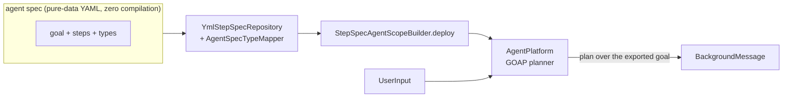

# POC 1 — No-code runtime (keystone)

The keystone claim: a **YAML agent spec is ingested at runtime with zero compilation**, and a
single general-purpose agent plans over its exported goal via GOAP.

## What it proves

- **No-compilation ingestion (C1).** A agent spec is loaded through `YmlStepSpecRepository` +
  `StepSpecAgentScopeBuilder.deploy()` into the live GOAP planner — the same `embabel-agent-spec`
  mechanism the vendor's production "realms" use.
- **An exported goal is a callable spec (C2).** The one `spec-agent` plans over the exported goal
  and returns its output — no sub-agents, no orchestration code.
- The planner is selectable per run (default GOAP), and the model endpoint is fully env-driven.

## How it works



`NoCodeRuntime` boots an `AgentPlatform`, maps the pack's pure-data `DynamicType`s onto Embabel
types (`AgentSpecTypeMapper`), ingests the `PromptedActionSpec`/`GoalSpec` step specs from YAML
(`StepSpecAssembler`), and runs a plan from a `UserInput` to the goal's `BackgroundMessage` output
(`SpecRunner`, planner chosen by `PlannerResolver`).

## Run it

Endpoint-gated (needs a live OpenAI-compatible endpoint — see the top-level README "Model
endpoint"):

```bash
BUILDER_PACK_DIR="$PWD/agent-specs/explainer" \
BUILDER_INPUT="Explain how a coffee machine works" BUILDER_PLANNER=GOAP \
    mvn -pl poc/poc-1-no-code-runtime spring-boot:run
```

## Conclusion

Against the hypothesis (claims C1 / C2): **proven.** The agent spec is ingested at runtime with
zero compilation — `YmlStepSpecRepository` + `StepSpecAgentScopeBuilder.deploy()` load it into the
live GOAP planner — and the single general-purpose agent plans over the exported goal and returns
its output with no sub-agents and no orchestration code. The full loop (describe → build →
validate → run) runs end-to-end on this runtime (POC 3 builds the pack; `./run-loop.sh` chains the
two). The one honest limit: the plan is deterministic (non-LLM), but the action bodies are LLM
calls, so the goal output varies run-to-run.

See `docs/04-poc-run-results.md` for the full run evidence.
