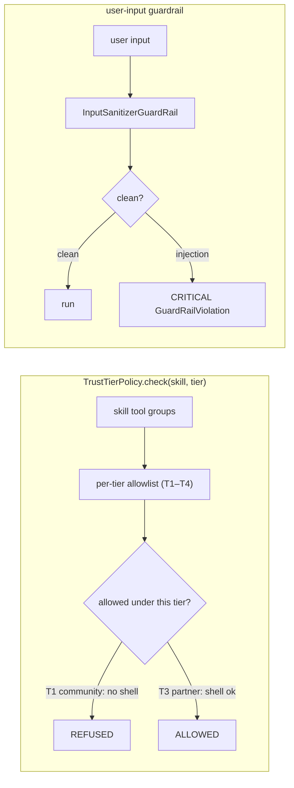

# POC 10 — Trust tiers / guardrails

A `TrustTierPolicy` enforces a **per-tier tool-group allowlist** (T1–T4) so a high-privilege skill is
refused under a low-trust context, and a global user-input guardrail blocks forbidden content.

## What it proves

- **Security / trust tiers (C12).** The `shell` skill is **REFUSED** under `T1_COMMUNITY`
  (disallowed `[shell]`) and **ALLOWED** under `T3_PARTNER`; a plain skill is allowed under `T1`.
- A globally-registered user-input guardrail (via `embabel.agent.guardrails.user-input`) lets a clean
  run through and **blocks** a prompt-injection with a CRITICAL-severity
  `GuardRailViolationException`.

> Caveat: the guardrail is a normalized multi-pattern matcher (lowercase, punctuation/whitespace
> stripped, matched against a set of known injection phrases), not a semantic detector — it catches
> obfuscated variants (extra spacing, punctuation, mixed case) a plain substring match missed, but a
> novel rephrasing outside the pattern set can slip through. A blocking (CRITICAL) guardrail triggers
> platform retries before the violation surfaces.

## How it works



`TrustTier` defines the T1–T4 allowlists; `TrustTierPolicy.check(skill, tier)` returns the
disallowed tool groups; `InputSanitizerGuardRail` (a `UserInputGuardRail`) flags forbidden input;
`TrustRunner` runs a pack and reports whether a guardrail blocked it.

## Run it

The tier allowlist is offline; the guardrail demo is endpoint-gated:

```bash
mvn -pl poc/poc-10-trust-tiers spring-boot:run
```

See `docs/04-poc-run-results.md`.
