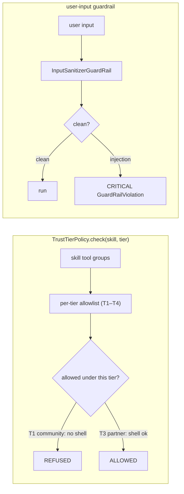

# POC 10 — Trust tiers / guardrails

A `TrustTierPolicy` enforces a **per-tier tool-group allowlist** (T1–T4) so a high-privilege skill is
refused under a low-trust context, and a global user-input guardrail blocks forbidden content.

## What it proves

- **Security / trust tiers (C12).** The `shell` skill is **REFUSED** under `T1_COMMUNITY`
  (disallowed `[shell]`) and **ALLOWED** under `T3_PARTNER`; a plain skill is allowed under `T1`.
- A globally-registered user-input guardrail (via `embabel.agent.guardrails.user-input`) lets a clean
  run through and **blocks** a prompt-injection with a CRITICAL-severity
  `GuardRailViolationException`.

> Caveat: the guardrail is a normalized multi-pattern matcher (lowercase, punctuation/whitespace
> stripped, matched against a set of known injection phrases), not a semantic detector — it catches
> obfuscated variants (extra spacing, punctuation, mixed case) a plain substring match missed, but a
> novel rephrasing outside the pattern set can slip through. A blocking (CRITICAL) guardrail triggers
> platform retries before the violation surfaces.

## How it works



`TrustTier` defines the T1–T4 allowlists; `TrustTierPolicy.check(skill, tier)` returns the
disallowed tool groups; `InputSanitizerGuardRail` (a `UserInputGuardRail`) flags forbidden input;
`TrustRunner` runs a pack and reports whether a guardrail blocked it.

## Run it

The tier allowlist is offline; the guardrail demo is endpoint-gated:

```bash
mvn -pl poc/poc-10-trust-tiers spring-boot:run
```

## Measured results (shared — security, C12 / C18)

POC 10 (runtime trust tiers + guardrail) and POC 21 (install-time static scan) are the two halves
of the same security hypothesis. This results section is **shared across their READMEs**
(identical in each); the consolidated read is in `docs/04-poc-run-results.md` §7.3.

**Runtime tier policy (POC 10):**

| skill | declared tool groups | T1_COMMUNITY | T3_PARTNER |
| --- | --- | --- | --- |
| `shell-runner` | `[shell]` | REFUSED (disallowed `[shell]`) | ALLOWED |
| `explainer` | `[]` | ALLOWED | ALLOWED |

**Install-time scan (POC 21):**

| pack | verdict | minimum tier | findings |
| --- | --- | --- | --- |
| `explainer` / `reference-heavy` / `compose-extract` / `compose-explain` | SAFE | T1_COMMUNITY | (clean) |
| `shell-runner` | REVIEW | T3_PARTNER | high-privilege tool (`shell`) + `UserInput → shell` chain |
| synthetic malicious pack | BLOCK | T3_PARTNER | prompt-injection + secret-exfil (2 criticals) + network + high-priv + chain |

The scanner's tier mapping agrees with the runtime policy: its "load at T3+" is exactly what POC 10
enforces. Both halves share the same honest limit — a normalized pattern matcher over declared
content, not a semantic detector.

## Conclusion

Against the hypothesis (claim C12): **proven.** The per-tier allowlist refused the `shell` skill
under `T1_COMMUNITY` and allowed it under `T3_PARTNER` (a plain skill is allowed under `T1`), and a
globally-registered user-input guardrail let a clean run through while **blocking** a prompt-
injection — including obfuscated variants — with a CRITICAL-severity
`GuardRailViolationException`. The honest limits: the guardrail is a normalized pattern matcher,
not a semantic detector (a novel rephrasing outside the pattern set can slip through), and a
blocking (CRITICAL) guardrail triggers platform retries before the violation surfaces (~5× over
~4 min live) — a latency cost. POC 21 is the install-time complement; see the shared results
above.

See `docs/04-poc-run-results.md`.
