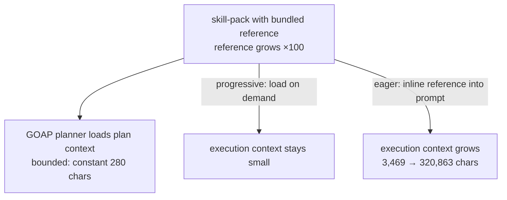

# POC 11 — Progressive-disclosure stress test

A skill-pack ships a large bundled reference. The POC measures two context costs: the **plan
context** (what the GOAP planner loads) stays bounded regardless of the reference size, whereas
inlining the reference into the action prompt grows the execution context with it. Fully offline.

## What it proves

- **Progressive disclosure bounds the plan context (C13).** The plan context stays constant (280
  chars) while the reference grows 3.1 KB → 313.1 KB (×100); the eager (inlined) prompt grows
  3,469 → 320,863 chars, so the eager/progressive ratio climbs 13.2× → 1,220×. Loading on demand,
  not eagerly, is what keeps context cost flat as on-disk knowledge grows unbounded.

## How it works



`PlanContextMeter` measures the plan-context size vs. the progressive/eager prompt size for a pack
that carries a `references/domain.md`; `ProgressiveDisclosureRunner` scales the reference and reports
the ratio. The sample pack is `skill-packs/reference-heavy`.

## Run it

Offline (no endpoint):

```bash
mvn -pl poc/poc-11-progressive-disclosure exec:java
```

See `docs/04-poc-run-results.md`.
