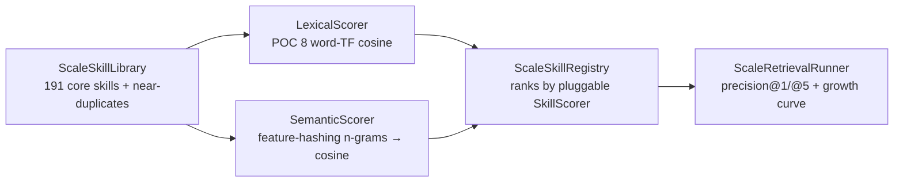

# POC 12 — Semantic retrieval at scale

Extends POC 8's lexical pre-filter to the **200+ same-typed skill library** that doc 02 §3.4 calls
"the bottleneck when you have many skills" and the "More Skills, Worse Agents?" result
(arXiv:2605.24050, up to −21% at 202 skills) describes. It compares the **lexical baseline** (POC 8's
word-TF cosine) against a **denser retriever** (feature-hashing character/word n-gram embeddings — an
offline, deterministic stand-in for the embedding index doc 03 §2.1 asks for) and measures selection
accuracy as the library grows and as near-duplicate (shadowing) skills accumulate.

Fully offline and deterministic — no model endpoint.

## What it proves

- **Retrieval scales cleanly at 200+ skills when skills are distinct.** At 191 same-typed
  (`UserInput → BackgroundMessage`) skills, both the lexical and the dense retriever hit
  **Precision@1 100%** on the benchmark — the "big folder" is not inherently the problem.
- **Near-duplicate shadowing collapses selection for both retrievers.** Once same-topic variants
  (e.g. "Explains how a coffee machine works *for a child*" vs the canonical one) accumulate, the
  canonical skill is no longer the uniquely-best text match, so Precision@1 drops sharply
  (lexical 17%, dense 0%). This reproduces the *selection-failure* mechanism the literature
  attributes to skill shadowing (not context overhead).
- **A denser text index does not cure shadowing on its own.** The failure is intrinsic to
  text-similarity when same-topic variants are more similar than the canonical skill. The fix the
  literature points to — library **curation** (dedup / lifecycle, doc 02 §3.3: SE-GoS, TrackRL) or a
  higher-level router — is orthogonal to the retriever. A real `EmbeddingService` plugs into the same
  `SkillScorer` seam, so this is representative of the dense-retrieval regime without an endpoint.

## How it works



`ScaleSkillLibrary` builds the same-typed library: a **core** of 191 distinct-topic skills across six
verb families, plus **near-duplicates** — 15 same-topic variants per benchmark target. `SkillScorer`
is the retriever seam; `LexicalScorer` reuses POC 8's word-TF cosine, `SemanticScorer` uses
`SemanticSimilarity` (feature-hashing char/word n-grams → fixed 256-d vector → cosine).
`ScaleSkillRegistry` ranks by the pluggable scorer; `ScaleRetrievalRunner` measures precision@1/@5
and the growth curve as near-duplicates are interleaved in.

## Run it

Offline (no endpoint):

```bash
mvn -pl poc/poc-12-semantic-retrieval exec:java
```

## Measured results (shared — skill selection, C10)

POCs 8, 12, 17, 19, 20, and 23 test the same hypothesis — **skill selection at scale** (claim C10) —
on the same scenario, with different techniques. This results section is **shared across their
READMEs** (identical in each); the consolidated read is in `docs/04-poc-run-results.md` §7.1.

**Small scale (POC 8 — 14 same-typed skills, lexical):** Precision@1 **100%**; the target stays
top-1 as same-verb distractors are added (growth curve).

**Distinct scale (POC 12/20/23 — 191 same-typed skills, full-library P@1):**

| method | P@1 (191 distinct) |
| --- | --- |
| lexical (word TF) | 100% |
| dense (feature hash) | 100% |
| embedding (MiniLM, local ONNX) | 100% |
| embedding (nomic, remote) | 100% |

**Under shadowing (POC 12/20/23 — 281 skills incl. 90 same-topic near-duplicates, full-library P@1):**

| method | P@1 (281, shadowing) |
| --- | --- |
| lexical (word TF) | 17% |
| dense (feature hash) | 0% |
| embedding (MiniLM, local ONNX) | 33% |
| embedding (nomic, remote) | 17% |

**On the 6-target candidate sets (POC 17/19 — matching vs strict variants):**

| method | matching@1 | strict@1 |
| --- | --- | --- |
| lexical (word TF) | 17% | 33% |
| dense (feature hash) | 0% | 0% |
| transformer (GLiNER2) | 83% | **100%** |
| llm-id (Qwen3-0.6B) | 0% | 50% |
| llm-ood (Qwen3-0.6B) | 50% | 67% |

**Scaling dimension (POC 23 — remote nomic embedding, generated library to 1000 skills):**
Precision@1 holds at **100%** from 100 to 1000 same-typed skills; steady-state per-query retrieval
(cosine over cached vectors, no model call) grows linearly and stays sub-millisecond-to-~1.3 ms,
while the one-time embedding index (one embedding per skill) is paid once and amortised. A
per-candidate LLM/transformer selector would instead need *n* model calls per query.

| size | P@1 | per-query retrieval |
| --- | --- | --- |
| 100 | 100% | 0.48 ms |
| 200 | 100% | 0.41 ms |
| 400 | 100% | 0.54 ms |
| 800 | 100% | 1.04 ms |
| 1000 | 100% | 1.27 ms |

**Shared reading:** retrieval is clean while skills are distinct (100% at every scale, up to 1000
skills); near-duplicate shadowing collapses text-similarity (lexical 17%, dense 0%), and no
text-similarity index cures it. Methods that score by *meaning* — a zero-shot transformer (GLiNER2,
the best: strict 100%), a fine-tuned 0.6B LLM, and a real embedding index — beat text-similarity,
but the near-duplicates are near-identical in *meaning* too, so none fully cures the collapse on its
own (the remote nomic embedding ties lexical at 17% under shadowing — the specific embedding model
matters). And the scaling result is unambiguous: a remote `EmbeddingService` retrieves cleanly to
1000 skills with sub-millisecond-to-~1 ms per-query cost and **zero per-query model calls** — the
reason it is the selection mechanism of choice as the library outgrows per-candidate selectors. The
real fix for shadowing is library **curation** (dedup / lifecycle — POC 18, applied in the POC 15
retrieval pane).

## Conclusion

Against the hypothesis (claim C10, at scale): **proven — and the failure mode is now measured.**
Retrieval scales cleanly at 200+ skills *when the skills are distinct* (Precision@1 100% at 191
for both the lexical baseline and the dense feature-hashing retriever). Once same-topic
near-duplicates accumulate (281 skills), the canonical skill stops being the uniquely-best text
match and **Precision@1 collapses for both** (lexical 17%, dense 0%) — the selection-failure
mechanism the literature attributes to skill shadowing (arXiv:2605.24050, "−21% at 202 skills"),
reproduced. The denser index does *not* cure it: the fix is library **curation** (dedup /
lifecycle — POC 18) or a meaning-scoring selector (POC 17 / POC 19 / POC 20 — see the shared
results above).

See `docs/04-poc-run-results.md`.
