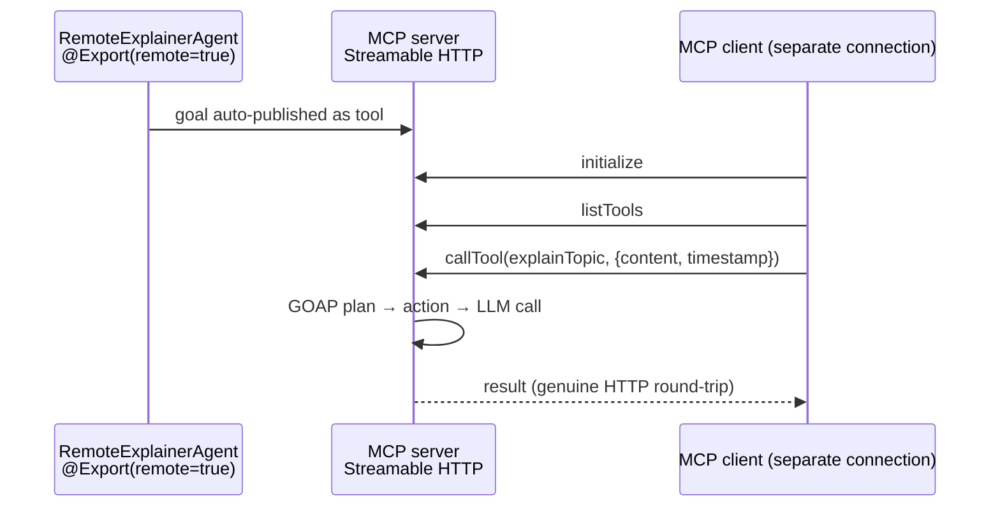

# POC 13 — Remote / MCP invocation

The **remote half** of the "normal agent harness" that doc 03 §2.3 promises (POC 7 covered the
local-CLI half via a `shell` tool group). A spec's goal is published as an **MCP tool** over
Streamable HTTP, and a *separate* MCP client invokes it over the network — the "consume" side of
remote invocation, where the exported goal is exposed to external MCP clients just as the no-code
runtime ingests it locally.

Endpoint-gated — the server-side action calls the model, so it needs a live OpenAI-compatible
endpoint. The MCP round-trip itself (server + client over HTTP) works regardless; the model call is
the endpoint-gated part.

## What it proves

- **An exported goal is auto-published as an MCP tool.** An `@Action` + `@AchievesGoal` method
  annotated `@Export(remote = true)` is picked up by `embabel-agent-starter-mcpserver` and exposed
  as a tool over Streamable HTTP at `http://localhost:<port>/mcp` — no manual tool registration.
- **A separate MCP client can invoke the spec over the network.** The official Java MCP SDK client
  connects to the endpoint, lists the published tools, and calls the tool; the server-side GOAP
  planner formulates the plan, executes the action, calls the LLM, and returns the result to the
  client. The round-trip is a genuine HTTP call, not an in-process one.

## How it works



`RemoteExplainerAgent` defines a single goal — `explainTopic(UserInput) → String` — with
`@Action`, `@AchievesGoal`, and `@Export(remote = true, name = "explainTopic")`. `RemoteMcpServerApp`
is a `@SpringBootApplication` that boots the MCP server (the default Streamable HTTP transport on the
app's web port) and, once it is up, connects to its own endpoint as an MCP client: `initialize` →
`listTools` → `callTool(explainTopic, {content, timestamp})`. It prints the published tools and their
input schemas, then the remote result, and shuts the context down so `spring-boot:run` terminates.

Two things that only surface in the live run:

- The goal method needs **both** `@Action` and `@AchievesGoal` to register as a goal. An
  `@AchievesGoal`-only method is rejected (`MISSING_ACTION_ANNOTATION` / `MISSING_GOALS`) and no tool
  is published.
- The tool's input schema mirrors the `UserInput` type, so the call must supply **both** `content`
  and `timestamp` (a `content`-only call fails schema validation).

## Run it

Endpoint-gated (needs the env vars from the root README). Pick a free port — the default 8080 may be
held by another local service — and point the client at the same port:

```bash
export OPENAI_CUSTOM_BASE_URL=<base-url>
export OPENAI_CUSTOM_API_KEY=<key>
export OPENAI_CUSTOM_MODELS=<model>
export EMBABEL_MODELS_DEFAULT_LLM=<model>

SERVER_PORT=18080 BUILDER_MCP_URL="http://localhost:18080" \
BUILDER_TOPIC="how a coffee machine works" \
    mvn -pl poc/poc-13-remote-mcp spring-boot:run
```

## Measured results (shared — runtime bridges, C11 / C16)

POCs 7, 13, and 16 prove the three runtime bridges doc 03 §2.3 names — the "normal agent
harness". This results section is **shared across their READMEs** (identical in each); the
consolidated read is in `docs/04-poc-run-results.md` §7.2.

| bridge | POC | live evidence | LLM calls in the plan |
| --- | --- | --- | --- |
| shell (local CLI) | POC 7 | `runCommand` → `{"stdout":"Linux"}`; goal achieved | 1 (action body) |
| MCP (remote tool) | POC 13 | `explainTopic` invoked over Streamable HTTP by a separate client | 1 (action body) |
| remote action (sidecar) | POC 16 | `remoteDigest` executed over HTTP to a separate process; plan in ~0.13 s | 0 |

All three: the same GOAP planner plans over, and executes, an action that runs outside the LLM —
in a local CLI, a remote MCP server, or a separate sidecar process.

## Conclusion

Against the hypothesis (claim C11, remote half): **proven.** An `@Action` + `@AchievesGoal` method
annotated `@Export(remote = true)` is auto-published as an MCP tool over Streamable HTTP with no
manual registration, and a separate MCP client (official Java SDK) invoked it over a genuine HTTP
round-trip — the server-side GOAP planner formulated the plan, executed the action, called the
LLM, and returned a real explanation to the client. Two live-only details: the goal method needs
**both** `@Action` and `@AchievesGoal` to register as a goal, and the tool's input schema mirrors
the `UserInput` type, so the call must supply both `content` and `timestamp`. With POC 7 (shell)
and POC 16 (remote action), all three of doc 03 §2.3's runtime bridges are now proven — see the
shared results above.

See `docs/04-poc-run-results.md`.
