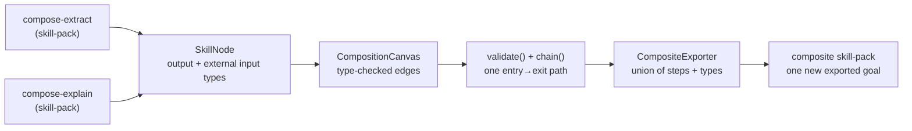

# POC 14 — The skill Composer (visual skill-chain editor, headless)

The **Skill Composer** that doc 03 §2.2 asks for: a way to chain exported goals (skills) into a
workflow and export the result as a **new composite skill** — "an exported goal whose action chain
*is* the plan". This POC builds the substance of that as a **headless, offline** model of the
"visual skill-chain editor" (the drag-and-drop pixels are a thin frontend over this graph model;
the substance — the canvas, the type-checked connections, the composed plan, and the composite
export — is what is proven here).

Fully offline and deterministic — no model endpoint. (Running the exported composite end-to-end is
a one-off live check via the no-code runtime; see `docs/04-poc-run-results.md` §5.)

## What it proves

- **Skills are nodes on a canvas; connections are type-checked.** A skill's *output* is its
  exported goal's output type; its *external inputs* are the action input types it does not produce
  itself. An edge (skill A → skill B) is valid only when A's output type is one of B's external
  inputs — the drag-and-drop "snap". Invalid connections are rejected.
- **A valid canvas is a single entry→exit chain.** The canvas must have exactly one entry skill
  (input `UserInput`) and one exit skill (output `BackgroundMessage`), with every intermediate edge
  type-compatible and the path covering every skill. This is the "GOAP shows the computed chain"
  half.
- **A valid canvas exports as a single new composite skill-pack.** The composite is the union of the
  component skills' action steps and intermediate types, under one new exported goal whose output
  is the exit skill's output type. The component skills' own goals are dropped — only their typed
  actions matter, and the non-LLM GOAP planner re-derives the chain from those actions. The exported
  pack re-validates cleanly and is a plain, loadable skill-pack.

## How it works



- **`SkillNode`** — one skill (an exported goal + its action steps); exposes its output type and
  external input types.
- **`CompositionCanvas`** — the graph (skills + directed edges); `validate()` reports type-in
  compatible edges, missing entry/exit, and structural problems; `chain()` returns the ordered
  entry→exit path (the composed plan).
- **`CompositeExporter`** — builds the composite `SkillPack` (union of steps + types, one composite
  goal) and writes it to disk via `smith-common`'s `SkillPackWriter`.
- **`ComposerApp`** — the offline demo: loads `compose-extract` + `compose-explain`, builds the
  canvas, validates it, prints the chain, exports the composite, and re-validates the export.

## Run it

Offline (no endpoint):

```bash
mvn -pl poc/poc-14-composer exec:java
```

Paths are overridable via `COMPOSE_PACK_A`, `COMPOSE_PACK_B`, `COMPOSE_NAME`, and
`COMPOSE_OUTPUT_DIR` (the composite is written to `COMPOSE_OUTPUT_DIR/<name>`, default
`target/composed/compose-composite`).

See `docs/04-poc-run-results.md`.
