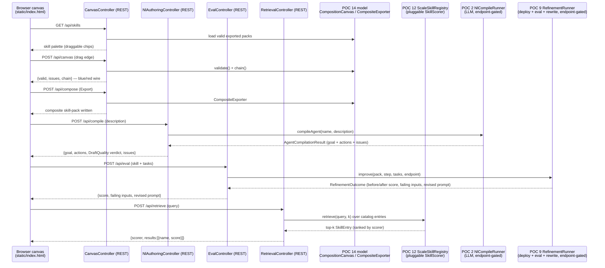

# POC 15 — The visual skill-chain editor (the builder UI)

The **builder UI** that doc 01 names as the missing piece (*"Embabel already ships ~70% of the
pieces; the missing piece is the builder UI"*) and that doc 03 §2.2 sketches as a "visual
skill-chain editor". POC 14 proved the headless graph model this sits on (the type-checked canvas,
the composed chain, and the composite export). POC 15 adds the **pixels**: a real, browsable
drag-and-drop canvas that drives that same model over REST.

The canvas, palette, and retrieval pane are fully offline and deterministic — no model endpoint.
The **author pane** and the **eval/refinement pane** are the endpoint-gated halves: the author pane
compiles a natural-language description into a draft via POC 2's `NlCompileRunner` (needs a live
OpenAI-compatible endpoint) and reports the draft's goal shape + `DraftQuality` verdict; the
eval/refinement pane runs a POC 5 eval over a set of tasks against a picked skill and, when tasks
fail, offers a POC 9-style prompt rewrite + re-score. Both return a clear configuration error rather
than an opaque model failure when no endpoint is set.

## What it proves

- **A browser canvas loads the skill palette.** `GET /api/skills` returns every valid, exported
  skill-pack under the skill-packs directory as a draggable chip (name, external input types, output
  type).
- **Connections "snap" only when the types match.** Dragging an output port onto an input port posts
  `POST /api/canvas`; a type-compatible edge renders blue, a type-incompatible one renders red with
  the reason (e.g. *"'BackgroundMessage' is not one of compose-extract's inputs [UserInput]"*). This
  is POC 14's edge type-check, surfaced visually.
- **The chain live-validates.** Every move recomputes `validate()` + `chain()`; the status badge
  shows "valid chain" with the computed path, or the list of issues.
- **Export writes a composite skill-pack.** The Export button posts `POST /api/compose`, which
  delegates to `CompositeExporter` and writes a well-formed composite pack (goal, steps, types) to
  the output dir — the same pack POC 14 proves runs end-to-end.
- **An author pane compiles a description into a draft.** The top right-hand panel posts
  `POST /api/compile` with a natural-language description; the draft's goal shape, its actions, and
  the `DraftQuality` verdict (HEALTHY / degenerate, with the reason) are shown, alongside any issues
  to review. This is the "describe a skill in plain language" half of the builder UI — POC 2's
  `NlCompileRunner` + POC 2/3's `DraftQuality` classifier, surfaced in the canvas. Endpoint-gated.
- **A retrieval pane shows which skills a task would route to.** The right-hand panel posts
  `POST /api/retrieve` with a natural-language query; the catalog is ranked by relevance and the
  top-k shown with their scores. It reuses the same pluggable `SkillScorer` seam the whole retrieval
  POC family shares (POC 8 lexical, POC 12 dense, POC 17 GLiNER2, POC 20 real embedding), so the
  offline lexical scorer is the default and a denser scorer is a drop-in.
- **An eval/refinement pane checks and refines a skill in one place.** The right-hand panel posts
  `POST /api/eval` with a skill from the palette; it runs a POC 5 eval over a set of tasks and shows
  the composite score + the failing inputs, and (the stretch) when tasks fail it runs a POC 9-style
  prompt rewrite from the failures and re-scores, showing the before/after score and the revised
  prompt. This is POC 9's `RefinementRunner` (deploy → evaluate → rewrite → re-validate → redeploy →
  re-evaluate) surfaced in the canvas. Endpoint-gated.

## How it works



- **`ComposerUiApp`** — a `@SpringBootApplication` that boots the web app.
- **`SkillCatalog`** — the palette: loads every valid, exported skill-pack under the skill-packs
  directory into a `name → SkillNode` map (walks up from the working dir to find the repo's
  `skill-packs/` unless `builder.skill-packs-dir` is set). Also exposes `retrievalEntries()`, which
  maps each skill to POC 8's `SkillEntry` (name + a description synthesized from the goal/step
  descriptions + I/O types) — the metadata the retrieval pre-filter scores against.
- **`CanvasController`** — the REST surface; every endpoint delegates to POC 14's model:
  - `GET /api/skills` → the palette (`SkillInfo`).
  - `POST /api/canvas` → `{valid, issues, chain}` via `CompositionCanvas.validate()` / `chain()`.
  - `POST /api/compose` → writes the composite and reports its shape via `CompositeExporter`.
- **`RetrievalController`** — the retrieval pane: `POST /api/retrieve` ranks `catalog.retrievalEntries()`
  with a pluggable `SkillScorer` (default POC 8's `LexicalScorer`, offline) via POC 12's
  `ScaleSkillRegistry` and returns the top-k with their scores. The scorer is a constructor field,
  so POC 20's real `EmbeddingService` drops in here without touching the endpoint.
- **`NlAuthoringController`** — the author pane: `POST /api/compile` compiles a description via POC 2's
  `NlCompileRunner` and maps the `AgentCompilationResult` to the draft's goal shape, actions, and the
  `DraftQuality` verdict. It checks `ModelEndpointConfig.configError()` first, so a missing endpoint
  yields a clear, named error before any LLM call (endpoint-gated).
- **`EvalController`** — the eval/refinement pane: `POST /api/eval` takes a skill from the palette and
  a set of tasks (a default set if none are given), then delegates the whole loop to POC 9's
  `RefinementRunner.improve()` — deploy the skill, evaluate, rewrite the prompt from the failing tasks,
  re-validate, redeploy, and re-evaluate. It checks `ModelEndpointConfig.configError()` first, so a
  missing endpoint yields a clear, named error before any model call (endpoint-gated).
- **`static/index.html`** — the self-contained canvas (vanilla JS, no build step): a skill palette,
  a drag-and-drop stage, SVG wires, a live status badge, Export / Reset controls, and a right-hand
  column with the Author, Eval/refine, and Retrieval panes.

## Run it

It's a web app — boot it, then open the canvas in a browser. The canvas, palette, and retrieval
pane are offline (no endpoint); the **author** and **eval/refinement** panes need the endpoint env
vars:

```bash
SERVER_PORT=18080 mvn -pl poc/poc-15-composer-ui spring-boot:run
# → open http://localhost:18080/

# for the author + eval/refinement panes (endpoint-gated), also set:
export OPENAI_CUSTOM_BASE_URL=... OPENAI_CUSTOM_API_KEY=...
export OPENAI_CUSTOM_MODELS=... EMBABEL_MODELS_DEFAULT_LLM=...
```

`SERVER_PORT` defaults to 18080 to avoid a local service on 8080; `COMPOSE_OUTPUT_DIR` (default
`target/composed-ui`) is where `POST /api/compose` writes exported composites.

## Tests

`CanvasControllerTest` pins the four REST behaviours offline — palette listing, valid-chain
acceptance, type-incompatible rejection, and composite export — using a standalone `MockMvc`
(spring-test) over a hand-built `SkillCatalog` and a temp export dir. It uses standalone `MockMvc`
rather than `@WebMvcTest` because the latter lives in the `spring-boot-webmvc-test` slice, which is
not present in the offline repo at this project's resolved Spring Boot version.

`RetrievalControllerTest` pins the retrieval pane offline — an extract query ranks the extract skill
first, an explain query ranks an explain skill first, and results come back sorted by score and
bounded by `k` — the same standalone `MockMvc` + hand-built `SkillCatalog`, with the default lexical
scorer (no model).

`NlAuthoringControllerTest` pins the author pane's offline scaffolding — a blank description is
rejected, and a missing endpoint returns a clear, named configuration error before any LLM call —
built with no `Ai`/`AgentPlatform` (the offline paths never reach the model).

`EvalControllerTest` pins the eval/refinement pane's offline scaffolding — no skill selected, an
unknown skill, and a known skill without an endpoint (clear, named configuration error) — built with
no `AgentPlatform` (the offline paths return before any model call).

See `docs/04-poc-run-results.md`.
