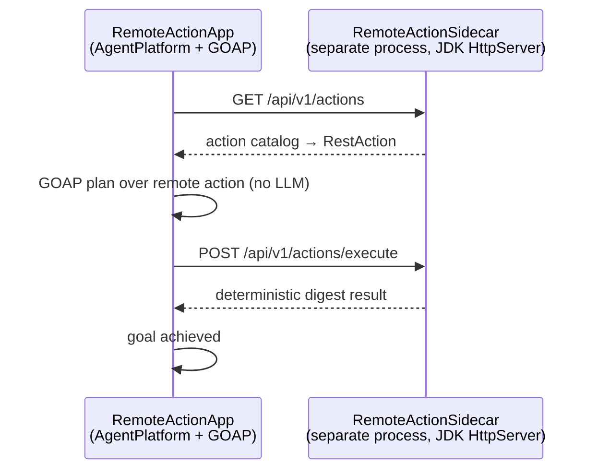

# POC 16 — The remote-action bridge

The **third runtime bridge** doc 03 §2.3 calls for (doc 03 §4.2 "Option B"): a spec that invokes an
action running in a **separate process**, planned and executed by the same GOAP planner that drives
local actions. POC 7 proved the *shell* bridge (a spec runs a real CLI); POC 13 proved the *MCP*
bridge (an exported goal published as a remote MCP tool). POC 16 proves the *remote-action* bridge —
the "normal agent harness" where a spec invokes an external worker over HTTP.

The plan is **fully deterministic and LLM-free**: the GOAP plan is non-LLM, and the remote action
runs deterministic sidecar code. The model endpoint is only present to boot the platform; it is
never called.

## What it proves

- **A separate process exposes an action.** `RemoteActionSidecar` is a standalone JDK `HttpServer`
  (no extra dependencies) running deterministic code — it digests the input text into word/char
  stats. It serves the three endpoints Embabel's `embabel-agent-remote` client consumes:
  - `GET /api/v1/actions` — the action catalog (`RestActionMetadata` JSON).
  - `GET /api/v1/types` — the action's types (empty here: the action uses the platform's built-in
    `UserInput` / `BackgroundMessage`).
  - `POST /api/v1/actions/execute` — run the action; body `{action_name, parameters}`, returns the
    output as a JSON object.
- **The agent plans over the remote action.** `RestServer.agentScope(platform)` pulls the sidecar's
  action in as a `RestAction`; a GOAP plan is formulated over it exactly like over a local action.
- **The plan executes the remote action over HTTP.** Running the plan POSTs to the sidecar's
  `/api/v1/actions/execute`; the sidecar runs its code and returns the result, which the plan
  adopts as the goal's output. Live: the plan `remoteDigest` ran in `PT0.127S`, the sidecar produced
  the digest, and the goal was achieved — with **no LLM call**.

## How it works



- **`RemoteActionSidecar`** — the sidecar process. One deterministic action (`remoteDigest`)
  consuming `UserInput` and producing `BackgroundMessage`; the input variable is named `userInput`
  (to match the `runAgentFrom` key) and the output `it` (to match the goal's output condition), and
  `pre`/`post` are empty so the preconditions come from the input binding.
- **`RemoteActionApp`** — boots the `AgentPlatform`, starts the sidecar, pulls its action in as a
  `RestAction`, registers the built-in I/O types (the platform has no base domain types — the same
  `JvmType` seam POC 1 uses), adds a `BackgroundMessage` goal, deploys the scope + agent, and runs a
  GOAP plan over the remote action.

## Run it

Needs the endpoint env vars only to boot the platform (the plan itself never calls the model):

```bash
export OPENAI_CUSTOM_BASE_URL=... OPENAI_CUSTOM_API_KEY=... OPENAI_CUSTOM_MODELS=... EMBABEL_MODELS_DEFAULT_LLM=...
mvn -pl poc/poc-16-remote-action spring-boot:run -Dbuilder.input="Explain how a remote worker pool runs a task"
```

The sidecar defaults to port 18090 (`builder.sidecar-port`); the app stops it on exit.

## Tests

`RemoteActionSidecarTest` pins the three-endpoint contract offline against an ephemeral-port
sidecar — the catalog (input var `userInput`, output var `it`, empty pre/post), the empty types, the
deterministic execute (5 words / 25 chars for a sample input), and unknown-action rejection. No
platform, no model.

## Measured results (shared — runtime bridges, C11 / C16)

POCs 7, 13, and 16 prove the three runtime bridges doc 03 §2.3 names — the "normal agent
harness". This results section is **shared across their READMEs** (identical in each); the
consolidated read is in `docs/04-poc-run-results.md` §7.2.

| bridge | POC | live evidence | LLM calls in the plan |
| --- | --- | --- | --- |
| shell (local CLI) | POC 7 | `runCommand` → `{"stdout":"Linux"}`; goal achieved | 1 (action body) |
| MCP (remote tool) | POC 13 | `explainTopic` invoked over Streamable HTTP by a separate client | 1 (action body) |
| remote action (sidecar) | POC 16 | `remoteDigest` executed over HTTP to a separate process; plan in ~0.13 s | 0 |

All three: the same GOAP planner plans over, and executes, an action that runs outside the LLM —
in a local CLI, a remote MCP server, or a separate sidecar process.

## Conclusion

Against the hypothesis (claim C16): **proven.** A separate sidecar process exposes an action over
HTTP; the agent pulls it in as a `RestAction`, and a GOAP plan plans over it and executes it over
the network **exactly like a local action** (live: plan `remoteDigest` in ~0.123–0.127 s, goal
achieved, **no LLM call** — the endpoint is only for platform boot). This closes the third of
doc 03 §2.3's runtime bridges (shell → POC 7, MCP → POC 13, remote action → POC 16); see the
shared results above.

See `docs/04-poc-run-results.md`.
