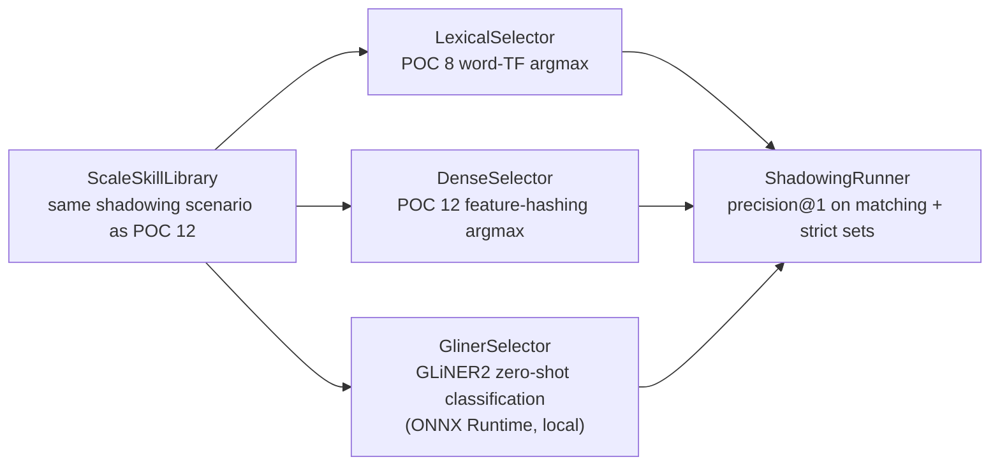

# POC 17 — GLiNER2 transformer skill classification

A **real transformer** takes the same within-topic skill-shadowing scenario POC 12 measured and
asks whether a zero-shot classifier that *understands* meaning breaks the tie that text-similarity
cannot. POC 8 (lexical) and POC 12 (dense feature-hashing) both select by text similarity and both
collapsed under shadowing (POC 12: lexical **17%**, dense **0%** Precision@1). POC 17 runs a GLiNER2
BERT classifier (via [GLiNER4j](https://github.com/gravitee-io/GLiNER4j) over ONNX Runtime) on the
identical candidate sets, alongside the same two baselines, so the three methods are directly
comparable.

The three methods share one `SkillSelector` seam (`select(query, candidates) → top-1 id`):
`LexicalSelector` (POC 8 word-TF argmax), `DenseSelector` (POC 12 feature-hashing argmax), and
`GlinerSelector` (GLiNER2 zero-shot classification over the candidate set).

## How it works



## Local-model-gated

This is a **new runtime category**: the benchmark runs only when the ONNX bundle is present on
disk. Without it, the launcher fails with a clear, actionable error (naming the missing files and
the download command) — not an opaque ONNX failure. The offline unit tests mock the classifier, so
the module builds green without the model (`mvn -pl poc/poc-17-gliner-retrieval test`).

## One-time setup (fetch the model)

The INT8-quantized `gliner2-base-v1` ONNX bundle (~208 MB) is **not committed** (large binary;
`models/` is gitignored). Fetch it once into the module's `models/` directory:

```bash
hf download gravitee-io/gliner4j-gliner2-base-v1 \
  --include "*.json" "onnx_quantized/classifier_full.onnx" \
  --local-dir poc/poc-17-gliner-retrieval/models/gliner2-base-v1
```

The classifier (INT8-quantized `onnx_quantized` variant, ~208 MB) expects this layout under
`models/gliner2-base-v1/`:

```
gliner4j_config.json
tokenizer.json
onnx_quantized/classifier_full.onnx
```

(The bundle also ships `onnx/` (FP32) and `onnx_fp16/` variants as accuracy references.)
Override the location with `BUILDER_GLINER_MODEL_DIR` (e.g. to a shared models cache).

## Run it

No endpoint needed — this is a local-model benchmark, not an LLM call. From the repo root, with the
bundle present:

```bash
mvn -pl poc/poc-17-gliner-retrieval exec:java
```

It prints a Precision@1 comparison table for the three methods (transformer / lexical / dense) on
the six `ScaleSkillLibrary` targets, in two candidate-set variants: **matching** (canonical + all 15
near-duplicates, directly comparable to POC 12) and **strict** (excluding the near-exact duplicate —
the meaningful shadowing signal).

## Measured results

Run 2026-11-02 (Java 21, ONNX Runtime 1.27.0 CPU, INT8 `onnx_quantized` variant):

| method | matching@1 | strict@1 |
| --- | --- | --- |
| **transformer (GLiNER2)** | **83%** | **100%** |
| lexical (word TF) | 17% | 33% |
| dense (feature hash) | 0% | 0% |

The transformer breaks the shadowing tie that text-similarity cannot: with the degenerate near-exact
duplicate removed (**strict**), it selects the canonical skill for all six targets (**100%**), while
lexical and dense collapse (33% / 0%). In the POC-12-comparable **matching** set — which includes the
near-exact `v0` duplicate, a genuinely ambiguous choice — the transformer still leads (**83%** = 5/6).
This is the mechanism the POC set out to test: a model that *understands* meaning, not one that
matches hashed n-grams.

## Tests

`SkillSelectorTest`, `LexicalSelectorTest`, `DenseSelectorTest`, `GlinerModelTest`,
`GlinerSelectorTest`, and `ShadowingRunnerTest` pin the selector seam, the two baselines, the
model gate, the label-building/top-1 logic (stubbed classifier), and the Precision@1 math — all
offline, no model.

See `docs/04-poc-run-results.md` for the measured results.
