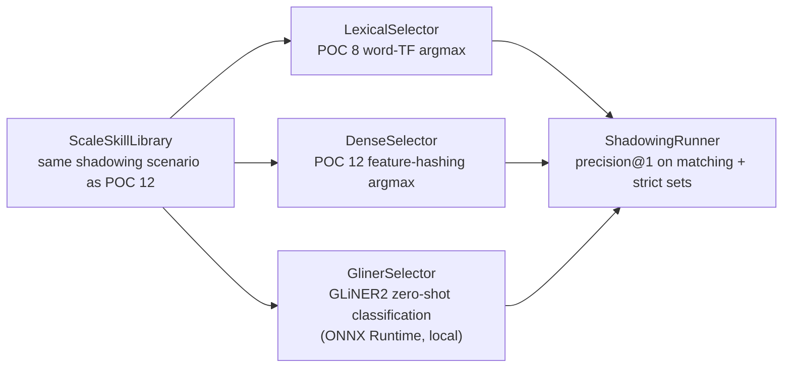

# POC 17 — GLiNER2 transformer skill classification

A **real transformer** takes the same within-topic skill-shadowing scenario POC 12 measured and
asks whether a zero-shot classifier that *understands* meaning breaks the tie that text-similarity
cannot. POC 8 (lexical) and POC 12 (dense feature-hashing) both select by text similarity and both
collapsed under shadowing (POC 12: lexical **17%**, dense **0%** Precision@1). POC 17 runs a GLiNER2
BERT classifier (via [GLiNER4j](https://github.com/gravitee-io/GLiNER4j) over ONNX Runtime) on the
identical candidate sets, alongside the same two baselines, so the three methods are directly
comparable.

The three methods share one `SkillSelector` seam (`select(query, candidates) → top-1 id`):
`LexicalSelector` (POC 8 word-TF argmax), `DenseSelector` (POC 12 feature-hashing argmax), and
`GlinerSelector` (GLiNER2 zero-shot classification over the candidate set).

## How it works



## Local-model-gated

This is a **new runtime category**: the benchmark runs only when the ONNX bundle is present on
disk. Without it, the launcher fails with a clear, actionable error (naming the missing files and
the download command) — not an opaque ONNX failure. The offline unit tests mock the classifier, so
the module builds green without the model (`mvn -pl poc/poc-17-gliner-retrieval test`).

## One-time setup (fetch the model)

The INT8-quantized `gliner2-base-v1` ONNX bundle (~208 MB) is **not committed** (large binary;
`models/` is gitignored). Fetch it once into the module's `models/` directory:

```bash
hf download gravitee-io/gliner4j-gliner2-base-v1 \
  --include "*.json" "onnx_quantized/classifier_full.onnx" \
  --local-dir poc/poc-17-gliner-retrieval/models/gliner2-base-v1
```

The classifier (INT8-quantized `onnx_quantized` variant, ~208 MB) expects this layout under
`models/gliner2-base-v1/`:

```
gliner4j_config.json
tokenizer.json
onnx_quantized/classifier_full.onnx
```

(The bundle also ships `onnx/` (FP32) and `onnx_fp16/` variants as accuracy references.)
Override the location with `BUILDER_GLINER_MODEL_DIR` (e.g. to a shared models cache).

## Run it

No endpoint needed — this is a local-model benchmark, not an LLM call. From the repo root, with the
bundle present:

```bash
mvn -pl poc/poc-17-gliner-retrieval exec:java
```

It prints a Precision@1 comparison table for the three methods (transformer / lexical / dense) on
the six `ScaleSkillLibrary` targets, in two candidate-set variants: **matching** (canonical + all 15
near-duplicates, directly comparable to POC 12) and **strict** (excluding the near-exact duplicate —
the meaningful shadowing signal).

## Measured results (shared — skill selection, C10)

POCs 8, 12, 17, 19, 20, and 23 test the same hypothesis — **skill selection at scale** (claim C10) —
on the same scenario, with different techniques. This results section is **shared across their
READMEs** (identical in each); the consolidated read is in `docs/04-poc-run-results.md` §7.1.

**Small scale (POC 8 — 14 same-typed skills, lexical):** Precision@1 **100%**; the target stays
top-1 as same-verb distractors are added (growth curve).

**Distinct scale (POC 12/20/23 — 191 same-typed skills, full-library P@1):**

| method | P@1 (191 distinct) |
| --- | --- |
| lexical (word TF) | 100% |
| dense (feature hash) | 100% |
| embedding (MiniLM, local ONNX) | 100% |
| embedding (nomic, remote) | 100% |

**Under shadowing (POC 12/20/23 — 281 skills incl. 90 same-topic near-duplicates, full-library P@1):**

| method | P@1 (281, shadowing) |
| --- | --- |
| lexical (word TF) | 17% |
| dense (feature hash) | 0% |
| embedding (MiniLM, local ONNX) | 33% |
| embedding (nomic, remote) | 17% |

**On the 6-target candidate sets (POC 17/19 — matching vs strict variants):**

| method | matching@1 | strict@1 |
| --- | --- | --- |
| lexical (word TF) | 17% | 33% |
| dense (feature hash) | 0% | 0% |
| transformer (GLiNER2) | 83% | **100%** |
| llm-id (Qwen3-0.6B) | 0% | 50% |
| llm-ood (Qwen3-0.6B) | 50% | 67% |

**Scaling dimension (POC 23 — remote nomic embedding, generated library to 1000 skills):**
Precision@1 holds at **100%** from 100 to 1000 same-typed skills; steady-state per-query retrieval
(cosine over cached vectors, no model call) grows linearly and stays sub-millisecond-to-~1.3 ms,
while the one-time embedding index (one embedding per skill) is paid once and amortised. A
per-candidate LLM/transformer selector would instead need *n* model calls per query.

| size | P@1 | per-query retrieval |
| --- | --- | --- |
| 100 | 100% | 0.48 ms |
| 200 | 100% | 0.41 ms |
| 400 | 100% | 0.54 ms |
| 800 | 100% | 1.04 ms |
| 1000 | 100% | 1.27 ms |

**Shared reading:** retrieval is clean while skills are distinct (100% at every scale, up to 1000
skills); near-duplicate shadowing collapses text-similarity (lexical 17%, dense 0%), and no
text-similarity index cures it. Methods that score by *meaning* — a zero-shot transformer (GLiNER2,
the best: strict 100%), a fine-tuned 0.6B LLM, and a real embedding index — beat text-similarity,
but the near-duplicates are near-identical in *meaning* too, so none fully cures the collapse on its
own (the remote nomic embedding ties lexical at 17% under shadowing — the specific embedding model
matters). And the scaling result is unambiguous: a remote `EmbeddingService` retrieves cleanly to
1000 skills with sub-millisecond-to-~1 ms per-query cost and **zero per-query model calls** — the
reason it is the selection mechanism of choice as the library outgrows per-candidate selectors. The
real fix for shadowing is library **curation** (dedup / lifecycle — POC 18, applied in the POC 15
retrieval pane).

## Conclusion

Against the hypothesis (claim C10, at scale — the remedy): **proven.** The GLiNER2 transformer
**breaks the shadowing tie** that text-similarity cannot: with the degenerate near-exact duplicate
removed (**strict**) it selects the canonical skill for all six targets (**100%**), while lexical
and dense collapse (33% / 0%); in the POC-12-comparable **matching** set — which includes the
near-exact `v0` duplicate, a genuinely ambiguous choice — it still leads (**83%** = 5/6). This is
the mechanism the POC set out to test: a model that *understands* meaning, not one that matches
hashed n-grams (see the shared results above). It also introduces the **local-model-gated**
runtime category — the benchmark runs only when the one-time ONNX bundle is present, and the
offline tests mock the classifier so the build stays green.

## Tests

`SkillSelectorTest`, `LexicalSelectorTest`, `DenseSelectorTest`, `GlinerModelTest`,
`GlinerSelectorTest`, and `ShadowingRunnerTest` pin the selector seam, the two baselines, the
model gate, the label-building/top-1 logic (stubbed classifier), and the Precision@1 math — all
offline, no model.

See `docs/04-poc-run-results.md` for the measured results.
