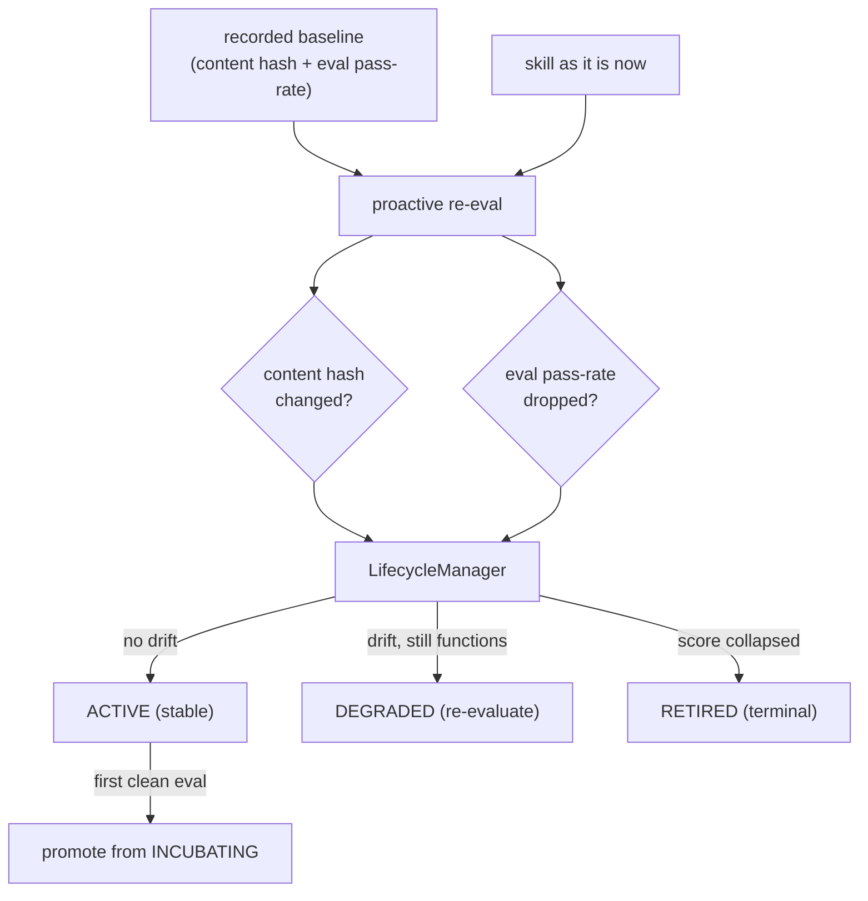

# POC 18 — Skill lifecycle / drift detection

The last hypothesis gap (doc 03 §1 "Skill decay / lifecycle" — marked 🔴 Gap; doc 02 §5 caveat 4,
doc 03 §5): **skills silently break** as the prompt / types / APIs they reference change, and a
library needs *proactive* maintenance, not just install-time vetting. This POC builds that
maintenance loop: a **SkillOps-style proactive re-eval** that re-scores a skill, compares its
content hash and eval pass-rate against the recorded baseline, and moves it through a lifecycle.

## What it proves

- **A skill's contract is its eval pass-rate, and drift is detectable.** Two independent signals:
  *content drift* (the pack's content hash diverged from baseline — prompt edited, a referenced
  type renamed, a tool group added) and *score drift* (the eval pass-rate dropped below baseline).
- **A lifecycle keeps the library honest.** `incubating → active → degraded → retired`: a clean
  baseline promotes a skill to ACTIVE; content or score drift moves it to DEGRADED (re-evaluate);
  a score collapse retires it (terminal). This is the "Skill Drift Is Contract Violation" /
  SkillOps maintenance model from doc 02 §5 caveat 4.
- **The mechanism is deterministic and offline.** The content hash, drift detection, and state
  machine are pure (no model); the live re-eval is endpoint-gated and reuses the same eval wiring
  as POC 9.

## How it works



`SkillContentHash` hashes the goal + each step (name, I/O, tool groups, prompt) + each type.
`DriftDetector` flags content drift (hash mismatch) and score drift (pass-rate drop beyond a
tolerance). `LifecycleManager.assess` combines them into a `DriftReport` (state transition +
verdict). `LifecycleSkill` provides three prompt variants of one tagline skill — healthy,
reworded (content drift only), regressed (content + score drift). `LiveEvalRunner` (endpoint-gated)
deploys a skill and measures its real eval pass-rate.

## Run it

Endpoint-gated (the live re-eval calls the model; the deterministic walkthrough always runs first):

```bash
mvn -pl poc/poc-18-skill-lifecycle spring-boot:run
```

The content-hash, drift-detection, and lifecycle halves are pinned by offline tests
(`SkillContentHashTest`, `DriftDetectorTest`, `LifecycleManagerTest`) — `mvn test` stays green
without a model.

## Conclusion

Against the hypothesis (claim C17 — the last hypothesis gap, doc 03 §1 "Skill decay /
lifecycle"): **proven, gap closed.** A skill's contract is its eval pass-rate, and drift is
detectable from two independent signals — content hash divergence and pass-rate drop — that drive
the `incubating → active → degraded → retired` lifecycle. Live: the healthy tagline variant
scored **100%**, the regressed variant **0%**, and the proactive re-eval correctly retired it
("score collapsed; the skill's contract is violated"); a silent prompt edit (content drift only)
moved it to DEGRADED for re-evaluation. The deterministic half (hash / drift / state machine) is
repeatable and offline-pinned; the live re-eval scores behaviour, so its verdict varies with the
model's in-domain adherence. This lifecycle is now applied end-to-end in the POC 15 retrieval
pane (retired dropped, degraded de-ranked).

See `docs/04-poc-run-results.md`.
