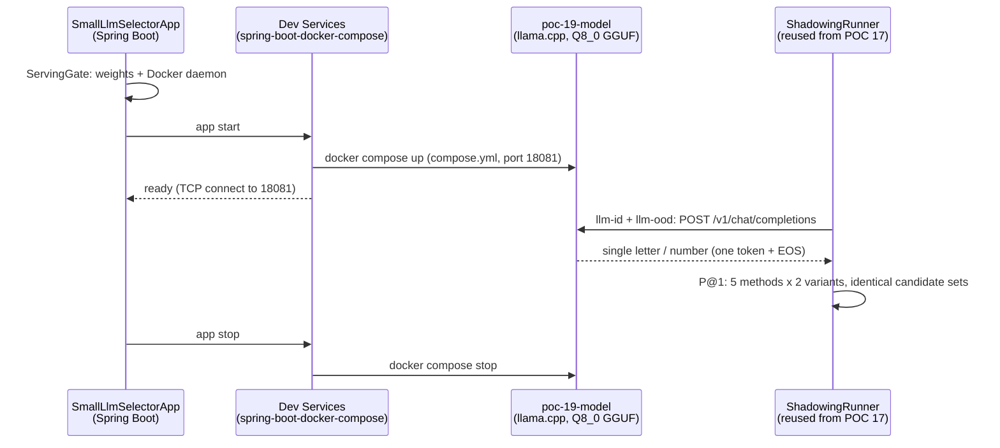

# POC 19: small-LLM skill selection

POC 17 proved a transformer zero-shot classifier (GLiNER2) breaks the skill-shadowing tie that
text similarity cannot. POC 19 tests the next mechanism: a **0.6B model fine-tuned for
single-label decisions** (`iromu/Qwen3-0.6B-openjev`) as a skill selector on the same scenario —
and proves the self-contained serving pattern: the model runs in a **Docker container whose
lifecycle Spring Boot Dev Services manages** from this module's `compose.yml`.

## How it works



The selector is POC 17's `SkillSelector` seam (`LlmSelector`): one instance per prompt format.
The **in-distribution (ID)** format is the model's typed-decision contract — the question,
lettered options, "Answer with the single letter of the correct option" — the shape it was
fine-tuned on (84.9% on its own validation split; the untrained base emits 0% letters). The
**out-of-distribution (OOD)** format drops the lettered-option contract for a free-form
"reply with only the number of the best skill" prompt. Both are scored on POC 12's
`ScaleSkillLibrary` shadowing scenario (6 targets × matching/strict candidate sets) alongside
the GLiNER2, lexical, and dense baselines, so the ID/OOD gap is directly measurable.

## One-time setup

```bash
cd poc/poc-19-small-llm-selector
hf download iromu/Qwen3-0.6B-openjev-GGUF Qwen3-0.6B-openjev-Q8_0.gguf --local-dir models
```

(The image `ghcr.io/ggml-org/llama.cpp:server` is pulled automatically on first run. The
Q8_0 GGUF is the sibling of the FP8 checkpoint — this machine's 2080 Ti (Turing) cannot run
vLLM modelopt-FP8, which requires Hopper+.)

## Run

```bash
mvn -pl poc/poc-19-small-llm-selector spring-boot:run
```

Requires the Docker daemon; the model server listens on port 18081. **Docker-gated** (a new
runtime category after POC 17's local-model-gated): the launcher checks the weights and the
Docker daemon before Spring starts, failing with a clear, actionable error otherwise. The
container is started at app start and stopped at app shutdown; if it is already running, the
app just connects (re-run the benchmark without reloading the model).

## Measured results (shared — skill selection, C10)

POCs 8, 12, 17, 19, 20, and 23 test the same hypothesis — **skill selection at scale** (claim C10) —
on the same scenario, with different techniques. This results section is **shared across their
READMEs** (identical in each); the consolidated read is in `docs/04-poc-run-results.md` §7.1.

**Small scale (POC 8 — 14 same-typed skills, lexical):** Precision@1 **100%**; the target stays
top-1 as same-verb distractors are added (growth curve).

**Distinct scale (POC 12/20/23 — 191 same-typed skills, full-library P@1):**

| method | P@1 (191 distinct) |
| --- | --- |
| lexical (word TF) | 100% |
| dense (feature hash) | 100% |
| embedding (MiniLM, local ONNX) | 100% |
| embedding (nomic, remote) | 100% |

**Under shadowing (POC 12/20/23 — 281 skills incl. 90 same-topic near-duplicates, full-library P@1):**

| method | P@1 (281, shadowing) |
| --- | --- |
| lexical (word TF) | 17% |
| dense (feature hash) | 0% |
| embedding (MiniLM, local ONNX) | 33% |
| embedding (nomic, remote) | 17% |

**On the 6-target candidate sets (POC 17/19 — matching vs strict variants):**

| method | matching@1 | strict@1 |
| --- | --- | --- |
| lexical (word TF) | 17% | 33% |
| dense (feature hash) | 0% | 0% |
| transformer (GLiNER2) | 83% | **100%** |
| llm-id (Qwen3-0.6B) | 0% | 50% |
| llm-ood (Qwen3-0.6B) | 50% | 67% |

**Scaling dimension (POC 23 — remote nomic embedding, generated library to 1000 skills):**
Precision@1 holds at **100%** from 100 to 1000 same-typed skills; steady-state per-query retrieval
(cosine over cached vectors, no model call) grows linearly and stays sub-millisecond-to-~1.3 ms,
while the one-time embedding index (one embedding per skill) is paid once and amortised. A
per-candidate LLM/transformer selector would instead need *n* model calls per query.

| size | P@1 | per-query retrieval |
| --- | --- | --- |
| 100 | 100% | 0.48 ms |
| 200 | 100% | 0.41 ms |
| 400 | 100% | 0.54 ms |
| 800 | 100% | 1.04 ms |
| 1000 | 100% | 1.27 ms |

**Shared reading:** retrieval is clean while skills are distinct (100% at every scale, up to 1000
skills); near-duplicate shadowing collapses text-similarity (lexical 17%, dense 0%), and no
text-similarity index cures it. Methods that score by *meaning* — a zero-shot transformer (GLiNER2,
the best: strict 100%), a fine-tuned 0.6B LLM, and a real embedding index — beat text-similarity,
but the near-duplicates are near-identical in *meaning* too, so none fully cures the collapse on its
own (the remote nomic embedding ties lexical at 17% under shadowing — the specific embedding model
matters). And the scaling result is unambiguous: a remote `EmbeddingService` retrieves cleanly to
1000 skills with sub-millisecond-to-~1 ms per-query cost and **zero per-query model calls** — the
reason it is the selection mechanism of choice as the library outgrows per-candidate selectors. The
real fix for shadowing is library **curation** (dedup / lifecycle — POC 18, applied in the POC 15
retrieval pane).

## Conclusion

Against the hypothesis (claim C10, at scale — a second remedy): **proven, with a caveat.** The
0.6B decision-tuned LLM **beats text similarity decisively** (50–67% vs 0–33%) but **does not
beat the transformer classifier** (100%/83%). The striking result: the **free-form OOD prompt
outperforms the model's own trained decision format** (67% vs 50% strict). Two caveats keep that
reading honest: the ID parser is strict (first character must be the letter — the contract answer
is one token + EOS), while the OOD parser also accepts a number anywhere or the skill's name; and
the model's 84.9% was measured on short-option tasks, whereas these options are full skill
descriptions. Both effects push the ID column down relative to OOD (see the shared results
above). The POC also introduces the **docker-gated** runtime category and the self-contained
serving pattern: the model runs in a `llama.cpp` container whose lifecycle Spring Boot Dev
Services manages from the module's `compose.yml`.
