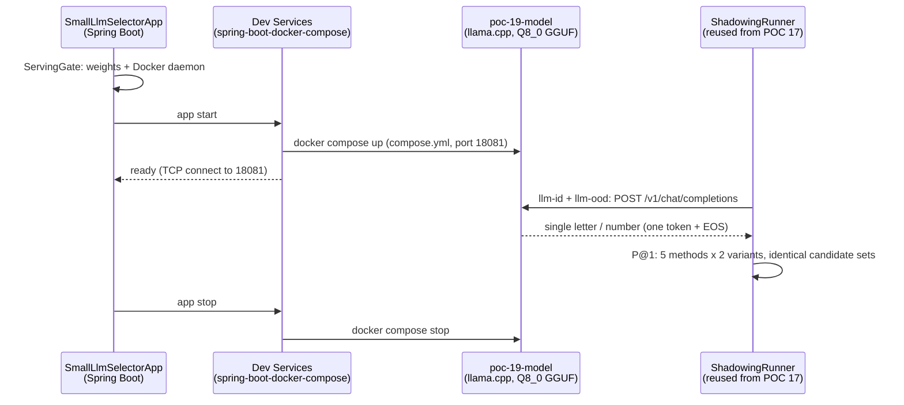

# POC 19: small-LLM skill selection

POC 17 proved a transformer zero-shot classifier (GLiNER2) breaks the skill-shadowing tie that
text similarity cannot. POC 19 tests the next mechanism: a **0.6B model fine-tuned for
single-label decisions** (`iromu/Qwen3-0.6B-openjev`) as a skill selector on the same scenario —
and proves the self-contained serving pattern: the model runs in a **Docker container whose
lifecycle Spring Boot Dev Services manages** from this module's `compose.yml`.

## How it works



The selector is POC 17's `SkillSelector` seam (`LlmSelector`): one instance per prompt format.
The **in-distribution (ID)** format is the model's typed-decision contract — the question,
lettered options, "Answer with the single letter of the correct option" — the shape it was
fine-tuned on (84.9% on its own validation split; the untrained base emits 0% letters). The
**out-of-distribution (OOD)** format drops the lettered-option contract for a free-form
"reply with only the number of the best skill" prompt. Both are scored on POC 12's
`ScaleSkillLibrary` shadowing scenario (6 targets × matching/strict candidate sets) alongside
the GLiNER2, lexical, and dense baselines, so the ID/OOD gap is directly measurable.

## One-time setup

```bash
cd poc/poc-19-small-llm-selector
hf download iromu/Qwen3-0.6B-openjev-GGUF Qwen3-0.6B-openjev-Q8_0.gguf --local-dir models
```

(The image `ghcr.io/ggml-org/llama.cpp:server` is pulled automatically on first run. The
Q8_0 GGUF is the sibling of the FP8 checkpoint — this machine's 2080 Ti (Turing) cannot run
vLLM modelopt-FP8, which requires Hopper+.)

## Run

```bash
mvn -pl poc/poc-19-small-llm-selector spring-boot:run
```

Requires the Docker daemon; the model server listens on port 18081. **Docker-gated** (a new
runtime category after POC 17's local-model-gated): the launcher checks the weights and the
Docker daemon before Spring starts, failing with a clear, actionable error otherwise. The
container is started at app start and stopped at app shutdown; if it is already running, the
app just connects (re-run the benchmark without reloading the model).

## Measured (2026-11-03, CPU)

| method | matching@1 | strict@1 |
| --- | --- | --- |
| transformer (GLiNER2) | **83%** | **100%** |
| lexical (word TF) | 17% | 33% |
| dense (feature hash) | 0% | 0% |
| llm-id (Qwen3-0.6B) | 0% | 50% |
| llm-ood (Qwen3-0.6B) | 50% | 67% |

The small LLM **beats text similarity decisively** (50–67% vs 0–33%) but **does not beat the
transformer classifier** (100%/83%). The striking result: the **free-form OOD prompt outperforms
the model's own trained decision format** (67% vs 50% strict). Two caveats keep that reading
honest: the ID parser is strict (first character must be the letter — the contract answer is
one token + EOS), while the OOD parser also accepts a number anywhere or the skill's name; and
the model's 84.9% was measured on short-option tasks, whereas these options are full skill
descriptions. Both effects push the ID column down relative to OOD.
