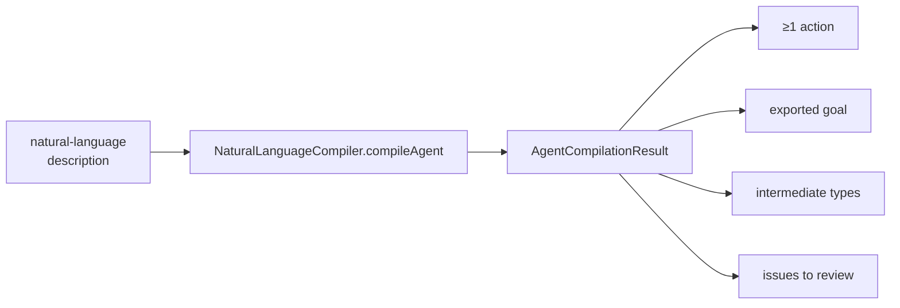

# POC 2 — NL-compile (description → draft)

De-risks the **natural-language → skill-draft** path: a plain-language description is compiled into
a draft skill (actions + goal + intermediate types) by Embabel's `NaturalLanguageCompiler`.

## What it proves

- **A skill can be authored from a natural-language description (C4).** `compileAgent` returns an
  `AgentCompilationResult` with ≥1 action, an exported goal, and the intermediate types the chain
  requires.
- An ambiguous description yields a draft **plus explicit issues to review**, not a silently-wrong
  draft. (The *quality* of the raw draft is the caveat tracked by POC 9.)

## How it works



`NlCompileRunner` wraps `NaturalLanguageCompiler.compileAgent` over a `StepSpecContextFactory`-built
context and reports the resulting actions, goal, types, and any issues.

## Run it

Endpoint-gated:

```bash
BUILDER_DESCRIPTION="A skill that explains a topic in plain language and posts it as a background message" \
    mvn -pl poc/poc-2-nl-compile spring-boot:run
```

## Conclusion

Against the hypothesis (claim C4): **proven, low quality at the source.** The NL → draft path
works — a plain-language description compiles to a draft with ≥1 action, an exported goal, and the
intermediate types — but the raw draft is the weak part: the same description has produced a
`HEALTHY` draft in one run and a `VOID_GOAL` degenerate draft in the next, so the `DraftQuality`
classifier (POC 2/3) measures it, and only POC 3's `normalizeGoalOutput` plus POC 9's
eval-guided refinement repair it. The compiler is a measurement problem with a proven fix, not a
broken path.

See `docs/04-poc-run-results.md`.
