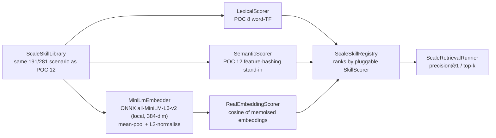

# POC 20 — real semantic `EmbeddingService`

The one piece the POC set had left unbuilt: a **real** dense embedding index behind the retrieval
pre-filter, as doc 03 §2.1 calls for ("build a semantic index over `GoalSpec.description` +
`PromptedActionSpec.description` + `DynamicType.description` using embeddings"). POC 12's dense
retriever was an **offline feature-hashing stand-in** (hashed character/word n-grams), and POC 17's
GLiNER2 was a zero-shot *classifier*, not an embedding index. POC 20 puts a genuine transformer
embedding model — `all-MiniLM-L6-v2` (384-dim BERT, via ONNX Runtime + the HuggingFace tokenizer) —
into POC 12's `SkillScorer` seam and runs the **identical** 200+ same-typed shadowing scenario to
answer the question POC 12 left open: does a real embedding index cure the near-duplicate collapse
that lexical and dense text-similarity both suffer?

The three methods share one `SkillScorer` seam (`score(query, entry) → double`) and the same
`ScaleSkillRegistry` / `ScaleRetrievalRunner` P@1 math, so the comparison is apples-to-apples:
`LexicalScorer` (POC 8 word-TF), `SemanticScorer` (POC 12 feature-hashing stand-in), and
`RealEmbeddingScorer` (this POC — cosine of the MiniLM embeddings, memoised per query and per skill).

## How it works



## Local-model-gated

Like POC 17, the live benchmark runs only when the ONNX bundle is present on disk. Without it, the
launcher fails with a clear, actionable error (naming the missing files and the download command) —
not an opaque ONNX failure. The offline unit tests exercise the same `run` path with a deterministic
stub `Embedder`, so the module builds green without the model (`mvn -pl poc/poc-20-semantic-embedding
test`).

## One-time setup (fetch the model)

The quantized `all-MiniLM-L6-v2` ONNX bundle (~23 MB) is **not committed** (large binary; `models/`
is gitignored). Fetch it once into the module's `models/` directory:

```bash
hf download Xenova/all-MiniLM-L6-v2 \
  --include "tokenizer.json" "config.json" "onnx/model_quantized.onnx" \
  --local-dir poc/poc-20-semantic-embedding/models/all-MiniLM-L6-v2
```

The embedder expects this layout under `models/all-MiniLM-L6-v2/`:

```
tokenizer.json
onnx/model_quantized.onnx
```

(`config.json` is included for reference.) Override the location with `EMBED_MODEL_DIR` (e.g. to a
shared models cache).

## Run it

No endpoint needed — this is a local-model benchmark, not an LLM call. From the repo root, with the
bundle present:

```bash
mvn -pl poc/poc-20-semantic-embedding exec:java
```

It prints a Precision@1 comparison table for the three methods (lexical / dense / real embedding) on
POC 12's scenario: the **core** 191 distinct-topic library, the **full** 281 library (with 90
same-topic near-duplicates), the growth curve, and per-target top-1.

## Measured results (shared — skill selection, C10)

POCs 8, 12, 17, 19, and 20 test the same hypothesis — **skill selection at scale** (claim C10) —
on the same scenario, with different techniques. This results section is **shared across their
READMEs** (identical in each); the consolidated read is in `docs/04-poc-run-results.md` §7.1.

**Small scale (POC 8 — 14 same-typed skills, lexical):** Precision@1 **100%**; the target stays
top-1 as same-verb distractors are added (growth curve).

**Distinct scale (POC 12/20 — 191 same-typed skills, full-library P@1):**

| method | P@1 (191 distinct) |
| --- | --- |
| lexical (word TF) | 100% |
| dense (feature hash) | 100% |
| embedding (MiniLM, real) | 100% |

**Under shadowing (POC 12/20 — 281 skills incl. 90 same-topic near-duplicates, full-library P@1):**

| method | P@1 (281, shadowing) |
| --- | --- |
| lexical (word TF) | 17% |
| dense (feature hash) | 0% |
| embedding (MiniLM, real) | 33% |

**On the 6-target candidate sets (POC 17/19 — matching vs strict variants):**

| method | matching@1 | strict@1 |
| --- | --- | --- |
| lexical (word TF) | 17% | 33% |
| dense (feature hash) | 0% | 0% |
| transformer (GLiNER2) | 83% | **100%** |
| llm-id (Qwen3-0.6B) | 0% | 50% |
| llm-ood (Qwen3-0.6B) | 50% | 67% |

**Shared reading:** retrieval is clean while skills are distinct (100% at every scale);
near-duplicate shadowing collapses text-similarity (lexical 17%, dense 0%), and no text-similarity
index cures it. Methods that score by *meaning* — a zero-shot transformer (GLiNER2, the best:
strict 100%), a fine-tuned 0.6B LLM, and a real embedding index — all beat text-similarity
decisively, but the near-duplicates are near-identical in *meaning* too, so none fully cures the
collapse on its own. The real fix is library **curation** (dedup / lifecycle — POC 18, applied in
the POC 15 retrieval pane).

## Conclusion

Against the hypothesis (claim C10 — the last retrieval gap): **proven, with the shared limit.**
A genuine `EmbeddingService` now exists and **retrieves cleanly at the distinct scale** (100% at
191 distinct-topic skills — the doc 03 §2.1 gap closed with a real transformer index, not a
stand-in). Under shadowing it **beats text-similarity** (33% vs lexical 17% / dense 0%) because it
scores by *meaning*, but it still gets shadowed on 4 of the 6 targets — the near-duplicates are
near-identical in *meaning* too, so the canonical skill is not the unique best match. This confirms
POC 12's conclusion: the fundamental fix for shadowing is library **curation** (dedup / lifecycle —
POC 18), not just a better embedding (see the shared results above). The run is
**local-model-gated** (one-time ONNX download; offline tests use a deterministic stub embedder).

## Tests

`EmbeddingMathTest` (mask-aware mean-pool, L2-normalise, cosine), `RealEmbeddingScorerTest` (cosine
of the memoised embeddings; each distinct query/entry embedded once), and `EmbeddingRetrievalAppTest`
(the three-method report shape and the model gate, with a deterministic stub `Embedder`) — all
offline, no model.

See `docs/04-poc-run-results.md` for the measured results read against the hypothesis.
