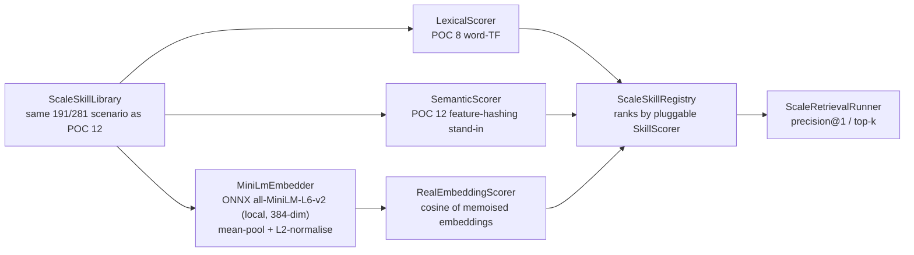

# POC 20 — real semantic `EmbeddingService`

The one piece the POC set had left unbuilt: a **real** dense embedding index behind the retrieval
pre-filter, as doc 03 §2.1 calls for ("build a semantic index over `GoalSpec.description` +
`PromptedActionSpec.description` + `DynamicType.description` using embeddings"). POC 12's dense
retriever was an **offline feature-hashing stand-in** (hashed character/word n-grams), and POC 17's
GLiNER2 was a zero-shot *classifier*, not an embedding index. POC 20 puts a genuine transformer
embedding model — `all-MiniLM-L6-v2` (384-dim BERT, via ONNX Runtime + the HuggingFace tokenizer) —
into POC 12's `SkillScorer` seam and runs the **identical** 200+ same-typed shadowing scenario to
answer the question POC 12 left open: does a real embedding index cure the near-duplicate collapse
that lexical and dense text-similarity both suffer?

The three methods share one `SkillScorer` seam (`score(query, entry) → double`) and the same
`ScaleSkillRegistry` / `ScaleRetrievalRunner` P@1 math, so the comparison is apples-to-apples:
`LexicalScorer` (POC 8 word-TF), `SemanticScorer` (POC 12 feature-hashing stand-in), and
`RealEmbeddingScorer` (this POC — cosine of the MiniLM embeddings, memoised per query and per skill).

## How it works



## Local-model-gated

Like POC 17, the live benchmark runs only when the ONNX bundle is present on disk. Without it, the
launcher fails with a clear, actionable error (naming the missing files and the download command) —
not an opaque ONNX failure. The offline unit tests exercise the same `run` path with a deterministic
stub `Embedder`, so the module builds green without the model (`mvn -pl poc/poc-20-semantic-embedding
test`).

## One-time setup (fetch the model)

The quantized `all-MiniLM-L6-v2` ONNX bundle (~23 MB) is **not committed** (large binary; `models/`
is gitignored). Fetch it once into the module's `models/` directory:

```bash
hf download Xenova/all-MiniLM-L6-v2 \
  --include "tokenizer.json" "config.json" "onnx/model_quantized.onnx" \
  --local-dir poc/poc-20-semantic-embedding/models/all-MiniLM-L6-v2
```

The embedder expects this layout under `models/all-MiniLM-L6-v2/`:

```
tokenizer.json
onnx/model_quantized.onnx
```

(`config.json` is included for reference.) Override the location with `EMBED_MODEL_DIR` (e.g. to a
shared models cache).

## Run it

No endpoint needed — this is a local-model benchmark, not an LLM call. From the repo root, with the
bundle present:

```bash
mvn -pl poc/poc-20-semantic-embedding exec:java
```

It prints a Precision@1 comparison table for the three methods (lexical / dense / real embedding) on
POC 12's scenario: the **core** 191 distinct-topic library, the **full** 281 library (with 90
same-topic near-duplicates), the growth curve, and per-target top-1.

## Measured results

Run 2026-11-03 (Java 21, ONNX Runtime 1.27.0 CPU, INT8-quantized MiniLM):

| method | core@1 (191 distinct) | full@1 (281, shadowing) |
| --- | --- | --- |
| lexical (word TF) | 100% | 17% |
| dense (feature hash) | 100% | 0% |
| **embedding (MiniLM)** | **100%** | **33%** |

Two findings:

1. **A real `EmbeddingService` now exists and retrieves cleanly at the distinct scale.** At 191
   distinct-topic skills the MiniLM index hits **100%** Precision@1 — the doc 03 §2.1 gap is closed
   with a genuine transformer index, not a stand-in.
2. **A real embedding beats text-similarity under shadowing, but does not fully cure it.** At full
   scale the transformer index scores **33%** — better than lexical (**17%**) and dense feature-hashing
   (**0%**) — because it scores by *meaning*, not hashed n-grams. But it still gets shadowed on 4 of
   the 6 targets (the near-duplicates are near-identical in *meaning* too, so the canonical skill is
   not the unique best match). This confirms POC 12's conclusion: the fundamental fix for shadowing
   is library **curation** (dedup / lifecycle — POC 18), not just a better embedding; a real
   `EmbeddingService` improves the signal but shares the near-duplicate ambiguity.

## Tests

`EmbeddingMathTest` (mask-aware mean-pool, L2-normalise, cosine), `RealEmbeddingScorerTest` (cosine
of the memoised embeddings; each distinct query/entry embedded once), and `EmbeddingRetrievalAppTest`
(the three-method report shape and the model gate, with a deterministic stub `Embedder`) — all
offline, no model.

See `docs/04-poc-run-results.md` for the measured results read against the hypothesis.
