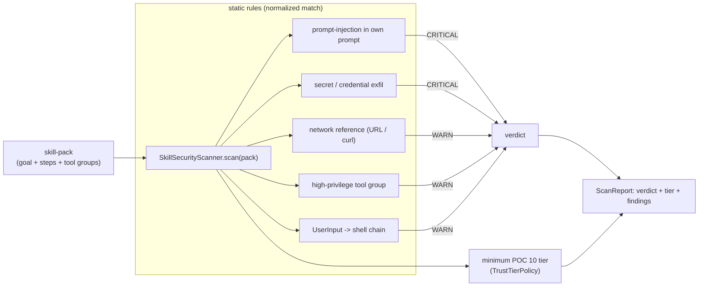

# POC 21 — Skill security / vulnerability scanning

An **install-time static scanner** that vets a skill-pack *before* it is loaded. It is the
install-time complement to [POC 10](../poc-10-trust-tiers/)'s *runtime* trust tiers: POC 10 gates a
skill at load/run time; POC 21 audits the pack's static content first. Fully offline — pure pattern
analysis over the skill-pack model, no model endpoint.

## What it proves

- **Skill security / install-time vetting (doc 02 caveat 3).** The survey reports **26.1% of
  42,447 community skills contain vulnerabilities** and that skills enable "trivially simple" prompt
  injection (Schmotz et al.) — *once loaded, a skill's instructions are treated as authoritative*.
  POC 21 is the "audit before installing" step doc 02 §6.8 calls for: it flags the risk a pack
  carries *before* any runtime tier can react.
- **A skill's own prompt is an attack surface.** The scanner detects prompt-injection text inside the
  skill's prompt (the skill hijacking the agent that loads it), secret-exfiltration patterns, network
  references, over-privileged tool groups, and the untrusted-input-to-shell chain.
- **The verdict maps onto POC 10's tiers.** Each scan reports a risk verdict (`SAFE` / `REVIEW` /
  `BLOCK`) and the *minimum* POC 10 trust tier whose allowlist covers the skill's tool groups — so the
  scanner's output ("load at T3+") is exactly what POC 10 would enforce at runtime.

> Caveat: like POC 10's guardrail, the scanner is a **normalized pattern matcher**, not a semantic
> detector — it catches obfuscated variants (spacing, punctuation, mixed case) but a novel rephrasing
> outside the pattern set can slip through. It audits the *declared* prompt and tool groups; a skill
> that smuggles capability through a bundled `scripts/` file or an obfuscated runtime path is beyond a
> static YAML scan. That is the honest limit of a non-LLM install-time gate.

## How it works



`SkillSecurityScanner.scan(pack)` runs five static rules over the pack's prompts and declared tool
groups, aggregates the findings into a verdict (`BLOCK` on any critical, `REVIEW` on any warning, else
`SAFE`), and computes the minimum `TrustTier` via POC 10's `TrustTierPolicy`. `Finding` carries the
severity, category, message, and evidence; `ScanReport` bundles them with the verdict and tier.

## Run it

```bash
mvn -pl poc/poc-21-skill-security exec:java
```

It scans the sample skill-packs (`explainer`, `shell-runner`, `reference-heavy`, `compose-extract`,
`compose-explain`) plus a synthetic malicious pack, printing each pack's verdict, minimum tier, and
findings.

## Measured results (shared — security, C12 / C18)

POC 10 (runtime trust tiers + guardrail) and POC 21 (install-time static scan) are the two halves
of the same security hypothesis. This results section is **shared across their READMEs**
(identical in each); the consolidated read is in `docs/04-poc-run-results.md` §7.3.

**Runtime tier policy (POC 10):**

| skill | declared tool groups | T1_COMMUNITY | T3_PARTNER |
| --- | --- | --- | --- |
| `shell-runner` | `[shell]` | REFUSED (disallowed `[shell]`) | ALLOWED |
| `explainer` | `[]` | ALLOWED | ALLOWED |

**Install-time scan (POC 21):**

| pack | verdict | minimum tier | findings |
| --- | --- | --- | --- |
| `explainer` / `reference-heavy` / `compose-extract` / `compose-explain` | SAFE | T1_COMMUNITY | (clean) |
| `shell-runner` | REVIEW | T3_PARTNER | high-privilege tool (`shell`) + `UserInput → shell` chain |
| synthetic malicious pack | BLOCK | T3_PARTNER | prompt-injection + secret-exfil (2 criticals) + network + high-priv + chain |

The scanner's tier mapping agrees with the runtime policy: its "load at T3+" is exactly what POC 10
enforces. Both halves share the same honest limit — a normalized pattern matcher over declared
content, not a semantic detector.

## Conclusion

Against the hypothesis (claim C18 — "skills are vetted before install"): **proven.** The static
scanner vets a pack *before* it is loaded: the benign sample packs scan **SAFE** at `T1`;
`shell-runner` scans **REVIEW** at `T3_PARTNER` (high-privilege tool + untrusted-input-to-shell
chain); the synthetic malicious pack (injection + API-key exfil + `curl` to a URL + `shell`) is
**BLOCK**ed with two criticals. Each pack maps to the minimum POC 10 trust tier whose allowlist
covers its tool groups, so the install-time verdict and the runtime policy agree. The honest limit
— shared with POC 10's guardrail — is that it is a normalized pattern matcher over the pack's
*declared* prompts and tool groups, not a semantic detector, and a capability smuggled through a
bundled `scripts/` file is beyond a static YAML scan. See the shared results above for the runtime
half (POC 10).

See `docs/04-poc-run-results.md`.
