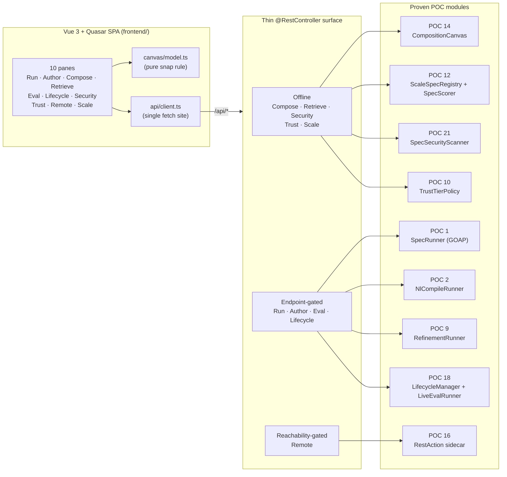

# POC 22 — The unified builder UI (the "missing piece", typed and testable)

POC 15 proved a builder UI exists, but it is a single vanilla-JS file whose logic is tangled into
the DOM — hard to test, hard to edit — and it drives only four of the twenty-one proven POC
capabilities. Doc 01 names the builder UI the *"missing piece."* POC 22 shows that piece can be a
**typed, component-based, unit-tested SPA** (Vue 3 + Quasar + TypeScript) that drives the *full*
set of proven capabilities over a thin REST surface, at a frontend footprint small enough that an
LLM can hold and edit it.

The SPA exposes **ten panes**, each backed by a thin `@RestController` that delegates to a proven
POC class (the POC 15 pattern — no new agent/spec logic):

| Pane        | Proven POC(s) | Behaviour                                   |
|-------------|---------------|---------------------------------------------|
| **Run**     | POC 1         | pick a spec, run the GOAP plan, see output (endpoint-gated) |
| **Author**  | POC 2         | NL → draft + `DraftQuality` verdict (endpoint-gated) |
| **Compose** | POC 14        | place specs, type-checked edges, export composite (offline) |
| **Retrieve**| POC 12/18     | rank the library by a pluggable scorer, curation-aware (offline) |
| **Eval**    | POC 9         | score + prompt rewrite + re-score (endpoint-gated) |
| **Lifecycle**| POC 18       | drift detection, re-eval, state transitions (re-eval endpoint-gated) |
| **Security**| POC 21        | scan a pack → findings + `SAFE`/`REVIEW`/`BLOCK` (offline) |
| **Trust**   | POC 10        | tier + tool-group allowlist (offline) |
| **Remote**  | POC 16/13     | `RestAction` over the sidecar / MCP tool (gated on reachability) |
| **Scale**   | POC 12        | shadowing `P@1` table across a growing library (offline) |

The panes split by their gating: the **offline** ones (compose, retrieve, security, trust, scale)
work with no model endpoint; the **endpoint-gated** ones (run, author, eval, lifecycle re-eval)
present a clear "endpoint not configured" state when the model env vars are absent; the **Remote**
pane presents a "backing process not running" state when its sidecar/MCP server is unreachable.

## How it works



- **`frontend/`** — the SPA. Pure logic is separated from the views so it is unit-testable:
  - `src/canvas/model.ts` — the type-checked "snap" rule and chain validation as pure functions
    (`{nodes, edges, specs} → {valid, issues, chain}`), mirroring POC 14's edge type-check.
  - `src/api/client.ts` — the **only** place that calls `fetch()`; every pane goes through it, so
    tests mock `fetch` once and exercise all panes' data flow.
  - `src/api/types.ts` — TypeScript interfaces mirroring the backend DTOs (the type-safety payoff:
    a backend field change is caught by `vue-tsc` / the tests).
  - `src/panes/*.vue` — thin Quasar views (inputs + a button + a results block); the logic is not in
    them.
- **The thin REST surface** — one `@RestController` per pane, each wrapping a proven POC class. The
  offline controllers delegate to the pure POC model; the endpoint-gated ones check
  `ModelEndpointConfig.configError()` first and return a clear, named configuration error before any
  model call; the Remote controller checks sidecar reachability and returns a "not running" body when
  down.
- **`SpecCatalog` / `SpecCuration`** — the palette (every valid, exported agent spec under the
  agent specs directory) and POC 18's library curation, reused by the Compose, Retrieve, and
  Lifecycle panes.

## What it proves

- **Every proven capability is a pane** — the ten panes are reachable from the nav, each backed by a
  distinct `/api/*` endpoint the pane invokes and renders.
- **Offline panes work with no endpoint** — compose a chain, retrieve, scan a pack, trust-tier
  check, and the scale table all run fully offline.
- **Endpoint-gated panes degrade gracefully** — without the model env vars they show
  "endpoint not configured" instead of failing.
- **The canvas snap is type-checked** — an edge is valid only when the source spec's output type is
  one of the target's input types; an incompatible edge is flagged with the type-mismatch reason
  (POC 14's rule, surfaced in the browser).
- **Retrieval is curation-aware and pluggable** — retired specs are dropped, degraded specs
  de-ranked, every hit stamped with its lifecycle state; a denser scorer (POC 17/19/20) drops in via
  the shared `SpecScorer` seam and the pane reports the active scorer.
- **Remote panes are gated on the backing process** — "not running" when the sidecar is down, the
  remote action's result when it is up.

## Build & run

The SPA is built with Vite into the Spring Boot static dir (`static/` is gitignored). Dev flow:
`vite` on `:5173` proxies `/api` to the app on `:18080`.

```bash
# 1. build the SPA into src/main/resources/static/
cd poc/poc-22-unified-ui/frontend
npm install
npm run build          # vue-tsc --noEmit && vite build

# 2. run the app (offline panes work with no endpoint)
cd ../..
SERVER_PORT=18080 mvn -pl poc/poc-22-unified-ui spring-boot:run
# → open http://localhost:18080/

# 3. for the endpoint-gated panes (Run, Author, Eval, Lifecycle re-eval), also set:
export OPENAI_CUSTOM_BASE_URL=... OPENAI_CUSTOM_API_KEY=...
export OPENAI_CUSTOM_MODELS=... EMBABEL_MODELS_DEFAULT_LLM=...
```

`SERVER_PORT` defaults to 18080 to avoid a local service on 8080. The default build depends only on
the light + remote POC modules; the heavy scorers are opt-in via the shared `SpecScorer` seam —
e.g. POC 20's real ONNX embedding scorer (the model bundle from POC 20's one-time download):

```bash
SERVER_PORT=18080 mvn -pl poc/poc-22-unified-ui spring-boot:run \
  -Dspring-boot.run.arguments="--builder.scorer=embedding --builder.embedding-model-dir=<absolute path to poc-20 models/all-MiniLM-L6-v2>"
```

With it active, the Retrieve and Scale responses report the scorer as `embedding (MiniLM)` and
rank by it; the default remains the offline `lexical` scorer.

## Tests

- **`vue-tsc --noEmit`** — the type gate; the `types.ts` ↔ backend DTO contract is enforced here.
- **Vitest unit (no DOM)** — `canvas/model.ts` (edge type-check + chain validation) and
  `api/client.ts` (request shaping + response parse, `fetch` mocked).
- **Vitest + `@vue/test-utils` (component)** — mount a pane, fill inputs, click, assert the API was
  called and the result rendered (Compose, Retrieve, one endpoint-gated pane).
- **Spring Boot `MockMvc`** — one test per controller, mirroring POC 15: the offline panes pin their
  response shapes; the endpoint-gated panes pin the gated path and a mocked endpoint-present path;
  the Remote pane pins the down path (and the up path against a live `RemoteActionSidecar`).

## Conclusion

Against the hypothesis (claim C15, extended — the builder UI as a typed, testable SPA):
**in progress.** The design risk the POC de-risks is not the capabilities — each pane delegates to
a proven POC class (POC 1/2/9/10/12/14/16/18/21), so the agent/spec logic is already proven — but
the *surface*: a typed, component-based, unit-tested SPA (Vue 3 + Quasar + TypeScript) that drives
the full set of proven capabilities over a thin REST surface. When complete, the verdict will be
that the "missing piece" doc 01 names can be a small, LLM-editable, type-checked frontend whose
type gate (`vue-tsc` + the `types.ts` ↔ DTO contract) catches backend field changes, with the
offline / endpoint-gated / reachability-gated panes each degrading to a clear, named state. Run
evidence is pending (the POC is still being built; see the OpenSpec change
`openspec/changes/poc-22-unified-ui`).

See `docs/04-poc-run-results.md`.
