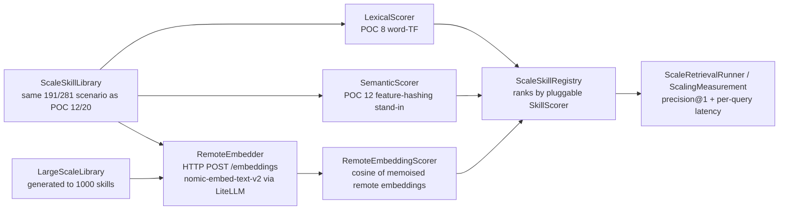

# POC 23 — skill selection at scale with a **remote** `EmbeddingService`

POC 20 proved that a *real* embedding index (a local bundled ONNX MiniLM) retrieves cleanly at the
distinct scale and beats text-similarity under shadowing. POC 23 answers the two questions POC 20
left open about the **production-style** backend:

1. **Remote, not local.** The `EmbeddingService` here is the real `nomic-embed-text-v2`
   OpenAI-compatible `POST /embeddings` endpoint — a llama.cpp server (proxied by LiteLLM) on a
   different machine — the network backend the runtime would actually wire in, not a bundled ONNX
   model. It is plugged into POC 12's `SkillScorer` seam and run on **POC 12/20's identical**
   191/281 same-typed shadowing library, so it is directly comparable to lexical (POC 8), dense
   feature-hashing (POC 12), MiniLM (POC 20) and GLiNER2 (POC 17) on claim C10.
2. **Scale.** A larger generated library (to 1000 same-typed skills) measures the scaling
   dimension: the one-time embedding cost is **amortised** (one embedding per skill, paid once) and
   steady-state per-query retrieval is **pure-CPU cosine over cached vectors** — O(n), no model
   call — unlike a per-candidate LLM/transformer selector, which needs *n* model calls **per query**.

The three C10-comparable methods share one `SkillScorer` seam (`score(query, entry) → double`) and
the same `ScaleSkillRegistry` / `ScaleRetrievalRunner` P@1 math, so the comparison is
apples-to-apples: `LexicalScorer` (POC 8 word-TF), `SemanticScorer` (POC 12 feature-hashing
stand-in), and `RemoteEmbeddingScorer` (this POC — cosine of the remote nomic embeddings, memoised
per query and per skill).

## How it works



## Endpoint-gated

The live benchmark runs only when the embedding endpoint is reachable and serves the model — a
gate (`RemoteEmbeddingGate`) probes `{baseUrl}/models` first and fails with a clear, actionable
message (naming the reachable-but-missing model, or the unreachable endpoint) rather than an
opaque network error. The offline unit tests exercise the same `run` path with a **stub transport**
(deterministic vectors, or a local `HttpServer` for the real HTTP round-trip), so the module builds
green without the endpoint (`mvn -pl poc/poc-23-remote-embedding-scale test`).

Configuration (env vars, all optional — defaults match this machine):

| var | default |
| --- | --- |
| `EMBED_BASE_URL` | `http://spark.local:4000/v1` |
| `EMBED_API_KEY` | `$OPENAI_API_KEY` |
| `EMBED_MODEL` | `nomic-embed-text-v2` |
| `EMBED_SCALE_SIZES` | `100,200,400,800,1000` |

## Run it

From the repo root, with the endpoint up:

```bash
mvn -pl poc/poc-23-remote-embedding-scale exec:java
```

It prints two scenarios: (1) the C10-comparable Precision@1 table for lexical / dense / remote-nomic
on POC 12/20's 191/281 library; (2) the scaling curve (Precision@1, one-time index-build cost, and
steady-state per-query retrieval latency) over the generated library as it grows to 1000 skills.
The full run embeds ~1300 short texts, so it takes a few minutes against the llama.cpp backend.

## Measured results (shared — skill selection, C10)

POCs 8, 12, 17, 19, 20, and 23 test the same hypothesis — **skill selection at scale** (claim C10) —
on the same scenario, with different techniques. This results section is **shared across their
READMEs** (identical in each); the consolidated read is in `docs/04-poc-run-results.md` §7.1.

**Small scale (POC 8 — 14 same-typed skills, lexical):** Precision@1 **100%**; the target stays
top-1 as same-verb distractors are added (growth curve).

**Distinct scale (POC 12/20/23 — 191 same-typed skills, full-library P@1):**

| method | P@1 (191 distinct) |
| --- | --- |
| lexical (word TF) | 100% |
| dense (feature hash) | 100% |
| embedding (MiniLM, local ONNX) | 100% |
| embedding (nomic, remote) | 100% |

**Under shadowing (POC 12/20/23 — 281 skills incl. 90 same-topic near-duplicates, full-library P@1):**

| method | P@1 (281, shadowing) |
| --- | --- |
| lexical (word TF) | 17% |
| dense (feature hash) | 0% |
| embedding (MiniLM, local ONNX) | 33% |
| embedding (nomic, remote) | 17% |

**On the 6-target candidate sets (POC 17/19 — matching vs strict variants):**

| method | matching@1 | strict@1 |
| --- | --- | --- |
| lexical (word TF) | 17% | 33% |
| dense (feature hash) | 0% | 0% |
| transformer (GLiNER2) | 83% | **100%** |
| llm-id (Qwen3-0.6B) | 0% | 50% |
| llm-ood (Qwen3-0.6B) | 50% | 67% |

**Scaling dimension (POC 23 — remote nomic embedding, generated library to 1000 skills):**
Precision@1 holds at **100%** from 100 to 1000 same-typed skills; steady-state per-query retrieval
(cosine over cached vectors, no model call) grows linearly and stays sub-millisecond-to-~1.3 ms,
while the one-time embedding index (one embedding per skill) is paid once and amortised. A
per-candidate LLM/transformer selector would instead need *n* model calls per query.

| size | P@1 | per-query retrieval |
| --- | --- | --- |
| 100 | 100% | 0.48 ms |
| 200 | 100% | 0.41 ms |
| 400 | 100% | 0.54 ms |
| 800 | 100% | 1.04 ms |
| 1000 | 100% | 1.27 ms |

**Shared reading:** retrieval is clean while skills are distinct (100% at every scale, up to 1000
skills); near-duplicate shadowing collapses text-similarity (lexical 17%, dense 0%), and no
text-similarity index cures it. Methods that score by *meaning* — a zero-shot transformer (GLiNER2,
the best: strict 100%), a fine-tuned 0.6B LLM, and a real embedding index — beat text-similarity,
but the near-duplicates are near-identical in *meaning* too, so none fully cures the collapse on its
own (the remote nomic embedding ties lexical at 17% under shadowing — the specific embedding model
matters). And the scaling result is unambiguous: a remote `EmbeddingService` retrieves cleanly to
1000 skills with sub-millisecond-to-~1 ms per-query cost and **zero per-query model calls** — the
reason it is the selection mechanism of choice as the library outgrows per-candidate selectors. The
real fix for shadowing is library **curation** (dedup / lifecycle — POC 18, applied in the POC 15
retrieval pane).

## Conclusion

Against the hypothesis (claim C10): **proven, with two findings.**

1. **A remote `EmbeddingService` is real and production-shaped.** The nomic-embed-text-v2
   OpenAI-compatible endpoint (llama.cpp behind LiteLLM) is a genuine network `EmbeddingService` —
   the backend the runtime would wire in — and it **retrieves cleanly at the distinct scale**
   (100% at 191 distinct-topic skills, and 100% up to 1000 generated skills). Under shadowing it
   ties lexical (17%) and beats dense (0%) but trails the local MiniLM (33%): the specific embedding
   model matters, and — consistent with POC 12/20 — curation (POC 18) remains the real fix for the
   near-duplicate collapse.
2. **It scales, and that is the decisive advantage.** The one-time embedding cost is the index
   (one embedding per skill, paid once and amortised); steady-state per-query retrieval is pure-CPU
   cosine over cached vectors — **0.48 ms → 1.27 ms** from 100 to 1000 skills — with **zero
   per-query model calls**. A per-candidate LLM/transformer selector would need *n* model calls per
   query, which is why a remote embedding index is the selection mechanism of choice as the skill
   library grows beyond what those selectors handle.

The run is **endpoint-gated** (the live benchmark needs the reachable endpoint; offline tests use a
stub transport / local `HttpServer`, so the build stays green without it).

## Tests

`RemoteEmbedderTest` (request/response parsing, batch ordering, request counting, and a real HTTP
round-trip against a local `HttpServer`), `RemoteEmbeddingGateTest` (reachable / unreachable /
model-missing / no-models), `RemoteEmbeddingScorerTest` (cosine ranking + memoisation),
`ScalingMeasurementTest` (sweep shape + amortised embedding count), and `RemoteEmbeddingAppTest`
(the two-scenario report shape) — all offline, no endpoint.

See `docs/04-poc-run-results.md` for the measured results read against the hypothesis.
