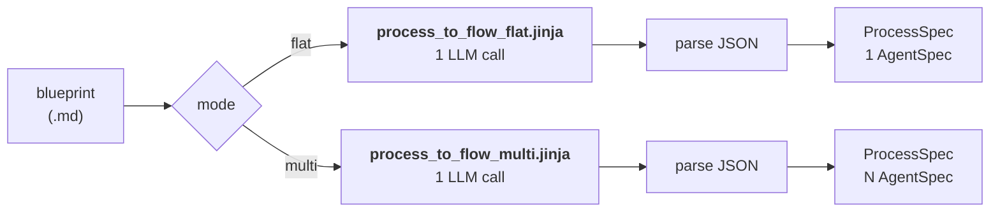
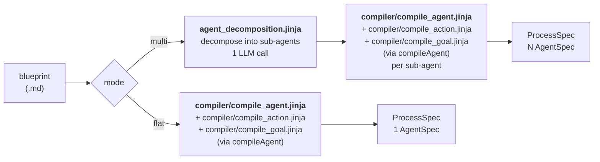

# POC 24 — Generation approaches: single-shot prompt vs. `embabel-agent-spec` NL compiler

Compares the two ways a business-process blueprint can be turned into agent spec(s), with a
focus on **decomposing a process into more than one agent** (a process = N `AgentSpec` packs
composed at runtime through shared intermediate types). It runs both approaches over the example
blueprints in `examples/blueprints/` (Aurora, Sentinel, TradingAgents) and reports a comparison.

## Hypothesis

A business process can be decomposed into several coherent agents (each owning one
responsibility, handing off to the next through shared types) rather than a single flat agent.
This POC asks **which generation approach produces the better multi-agent decomposition**:

- **Approach A — single-shot:** one hand-written prompt (`process_to_flow_multi.jinja`) asks the
  model to emit the whole multi-agent process as JSON in a single call. This is the approach the
  studio's home "Generate" workspace uses today.
- **Approach B — `embabel-agent-spec` NL compiler:** the process is first decomposed into
  sub-agents, then each sub-agent is compiled by Embabel's `DefaultNaturalLanguageCompiler`,
  which runs its own `compile_agent.jinja` / `compile_action.jinja` / `compile_goal.jinja`
  prompts. This is the approach the builder (`/api/build`) uses today.

Both produce the shared `AgentSpec` format (`smith-common`), so the same validator and the same
runtime composition apply to either.

## How it works

Each approach is a pipeline from a blueprint `.md` to a `ProcessSpec`. **Every LLM step is
labelled with the exact prompt file it uses** (paths are relative to
`src/main/resources/`). The `flat` and `multi` modes share an approach but differ in the
prompt: `flat` asks for one agent, `multi` asks for the whole decomposed process.

### Approach A — single-shot (`SingleShotGenerator`)

One prompt, one LLM call. The model is asked to emit the entire process as JSON in a single
response, so it can coordinate the type names across agents.



### Approach B — `embabel-agent-spec` NL compiler (`EmbabelGenerator`)

`flat` is a single `compileAgent` call. `multi` first decomposes the process into sub-agents
with its own prompt, then compiles **each sub-agent independently** with
`DefaultNaturalLanguageCompiler.compileAgent`, which runs Embabel's three compiler prompts.



### Prompt inventory

| Approach | Mode | LLM step | Prompt file |
|----------|------|----------|-------------|
| A — single-shot | flat | emit the whole agent | `prompts/process_to_flow_flat.jinja` |
| A — single-shot | multi | emit the whole multi-agent process | `prompts/process_to_flow_multi.jinja` |
| B — embabel | flat | compile one agent | `prompts/compiler/compile_agent.jinja`, `prompts/compiler/compile_action.jinja`, `prompts/compiler/compile_goal.jinja` |
| B — embabel | multi | 1. decompose into sub-agents | `prompts/agent_decomposition.jinja` |
| B — embabel | multi | 2. compile each sub-agent | `prompts/compiler/compile_agent.jinja`, `prompts/compiler/compile_action.jinja`, `prompts/compiler/compile_goal.jinja` |

> **Note on the `compiler/` prompts.** The `prompts/compiler/*.jinja` files are a **snapshot**
> copied from the `embabel-agent-spec` jar, kept in this POC so the comparison is self-contained
> and auditable. At runtime the real `DefaultNaturalLanguageCompiler` loads its own copies from
> classpath `compiler/…` inside the jar — this POC does **not** feed its snapshot to the compiler.

Both approaches emit the shared `AgentSpec` format, so the same validator and the same runtime
composition apply to either. A `ProcessSpec` is a named, ordered list of `AgentSpec` agents: the
first takes `UserInput`, the last agent's goal is the process's final deliverable, and agents
connect by sharing intermediate types (an earlier agent's goal output is a later agent's step
input).

## The comparison metric

`ProcessValidator` scores each generated process on:

- **agents / steps** — how many agents and total action steps.
- **shared types** — types referenced by more than one agent (the cross-agent glue).
- **per-agent goal** — each agent's goal output type must be produced by one of its own steps
  (structural), and be reachable from the process entry (connectivity).
- **process-wide feeding** — every step input must be produced by some agent (or be `UserInput`).
- **goal-name uniqueness** — the runtime rejects two agents exporting the same goal name.
- **connectivity** — the process must flow from `UserInput` to the final goal.

## How to run

Offline (no endpoint) — the parsing, normalisation and validation logic:

```
mvn -pl poc/poc-24-generation-approaches test
```

Live comparison (needs an OpenAI-compatible endpoint):

```
export OPENAI_CUSTOM_BASE_URL=... OPENAI_CUSTOM_API_KEY=... OPENAI_CUSTOM_MODELS=... EMBABEL_MODELS_DEFAULT_LLM=...
mvn -pl poc/poc-24-generation-approaches spring-boot:run \
    -Dspring-boot.run.arguments="--cmp.examples=/path/to/examples/blueprints --cmp.blueprints=Aurora,Sentinel,TradingAgents --cmp.modes=flat,multi"
```

Filter with `--cmp.blueprints=TradingAgents` and `--cmp.modes=multi`. The report is written to
`results/comparison.md` and printed to stdout.

## Measured results

Live run over `examples/blueprints/` (Aurora, Sentinel, TradingAgents), model `Qwen-instruct`.
`connected` = the process flows from `UserInput` to the final goal; a `VALID` verdict requires no
issues **and** `connected`. Full per-agent detail is in [`results/comparison.md`](results/comparison.md).

| Blueprint | Approach | Mode | Agents | Steps | Shared | Connected | Verdict |
|-----------|----------|------|:------:|:-----:|:------:|:---------:|---------|
| Aurora | single-shot | flat | 1 | 10 | 0 | yes | **VALID** |
| Aurora | embabel | flat | 1 | 1 | 0 | no | INVALID (2) |
| Aurora | single-shot | multi | 8 | 12 | 7 | yes | **VALID** |
| Aurora | embabel | multi | 11 | 22 | 6 | no | INVALID (18) |
| Sentinel | single-shot | flat | 1 | 10 | 0 | yes | **VALID** |
| Sentinel | embabel | flat | 1 | 5 | 0 | no | INVALID (2) |
| Sentinel | single-shot | multi | 8 | 18 | 7 | no | INVALID (4) |
| Sentinel | embabel | multi | 8 | 13 | 3 | no | INVALID (16) |
| TradingAgents | single-shot | flat | 1 | 8 | 0 | yes | **VALID** |
| TradingAgents | embabel | flat | 1 | 1 | 0 | no | INVALID (2) |
| TradingAgents | single-shot | multi | 5 | 15 | 4 | no | INVALID (4) |
| TradingAgents | embabel | multi | 8 | 9 | 7 | no | INVALID (9) |

**Score (this run):** single-shot **4/6** valid + connected; embabel **0/6**.

## Conclusion

The single-shot approach is the better fit, and the honest result is nuanced:

- **Flat (single agent) — single-shot wins clearly.** 3/3 valid + connected, with coherent 8–10
  step agents where every input is fed and the goal is reachable. The embabel NL compiler's flat
  output is degenerate (1–5 steps) and disconnected: it invents an entry type (`PurchaseOrder`,
  `SecurityEvent`, `RunConfiguration`) instead of taking `UserInput`, and its goal is often `void`
  or unreachable.

- **Multi-agent — single-shot is better but not bulletproof.** This run: single-shot multi was
  valid + connected on Aurora (8 agents, 7 shared types) but not on Sentinel or TradingAgents — in
  both the model introduced a **circular dependency** in the parallel branches that merge (Sentinel:
  `investigator` ↔ `risk_assessment`; TradingAgents: `bull_researcher_case` ↔
  `bear_researcher_case`). The embabel multi was disconnected on **all three**, because each
  sub-agent is compiled in isolation and the cross-agent type names never line up (e.g. `OrderRecord`
  vs `RawPurchaseOrder`), and the first agent never takes `UserInput`.

- **Why the gap.** Single-shot asks the model to emit the whole process at once, so it *can*
  coordinate the shared types — but it must get the dependency order right in one shot, and
  parallel-branch merges are where it introduces cycles. The embabel compiler never sees the other
  agents, so it cannot coordinate the hand-offs at all.

- **Non-determinism.** The model is non-deterministic, so individual runs vary. A separate run of
  the same matrix produced single-shot multi **3/3** valid (vs. 1/3 here) while embabel multi stayed
  **0/3** in both. The consistent finding: single-shot multi is *sometimes* valid; embabel multi is
  *never* valid.

**Recommendation.** Use the single-shot approach for the studio's multi-agent "Generate" workspace.
Because it can introduce cycles in processes with merging parallel branches, pair it with
`ProcessValidator` (which detects exactly these cycles) and a repair step (reorder the agents /
restructure the parallel branches) before publishing. Keep the `embabel-agent-spec` NL compiler for
single-agent authoring; do not use it for multi-agent composition until it can coordinate
shared-type hand-offs across sub-agents.

**Caveats.**

- **Prompt symmetry:** Approach A's prompts are purpose-built for this POC; Approach B uses
  Embabel's production compiler prompts. This compares the two *mechanisms* (one coordinated call
  vs. independent per-agent compilation), not prompt quality.
- **Raw embabel output:** the embabel specs are shown raw; the builder normally applies goal-output
  normalization (`void` → `BackgroundMessage`). The multi-agent disconnection is independent of that
  normalization.
- **Same model:** `Qwen-instruct` at the same temperature for every run, so the difference is the
  mechanism, not the model.
