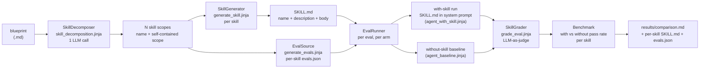

# POC 25 — Blueprint → Agent Skill generation, validated with/without the skill

Turns a business-process blueprint into a **set of Agent Skills** (one `SKILL.md` each, in the
[Agent Skills format](https://agentskills.io/)) and validates them the way the Anthropic
**skill-creator** does. First the blueprint is **decomposed into the skills required to
compartmentalize the process** (the extraction step); each skill is then generated into its own
`SKILL.md`, and a per-skill `evals.json` suite of scenario prompts is run against a
general-purpose agent **with that skill loaded** and **without it** (the baseline), each run
graded against verifiable expectations, and the **with-skill pass rate is compared to the
no-skill baseline, per skill**. The skill lift is the measured value of each generated skill.

## Hypothesis

A business-process blueprint can be **decomposed into a set of Agent Skills** that
compartmentalize the process, such that a general-purpose agent **loaded with a skill** handles
that skill's scenarios measurably better than the same agent **without** it. This POC asks
whether that is true, and by how much — measured by the skill-creator eval loop (with-skill vs.
no-skill baseline, graded against expectations), per skill, over the example blueprints in
`examples/blueprints/` (Aurora, Sentinel, TradingAgents).

This is a new direction for the "portable unit": POC 24 asked which *generator* produces the
better **Embabel AgentSpec**; POC 25 asks whether the unit can instead be an **Agent Skill**
(the Anthropic format — `SKILL.md` + optional `scripts/`/`references/`/`assets/`), and whether
loading the *right* skill into a general agent measurably improves the agent's understanding of
that slice of the process. The extraction step — deciding **how many** skills the process needs
and **what each owns** — is the POC's central claim.

## How it works

Each blueprint is a pipeline: **decompose** it into the skills required to compartmentalize the
process, then — **per skill** — generate the skill, draft its eval suite, run every eval with and
without the skill, grade, and benchmark. **Every LLM step is labelled with the prompt file it
uses** (paths are relative to `src/main/resources/`).



### 1. The extraction step — decompose into skills (`SkillDecomposer`)

One LLM call (`skill_decomposition.jinja`) turns the blueprint into the set of skills required to
compartmentalize the process. The model decides **how many** skills the process needs and names
each one; it returns a JSON list of `{name, scope}` where each `scope` is a **self-contained**
description of that skill's responsibility — the part of the process it owns, with its decision
points, the rule for each branch, its escalation rules, and the counter-intuitive gotchas that
belong to it. Names are normalized to valid Agent Skills slugs. A process with one coherent
responsibility decomposes into a single skill; a multi-phase or multi-actor process (e.g.
Sentinel's specialist agents) decomposes into several.

### 2. Skill generation (`SkillGenerator`)

One LLM call per skill (`generate_skill.jinja`) turns a skill's scope into its `SKILL.md`. The
**name** is fixed by the decomposition (so it matches the skill folder name, per the Agent
Skills spec); the model supplies the **description** (the triggering mechanism — what it does and
when to use it) and the **body** (the operating procedure: the core workflow, the decision points
and the rule for each branch, the escalation rules, and a *Gotchas* section for the
counter-intuitive constraints). The output is a well-formed `SKILL.md`, checked against the
frontmatter constraints by `SkillMdValidator` (`name` 1-64 lowercase-alphanumeric-or-hyphen, no
leading/trailing/consecutive hyphens; `description` non-empty, ≤ 1024 chars).

### 3. The per-skill eval suite (`EvalSuite`, `EvalSource`)

Each skill gets its own suite, in the skill-creator `evals/evals.json` format:
`{skill_name, evals: [{id, prompt, expected_output, files, expectations}]}`. The suite is
**generated per skill at run time** (`generate_evals.jinja`) from that skill's scope: 3-4
**concrete scenarios** (specific products, numbers, dates, actors) that exercise a decision point
or exception in the skill's responsibility, plus **verifiable expectations** a correct answer
must satisfy. (Hand-authored per-blueprint suites remain under `src/main/resources/evals/` as a
reference format and are still loaded by `EvalSource.load`.)

### 4. The with/without-skill runs (`EvalRunner`)

For each eval of a skill, two runs of the **same** scenario prompt:

- **with-skill** — that skill's `SKILL.md` is embedded in the system prompt
  (`agent_with_skill.jinja`), simulating skill activation (progressive disclosure: the skill body
  is in context because the task matches).
- **without-skill** — a plain baseline system prompt (`agent_baseline.jinja`), no skill.

Each answer is graded by an **LLM-as-judge** (`SkillGrader`, `grade_eval.jinja`) against the
eval's expectations, producing the skill-creator `grading.json` shape: an `expectations` array of
`{text, passed, evidence}`.

### 5. The arms, side by side

The same with/without-skill comparison is measured over configurable transports (the default is a
single arm):

- **`raw`** — a raw OpenAI-compatible chat-completions call (the default arm; the same wire the
  studio's single-shot generator and POC 24 use).
- **`embabel`** — the same calls routed through Embabel's `Ai` LLM abstraction
  (`ai.withDefaultLlm().generateText(...)`), the product's model layer. Enable it with
  `--skillgen.arms=embabel`. The skill content is identical; only the transport differs.

### 6. The benchmark (`Benchmark`)

Per skill, per arm, the pass rate is the fraction of all expectations passed across the skill's
suite for that configuration. The **skill lift** (delta) is the with-skill pass rate minus the
no-skill baseline pass rate — the measured value of that skill.

## How to run

Offline (no endpoint) — the decomposition parsing, frontmatter validation, evals parsing, and
benchmark aggregation:

```
mvn -pl poc/poc-25-skill-generation test
```

Live (needs an OpenAI-compatible endpoint):

```
export OPENAI_CUSTOM_BASE_URL=... OPENAI_CUSTOM_API_KEY=... OPENAI_CUSTOM_MODELS=... EMBABEL_MODELS_DEFAULT_LLM=...
mvn -pl poc/poc-25-skill-generation spring-boot:run
```

Filter the matrix with `--skillgen.blueprints=TradingAgents` or `--skillgen.arms=embabel` (the
default arm is `raw`). The report is written to `results/comparison.md`, each generated
`SKILL.md` to `results/<blueprint>/<skill>/SKILL.md`, and each skill's eval suite to
`results/<blueprint>/<skill>/evals.json`.

## Measured results

Live run over `examples/blueprints/` (Aurora, Sentinel, TradingAgents), model `Qwen-instruct`,
single `raw` arm (the default), **per-skill eval suites generated at run time**. Each blueprint is
first decomposed into its skill set; every skill is then measured independently (with-skill vs.
no-skill on its own scenarios). Full per-eval detail is in
[`results/comparison.md`](results/comparison.md).

Decomposition and per-skill lift (mean of the measured skills in each blueprint):

| Blueprint | Skills extracted | Measured | Mean skill lift | Best skill | Negative lifts |
|-----------|:---------------:|:--------:|:---------------:|------------|:--------------:|
| Aurora | 9 | 8 | **+17.2%** | inventory-allocation-and-replenishment **+38%** | 0 |
| Sentinel | 8 | 6 | **+2.3%** | digital-forensics-and-evidence-management **+20%** | 2 |
| TradingAgents | 16 | 13 | **+22.3%** | decision-recording-and-reporting **+75%** | 2 |

**27 of 33** extracted skills were measured — 19 lifted, 4 were neutral (±0), 4 were slightly
negative; across all 27 the mean lift is **+16.4%**. (6 skills could not be scored: the LLM-judge
returned malformed grading JSON on 3 consecutive attempts — a transient endpoint failure; their
`SKILL.md` and eval suite generated fine.)

The largest per-skill lifts land exactly where the process carries non-obvious domain rules:

| Skill | With-skill | No-skill | Lift |
|-------|:----------:|:--------:|:----:|
| TradingAgents · decision-recording-and-reporting | 100% | 25% | **+75%** |
| TradingAgents · fundamentals-analysis | 100% | 46% | **+54%** |
| TradingAgents · run-resumption-management | 100% | 54% | **+46%** |
| TradingAgents · news-macro-analysis | 80% | 40% | **+40%** |
| Aurora · inventory-allocation-and-replenishment | 100% | 63% | **+38%** |
| TradingAgents · run-configuration-and-validation | 100% | 65% | **+35%** |

## Conclusion

The extraction step holds: each blueprint decomposes into a coherent set of skills that
compartmentalize the process — Aurora into 9 stages (order intake → … → notifications), Sentinel
into 8 specialist functions, TradingAgents into a 16-role firm (analysts → research debate →
trader → risk debate → portfolio manager → settlement/learning) — and every generated `SKILL.md`
is a well-formed Agent Skill with its own eval suite. Measured **per skill**, loading the skill
improves the agent on average (mean **+16.4%** lift across the 27 measured skills, positive on 19
of them), and the lift is largest exactly on the skills whose decision rules are non-obvious domain
facts a general model does not know — decision-recording-and-reporting **+75%** (provenance headers
and snapshot-cleanup rules), fundamentals-analysis **+54%** (point-in-time accuracy),
run-resumption-management **+46%** (snapshot-identity matching).

The decomposed picture is **more nuanced than the single-skill baseline it replaces**, and that is
the real finding:

- **Per-skill lifts are smaller and noisier than the old monolithic lift.** The single-skill flow
  reported +25% to +58% per blueprint; the decomposed flow averages +16.4% and ranges from -13% to
  +75%. A narrow skill measured against a *narrow, auto-generated* eval suite has far less headroom
  than a monolith measured against a broad hand-authored suite — the capable baseline already
  answers many of a single skill's scenarios, so the ceiling compresses the lift.
- **Four skills showed a small negative lift** (Sentinel orchestration-and-coordination -10%,
  threat-intelligence-enrichment -6%; TradingAgents research-manager-verdict -13%,
  instrument-identity-resolution -6%). These are slices the capable baseline largely handles
  anyway, or whose scope overlaps a sibling skill so the with-skill gain is diluted; with an
  LLM-judge over 3-4 auto-generated expectations, a few points either way is within grading noise.
  The skill is not *harmful* there — it is *redundant*.
- **The extraction is non-deterministic.** A separate run gave TradingAgents 15 skills (vs 16
  here) and an earlier run collapsed Aurora to 1-2 skills. "How many skills" is a heuristic
  judgment by the model, not a fixed partition — so per-skill numbers are only comparable across
  runs once the decomposition is pinned (temperature 0 / caching).

**Honest limits.** (1) **Grader fragility** is the dominant source of lost data here: 6 of 33
skills returned malformed grading JSON 3× in a row and could not be scored — a harness-robustness
limit, not a skill-quality result; re-running those skills (or hardening the grader to repair
truncated JSON) would recover them. (2) **Auto-generated evals are not fixed**: expectations are
drafted by the same model per run, so a skill's measured lift partly tracks how discriminative its
eval suite happened to be. (3) The skill is a *description* of the process, not an executable spec —
it improves understanding and decision-making, not execution.

**Recommendation.** Decompose-then-compile is a sound way to turn a blueprint into a set of
loadable Agent Skills, and the with/without-skill delta remains the right acceptance metric — but
for a *decomposed* skill, measure each skill against a **fixed, hand-checked** eval suite and
re-run on grader flakiness before trusting the number, and read a small negative lift as a signal
the skill is redundant (merge it into a neighbour) rather than broken. The extraction step is the
promising part: it produces sensible, non-trivial compartmentalizations (the 16-role TradingAgents
firm is the clearest evidence), and pinning the decomposition would turn the per-skill lift into a
stable, comparable acceptance signal.

**Caveats.**

- **Same model:** `Qwen-instruct` at the same temperature for every run, so the difference is the
  skill's presence, not the model.
- **LLM-as-judge grading:** the pass/fail per expectation is decided by an LLM judge, not a
  deterministic check — the expectations are written to be verifiable, but the grading is
  model-based (the same method the skill-creator uses).
- **Per-skill generated evals:** each skill's eval suite is drafted by the model at run time from
  that skill's scope; the hand-authored suites under `src/main/resources/evals/` remain a reference
  format. A fixed suite would make lifts comparable across runs.
- **New area:** this POC extends the "portable unit" idea beyond the Embabel AgentSpec (POC 24)
  to the Anthropic Agent Skill format; it is a new direction, not one of the docs/04 claims
  C1-C18.
