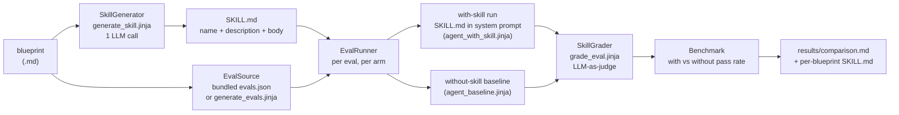

# POC 25 — Blueprint → Agent Skill generation, validated with/without the skill

Turns a business-process blueprint into an **Agent Skill** (a `SKILL.md` in the [Agent Skills
format](https://agentskills.io/)) and validates it the way the Anthropic **skill-creator**
does: an `evals.json` suite of scenario prompts is run against a general-purpose agent **with
the generated skill loaded** and **without it** (the baseline), each run is graded against
verifiable expectations, and the **with-skill pass rate is compared to the no-skill baseline**.
The skill lift is the measured value of the generated skill.

## Hypothesis

A business-process blueprint can be compiled into an Agent Skill such that a general-purpose
agent **loaded with the skill** handles the process's scenarios measurably better than the same
agent **without** the skill. This POC asks whether that is true, and by how much — measured by
the skill-creator eval loop (with-skill vs. no-skill baseline, graded against expectations),
over the example blueprints in `examples/blueprints/` (Aurora, Sentinel, TradingAgents).

This is a new direction for the "portable unit": POC 24 asked which *generator* produces the
better **Embabel AgentSpec**; POC 25 asks whether the unit can instead be an **Agent Skill**
(the Anthropic format — `SKILL.md` + optional `scripts/`/`references/`/`assets/`), and whether
loading it into a general agent measurably improves the agent's process understanding.

## How it works

Each blueprint is a pipeline: generate the skill, load (or draft) its eval suite, then run every
eval with and without the skill, grade, and benchmark. **Every LLM step is labelled with the
prompt file it uses** (paths are relative to `src/main/resources/`).



### 1. Skill generation (`SkillGenerator`)

One LLM call turns the blueprint into a skill. The skill **name** is fixed by the blueprint (so
it matches the skill folder name, per the Agent Skills spec); the model supplies the
**description** (the triggering mechanism — what it does and when to use it) and the **body**
(the operating procedure: the core workflow, the decision points and the rule for each branch,
the escalation rules, and a *Gotchas* section for the counter-intuitive constraints). The output
is a well-formed `SKILL.md`, checked against the frontmatter constraints by `SkillMdValidator`
(`name` 1-64 lowercase-alphanumeric-or-hyphen, no leading/trailing/consecutive hyphens;
`description` non-empty, ≤ 1024 chars).

### 2. The eval suite (`EvalSuite`, `EvalSource`)

The suite is in the skill-creator `evals/evals.json` format:
`{skill_name, evals: [{id, prompt, expected_output, files, expectations}]}`. Each eval is a
**concrete scenario** (specific products, numbers, dates, actors) that exercises a decision point
or exception in the process, plus **verifiable expectations** a correct answer must satisfy. Two
sources, mirroring skill-creator's "save test cases to `evals.json`" and "draft some quantitative
evals":

- **`bundled`** (default): a hand-authored suite per blueprint under `src/main/resources/evals/`.
- **`generated`**: the model drafts the suite from the blueprint at run time
  (`generate_evals.jinja`).

### 3. The with/without-skill runs (`EvalRunner`)

For each eval, two runs of the **same** scenario prompt:

- **with-skill** — the generated `SKILL.md` is embedded in the system prompt
  (`agent_with_skill.jinja`), simulating skill activation (progressive disclosure: the skill body
  is in context because the task matches).
- **without-skill** — a plain baseline system prompt (`agent_baseline.jinja`), no skill.

Each answer is graded by an **LLM-as-judge** (`SkillGrader`, `grade_eval.jinja`) against the
eval's expectations, producing the skill-creator `grading.json` shape: an `expectations` array of
`{text, passed, evidence}`.

### 4. The two arms, side by side

The same with/without-skill comparison is measured over **two transports**, so the finding is not
an artifact of one calling mechanism:

- **`raw`** — a raw OpenAI-compatible chat-completions call (the lightweight arm; the same wire
  the studio's single-shot generator and POC 24 use).
- **`embabel`** — the same calls routed through Embabel's `Ai` LLM abstraction
  (`ai.withDefaultLlm().generateText(...)`), the product's model layer. The skill content is
  identical; only the transport differs.

### 5. The benchmark (`Benchmark`)

Per arm, the pass rate is the fraction of all expectations passed across the suite for that
configuration. The **skill lift** (delta) is the with-skill pass rate minus the no-skill baseline
pass rate — the measured value of the generated skill.

## How to run

Offline (no endpoint) — the frontmatter validation, evals parsing, benchmark aggregation and
skill parsing:

```
mvn -pl poc/poc-25-skill-generation test
```

Live (needs an OpenAI-compatible endpoint):

```
export OPENAI_CUSTOM_BASE_URL=... OPENAI_CUSTOM_API_KEY=... OPENAI_CUSTOM_MODELS=... EMBABEL_MODELS_DEFAULT_LLM=...
mvn -pl poc/poc-25-skill-generation spring-boot:run
```

Filter the matrix with `--skillgen.blueprints=TradingAgents`, `--skillgen.arms=raw`, or
`--skillgen.evalsource=generated`. The report is written to `results/comparison.md`, each
generated `SKILL.md` to `results/<blueprint>/<skill>/SKILL.md`, and the eval suite used to
`results/<blueprint>/evals.json`.

## Measured results

Live run over `examples/blueprints/` (Aurora, Sentinel, TradingAgents), model `Qwen-instruct`,
bundled evals, both arms. Full per-eval detail is in [`results/comparison.md`](results/comparison.md).
The with-skill pass rate beat the no-skill baseline in **all six cells** — a lift of **+25% to
+58%**.

| Blueprint | Arm | With-skill pass | No-skill pass | Skill lift |
|-----------|-----|:---------------:|:-------------:|:----------:|
| Aurora | raw | 100% | 42% | **+58%** |
| Aurora | embabel | 75% | 50% | **+25%** |
| Sentinel | raw | 100% | 56% | **+44%** |
| Sentinel | embabel | 100% | 44% | **+56%** |
| TradingAgents | raw | 75% | 42% | **+33%** |
| TradingAgents | embabel | 75% | 33% | **+42%** |

## Conclusion

The hypothesis holds: a business-process blueprint compiled into an Agent Skill measurably
improves a general-purpose agent's understanding of that process. The with-skill pass rate beat
the no-skill baseline in **every one of the six cells** — a lift of **+25% to +58%** (the no-skill
baseline scores 33-56% on general knowledge alone; the skill lifts it to 75-100%).

- **The lift is real and consistent, not a transport artifact.** Both the raw OpenAI-compatible
  arm and the Embabel `Ai` runtime arm show a positive lift on every blueprint, so the skill's
  value is not an artifact of one calling mechanism.
- **The skill helps most exactly where a general model is blind.** Sentinel (the multi-agent
  security platform) shows the largest lift (+44% to +56%): its decision rules are non-obvious
  domain facts (the orchestrator does not independently declare a threat harmless; INTEL
  distinguishes verified from unconfirmed intelligence) that a general model does not know.
  Aurora raw hit **100%** with-skill — the skill captured the cold-chain decision rules (FEFO,
  "a delivery is not done until the recipient confirms", critical orders never auto-close) that
  the baseline missed.
- **The baseline is non-trivial.** The no-skill agent already scores 33-56% because the model has
  general knowledge of these process types. The skill is a lift on top of that, not from zero —
  and the lift is largest on the most domain-specific rules.

**Honest limits.** (1) The model is non-deterministic: a separate run of the same matrix gave
Aurora raw **+42%** instead of +58%. (2) The skill does not always help a single eval — e.g.
TradingAgents eval 1 (parallel analysts / debate gating) scores 2/3 both with and without the
skill, because the model grasps the parallelism but misses the "debate starts only when all
analysts have filed" nuance even when the skill states it. (3) The skill is a *description* of
the process, not an executable spec — it improves understanding and decision-making, but does not
itself run the process.

**Recommendation.** Generating an Agent Skill from a blueprint is a sound way to package process
knowledge for a general-purpose agent, and the skill-creator eval loop (with-skill vs. no-skill
baseline, graded against verifiable expectations) is a valid way to measure that a generated skill
actually helps. Use the with/without-skill delta as the acceptance metric for a generated skill;
a positive, consistent lift across both transports (as here) is the signal that the skill is worth
loading.

**Caveats.**

- **Same model:** `Qwen-instruct` at the same temperature for every run, so the difference is the
  skill's presence, not the model.
- **LLM-as-judge grading:** the pass/fail per expectation is decided by an LLM judge, not a
  deterministic check — the expectations are written to be verifiable, but the grading is
  model-based (the same method the skill-creator uses).
- **Bundled evals:** the default run uses hand-authored evals; `--skillgen.evalsource=generated`
  lets the model draft them, for a fully end-to-end (but less controlled) measurement.
- **New area:** this POC extends the "portable unit" idea beyond the Embabel AgentSpec (POC 24)
  to the Anthropic Agent Skill format; it is a new direction, not one of the docs/04 claims
  C1-C18.
