# POC 26 — Agent Skill scripts that actually run: GraalJS on a plain JDK

[Agent Skills](https://agentskills.io/) carry an optional `scripts/` folder, and Embabel's
[Agent Skills reference](https://hub.embabel.com/reference/agent_skills) says plainly: *"Script
execution is not yet supported."* That is still the documented state at 1.5.4, and it is the gap
this POC closes.

It turns out the gap is narrower — and more interesting — than the doc suggests. Embabel **does**
ship a script SPI, `com.embabel.agent.skills.script.SkillScriptExecutionEngine`, and
`Skills.withScriptExecutionEngine(engine)` is the seam. What it ships *around* that SPI is
`NoOpExecutionEngine` (the default, which logs `script execution is not yet supported` and offers
no script tool), plus `ProcessSkillScriptExecutionEngine`, `DockerSkillScriptExecutionEngine` and
`PodmanSkillScriptExecutionEngine` — all of which **spawn an external interpreter**. So a `.js`
skill script has no in-JVM runner at all: it needs Node installed on the host that happens to be
running the agent.

This POC implements the missing engine with **GraalJS embedded on a plain JDK**, exactly as
[RunOnJDK.md](https://github.com/oracle/graaljs/blob/master/docs/user/RunOnJDK.md) describes it —
`org.graalvm.polyglot:polyglot` + `org.graalvm.polyglot:js` as ordinary Maven dependencies, no
GraalVM distribution, no `GRAALVM_HOME`, no `node`. Scripts are written against **ECMAScript 2026**
(ECMA-262 17th edition, approved June 2026).

## Hypothesis

Adding `SkillScriptExecutionEngine` implementations is enough to make an Agent Skill's
`scripts/*.js` executable by an Embabel agent, and an **in-JVM GraalJS engine embedded on a stock
OpenJDK** is a viable implementation of it: it should turn a skill's JavaScript into a callable
agent tool, run it under real guardrails, and give those scripts a genuine ECMAScript 2026
surface — with no GraalVM and no Node on the host.

Measured on `mvn -pl poc/poc-26-graaljs-skill-scripts spring-boot:run` and `mvn test` (31 tests,
all offline), on Zulu OpenJDK 25 with **no** GraalVM and Node present only as an unrelated
co-resident binary:

- the script tool appears **only** once an engine is installed:
  `[activate, listResources, readResource]` → `[activate, listResources, readResource, invoice-totalling_compute_totals]`;
- the skill's JavaScript runs in the agent's own JVM and returns the audited figures
  (`netTotal 1259.88`, `vatTotal 50.4`, `payable 1310.28`), and its business rules reject an
  unapproved discount with exit code 2;
- **14/14** ECMAScript 2026 probes execute — every feature in the approved-edition list, each one
  a real script run through the engine, not a feature-detection claim;
- with a live endpoint, the model calls `activate` and then `invoice-totalling_compute_totals`
  through Embabel's own tool loop and reports the script's numbers.

**Verdict: the hypothesis holds.** The doc's "not yet supported" is a missing *implementation*,
not a missing *extension point* — one bean closes it.

## How it works

```mermaid
flowchart LR
    SK["skills/invoice-totalling/<br/>SKILL.md + scripts/compute_totals.js"] --> LOAD["DefaultDirectorySkillDefinitionLoader<br/>(Embabel, unchanged)"]
    LOAD --> LS["LoadedSkill<br/>hasScripts() = true"]
    LS -->|"Skills.tools()"| SEAM{"SkillScriptExecutionEngine<br/>the SPI Embabel already ships"}
    SEAM -->|"NoOp (default)"| NONE["no script tool<br/>logs 'script execution is not yet supported'"]
    SEAM -->|"Process / Docker / Podman"| EXT["spawns node / python / a container"]
    SEAM -->|"withScriptExecutionEngine(...)"| GRAAL["GraalJsSkillScriptExecutionEngine<br/>(this POC)"]
    GRAAL --> CTX["GraalJS Context<br/>HostAccess.EXPLICIT · no host class · no IO<br/>no env · no threads · no processes<br/>statement + time limits"]
    CTX --> GL["CLI-shaped globals<br/>args · stdin · process.argv/exit<br/>readFile · writeFile"]
    GL --> JS["compute_totals.js<br/>Math.sumPrecise · Iterator.concat<br/>Error.isError · Map.getOrInsertComputed<br/>Uint8Array.toBase64 · JSON.rawJSON"]
    JS --> RES["ScriptExecutionResult<br/>Success / Failure / Denied"]
    RES --> TOOL["agent tool<br/>invoice-totalling_compute_totals"]
    TOOL --> LLM["SkillScriptAgent<br/>context.ai().withDefaultLlm()<br/>.withReference(skills)"]
```



### 1. The engine (`GraalJsSkillScriptExecutionEngine`)

Implements Embabel's `SkillScriptExecutionEngine` for `ScriptLanguage.JAVASCRIPT` only, so the
other languages keep falling through to whatever else is installed. Per call it builds one
hardened `Context`:

```java
Context.newBuilder("js")
    .option("engine.WarnInterpreterOnly", "false")
    .allowHostAccess(HostAccess.EXPLICIT)
    .allowHostClassLookup((name) -> false)
    .allowCreateThread(false).allowNativeAccess(false).allowCreateProcess(false)
    .allowEnvironmentAccess(EnvironmentAccess.NONE)
    .allowIO(false)
    .out(stdout).err(stderr);
```

`allowIO(false)` is the load-bearing choice: the script gets **no** filesystem. The two file
operations a CLI script legitimately needs are given explicitly as globals, and only against the
per-run working directory — `readFile(name)` sees the `inputFiles` the caller staged, and
`writeFile(name, content)` lands in an output directory whose contents come back as
`ScriptArtifact`s. Everything else a Node script might reach for is absent by construction.

Two guardrails stop a runaway script, because an in-JVM engine cannot be killed from outside the
way an OS process can:

- `ResourceLimits.statementLimit(25_000_000)` — deterministic, counts executed statements;
- a watchdog that calls `context.close(true)` after 5 s.

Both surface as a `Failure`, distinguished by testing `PolyglotException.isResourceExhausted()`
**before** `isCancelled()` — the statement-limit exception also reports itself as cancelled, so
the order matters or a limit trip is mislabelled a timeout.

`process.exit(2)` is implemented by throwing a host `ScriptExit` from a `@HostAccess.Export`
method and reading the code back; it is control flow, not an error, and is reported as a
`Success` with that exit code, exactly like a real CLI.

### 2. The script globals (`args`, `stdin`, `process`, `readFile`, `writeFile`)

A skill script is not a Node program and not a browser page, so the engine gives it a deliberate
third surface — CLI-shaped, and nothing more:

| Global | Present | Absent (deliberately) |
|---|---|---|
| `args` | the CLI arguments as a guest array | `require` |
| `stdin` | the caller's stdin as a string | `module` |
| `process.argv` / `process.exit(code)` | yes, `argv` is the same array | `process.env` (env access is `NONE`) |
| `readFile` / `writeFile` | staged inputs / artifact outputs | `globalThis.process` beyond the above |

The engine's own test asserts that shape (`typeof` each of the five: `object`, `object`,
`undefined`, `undefined`, `undefined`), so the surface can't silently grow towards Node.

### 3. Why it is in-JVM at all (`ScriptEngineComparison`)

The engine Embabel ships for JavaScript spawns `node`. The comparison runs the identical
CPU-bound script through both and reports the median of three runs, which is what the
[RunOnJDK.md](https://github.com/oracle/graaljs/blob/master/docs/user/RunOnJDK.md) trade-off
actually looks like in this setting — see **Results** for the honest numbers, including where
this loses.

The dependency difference is the part that changes deployment: with no `node` on the host the
external engine cannot run a `.js` skill script at all, while the in-JVM engine does not look for
one.

### 4. The ECMAScript 2026 claim (`Es2026Conformance`)

Not a feature-detection table. Each probe is written as a real script into a temporary skill
directory and **executed through the engine**, so a pass is an execution. The probe list is the
approved 17th-edition surface: `Math.sumPrecise`, `Iterator.concat`, `Array.fromAsync`,
`Error.isError`, `Map.prototype.getOrInsert`/`getOrInsertComputed`,
`WeakMap.prototype.getOrInsert`, `Uint8Array` base64/hex conversions, `JSON.rawJSON`, the
`JSON.parse` reviver source argument — plus `Float16Array` and the adjacent ES2025 iterator
helpers and ES2024 `Object.groupBy` that real scripts end up needing. Async probes run as `.mjs`,
because the engine evaluates `.mjs` in module mode (`application/javascript+module`), which is the
only mode that admits top-level `await`.

### 5. The skill and its script

`src/main/resources/skills/invoice-totalling/` is an ordinary Agent Skill — frontmatter with
`name`, `description`, `license`, `compatibility`, `metadata`, a workflow body, and rules the
script enforces: per-category VAT (goods 0, freight 21, services 21), per-line rounding to cents,
a discount over 15% requires `--approval=<who>`, freight is never discounted, and an unknown
category is rejected rather than defaulted.

`scripts/compute_totals.js` is where ES2026 earns its place rather than being decoration:
`Math.sumPrecise` for an exact float sum where a `reduce()` drifts, `Map.getOrInsertComputed` to
create and read each category bucket in one operation, `Iterator.concat` to fold the priced nets
and the line counts behind them into a single checksum stream, `Error.isError` as the only
reliable cross-realm test in a `catch`, `Uint8Array.toBase64` for that checksum, and `JSON.rawJSON`
so a ledger account number wider than a double survives the round trip
(`91827364550123456789` comes back intact).

### 6. The agent (`SkillScriptAgent`)

`context.ai().withDefaultLlm().withReference(skills).withSystemPrompt(...)` — and the arithmetic is
no longer the model's problem. The system prompt forbids computing any figure and requires
reporting what the script returned, which is the point of moving the calculation into a script:
the model's job becomes argument-passing, not floating point.

## Results

From `mvn -pl poc/poc-26-graaljs-skill-scripts spring-boot:run` (sections 1–5 print with no API
key; section 6 needs the endpoint env vars).

### Before and after: the tool list

```
Embabel's default engine (NoOpExecutionEngine) : [activate, listResources, readResource]
with the GraalJS engine installed              : [activate, listResources, readResource, invoice-totalling_compute_totals]
```

With the default engine Embabel also logs, for this exact skill:

```
WARN DefaultDirectorySkillDefinitionLoader -- Skill 'invoice-totalling' contains scripts,
     but script execution is not yet supported
```

That line is the documented behaviour, reproduced here as the baseline of the comparison; the
`activate`/`listResources`/`readResource` tools are present in both arms, so the only difference
is the script.

### The script, executed in the agent's JVM

```
exit code 0, stdout:
{
  "number": "INV-2026-014",
  "lineCount": 13,
  "netByCategory": { "goods": 1019.88, "freight": 240 },
  "netTotal": 1259.88,
  "vatByCategory": { "goods": 0, "freight": 50.4 },
  "vatTotal": 50.4,
  "payable": 1310.28,
  "checksum": "Z29vZHM9MTAxOS44OHxmcmVpZ2h0PTI0MHxnb29kczpuPTF8ZnJlaWdodDpuPTE=",
  "ledgerAccount": 91827364550123456789
}
a discount over 15% without approval -> exit 2, stderr: REJECTED: a 20% discount needs an --approval=<who> argument
```

`ledgerAccount` is the `JSON.rawJSON` case: a 20-digit integer that a `double` cannot represent
survives verbatim.

### ECMAScript 2026

| Feature | Since | Engine |
|---------|-------|--------|
| `Math.sumPrecise` | ES2026 | supported |
| `Iterator.concat` | ES2026 | supported |
| `Array.fromAsync` | ES2026 | supported |
| `Error.isError` | ES2026 | supported |
| `Map.prototype.getOrInsert` | ES2026 | supported |
| `Map.prototype.getOrInsertComputed` | ES2026 | supported |
| `WeakMap.prototype.getOrInsert` | ES2026 | supported |
| `Uint8Array to/fromBase64 and to/fromHex` | ES2026 | supported |
| `JSON.rawJSON` | ES2026 | supported |
| `JSON.parse reviver source argument` | ES2026 | supported |
| `Float16Array` | ES2026 | supported |
| `Iterator helpers` | ES2025 | supported |
| `Object.groupBy` | ES2024 | supported |
| `Top-level await (ESM)` | ES2022 | supported |

`14/14 probes executed successfully` — on Zulu OpenJDK 25, with GraalJS 25.4.4.1.1 pulled as two
ordinary Maven dependencies.

### In-JVM against the shipped external interpreter

Same CPU-bound script, median of three runs:

| Engine | Runs the script in | Exit | Median (ms) | Result |
|--------|------------------|:----:|------------:|--------|
| graaljs (in-JVM) | the agent's own JVM | 0 | 396 | longest collatz 261 at 6171 |
| process (external node) | a spawned node process | 0 | 38 | longest collatz 261 at 6171 |

**Read this row honestly: on CPU-bound work the external engine is ~10× faster here**, because
this is the interpreter-only configuration RunOnJDK.md warns about — `Engine` reports
`JVMCI is not enabled for this JVM` and falls back. The in-JVM engine wins on what it costs per
call (no process spawn, no Node dependency, results already host-side) and loses on raw throughput
until the Graal compiler is added; the script under test is deliberately pure CPU to make that
visible. For the work a skill script normally does — parse an input, apply rules, emit a
structured result — 396 ms of interpreter is not the bottleneck; the model call around it is
(18 s in section 6 below).

### The model calling the script (endpoint-gated)

Against the local LiteLLM endpoint, Embabel's tool loop offered the script as a tool and the model
used it:

```
(totalInvoice) starting tool loop [smith_skill_scripts_activate,
    smith_skill_scripts_invoice-totalling_compute_totals,
    smith_skill_scripts_listResources, smith_skill_scripts_readResource] max=20
calling tool smith_skill_scripts_activate({"name":"invoice-totalling"})
calling tool smith_skill_scripts_invoice-totalling_compute_totals({"stdin":"{ ... invoice ... }"})
  → returned "Script completed with exit code 0 / Duration: 18ms / === stdout === { … }"
Tool loop completed after 5 iterations
goal ...totalInvoice achieved in PT18.564784639S
```

The script ran in 18 ms inside the JVM; the 18 s is the model, not the script. The answer the
model returned was the script's own figures, and it flagged the fields it could not reconcile
rather than quietly recomputing them — which is the behaviour the prompt asks for and the reason
for putting arithmetic in a script at all.

## How to run

```bash
mvn install -DskipTests                                   # one-time, so siblings resolve

# Offline — prints sections 1–5 (environment, tool list, script run, ES2026 table, comparison)
mvn -pl poc/poc-26-graaljs-skill-scripts spring-boot:run

# With the model demo as well (section 6)
export OPENAI_CUSTOM_BASE_URL=http://localhost:4000
export OPENAI_CUSTOM_API_KEY=sk-...
export OPENAI_CUSTOM_MODELS=my-model
export EMBABEL_MODELS_DEFAULT_LLM=my-model
mvn -pl poc/poc-26-graaljs-skill-scripts spring-boot:run

# The 31 offline tests
mvn test -pl poc/poc-26-graaljs-skill-scripts
```

Sections 1–5 print **before** Spring is started, because Embabel's model configuration fails to
instantiate without an endpoint and none of that evidence needs a model. `smith.skill-scripts.dir`
overrides which skill pack is installed.

## Conclusion

**Claim tested: C11 — "Specs invoke CLIs/scripts"** ([docs/04 §2](../../docs/04-poc-run-results.md)),
extended from a spec reaching an external CLI to a **skill carrying its own script and having it
executed**. **Verdict: proven, with the speed caveat.**

**Yes — it works, and the fix is smaller than the documentation implies.** Embabel 1.5.4 already
has the extension point (`SkillScriptExecutionEngine`) and already wires it into the tool surface
(`Skills.tools()` → `LoadedSkill.getScriptTools(engine)`); what it lacks is an in-JVM
implementation for JavaScript. One class of ~525 lines supplies it, one call
(`Skills.withScriptExecutionEngine(engine)`) installs it, and the skill's `scripts/compute_totals.js`
becomes a tool the model calls — with the same `SKILL.md`, unchanged. Key numbers: the script tool
appears only with the engine installed; `netTotal 1259.88` / `payable 1310.28` computed in-JVM by
the skill's own JavaScript; **14/14** ES2026 probes executed; the model's tool loop called
`invoice-totalling_compute_totals` and the script answered in 18 ms inside the 18 s model turn.

GraalJS embedded on a stock OpenJDK is a good substrate for it: ECMAScript 2026 is fully there
(14/14 probes), and because the engine is a library rather than a subprocess, the host can enforce
what a spawned interpreter cannot — no filesystem, no environment, no host classes, no threads, no
child processes, a statement budget and a watchdog, all inside the agent's own process.

**Recommendation.** Adopt the in-JVM engine as the default for `JAVASCRIPT` skill scripts and keep
the process/Docker/Podman engines for the languages GraalJS does not cover. Concretely:

1. Ship a GraalJS engine in `embabel-agent-skills` beside the existing four, so the default is not
   "scripts silently do nothing" but "scripts run, sandboxed, in-process".
2. Keep `NoOpExecutionEngine` as the opt-out, and keep its warning — it is the right behaviour for
   a host that has not chosen an engine.
3. Make the guardrails above (statement limit, wall clock, output cap, no-IO with staged inputs and
   artifact outputs) part of the SPI contract, not each engine's private invention: an in-JVM
   engine without them is worse than an external one.

**Honest limits.**

1. **Interpreter speed.** Without `--upgrade-module-path` Graal's compiler the JavaScript runs
   interpreted, ~10× slower than Node on CPU-bound code (396 ms vs 38 ms above). Adding
   `org.graalvm.compiler:compiler` recovers it but pins the deployment to a JVMCI-capable JVM —
   the exact trade-off RunOnJDK.md presents, left open here on purpose.
2. **The statement budget is a real ceiling.** The comparison script at 100 000 iterations was
   stopped by the 25 000 000-statement limit while Node ran it happily. Raise the limit for
   trusted skills; do not remove it for untrusted ones.
3. **Not a Node runtime.** No `require`, no npm, no `process.env`, no real filesystem. A skill
   script that needs the Node ecosystem still wants `ProcessSkillScriptExecutionEngine`.
4. **Sandbox policy could not be tightened further.** GraalJS 25.4's `SandboxPolicy.CONSTRAINED`
   and above reject a builder that sets standard out/err, and capturing stdout/stderr is exactly
   what a script engine must do — so this engine relies on the explicit `allow*` lockdowns instead
   of the declarative policy. Treat it as *hardened*, not as a security boundary against a
   determined guest; untrusted third-party scripts belong in the Docker/Podman engines.
5. **ES2026 coverage is measured, not certified.** 14 probes cover the approved edition's named
   features; they are not the ECMA-262 conformance suite, and a feature outside the probe list is
   unverified rather than known-good.
6. **Kotlin interop is reflective.** Embabel's result types are Kotlin with `@JvmSynthetic`
   default-argument constructors and a `kotlin.time.Duration` value class, so `ScriptExecutionResults`
   constructs them reflectively (`box-impl`, `DurationKt.toDuration`). It works and is tested, but
   it is the one part of this engine that a Kotlin-side factory would make unnecessary.
