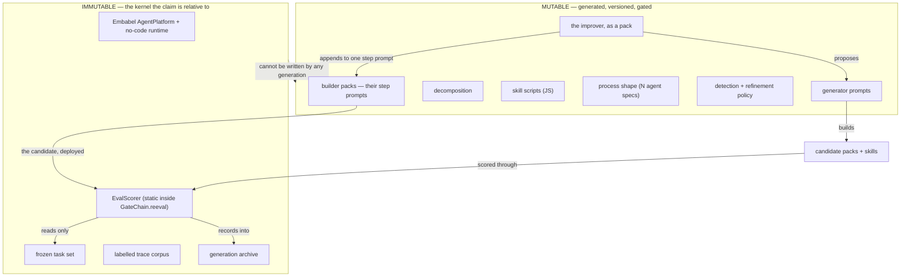

# POC 27 — Can a builder improve the process that builds, including the part that does the improving

The loop in `prod/embabel-smith-builder` (`builder/improve`, moved out of the studio on 2026-11-21)
improves one thing: the prompts of the steps that failed. It
cannot touch the generator that wrote them. This module asks how much of that loop can be made
self-referential before the improvement stops meaning anything — and it answers with measurements
taken before any prompt was tuned, on a frozen benchmark, through the product's own scorer.
On 2026-11-22 the improvement object was retargeted, from a pack this module assembled in Java to one
of the builder's own packs; the numbers measured before that change are unchanged below, because they
are the record.

**Verdict up front: not proven.** The free half of the design had no headroom to improve into, and the
half that had headroom cannot be exercised on the local endpoint. Both are reported as results below,
with the numbers, rather than as caveats.

## Hypothesis

A builder can improve its own building process — generator prompts, decomposition, skill scripts,
process shape, and the detection and refinement policies themselves — and the improvement can be
measured without the improver grading its own homework, provided the scorer, the task set, the labelled
corpus and the archive sit on the side of a boundary the improver cannot edit.

The failure mode this is designed against is already in this repository's record: a builder-built pack
is stamped with a baseline equal to its own build-time score, pinned at the score gate's maximum, so
the strict comparison can never pass and the loop jams until a fallback proves the fix instead
([`docs/10-self-improvement.md`](../../docs/10-self-improvement.md)). That is self-grading generalised:
any improver that scores itself optimises its scorer, not its work.

## How it works

### The boundary, not the recursion, is the claim



"Who improves the improver" is answered structurally rather than recursively: a generated policy is
*data the kernel interprets*, so generation N+1's improver is checked by code generation N could not
edit. The boundary is a checked-in file,
[`evidence/MUTABILITY.md`](src/main/resources/evidence/MUTABILITY.md), listing seven mutable surfaces
plus the builder's own four packs against fifteen fixed ones; later classes cite it rather than
restating it.

### The reframe: the improvement object is a builder pack

The candidate is no longer a pack assembled in Java. `PolicyImprover.candidate(...)` loads
`builder-single-spec` from `prod/embabel-smith-builder/builder-agent-specs/` — through
`outerloop/BuilderPacks`, which walks up from the working directory the way POC 14 and POC 21 walk for
`agent-specs/`, and names a refusal when the pack is not there rather than falling back to one
assembled in code — renames it to the variant id, and appends the generated policy text to **one** step
prompt. The step is `scopeCoreProcess`, the pack's entry step: the one declaring `UserInput` and
interpolating `{{userInput.content}}`, so an eval task's prompt still reaches the candidate. Everything
else is the shipped pack — the same step names, the same `inputTypeNames` and `outputTypeName`, the
same declared types. The mutation operator is `outerloop/BuilderPacks.withStepPrompt`, which rebuilds
an `ActionStepSpec` passing every field but the sixth — the discipline the product's own
`builder/improve/Refiner.withPrompt` encodes, restated rather than called because that method is
private and its public `refine` needs failure traces and a model call — so the surface is drawn in code, and
[`evidence/MUTABILITY.md`](src/main/resources/evidence/MUTABILITY.md) stays the single statement of it.

That is what puts the generator's instructions on the surface without widening what a mutation may
touch. The builder's flow now exists in the format it builds — four packs under `builder-agent-specs/`
— and `builder-single-spec`'s step prompts are a transcription of the instructions
`SingleShotAgentSpecGenerator.defaultPrompt()` carries, split by decision rather than by sentence. A
candidate therefore changes the builder's instructions *as pack text*. It does not change what
`smith build` does by default: the CLI calls the Java generators and reads those prompts off the
classpath, so the packs are a second, mutable representation of the same instructions and not the one in
production. `smith build --flow pack` is the exception, and it is not the default: that invocation
deploys `builder-agent-specs/builder-spec-one-shot` through the eval invoker instead of calling the Java
generator, so a published candidate to that pack would change what such a run does. Reach moved on
2026-11-22, and it moved into the packs. `builder-single-spec/steps/assembleAgentSpec.yml` and
`builder-spec-one-shot/steps/draftAgentSpec.yml` declare `toolGroups: [validate]`, and
`prod/embabel-smith-builder/src/main/java/com/embabel/smith/builder/tools/ValidationToolGroup.java`
registers that role as a `ToolGroup` bean, so a candidate built from either pack is **offered** the
builder's validator where it was offered nothing: the loop now logs
`starting tool loop [validatePack]` instead of `starting tool loop []` behind the platform's
unresolved-role warning. Measured on the test-seam deploy the model then declines it (`called=0`, goal in
one model call); on the builder's `--flow pack` path it calls it. The counts taken there before 2026-11-22
— 2, 3 and 116 calls across three blueprint inputs, 92 of 93 results on one build the same
`LAYOUT_MISSING_MANIFEST` — belong to an argument the step could not name, a directory that does not exist
mid-step; `validatePack` now takes `specJson`, the spec the step is about to return, so those counts
measure a tool the step could not aim rather than the checks it runs. The mutation operator passes the field through untouched, so no candidate *adds* a group:
a candidate's reach is its parent pack's. What moved is that reach is decided partly in pack text rather
than wholly by the driver. Two consequences belong with every number that describes a run's cost or its
score:

- **One metered call is no longer one call.** The counter still counts one per `invoke(String)`, which
  is the figure `Budget.costPerCandidate` was derived against, but on `builder-single-spec` each counted
  invocation drives five model calls. A live pass therefore spends the pack's step count times the
  declared per-candidate calls, and `costPerCandidate` under-states it by that factor. The gap is
  carried by the budget rather than closed by inflating a counter that is also the run's evidence. The
  launcher's other ceiling is a wall clock — 60 s per call, the latency this POC measured twice as a
  timeout, against 5400 s total, which is 90 declared calls at that rate.
- **A live pass scores spec text, not an answer.** The frozen tasks are question → answer; a candidate
  now answers by drafting a spec through five steps. Offline scoring is unaffected, but a live run over
  `benchmark/tasks/` grades drafted spec text against defect-answer `require`/`anyOf` lists, and a
  number from such a run has to be read as that.

What the loop cannot reach is also fixed by code rather than by rule: agent order is not on the surface
(an operator is handed a pack, and a pack has no agent order to reorder), and neither are a step's
`pre`/`post` condition names — which fail at deploy, not at validation. Both are recorded in
`evidence/MUTABILITY.md`, with the test that pins each. Reach is a different matter from either. The
candidate pack's `assembleAgentSpec` step declares `toolGroups: [validate]`, and
`builder/tools/ValidationToolGroup` now registers that role, so the candidate is *offered* the builder's
validator — measured as `starting tool loop [validatePack]`, and `called=0` on that test seam, where the
same deploy previously logged `starting tool loop []`. The operator passes the field
through untouched, so this is not a widened surface; it is a widened reach, shared with its parent pack.

### Two loops, because the outer one is unaffordable at depth

| | INNER | OUTER |
| --- | --- | --- |
| Cost | **0 model calls** — measured, not asserted | paid; 70 calls declared before the first one, and a counted call now hides five |
| Input | frozen labelled trace corpus (17 tuning / 12 held-out lines; §3's run measured 16/10) | frozen task set (6 tasks) |
| Surface | a generated ECMAScript detection policy run through POC 26's GraalJS engine | `builder-single-spec`, one step prompt appended to, deployed on the platform |
| Judge | precision and recall against human labels | the product's `GateChain` + `EvalScorer` |
| Status | **ran; derivative flat** | **blocked on the endpoint** |

The inner loop is where the recursion lives, and it is free by design. The outer loop tests whether an
offline win transfers into better packs — the only part that needs paid calls.

### Referee isolation

The gate is a separate, hand-started JVM (`referee.RefereeProcess`). It loads no skill folder and opens
no Graal `Context`, so a candidate can never generate the code that grades it. This is enforced by
construction rather than by intent.

## Results

### 1. The frozen benchmark, and the two arms that disagree

Six hand-authored tasks with human-written expected outputs
([`benchmark/tasks/`](src/main/resources/benchmark/tasks/)), scored two ways: the product's own
substring arm (`EvalScorer`), which is what the gate actually uses, and a human-label arm recorded
alongside it as the named gap.

Measured live, 6 model calls ([`evidence/baseline.json`](src/main/resources/evidence/baseline.json)):

| Arm | Score | Failing tasks |
| --- | --- | --- |
| Product substring gate | **0.667** | `b27-t02`, `b27-t03` |
| Human label | **0.333** | `b27-t02`, `b27-t03`, `b27-t05`, `b27-t06` |

`headroom: true` — two of six fail the gate, so the task set is not what constrains the loop.

**The finding is the divergence, not the score.** On `b27-t05` and `b27-t06` the substring arm says
PASS and a human says FAIL. The gate arm is systematically looser, so a loop optimising it can raise
its score on two tasks that a reader would still call wrong. This is the design's
"the scorer is an LLM grader → a loop finds the judge's vocabulary" risk, realised on a *deterministic*
arm: the hazard is not that the judge is a model, it is that any fixed judge has a vocabulary.

### 2. The noise floor measured 0.0, and it was not raised

Three passes over an unchanged process, 18 calls
([`evidence/noise-floor.json`](src/main/resources/evidence/noise-floor.json)): gate scores
`[0.667, 0.667, 0.667]`, no task flipping, `gateFloor: 0.0`, human-label floor also `0.0`.

A floor of 0.0 means the "delta inside the floor is no improvement" branch cannot fire on this setup.
The protection reduces to the paired repeats and the derivative test. The artifact refuses to raise a
measured zero — substituting a threshold "to be safe" would move the one number `MUTABILITY.md` fixes.

### 3. The inner loop converged on its own seed

Offline, deterministic, **0 model calls** read off the meter:

```
hand-written : heldout: precision 1.0 recall 1.0 (tp 5 fp 0 fn 0 tn 5)
  g0 SEED                       tuning: 1.0 / 1.0   heldout: 1.0 / 1.0
  g1 KEYWORD_INSTEAD_OF_PREFIX  tuning: 1.0 / 0.875 heldout: 1.0 / 0.8
  g2 DROP_TRIGGER               tuning: 1.0 / 0.875 heldout: 1.0 / 0.8
  g3 DROP_TRIGGER               tuning: 1.0 / 0.875 heldout: 1.0 / 0.8
generations  : 4 of 12 — converged   best variant : b27-inner-seed   model calls : 0
```

**The derivative is flat at best and negative everywhere else.** The hand-written policy scores
1.0/1.0 on the held-out split; so does the generated seed prompt; and every mutation tried made recall
strictly worse. The loop stopped by patience, not by success, and its best variant is the variant it
started from.

That is the design's named ceiling failure, realised on the inner surface: the labelled corpus cannot
separate these policies because it has nothing to separate them on. It also bounds how much the
corpus can support — 10 held-out lines with 5 positives means one flipped case moves recall by 0.2, so
even the differences shown are one case wide. The corpus is **hand-authored synthetic** traces (a
`git:example.com` pack, `Claim 4502`), by design: mining real traces would let the improving system
choose which failures count.

### 4. The outer loop never ran validly, and the cause was this POC's own prompt

Two live attempts. Both booted, read the recorded baseline and the `0.0` floor, declared **60 calls
before the first one** — the figure from before `Budget` derived a deploy term, so the launcher declares
70 now — and died deserialising the first scored candidate:

```
tools.jackson.databind.exc.MismatchedInputException: Content part must contain 'text' or 'mimeType'
  (through reference chain: BackgroundMessage["parts"]->java.util.ArrayList[0])
```

The first diagnosis recorded here — that the endpoint's models emit a JSON shape the binding cannot
accept — was **wrong**, and it survived two rounds before source refuted it. The actual defect is in
`outerloop/PolicyImprover.java:161-162`: the `detect` step is built with `prompt.render()` as its prompt,
and `PolicyPrompt.render()`, the seed prompt and the policy scripts contain **no `{{userInput…}}`
placeholder**. `UserInput` is a blackboard binding only; in `PromptedActionSpecAction` a template variable
the template never names is never sent. So the six frozen tasks produced **six byte-identical requests**,
and the answer to one was the answer to all six. Repaired 2026-11-21: the step now interpolates
`{{userInput.content}}`, and `AgentSpecValidator` rejects a step whose declared inputs appear nowhere in
its prompt (`PROMPT_IGNORES_DECLARED_INPUT`), so the same mistake fails offline instead of live.

That explains every symptom, including the one that looked like a model problem. The model's reply —
*"Policy b27-inner-seed loaded. Active triggers: …"* — is it **summarising the policy**, because the policy
was the whole prompt; it even named the parent variant id. And candidate 1's task 1 took 20,449 ms while
tasks 2–6 took 13–23 ms, which is a prompt-keyed cache hit at the endpoint, not a fast model. **No score
this harness produced could have distinguished two candidates, because every candidate saw one input.**

`BackgroundMessage` is a real but **separate** trap. Upstream's
`prompts/compiler/compile_action.jinja:16-18` instructs the NL compiler to return it as an action output,
yet in the spec jar the class is referenced by exactly one file — itself — and by no upstream test; its
`parts` is a `List<ContentPart>` whose deserializer discriminates on the *property name* (`text` /
`mimeType`), so `{"type":"text","content":…}` cannot bind; and `MismatchedInputException` is the single
`DatabindException` upstream deliberately made retryable, which is why ten identical retries fired. The
shape this repository already proves works is a **declared domain type** — every pack under
`examples/out/` uses one — and `DraftToAgentSpec.NON_RETURNABLE_OUTPUTS` includes `java.lang.String`, so
even a scalar-string goal is remapped to `BackgroundMessage` and inherits the trap.

**No test in this repository could have caught the prompt bug.** Every multi-task test injects a
constant-returning lambda (`RefinementLoopTest.java:107`, `GateChainTest.java`), so identical answers
across tasks are the fixture rather than a failure; and `AgentSpecValidator.defaultFrameworkTypes()`
whitelists `BackgroundMessage`, so an affected pack validates green and only fails live against a real
model. One thing did survive: **two 60 s timeouts preceded the one real completion**, so a 60-call budget
lands in hours, which answers the design's open question about a third generation against one.

No archive, no per-generation report, no held-candidate count — and the outer loop is therefore
**unmeasured**, not blocked.

### 5. The four measurement guards, each with its number

A run whose denominator, floor or inputs are wrong produces a number that cannot be read, so each of the
four conditions that made §4's run uninterpretable is now guarded before a call is spent. All four are
offline-checked; none of them is a live result.

**Headroom.** Four task files the unmutated packs are expected to fail — `b27-t07` to `b27-t10`, one per
stage, each carrying `anyOf`, `forbid` and a `check` saying why the answer is not guessable from the
question — live in [`benchmark/tasks-headroom/`](src/main/resources/benchmark/tasks-headroom/),
deliberately **beside** `benchmark/tasks/` rather than inside it. The frozen set's file count is not a
description of the benchmark, it is an input to the system: `OuterLoopProcess.budget()` derives the
declared spend from it, and ten tasks declare 110 model calls, which at the measured 60 s per call is
6600 s against the 5400 s wall clock — so folding them in makes the launcher refuse with
`OuterLoopRefused` before spending anything, and would mean raising a guardrail that exists precisely
because a call ceiling alone lets a run take hours. The four files therefore sit beside the six, every
recorded denominator stays true, and `baseline/AddedHeadroomTasksTest` is the one place that loads both
directories — including the all-correct case that must report *no* headroom. The price of folding them
in is named rather than hidden: re-measure `evidence/baseline.json` and `evidence/noise-floor.json` over
ten prompts, update six fixtures and the spend-ceiling arithmetic, and raise the wall clock past 6600 s
or cut a generation. The corpus half of the same guard cost nothing: `tuning.jsonl` went 16 → 17
(`t-017`) and `heldout.jsonl` 10 → 12 (`h-011`, a step failure that merely *mentions* lifecycle state;
`h-012`, an equal re-eval the strict `<` must not call a defect).

**Denominator.** The deciding mark is the product's own gate score over a **4-task subset** while the
gate re-scores a candidate over the full frozen six. Disagreement between the two arms is
`{b27-t05, b27-t06}`, so those two leave the deciding denominator and the deciding score reads 0.5
where the primary arm alone reads 0.667 — *smaller denominator, not better score* — and the exclusion is
recomputed by the record itself rather than handed in, so a task cannot be dropped for being
inconvenient. The launcher prints which mark it used. Open, not hidden: `OuterLoopProcess` still gates
on the 6-task mark, because comparing a 4-task figure against a 6-task re-score is a unit mismatch.

**Noise floor.** The artifact §2 reports is the one taken after the candidate change: `BaselineProcess`
over the unchanged seed pack, 3 repeats, **18 calls read off the meter** (6 tasks × 3 repeats, declared
before the first call), 02:14 wall clock, `gateFloor: 0.0` across `[0.667, 0.667, 0.667]` with nothing
flipping. The label arm is `humanLabelFloor: 0.0` across `[0.167, 0.167, 0.167]`, also with nothing
flipping. A measured 0.0 is passed through as 0.0 and never raised for safety, so any delta at all
clears this floor — the honest reading of three repeats that answered identically. The label arm moved
from the earlier recording's `[0.333, 0.333, 0.333]`: both arms show zero within-run spread, so that is
a difference *between* recordings, not noise inside one, and it does not touch the threshold the gate
uses.

**Distinct requests.** `DistinctAnswerGuard` wraps the metered invoker factory and checks the answers
themselves, since `AgentSpecInvoker` exposes only `String invoke(String input)` and no prompt to
inspect. It trips on the **second answer of the first candidate** — two distinct prompts asked, two
calls spent — rather than after the candidate's remaining tasks or the other variants, and it throws
`OuterLoopRefused` with a recorded reason naming how many answers were equal and what the first said.
Both halves are tested: a constant-answering invoker stops the launcher at two calls, a varying one
passes the same check. Its limit is stated, not discovered later: the comparison is byte-equality on
whole answers, so a boilerplate reply to two different prompts would trip it if the frozen set ever
grows a short-answer task.

## How to run

```bash
# The offline suite — 142 tests as recorded 2026-11-22, no endpoint
./mvnw -Ppoc -pl poc/poc-27-recursive-self-improvement test

# Inner loop: free, deterministic, prints the table above
./mvnw -Ppoc -pl poc/poc-27-recursive-self-improvement spring-boot:run \
  -Dspring-boot.run.main-class=com.embabel.smith.selfimprove.innerloop.InnerLoopMain

# Baseline + noise floor: 18 paid calls, declared first, writes both artifacts
./mvnw -Ppoc -pl poc/poc-27-recursive-self-improvement spring-boot:run \
  -Dspring-boot.run.main-class=com.embabel.smith.selfimprove.baseline.BaselineProcess

# Outer loop: refuses to start unless both artifacts are recorded AND say there is headroom
./mvnw -Ppoc -pl poc/poc-27-recursive-self-improvement spring-boot:run \
  -Dspring-boot.run.main-class=com.embabel.smith.selfimprove.outerloop.OuterLoopProcess
```

This module has five `main` classes, so `-Dspring-boot.run.main-class` is mandatory. Paths resolve from
`-Dsmith.self-improve.dir` (default `src/main/resources`) and `-Dsmith.self-improve.out`. The launcher
parses `baseline.json` and refuses on its **contents** — `Referee.assertOuterLoopMayStart()` is only a
presence check, so a recorded `headroom: false` would otherwise wave a paid run through.

## Conclusion

**Claim tested: recursive self-improvement of the builder's own process, measured against a frozen
benchmark the improver cannot edit. Verdict: not proven on this setup — and the mechanism of the
failure is the useful result.**

**What the POC does establish.** A mutable/fixed boundary a self-referential loop can live inside, with
the boundary itself as a checked-in artifact that later classes cite and a launcher enforces — and,
after the reframe, an improvement object that is a real pack rather than one assembled for the test,
mutated by the product's own operator. A frozen benchmark with a human-label arm that *caught the gate
arm being wrong on 2 of 6 tasks* — the single most valuable number here, because it is the one thing
standing between a loop and a score it cannot defend. A measured noise floor of 0.0 that was passed
through at 0.0 instead of being raised. A budget declared from arithmetic before the first call rather
than chosen, now with a wall-clock ceiling beside it. An inner loop that recurses for zero model calls.
And a launcher that refuses a paid run on the *contents* of an artifact, which the referee's own
presence check does not.

**What it did not establish.** That self-reference improves anything. The inner loop's best variant was
its seed, every mutation was worse, and it converged by exhausting patience — a single round of
hill-climbing that the word "recursive" would decorate. The outer loop, the only half with measured
headroom, never produced a single scored candidate — and §4 shows why: its candidates never saw the input
they were supposed to answer, so it is unmeasured rather than blocked.

**Honest limits.**

1. **The labelled corpus is saturated, and the lines added since have not been run.** A hand-written
   policy already scores 1.0/1.0 held-out, so the free half of the design has no room to demonstrate
   improvement. Three corpus lines arrived with the headroom work (§5: `t-017`, `h-011`, `h-012`) and
   target exactly that, but no re-run of the inner loop over them is recorded, so saturation stands as
   measured. Widening the corpus stays a new authored artifact, not a knob.
2. **29 corpus lines is still not a judge.** §3's run measured 26; on its 10-line held-out split one
   flipped case moves recall by 0.2, so the differences shown are one case wide.
3. **The gate arm and a human disagree on 2 of 6 tasks**, and the gate arm is the one that decides.
   Those two are now excluded from the deciding denominator and reported by id (§5), which leaves 4; the
   reconciliation between that mark and the one the gate re-scores is open.
4. **The outer loop is unmeasured, not blocked.** Its candidates interpolated no `{{userInput…}}`, so all
   six eval tasks were one request. Each gap recorded at the time now has an answer in this tree: the
   candidate is a real pack whose entry step keeps the interpolation; the builder packs declare a named
   type for every step output, so no step routes a result through `BackgroundMessage`; and the headroom
   tasks exist, in `benchmark/tasks-headroom/` beside the frozen six. What is missing is a live pass —
   and when one is made it has to be read under the two consequences in the reframe section: a counted
   call hides five, and a live score grades drafted spec text against answer expectations. Endpoint
   latency is the other cost: two 60 s timeouts on the one real call.
5. **The prompt bug is a product-shaped gap, not only a POC one.** Nothing in `prod/` compares answers
   across eval tasks — every multi-task test uses a constant-returning invoker — and the spec validator
   then accepted an input-blind pack. Both would have caught this offline. The validator half is closed
   (`PROMPT_IGNORES_DECLARED_INPUT`, 2026-11-21), and this launcher now refuses on identical answers
   (§5); a product-level test that compares answers across tasks is still open.
6. **Nothing here promotes into `prod/`.** `prod/` is untouched throughout; rollback is this directory
   and two lines in `poc/pom.xml`.

**Recommendation.** The two things this page asked for before spending another call are now built: the
candidate carries its input — it is a builder pack whose entry step interpolates
`{{userInput.content}}` — and a pack that names none of its declared inputs is rejected offline; the
corpus gained the three lines aimed at separating policies the old split could not separate. What
remains is the pass itself. Run it as one live pass over the frozen six, since the headroom tasks sit
beside that set and not inside it, and read the result under what a candidate now is: five model calls
behind every counted call, and drafted spec text graded against defect-answer expectations. Separately,
the substring-vs-human divergence is a gate defect to report, not a POC caveat.

## Shared results

POC 27's run results are recorded in
[`docs/04-poc-run-results.md`](../../docs/04-poc-run-results.md) **§7.5**, alongside POC 23 (§7.1) and
POC 26 (§7.4); POCs 22, 24 and 25 remain covered only in their own READMEs. The module table row in the
root [`README.md`](../../README.md) points here, and this README's **Conclusion** carries the verdict.

## Literature

The self-improvement line this sits in. Each identifier was resolved against arXiv on 2026-11-20, and
each title below is arXiv's own.

- **Gödel machines** — arXiv:cs/0309048, "Goedel Machines: Self-Referential Universal Problem Solvers
  Making Provably Optimal Self-Improvements". The move this POC copies: fix an interpreter, state the
  claim relative to it.
- **STOP** — arXiv:2310.02304, self-improving prompt optimisers.
- **Darwin Gödel Machine** — arXiv:2505.22954, "Darwin Godel Machine: Open-Ended Evolution of
  Self-Improving Agents". Its contribution is the open-ended archive; this POC's choice of an archive
  over a hill-climb (D6) is *our* reasoning sitting beside that idea, not a result that paper reports.
- **Gödel Agent** — arXiv:2410.04444.
- **ADAS** — arXiv:2408.08435, "Automated Design of Agentic Systems".
- **Voyager** — arXiv:2305.16291; **LLMs-as-Tool-Makers** — arXiv:2305.17126, "Large Language Models as
  Tool Makers"; **Agent Workflow Memory** — arXiv:2409.07429.
- **Reflexion** — arXiv:2303.11366; **Self-Refine** — arXiv:2303.17651; **STaR** — arXiv:2203.14465.
- **Reward over-optimization** — arXiv:2210.10760, "Scaling Laws for Reward Model Overoptimization"
  (Gao–Schulman–Hilton). The reason a loop optimising a fixed judge is a hazard rather than a bonus.
