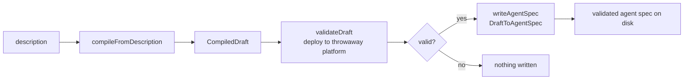

# POC 3 — Builder agent

The builder is a **single GOAP-planned, code-backed `@Agent`** — not an LLM-driven fleet. Its goal
is "a validated agent spec exists on disk"; its code-backed actions run
`compileFromDescription → validateDraft → writeAgentSpec`.

## What it proves

- **The builder is one agent, no orchestration (C4 / C5).** GOAP plans the compile → validate →
  write sequence by matching typed preconditions.
- **Validate-before-write.** An invalid draft is rejected and *nothing* is written to disk — the
  single invariant that keeps the agent spec directory trustworthy.
- The loop is end-to-end: description → draft → validated pack on disk.

## How it works



`BuilderAgent`'s actions: `compileFromDescription` wraps the NL compiler (POC 2) into a
`CompiledDraft`; `validateDraft` deploys it to a throwaway platform and checks bindings/schemas,
producing a `ValidatedDraft`; `writeAgentSpec` emits via `smith-common` (`DraftToAgentSpec`) only if
validation passes.

## Run it

Endpoint-gated:

```bash
BUILDER_DESCRIPTION="A spec that explains a topic in plain language and posts it as a background message" \
BUILDER_OUTPUT_DIR="$PWD/built-specs" \
    mvn -pl poc/poc-3-builder-agent spring-boot:run
```

## Conclusion

Against the hypothesis (claims C4 / C5): **proven.** The builder is one GOAP-planned, code-backed
agent — no orchestration — and the loop is end-to-end: description → draft → validated pack on
disk. The validate-before-write invariant held in every run: an invalid draft is never written, and
`normalizeGoalOutput` repaired a live `NO_OP_GOAL` raw draft to `HEALTHY` before the pack was
written. The residual weakness is the LLM's action-body quality (claim C9), which POC 9's
eval-guided refinement loop repairs.

See `docs/04-poc-run-results.md` and `.wiki/risks/validate-before-write.md`.
