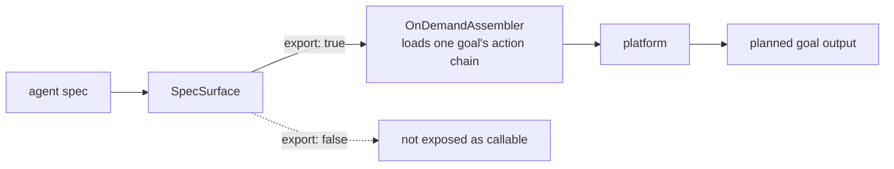

# POC 4 — Spec format (exported goal as spec, on-demand load)

Proves the **exported-goal-as-spec** primitive and the **portable, lossless** agent spec format.

## What it proves

- **An exported goal is a callable spec (C2 / C3).** A single exported goal is loaded on demand and
  planned over its action chain; the plan resolves to the goal's output type.
- A goal declared `export: false` is **not** exposed as a callable spec.
- The `manifest/goal/steps/types` folder round-trips losslessly (write → read), mirroring both the
  SKILL.md-folder paradigm and the production realm format.

## How it works



`SpecSurface` exposes only `export: true` goals as callable specs; `OnDemandAssembler` loads one
goal's action chain into the platform on demand.

## Run it

The surface is offline; running the goal is endpoint-gated:

```bash
BUILDER_PACK_DIR="$PWD/agent specs/explainer" BUILDER_INPUT="Explain how a coffee machine works" \
    mvn -pl poc/poc-4-agent-spec-format spring-boot:run
```

## Conclusion

Against the hypothesis (claims C2 / C3): **proven.** An exported goal is a callable spec — loaded
on demand and planned over its action chain — and a goal declared `export: false` is not exposed.
The `manifest/goal/steps/types` folder round-trips losslessly, so a agent spec is a portable,
versioned, lossless package: the same folder shape as both the SKILL.md-folder paradigm and the
production realm format.

See `docs/agent spec-format.md` and `docs/04-poc-run-results.md`.
