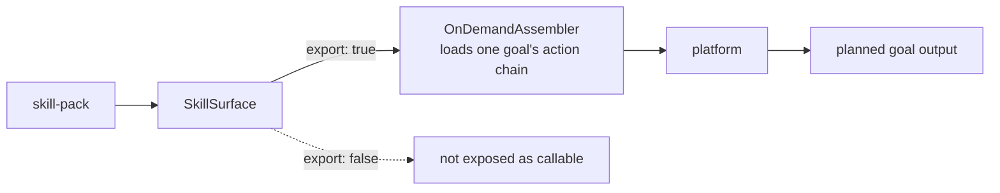

# POC 4 — Skill format (exported goal as skill, on-demand load)

Proves the **exported-goal-as-skill** primitive and the **portable, lossless** skill-pack format.

## What it proves

- **An exported goal is a callable skill (C2 / C3).** A single exported goal is loaded on demand and
  planned over its action chain; the plan resolves to the goal's output type.
- A goal declared `export: false` is **not** exposed as a callable skill.
- The `manifest/goal/steps/types` folder round-trips losslessly (write → read), mirroring both the
  SKILL.md-folder paradigm and the production realm format.

## How it works



`SkillSurface` exposes only `export: true` goals as callable skills; `OnDemandAssembler` loads one
goal's action chain into the platform on demand.

## Run it

The surface is offline; running the goal is endpoint-gated:

```bash
BUILDER_PACK_DIR="$PWD/skill-packs/explainer" BUILDER_INPUT="Explain how a coffee machine works" \
    mvn -pl poc/poc-4-skill-format spring-boot:run
```

## Conclusion

Against the hypothesis (claims C2 / C3): **proven.** An exported goal is a callable skill — loaded
on demand and planned over its action chain — and a goal declared `export: false` is not exposed.
The `manifest/goal/steps/types` folder round-trips losslessly, so a skill-pack is a portable,
versioned, lossless package: the same folder shape as both the SKILL.md-folder paradigm and the
production realm format.

See `docs/skill-pack-format.md` and `docs/04-poc-run-results.md`.
